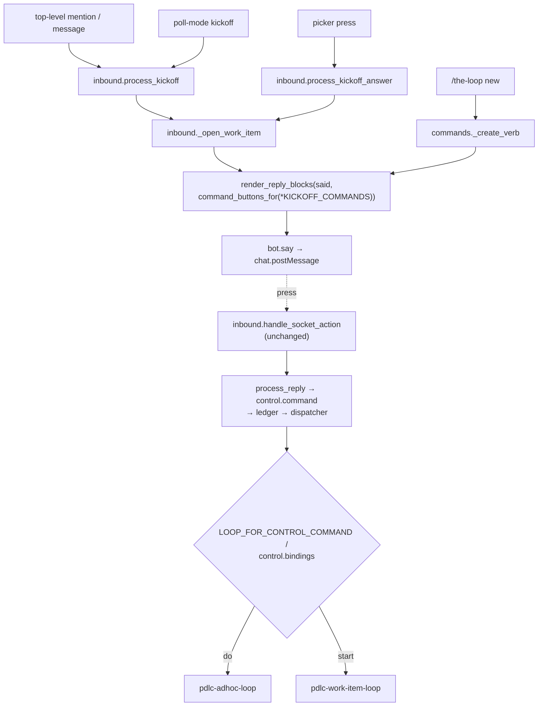

<!-- Written per the `the-loop:writing` skill. -->

# Design: a Slack kickoff offers Do or Start, not Start alone

## Overview

The change is about twenty lines in `cli/the_loop/channels/slack.py`, plus one argument
changed at each of two call sites. Every kickoff path already ends in one rendering call:

```python
render_reply_blocks(said, config.command_buttons_for("start"))
```

That call sits at `inbound._open_work_item` and `commands._create_verb`. The repository
picker's answer and the poll-mode kickoff both run through `_open_work_item`, so these
two sites cover all four paths. Both sites now ask for `KICKOFF_COMMANDS = ("do",
"start")`. `render_reply_blocks` gains a description section between the reply text and
the buttons. Everything downstream of a press already handles `do`: the press becomes the
member's reply carrying the keyword, then a `control.command` on the ticket, then the
dispatcher. The dispatcher maps `do` to `pdlc-adhoc-loop` through
`LOOP_FOR_CONTROL_COMMAND`, or to whatever `routing.control.commands` binds `do` to.

## Architecture



Only the boxes `R` and the two arrows into it change. Everything from `HA` onward is
unchanged and already tested for `start` (issue-337) and for a typed `do` (issue-225).

## Components & interfaces

**`channels/slack.py`**

| Name | Today | After |
|------|-------|-------|
| `COMMAND_BUTTONS` | `{"execute": "Execute", "start": "Start"}` | `{"execute": "Execute", "do": "Do", "start": "Start"}`. `BUTTON_NAMES` derives from it, so a press's outcome line names "Do" with no further edit. |
| `KICKOFF_COMMANDS` *(new)* | — | `("do", "start")`: the commands a newly opened work item is offered, in render order (requirements D2). Exported in `__all__`. |
| `COMMAND_DESCRIPTIONS` *(new)* | — | `command → one line`, fixed words (D3). `do`: *"a tactical task — no spec chain or phase gates; the-loop works it until you say it is done."* `start`: *"the full PDLC — phase selection, requirements, design, testing plan, reviews and an approval gate."* `execute` has no entry, so the phase-selection mirror renders exactly as today. |
| `render_reply_blocks(text, commands)` | section, then an actions block when `commands` renders any button | section, then **a description section** listing `*<Label>* — <line>` for each rendered command that has a description (in the same order as the buttons), then the actions block. With no button rendered it returns the text section alone, as today. |

The description section uses `mrkdwn` and fixed strings only. Nothing from the member's
message is interpolated into it.

**`channels/inbound.py` `_open_work_item`** and **`channels/commands.py`
`_create_verb`**: `command_buttons_for("start")` → `command_buttons_for(*KICKOFF_COMMANDS)`.
`command_buttons_for` already drops a disabled keyword, and drops everything when the
channel cannot receive a press. Requirement 1.4 needs nothing new.

**Unchanged:** `_command_buttons` (both buttons stay `style: primary`, so neither looks
like the default; D2), `handle_socket_action`, `report_press` (a landed press removes
every non-link button, which satisfies 2.3), the dispatcher and the graph.

## UI/UX design

This is a user-facing Slack surface, so the visual contract is a self-contained HTML
mock of the reply: `design/kickoff-reply.html`, in light and dark. It shows the reply
before a press, and after a landed Do press (buttons replaced by the context line). It
mirrors Block Kit's layout, not Slack's exact pixels.

| Artifact | Shows |
|----------|-------|
| [`design/kickoff-reply.html`](design/kickoff-reply.html) | before a press; after a landed **Do** press |

The Block Kit payload itself is the binding contract, and the unit test pins it.

```
section  : Opened github:o/r#42 — https://…. This thread is now that work item's conversation — replies here reach it.
section  : *Do* — a tactical task — no spec chain or phase gates; the-loop works it until you say it is done.
           *Start* — the full PDLC — phase selection, requirements, design, testing plan, reviews and an approval gate.
actions  : [Do] [Start]
```

## Data models

None. No state, schema or config shape changes. The button value is the configured
keyword string, as for Start.

## Error handling

Nothing new can fail. An empty `do` keyword means the button is not rendered (existing
`command_buttons_for`). A post that fails is handled as today: the kickoff tail's
`bot.say` is best-effort, and the slash path's `try/except` around opening the
conversation is unchanged. A press that does not land keeps both buttons
(`report_press`, unchanged).

## Security design

Each requirements-phase boundary and how it is enforced:

| Boundary / abuse case | Enforced by | Change |
|---|---|---|
| Untrusted press payload (`action_id`, `value`) | `handle_socket_action` reads only `the-loop:`-prefixed actions and treats the value as **text** through `process_reply` | none |
| Unlisted member presses Do (abuse 1) | `_authorized` / allow-list in `process_reply`, fail-closed; dropped presses are not reported | none |
| Crafted value (abuse 2) | `parse_command` recognises configured keywords only, so anything else is plain text | none |
| Press on an unrelated message (abuse 3) | same pipeline as typing the keyword in that thread | none |
| Grant or reachability lost (abuse 4) | `command_buttons_for` → `command_buttons` (`push_reachable` and `control.command`) at render; the grant is re-checked on the press by `process_reply` | none |
| Description text | fixed constants, no interpolation of member text | new, by construction |

No new attack surface. The new code renders constants and one more existing keyword.

## Testing strategy

Test-first, in the existing suites (details in `testing-plan.md`):

- **Unit, `test_channels_buttons.py`:** `render_reply_blocks` with both commands gives
  the section, then a description section with Do before Start, then the actions block
  with Do and Start buttons and their keyword values. With only `start` it gives one
  line and one button. With none it gives the text section alone. `execute` gets no
  description. The button tables still agree.
- **Integration, `test_channels_integration.py`:** the kickoff reply carries `[do,
  start]`. Pressing **Do** records an unmarked `the-loop do` on the new issue, and
  `parse_command` reads it as `do`. A disabled `do` keyword renders Start alone.
- **Integration, `test_channels_commands.py`:** `/the-loop new` renders both buttons.
- **Integration (dispatcher):** a `the-loop do` control comment selects
  `pdlc-adhoc-loop`. The existing issue-225 tests already prove this, and the
  verification step re-runs them rather than duplicating them.

## Trade-offs & decisions

- **A description section, not a `context` block.** A context block renders small and
  grey. These lines are what the member uses to choose, so they get section text.
- **Generic, not kickoff-specific.** The descriptions live in `render_reply_blocks`,
  keyed by command, not in a kickoff-only renderer. Any future reply offering a
  described command gets its line for free. `execute`, which has no description, is
  unaffected.
- **No `style` change.** Both buttons stay `primary`, as every command button is today.
  Equal styling is how requirements D2 avoids a default.

## Open questions

None.

## Review comments

> Appended by the-loop's `record-feedback` hook when a human gate approves with
> comments (issue-109).
