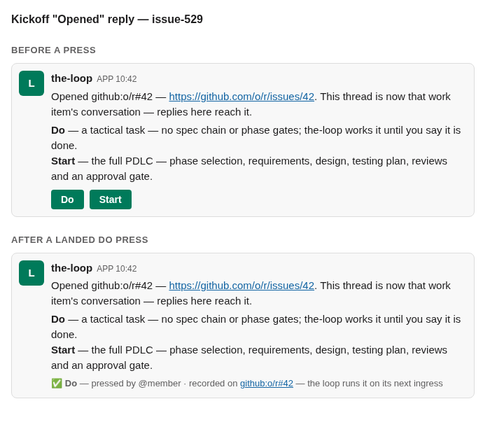
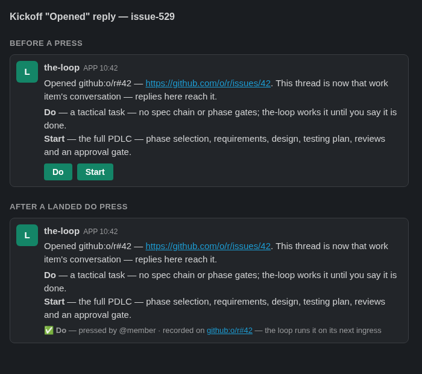

# UI / visual (T5): the kickoff reply mock

`design/kickoff-reply.html`, rendered by headless Chromium at 700×620. The theme is
forced through the page's `data-theme` attribute.

| Theme | Screenshot |
|-------|------------|
| light |  |
| dark |  |

Both states match the block order the unit test pins. Before a press: the text, a
description section with Do then Start, and the buttons. After a landed Do press: the
buttons are replaced by the outcome line.
