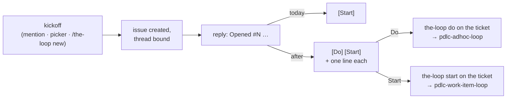

<!-- Written per the `the-loop:writing` skill. -->

# Requirements: a Slack kickoff offers Do or Start, not Start alone

## Introduction

When a member opens a work item from Slack, the-loop offers them one way to run it: the
full PDLC ([#529](https://github.com/MadaraUchiha-314/the-loop/issues/529)). Every kickoff
path ends in the same reply: *"Opened … This thread is now that work item's
conversation"*. Under it is a single **Start** button (issue-337). The paths are a
top-level `@the-loop` mention in the central channel, a press on the repository picker
(issue-349), and `/the-loop new` (issue-378). Start arms `pdlc-work-item-loop`:
phase selection, the spec chain, reviews, the approval gate. Many Slack requests are
tactical ("bump this dependency", "re-run that report") and want the ad-hoc loop
(`the-loop do`, issue-225) instead. It already exists, but a Slack member can only reach
it by knowing to type the keyword into the thread. The button row makes the choice for
them.

**What we do about it.** The reply offers **Do** and **Start** side by side. Each comes
with one line saying what it runs, so the member picks with the trade-off in front of
them. A press works the way a Start press works today: it is the member's typed
keyword, recorded on the ticket and judged by the same authorization. Nothing else about
the kickoff changes. The issue is still created first, the thread is still bound to it,
and the typed keywords still work.

**What it costs.** One more button on one reply, and one more entry in the fixed
button-name table. There is no new grant, scope, config key or keyword. `do` is
already a control command under the `control.command` grant the Start button already
needs.

**What to check.** Decision D1 (the issue is still created *before* the choice, not
after it) and the abuse cases under *Security considerations*.

### Decisions this document takes, for the approver

| # | Decision | Alternative not taken |
|---|----------|-----------------------|
| D1 | The choice is offered **after** the issue is created, on the existing "Opened" reply. Both `do` and `start` are commands recorded on an existing ticket, and the kickoff already creates the ticket before asking anything. | Hold the message and ask before creating anything, as the repository picker does. That needs a second pending-question store and a TTL, and a member who never answers has nothing filed at all. |
| D2 | **Do** comes first and **Start** second, matching the ticket's order. Do is the lighter option. Neither is styled as the default. | Keep Start primary-styled and Do plain. That would push members toward the heavier loop, which is the behaviour the ticket objects to. |
| D3 | The descriptions are **fixed words** in the-loop's code, not configurable. | A config key per description. YAGNI: nobody has asked for one, and an operator who re-points `do`/`start` to a graph of their own (issue-343) still gets the button. Its description then speaks of the shipped loops, which is the one inaccuracy we accept. |
| D4 | Slack only. A work item opened on GitHub or Jira gets phase selection after a typed `the-loop start` or `the-loop do`, as today. | Offering a choice on GitHub too. There is no kickoff there to attach it to: the person typing the keyword has already chosen. |

## Requirements

### Requirement 1 — The kickoff reply offers both loops

**User story:** As a Slack member opening a work item, I want to choose between the
ad-hoc loop and the full PDLC when the item is opened, so that a tactical request does
not walk phase selection, a spec chain and an approval gate.

#### Acceptance criteria (EARS)

1. WHEN a kickoff creates a work item AND the channel may render command buttons
   (`push_reachable` and the `control.command` grant) THEN the "Opened" reply SHALL carry
   a **Do** button and a **Start** button, in that order, in one actions block.
2. WHEN the reply carries the buttons THEN it SHALL also carry one line per rendered
   button saying what it runs: for Do, a tactical task with no spec chain or phase
   gates, worked until you say it is done; for Start, the full PDLC with phase
   selection, requirements, design, tests, reviews and approval.
3. The three kickoff paths SHALL render the same buttons and lines: a top-level mention
   or message, a repository-picker press that opened the item, and `/the-loop new`.
4. IF the operator disabled one of the two keywords (empty in
   `routing.control.keywords`) THEN that button and its line SHALL be left out and the
   other SHALL still render. IF both are disabled, or the channel may not render command
   buttons, THEN the reply SHALL carry neither, exactly as the Start button is withheld
   today.
5. Each button's value SHALL be the **configured** keyword for its command, so a press
   is the same as typing that keyword in the thread.

### Requirement 2 — A press runs the loop the member picked

**User story:** As that member, I want the button I press to run that loop, so that the
choice is the one my click made and not a default.

#### Acceptance criteria (EARS)

1. WHEN an authorized member presses **Do** THEN the-loop SHALL handle it as that
   member's reply carrying the configured `do` keyword. That means a `control.command`
   recorded on the ticket, which arms the work item on `pdlc-adhoc-loop`.
2. WHEN an authorized member presses **Start** THEN the behaviour SHALL be unchanged
   from today: the work item is armed on `pdlc-work-item-loop` and phase selection is
   posted.
3. WHEN either press is processed AND lands THEN the reply SHALL be edited by the
   existing press rule: both buttons removed, plus a context line naming the button
   pressed (`Do` or `Start`), who pressed it and the outcome. A second press is
   therefore not offered.
4. WHEN a press does not land THEN the buttons SHALL stay, under the existing rule.
5. Typing `the-loop do` or `the-loop start` in the thread SHALL keep working unchanged.

## Non-functional requirements

- **No new configuration.** No config key, grant, Slack scope, manifest change or schema
  change.
- **Observability.** A press is recorded through the existing events: the press outcome
  and the `control.command` record. No new event type is introduced.
- **Phone width.** Two short labels in one actions block, which Slack lays out on one
  row.

## Security considerations

- **Actors & trust:** a Slack workspace member pressing a button, and the Slack
  interactivity payload (untrusted: a client can send any `action_id`/`value`).
- **Trust boundaries & data:** the press crosses into the-loop on the same
  `block_actions` path every command button uses (Socket Mode, or the gateway). The value
  is read as **text** and judged by the ordinary inbound pipeline with the ordinary
  authorization: the allow-list, the `control.command` grant, and the ledger's
  named-actor check on the mirrored command. No secret or personal data is added.
- **Abuse cases (EARS):**
  1. WHEN a member who is not on the allow-list presses Do THEN the-loop SHALL drop the
     press without recording anything, editing the message or arming the item, exactly
     as for Start.
  2. WHEN a crafted payload carries the Do `action_id` with a value other than a
     configured keyword THEN it SHALL be read as plain text, as any unrecognised button
     value is today, and SHALL arm nothing.
  3. WHEN a crafted payload sends the Do press against a message that is not a kickoff
     reply THEN it SHALL be handled as the same member typing `the-loop do` in that
     thread, and is authorized as such. A button buys nothing a typed message would not.
  4. WHEN the channel loses the `control.command` grant or push reachability THEN the
     reply SHALL render no Do button. A press on an older message SHALL then be judged
     under the current grant, as for Start.
- **Fail closed:** no button renders when it cannot be received or acted on. A press is
  never authorized by its button, only by its author.
- **No new attack surface.** The `do` command, its grant and its authorization exist
  already (issue-225, issue-337). This change only renders a second button with an
  existing keyword as its value, on a message that already carries one.

## Out of scope

- `contribute` and `review` buttons. Neither fits a new work item: contribute joins an
  in-progress item, and review is typed on a pull request.
- Changing what `do` or `start` do once armed.
- Holding the kickoff until a choice is made (D1).
- Any GitHub- or Jira-side change (D4).

## Open questions

None. The ticket fixes the two options and asks for a description on each. The four
judgement calls are recorded as D1–D4 above.

## Review comments

> Appended by the-loop's `record-feedback` hook when a human gate approves with
> comments (issue-109).
