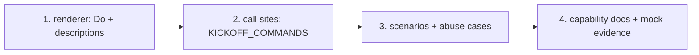

<!-- Written per the `the-loop:writing` skill. -->

# Tasks: a Slack kickoff offers Do or Start, not Start alone

Four tasks, all in this repository and all small. The renderer comes first, because the
two call sites render through it. The docs come last. Every code task is red → green:
the test is written first and fails, then the code makes it pass.

## Task list

- [x] 1. Renderer: a Do button and the description lines
  - `slack.py`: `COMMAND_BUTTONS` gains `"do": "Do"`. New `KICKOFF_COMMANDS = ("do",
    "start")` and `COMMAND_DESCRIPTIONS` (fixed words, `do` and `start` only), both in
    `__all__`. `render_reply_blocks` inserts a description section (`*<Label>* —
    <line>`, one per rendered command that has a description, in button order)
    between the text section and the actions block.
  - _Depends on:_ none
  - _Requirements:_ R1.1, R1.2, R1.4, R1.5
  - _Test:_ T1 — `tests/test_channels_buttons.py` (two commands give text, then
    descriptions, then `[Do, Start]`; one command gives one line; none gives text only;
    `execute` has no line; the tables agree) (red→green)
- [x] 2. Call sites: every kickoff path offers both
  - `inbound._open_work_item` and `commands._create_verb`:
    `command_buttons_for("start")` → `command_buttons_for(*KICKOFF_COMMANDS)`, and their
    comments updated.
  - _Depends on:_ 1
  - _Requirements:_ R1.1, R1.3, R1.4
  - _Test:_ T2 — `tests/test_channels_integration.py` (the existing kickoff reply test
    now expects `[do, start]`), `tests/test_channels_commands.py` (`/the-loop new`),
    `tests/test_channels_kickoff_picker.py` (the picker's opened reply) (red→green)
- [x] 3. Scenarios: pressing Do, a disabled keyword, the abuse cases
  - Integration tests with Gherkin docstrings and `Requirement:` links: pressing Do
    records an unmarked `the-loop do` that `parse_command` reads as `do`, and the reply
    is edited naming "Do"; `routing.control.keywords.do: ""` renders Start alone; an
    unlisted member's Do press records and edits nothing; a crafted non-keyword value on
    the Do `action_id` arms nothing; no `control.command` grant means no buttons at all.
  - _Depends on:_ 2
  - _Requirements:_ R1.4, R2.1, R2.3, R2.4, abuse 1, 2, 4
  - _Test:_ T2 + T8 — `tests/test_channels_integration.py -k "do_press or do_button"`
- [ ] 4. Docs and visual evidence
  - `docs/capabilities/channels.md`: the rendering bullet (Execute / Start / **Do**,
    each with its line on the kickoff reply) and the kickoff and `/the-loop new`
    bullets, plus a history row for issue-529. The "Opened … Start button" wording in
    `docs/guides` / README, if any exists, is updated too.
  - Screenshots of `design/kickoff-reply.html` in light and dark.
  - _Depends on:_ 3
  - _Requirements:_ all (docs ship with the change)
  - _Test:_ T5 + T12 — the screenshots; `uv run pre-commit run --all-files`
