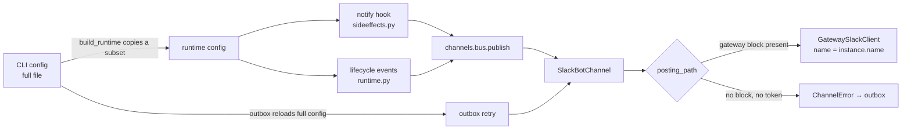

<!-- Written per the `the-loop:writing` skill. -->

# Design: graph notifications on a gateway consumer post first time

## Overview

Seed the two missing keys — `gateway` and `instance` — into the config `build_runtime`
builds, next to `channels` and `state`. Every graph runtime is built there, so both
in-graph publishers (the `notify` hook and the runtime's lifecycle events) pick them
up with no change of their own. Satisfies R1.1–R1.4.

## Architecture

Before the fix, `RC` lacked `gateway` (so `P` took the `X` branch) and `instance` (so
`G` would use the default name). After it, `RC` carries both.

## Components & interfaces

- **`cli/the_loop/graph/bootstrap.py::build_runtime`** — the `config` dict gains:
  - `"gateway": cli_cfg.get("gateway")` — copied as-is (a mapping, or `None`). The value
    is passed through unvalidated: `gateway_block()` already types it and returns
    `None` for an absent or malformed block, so the runtime config makes no second
    decision about it.
  - `"instance": cli_cfg.get("instance") or {}` — same treatment; `instance_name()`
    falls back to the default name when it is empty.

  A CLI config without a `gateway` block gives a runtime config whose `gateway` is
  `None`, which `gateway_block()` reads exactly as an absent key (R1.4).

No other component changes. `notify`, `publish_lifecycle`, `posting_path`,
`outbound_client` and `GatewaySlackClient` already read these keys from the config
they're handed.

## UI/UX design

N/A — no user-facing surface.

## Data models

None. No schema change: both keys already exist in `cli-config.schema.json`.

## Error handling

Unchanged. A malformed `gateway` block is still logged by `gateway_block()` and
resolves to `none`; the post still raises `ChannelError` and is queued in the outbox.
The only behaviour change is that a *well-formed* block is now seen on the first
attempt.

## Security design

- **Trust boundary:** the runtime config is built from the operator's CLI config only
  (`load_cli_config_best_effort`), never from the work item, its thread or the
  agent-writable `work-item-state.json`. The fix adds two keys from that same source.
- **Secrets:** neither key is a secret. Tokens remain env-var references.
- **Fail-closed:** unchanged — an unusable block resolves to `none` and raises.
- **Abuse case:** none new. Covered by T1's negative case: a config without `gateway`
  yields no gateway path.

## Testing strategy

A unit test on `build_runtime` (monkeypatching `load_cli_config_best_effort`, the
pattern `test_jira_verbs.py` uses) asserts the runtime config carries both keys,
resolves `posting_path(...).kind == "gateway"` with no token, and carries no gateway
when the CLI config has none. An integration test runs the real `notify` hook on a
runtime built from a gateway-consumer config, with the gateway client's HTTP call
replaced by a recorder, and asserts one delivered post under the configured instance
name and an empty outbox:
`Scenario: a graph notification on a gateway consumer posts through the gateway on the first attempt`.

## Trade-offs & decisions

- **Copy the keys, rather than pass the full CLI config to hooks** (the ticket's second
  option). The runtime config is a deliberate subset — hooks get named keys and the
  daemon's dispatch policy doesn't leak into them — and every other key the channels
  layer needs (`channels`, `state`) is already seeded this way. Two more lines keep the
  pattern; switching `notify` alone to the full config would leave the lifecycle
  publisher in `runtime.py` broken, and would mean a second config load per hook.
- **Also copy `instance`.** Found in the audit the ticket asked for: the gateway client
  names the instance from the same config.

## Open questions

None.

## Review comments
