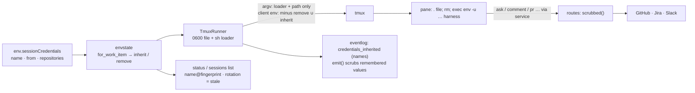

<!-- the-loop PR briefing (R10) -->

# feat(issue-533): opt-in session credentials, never on argv — reviewer briefing

## TL;DR

`env.sessionCredentials` (off by default) lets an operator hand a spawned agent session a
named token, for example a narrower `GH_TOKEN` for `gh` calls the service does not wrap.
The value reaches the pane through a per-spawn `0600` file that a fixed `sh` loader
sources, deletes and `exec`s past. It is never on an argv or in any tmux environment. The
service masks the value in text a session sends it, and `status`/`sessions list` show who
holds what, by fingerprint.

**Risk tier 4.** This needs your PR approval **and** a named security sign-off. One
security decision (SEC-1) is open: see the end.

## Where to focus (in this order)

1. **The loader and the delivery file**, in `cli/the_loop/runner.py`: `CREDENTIAL_LOADER`,
   `_admit_credentials`, `_write_credential_file`, `_settle_credentials`. This is the only
   place a value leaves the daemon. Check:
   - only the path is on argv, and it stays in `$1` (CR1-1);
   - `O_EXCL|O_NOFOLLOW`, `0600`/`0700`, owner check;
   - unlink on failure (SR2-1), and a sweep on every spawn (CR1-3).
2. **The boundary**, in `cli/the_loop/envstate.py`: `session_credentials`,
   `SessionEnvironment.for_work_item`, `without_inherit`, `passthrough_names`. Check that
   `inherit` is filled only by `for_work_item`. Every listed `name` and `from`, valid or
   skipped, stays in `remove` unless admitted (R2, CR1-2). The passthrough refuses those
   names (SR1-1).
3. **The client environment**: `spawn_in`/`respawn_in` run `tmux` with
   `remove ∪ inherit` dropped. That keeps the value, and the daemon's same-named token,
   out of a server this spawn starts (R3.5).
4. **Masking**: `cli/the_loop/sessioncreds.py`, the `scrubbed()` helper in
   `api/routes.py` (seven routes) and `EventLog.emit`.
5. **Skim**: the status line and list column (`core/lifecycle.py`, `commands/sessions_cmd.py`,
   `core/sessions.py`), the schema and the docs.

## What changed (map)

## Key decisions & why (education)

- **A file plus a constant `sh` loader, not `tmux update-environment`.** tmux's
  environments are readable from any pane on the server with `show-environment`, and
  setting one means a `tmux` argv. The file keeps tmux out of the value's path entirely.
  `sh` is used over a Python loader because it needs no interpreter path or importable
  package in the pane.
- **`for_work_item` is the only place a value is admitted.** Anything that forgets to
  resolve a work item gets nothing, with every name stripped, so it fails closed by
  construction.
- **Scrub at the service's routes, not at each sink.** No single outbound funnel exists:
  the bus, ticket/PR creation and Slack each write separately. The routes are the one
  place session text enters, so every sink downstream, including future ones, sees masked
  text. The event log scrubs too, using the values its own process has seen, so it never
  reads the disk.
- **Inherited names count in the drift check.** Rotation reads `stale` and reuses
  issue-410's `sessions restart`, which delivers through the same file.
- **No routing change** (R6): a session holding a token still goes through the service,
  and no flag was added.

## Evidence

- **Verification** ([`testing-plan.md`](../testing-plan.md#verification-results),
  [`verification.md`](verification.md)):
  - T1 unit: 235 passed;
  - T2 real tmux, on a private server started by the spawn: 4 passed, none skipped;
  - full suite: 6867 passed;
  - ruff, format, pyright, markdownlint and config validation all clean.
- **Mapping to #533's acceptance criteria**: [`final-validation.md`](final-validation.md).
- **Reviews**:
  - [self-review](self-review.md): 2 rounds, 2 fixes;
  - [critic](critic-review.md): codex, 1 round, 3 fixes;
  - [security](security-review.md): checklist pass plus the skill pass, which found SEC-1.

## Open questions for the reviewer

1. **SEC-1, your security decision.** `repositories` scopes what a session is *given*,
   not what it can *reach*. Sessions share a Unix user, so an agent can read a concurrent
   session's `/proc/<pid>/environ`. The docs now say the scope is not isolation. Choose:
   1. accept as documented (recommended);
   2. drop `repositories`;
   3. block until per-session isolation exists.
2. **Residual risk.** An agent holding a token can leak it through `gh`, `git` or `curl`
   directly, which no scrubber sees. Do you accept this as documented?
3. **The tier-4 security sign-off**: please state it explicitly on this PR.
