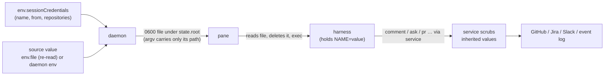

<!-- Authored per the the-loop:writing skill. -->

# Requirements: opt-in session credentials, never on argv

> Phase 1 of 4 (requirements → design → testing plan → tasks). Tier 4
> (`human-approves-pr`, plus a named human security sign-off): the change lets an
> operator hand an agent session a token, which [issue-482][i482] forbade outright.
> The `requirements-approval` and `design-approval` gates were declared skipped at
> phase selection, so the human review of this spec happens on the pull request.

## Introduction

**What is missing.** Since [issue-482][i482] a session the daemon spawns holds no
credential. The runner strips every `*tokenEnv` / `*secretEnv` name and every `env.file`
name from the pane (`env -u NAME …`), and `env.sessionPassthrough` refuses a credential
name. So inside a session `gh`, `git` over HTTPS and every other CLI that reads a token
from the environment run unauthenticated. The agent can reach GitHub only through the
verbs the service wraps; anything else (`gh api` on an unwrapped endpoint, a private
release asset, a second private repository) fails with a 401, and the agent escalates or
offers an interactive `gh auth login` — a long-lived token on disk under a person's
account, which is worse than a scoped token the operator chose.

**Why it can be allowed now.** The leak [issue-482][i482] and [#485][i485] fixed came
from **values on argv** (`tmux new-session -e NAME=value`, readable in `ps` and kept as
the tmux server's process name), not from a session holding a credential. An operator
should be able to accept the second without bringing back the first.

**What this changes.**

- A new, default-off, per-name opt-in, `env.sessionCredentials`, names a variable the
  session sees and the daemon-side variable its value comes from.
- The value reaches the pane through a per-spawn `0600` file under `state.root` that
  the pane reads and deletes before it `exec`s the harness. No argv, and no tmux
  environment (global or session), ever carries it.
- The drift check treats an inherited name as expected, so a rotation reads `stale` and
  takes the existing relaunch path ([issue-410][i410]).
- The service scrubs every inherited value out of text a session sends it before that
  text leaves the daemon.
- `status` and `sessions` show which credential names each live session holds, by name
  and fingerprint; each spawn that hands one over logs a warning-level event.

[i482]: https://github.com/MadaraUchiha-314/the-loop/issues/482
[i485]: https://github.com/MadaraUchiha-314/the-loop/issues/485
[i410]: https://github.com/MadaraUchiha-314/the-loop/issues/410

## Requirements

### Requirement 1: an explicit, default-off opt-in

**User story:** As an operator whose agents need `gh` beyond the wrapped verbs, I want
to name the exact credentials a session may hold and where each comes from, so I can
hand sessions a narrower token than the daemon's own.

#### Acceptance criteria (EARS)

1.1 The CLI config SHALL accept `env.sessionCredentials`: a list of entries, default
empty, each with `name` (the variable the session sees, required), `from` (the
daemon-side variable its value is read from, default `name`) and `repositories` (an
optional list of `[HOST/]OWNER/REPO`).

1.2 WHEN `env.sessionCredentials` is empty or absent THEN a spawned session's
environment, its argv and the tmux server's environment SHALL be exactly what they are
before this change, and the issue-482 tests SHALL pass unchanged.

1.3 WHEN an entry's `name` or `from` is not a valid variable name (`^[A-Za-z_][A-Za-z0-9_]*$`)
THEN the-loop SHALL skip that entry and log a warning naming the offending field's text
(never a value); other entries SHALL still apply.

1.4 WHEN an entry's `from` variable is set neither in `env.file` nor in the daemon's
environment THEN the spawn SHALL proceed without that credential and SHALL log a warning
naming `name` and `from` (never a value).

1.5 The value of `from` SHALL be read per spawn: from `env.file` when the file declares
it (re-read now, issue-410's rule), else from the daemon's environment.

1.6 WHEN an entry's `from` is one of the daemon's own credential names (the set
issue-482 R4.2 defines) THEN the-loop SHALL still honour it AND SHALL log a warning
naming the variable that recommends a separate, least-privilege token.

1.7 WHEN an entry lists `repositories` THEN the credential SHALL be handed only to a
session whose work item is a GitHub item in one of those repositories (compared
case-insensitively, a missing host meaning `github.com`); a session for any other work
item, a Jira item or a standing session SHALL NOT receive it.

1.8 WHEN two entries name the same `name` THEN the first SHALL apply and the later one
SHALL be skipped with a warning naming the variable.

1.9 `env.sessionPassthrough` SHALL keep refusing credential names exactly as issue-482
R4.3 defines; `env.sessionCredentials` SHALL be the only way a credential reaches a
session.

### Requirement 2: the boundary admits only the opted-in names

**User story:** As a security reviewer, I want the session boundary to change by exactly
the opted-in names and nothing else.

#### Acceptance criteria (EARS)

2.1 The names a pane must not hold SHALL be the issue-482 set (every credential name
and every `env.file` name, minus the forwarded passthrough names), plus every configured
entry's `from` name, minus the names this session inherits. A source variable is
daemon-side only: a session never holds `SESSION_GH_TOKEN` under that name.

2.2 A name an entry would hand over that is excluded by R1.3, R1.4 or R1.7 SHALL stay in
the removed set, so the pane does not inherit it from the tmux server.

### Requirement 3: the value never appears on any argv or in tmux's environment

**User story:** As an operator, I want a session credential to be invisible to `ps` and
to every other tmux pane, so opting in does not reopen the issue-482/#485 leak.

#### Acceptance criteria (EARS)

3.1 WHEN a session is spawned or respawned with an inherited credential THEN its value
SHALL NOT appear in the argv of any process the-loop starts: the `tmux` client, the tmux
server (including when this spawn starts it), and the pane's command.

3.2 The value SHALL reach the pane through a per-spawn file created with mode `0600`
under `state.root`, whose path is the only thing the pane's argv carries.

3.3 The pane SHALL read the file, delete it, and only then `exec` the harness, so the
file is gone once the harness is running.

3.4 WHEN the spawn fails before the pane could read the file THEN the daemon SHALL
delete the file; AND the daemon SHALL delete any such file older than a short bound
(minutes) it finds under `state.root` at its next spawn, so a crash leaves no value on
disk for long.

3.5 The value SHALL NOT be placed in the `tmux` client process's environment, in the tmux
server's global environment (`tmux show-environment -g`) or in any session's tmux
environment, including when this spawn is what starts the server.

3.6 No other tmux session — another work item's, a standing session, or the web-terminal
hub — SHALL receive the value.

### Requirement 4: rotation reads as drift

**User story:** As an operator rotating a session token, I want `status` to tell me which
sessions still hold the old one and `sessions restart` to fix them, as it does for
passthrough values.

#### Acceptance criteria (EARS)

4.1 The drift comparison (`the-loop status`, `sessions restart`) SHALL treat an
inherited name as expected: a live session that lacks it, or holds a value whose
fingerprint differs from the current source value's, SHALL read `stale`.

4.2 `sessions restart` SHALL relaunch a stale session through the same file delivery
(R3), so a restarted pane holds the current value.

4.3 Every rendering of the comparison SHALL identify a value only by its fingerprint.

### Requirement 5: inherited values are scrubbed from what leaves the daemon

**User story:** As an operator, I want a token my agent holds to be masked if the agent
pastes it into a comment, a Slack post or a log, so a careless `env` dump does not
publish it.

#### Acceptance criteria (EARS)

5.1 WHEN the service receives free text from a session (a comment, a question, a PR
title or body, a channel post, a self-diagnosis record) THEN it SHALL replace every
current inherited credential value in that text with a visible mask before posting it to
GitHub, Jira or Slack or writing it to the event log.

5.2 The set of values scrubbed SHALL be the current source values of every configured
`env.sessionCredentials` entry, re-read when the text is scrubbed, so a rotated value is
scrubbed from the moment it is configured.

5.3 WHEN no `env.sessionCredentials` is configured THEN the outbound text SHALL be
unchanged by this requirement.

### Requirement 6: routing is unchanged

6.1 A daemon-spawned session that holds a credential SHALL still send `ask`, `comment`,
`ticket …` and `pr …` through the service, and SHALL NOT run them in-process when no
service answers (issue-482 R3.2). This change adds no flag that alters that.

### Requirement 7: the operator can see what each session holds

7.1 `the-loop status` and `the-loop sessions list` SHALL show, for each live session,
which inherited credential names its process holds, each by name and fingerprint only.

7.2 WHEN a spawn hands one or more credentials to a session THEN the-loop SHALL record
one warning-level event naming the work item and the inherited names (never a value).

### Requirement 8: the trade-off is documented

8.1 The schema description of `env.sessionCredentials` and the operator docs SHALL
state that an unattended agent holding a token can leak it through `env`, `set -x`, a
debug dump, its transcript or a pasted log; that redaction (R5) reduces but does not
remove that risk; and SHALL recommend a dedicated, least-privilege, short-lived token.

## Non-functional requirements

- **No new dependency.** Delivery uses only what a pane already has (a POSIX shell).
- **Observability.** Every warning names variables, never values (R1.3, R1.4, R1.6,
  R1.8, R7.2), the issue-410 rule.

## Security considerations

**Untrusted actors.** Any local process that can list processes or read files under
`state.root` as another user; the agent inside the session, which reads text from
issues, PRs and the web and can be steered by it; anyone who reads what the agent posts
(public issues, Slack channels, the event log).

**Trust boundaries & data.**

- Daemon ↔ session. Before: the session holds no credential. After: it holds exactly
  the opted-in names, with values the operator chose. The service still holds the
  daemon's own credentials and performs every wrapped call.
- the-loop ↔ tmux. Anything on a tmux argv or in tmux's environment is public to the host
  or to every pane; the value crosses neither (R3).
- Daemon ↔ disk. The value rests briefly in a `0600` file under `state.root` (R3.2–R3.4).
- Session → outside world. Text the agent produces passes the service's scrubber (R5).

**Abuse cases (EARS).**

- A1. WHEN a local user runs `ps -eo args` while or after a session is spawned THEN no
  inherited value SHALL appear (R3.1).
- A2. WHEN the spawn starts the tmux server THEN `tmux show-environment -g` SHALL NOT
  hold the inherited name's value, and a later web-terminal hub or other session SHALL
  NOT inherit it (R3.5, R3.6).
- A3. WHEN another local user tries to read the delivery file THEN the read SHALL fail
  (mode `0600`) AND the file SHALL be gone once the harness runs (R3.2, R3.3).
- A4. WHEN a steered agent pastes the token into a comment, a PR body or a Slack post
  through the service THEN the posted text SHALL carry the mask instead (R5.1).
- A5. WHEN an operator lists `GH_TOKEN` in `sessionPassthrough` hoping to forward it
  THEN it SHALL still be refused there (R1.9), so the token reaches a session only
  through the audited opt-in.
- A6. WHEN an operator points `from` at the daemon's own token THEN the-loop SHALL warn
  (R1.6), so the broad token is never handed over silently.
- A7. WHEN a credential scoped to `repositories` is configured THEN a session for a
  different repository SHALL NOT receive it (R1.7).

**Residual risk, stated.** An agent that holds a token can still leak it in ways no
scrubber sees: `git push` to an attacker's remote, a `curl` to an external host, a
transformed value (base64, split). This is the trade-off R8 documents; the mitigation is
a least-privilege, short-lived token, which `from` exists to make easy.

**Fail closed.** A malformed entry, an unset source or an unmatched repository scope
means that credential is not handed over and its name stays stripped (R1.3, R1.4, R1.7,
R2.2). A delivery file that cannot be created with mode `0600` means the spawn proceeds
without the credentials (warning naming the names), never with the values on argv.

## Out of scope

- A flag that turns on the in-process fallback for a session holding a credential
  ([#533][i533] item 6 asks only that routing stay unchanged by default).
- Scrubbing text the agent sends **directly** with the credential it holds (its own
  `gh issue comment`, `git push`): that text never passes the daemon. R8 documents it.
- Delivery through `tmux update-environment` (the issue's second option): the file
  delivery meets every criterion with less tmux-version surface.

[i533]: https://github.com/MadaraUchiha-314/the-loop/issues/533

## Open questions

None blocking. Defaults chosen (recorded in `design.md`): the stale-file bound for R3.4,
and that `repositories` matches GitHub work items only.

## Review comments

> Appended by the-loop's `record-feedback` hook when a human gate approves with
> comments (issue-109).
