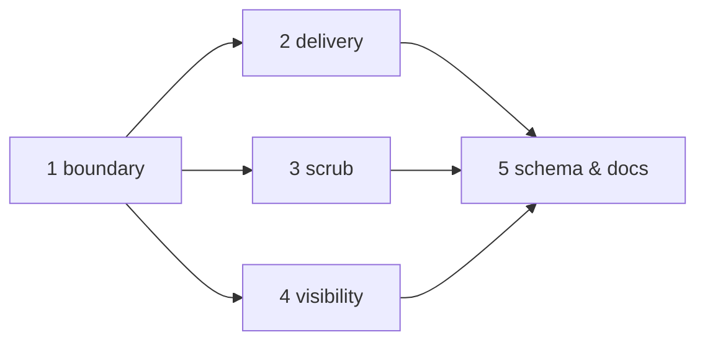

<!-- Authored per the the-loop:writing skill. -->

# Tasks: opt-in session credentials, never on argv

> Derived from [`design.md`](design.md) and [`testing-plan.md`](testing-plan.md). Each
> task is test-first; security-relevant tasks name their negative test.

## Task list

- [ ] 1. Parse `env.sessionCredentials` and resolve the boundary per work item
  - `SessionCredential`, `session_credentials()`, `SessionEnvironment.credentials` /
    `.inherit` / `.for_work_item()`; `remove` gains every `name`/`from`; `compare()`
    and `_wanted()` read `inherit`; `session_environment_and_lines` returns non-`None`
    when only `sessionCredentials` is set.
  - _Depends on:_ none
  - _Requirements:_ R1.1–R1.9, R2, R4.1, R4.3
  - _Test:_ T1/T8 — `tests/test_envstate.py` new cases (parsing, warnings, scope A7,
    passthrough refusal A5, daemon-credential warning A6, unconfigured equality R1.2)
- [ ] 2. Deliver inherited values through a `0600` file and the `sh` loader
  - `_credential_file()`, sweep, loader prefix in `_harness_command`, client env strips
    `remove ∪ inherit`, delete-on-failure, `session.credentials_inherited` event,
    `credentials_dir` wired from the dispatcher, standing sessions and restart.
  - _Depends on:_ 1
  - _Requirements:_ R3.1–R3.6, R4.2, R7.2
  - _Test:_ T1/T8 — `tests/test_tmux_runner.py` new cases (argv has no value A1, file
    mode / symlink A3, client env A2, failure cleanup, sweep, event); T2 —
    `tests/test_session_credentials_integration.py` (real tmux)
- [ ] 3. Scrub inherited values from session text and the event log
  - `sessioncreds` module; route-layer `_scrubbed()` on ask, reply, comments,
    tickets, PRs, force, skip; `EventLog.emit` scrub; self-diagnosis `compose_issue`.
  - _Depends on:_ 1
  - _Requirements:_ R5.1–R5.3
  - _Test:_ T1/T8 — `tests/test_sessioncreds.py`, `tests/test_api_session_credentials.py`
    (A4)
- [ ] 4. Show held credentials in `status` and `sessions list`
  - drift row + `list_sessions` `credentials` map; `credentials_line` in status;
    `Credentials` column when present.
  - _Depends on:_ 1
  - _Requirements:_ R7.1
  - _Test:_ T1 — `tests/test_session_environment.py` new cases
- [ ] 5. Schema, operator docs, capability doc, changelog
  - `env.sessionCredentials` in `cli-config.schema.json` (with the trade-off);
    `docs/config/cli/index.md`, `docs/cli/commands/status.md`,
    `docs/cli/commands/sessions.md`, `docs/capabilities/interactive-sessions.md`,
    `CHANGELOG.md`.
  - _Depends on:_ 1, 2, 3, 4
  - _Requirements:_ R8.1
  - _Test:_ T10 — `make validate`; T12 — `make lint`

## Dependency graph (DAG)

## Checkpoints

The targeted T1 command after each task; T2 after task 2; the full suite (`make test`)
and static checks after task 5, before verification.
