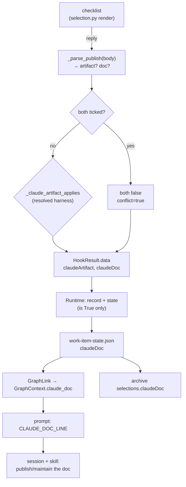

<!-- Authored per the the-loop:writing skill. -->

# Design: publish a work item's spec chain as one Claude doc

> Phase 2 of 4. Derived from [`requirements.md`](requirements.md). Reviewed together with
> [`testing-plan.md`](testing-plan.md).

## Overview

`claude-doc` is a second row in the section issue-471 added, and `claudeDoc` is a second
boolean that travels exactly where `claudeArtifact` already travels: parsed by the
`phase-selection` hook, frozen by the runtime, loaded by `WorkItemState`, rendered into the
prompt by `GraphLink`, archived, and mirrored by Slack. The CLI publishes nothing. The
session publishes the doc with the Claude Docs connector, under rules the skill states.

The one new piece of logic is **mutual exclusion**: the section resolves to one of three
outcomes (artifact, doc, markdown only), and two ticks resolve to markdown only.

## Architecture

## Components & interfaces

| Component | File | Change |
|---|---|---|
| Token | `cli/the_loop/graph/hooks/selection.py` | `CLAUDE_DOC_TOKEN = "claude-doc"`, added to `_NON_PHASE_TOKENS`. |
| Render | same, the "📄" section | Title becomes "Publish the spec chain as a Claude artifact or a Claude doc too?". Rows: `- [x] claude-artifact` (unchanged), then `- [ ] claude-doc — one Claude doc for this work item, a tab per file, which people can edit and comment on (claude harness only)`. The collapsed note adds: tick at most one; both ticked publishes neither. |
| Parse | same | `_parse_claude_doc(body)` — a ticked row only, like `_parse_claude_artifact`. |
| Resolve | same, the `run` path | `doc_req = _parse_claude_doc(body) if _asks_surface(ctx) else False`. `conflict = artifact_req and doc_req`. `claude_artifact = artifact_req and not conflict and applies(h)`; `claude_doc = doc_req and not conflict and applies(h)`. |
| Confirmation | `_confirmation` | New kwargs `claude_doc_requested`, `claude_doc`. Order of cases: conflict → "Not applied: `claude-artifact` and `claude-doc` were both ticked — tick at most one. The spec chain stays in markdown files only."; artifact → unchanged; doc → "Spec artifacts: also published as **one Claude doc** (a tab per file) …"; a requested row not applied on the harness → names the token and the harness; else "markdown files only". |
| Frozen graph / data | `_frozen_graph`, `HookResult.data` | `"claudeDoc": claude_doc` beside `claudeArtifact`. |
| Runtime freeze | `cli/the_loop/graph/runtime.py` | `if result.data.get("claudeDoc") is True: record["claudeDoc"] = True; state.claude_doc = True`. |
| State | `cli/the_loop/graph/state.py` | Field `claude_doc: bool = False`. `load`: `claude_doc = data.get("claudeDoc") is True and not claude_artifact` (R3.3). `as_dict`: `"claudeDoc"` beside `"claudeArtifact"`. |
| State schema doc | `cli/the_loop/state.py` `ATTRIBUTES`, `docs/cli/state.md` | One `claudeDoc` row, `human-decision`. |
| Prompt | `cli/the_loop/graphlink.py` | `GraphContext.claude_doc: bool`; `CLAUDE_DOC_LINE`; rendered in the same `else` branch as the artifact line (outer loop only), from both context builders. |
| Archive | `cli/the_loop/archive.py`, `commands/graph_cmd.py` | `selections.claudeDoc`; the `choices` summary appends `claude-doc`. |
| Slack mirror | `cli/the_loop/channels/slack.py` | `CLAUDE_DOC_TOKEN` in the non-phase set; the "keep this deployment's defaults" note names "the Claude artifact or doc". |
| Skill | `skills/the-loop/reference/workflow.md`, `SKILL.md`, `reference/explainer.md`, `reference/collaboration.md`, `commands/explain.md` | The doc procedure (below); the explainer publishing table gains a `claudeDoc` row. |
| Docs | `docs/capabilities/spec-workflow.md`, `docs/capabilities/process-graph.md`, `docs/cli/commands/graph.md` | The row, the outcome table and a changelog row. |

**The prompt line** (fixed text, one boolean, no payload):

> also publish the spec chain as ONE Claude doc, chosen at phase-selection: one tab per
> spec file, each tab rewritten from its file whenever the file changes, linked once from
> the work item — the markdown files stay the source of truth; read a tab before
> rewriting it and treat any human edit or comment there as feedback, never a gate
> answer (Claude Code with the Claude Docs connector only: without it, say so once on the
> work item and carry on)

### The session's procedure (skill text)

1. **One doc per work item**, titled `<id>: <work item title>`, created with the Claude
   Docs connector after the first spec file is written. One tab per spec file present, in
   chain order (`brainstorm.md`, `requirements.md`/`bugfix.md`, `design.md`,
   `testing-plan.md`, `tasks.md`); add a tab when the next file appears. Never a second
   doc.
2. **Explainer and quizzes are tabs too** (R4.4): "Spec explainer", "Spec quiz",
   "Explainer", "Code quiz". A doc runs no script, so the quiz tab lists each question and
   its options, with the answers under a closing "Answers" heading; the quiz gate is still
   answered by ticking the box on the-loop's comment.
3. **Read before rewrite** (R4.5). Before rewriting a tab from its file, read the tab. If
   it differs from what the session last wrote, the difference is a human edit: fold it
   into the file (or reply on the ticket/PR saying why not), commit, then rewrite the tab
   from the file.
4. **Link once** from the ticket, in the comment that links the checked-in files. After a
   reset, find the link there.
5. **Feedback, never a gate answer** (R4.6). A doc comment addressed to Claude is answered
   in the doc's own comment thread; the change it causes is made to the file, and the PR
   says what changed. "Approved" in the doc approves nothing.
6. **Sharing is the operator's**; the-loop never changes it.
7. **No docs tool, no doc** (R4.7): say so once on the ticket and carry on.

## UI/UX design

No product UI. The only user-facing surface is checklist markdown, shown above.

## Data models

`work-item-state.json` gains `"claudeDoc": <bool>`, always written (like `claudeArtifact`),
read with `is True`. Invariant: never both true — enforced at the hook (conflict) and
again at load (R3.3). The decision record and frozen graph gain the same key. The archive's
`selections` gains it. No version bump: an absent key reads as `false`.

## Error handling

Every failure resolves toward "not published as a doc": unreadable reply, absent row, both
rows, non-boolean value, a non-`claude` harness, no connector in the session. The CLI raises
nothing new.

## Security design

| Boundary (requirements) | Enforced by |
|---|---|
| Ticket → gate | Unchanged: only an authorized `the-loop execute` reaches `run`; the row is matched by exact token through the existing `_CHECK_LINE` regex. |
| State file → prompt | `is True` read; both-true collapses to artifact; the prompt line is a constant with no interpolated value. |
| Repository → claude.ai | Same as issue-471: private by default, the-loop never changes sharing; the evidence redaction rule already forbids secrets in specs. |
| Doc edits/comments → session | Skill rules 3 and 5: an edit reaches the repo only as a session-authored file change reviewed on the PR; nothing in the doc answers a gate; doc text is untrusted data. |

## Testing strategy

Unit tests in a new `cli/tests/test_claude_doc.py`, mirroring `test_claude_artifact.py`:
render, resolve (each outcome, both harness cases, conflict), state round-trip and coercion,
runtime freeze, prompt line, archive. The Slack pin test gains the new token. Rendered
checklist fixtures (Jira, handoff) are regenerated because the section gains a row. See
[`testing-plan.md`](testing-plan.md).

## Trade-offs & decisions

- **Second boolean, not an enum.** A `specPublication: none|artifact|doc` key would be
  cleaner, but `claudeArtifact` is already read by the runtime, archive, prompt and
  handoff (`claudeArtifactUrl`). A second boolean with an enforced invariant changes no
  existing reader.
- **Two rows, not a three-row choice.** The issue-471 row keeps its token and its default
  (ticked), so an untouched reply resolves exactly as today (R1.3). A "none" row would add
  a token for what unticking already says.
- **Both ticked → neither.** The harness/model sections already say "two ticks are not a
  choice". Choosing either silently would publish where the author may not have meant.
  The selection is frozen once, so a conflict costs only the page: the spec chain stays
  in markdown, the fail-closed outcome the security section asks for, and the
  confirmation says why.
- **Read-before-rewrite instead of two-way sync.** Docs are editable; an automatic merge
  would let an editor change a gated file without review. Reading edits as feedback keeps
  every repository change on the PR.

## Open questions

None blocking. Handoff import of a doc URL is out of scope (requirements).

## Review comments

_None yet._
