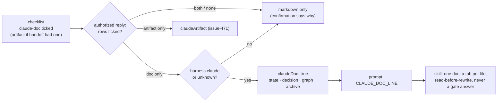

# feat(issue-536): publish the spec chain as a Claude doc — reviewer briefing

## TL;DR

`phase-selection` now offers **`claude-doc`** beside issue-471's `claude-artifact`, and it
is **ticked by default in the artifact's place** (your comment on #536). A Claude doc is
an editable, commentable document with a tab per spec file. Tick at most one; ticking
both uses the default (your decision on this PR). On the `claude` harness the choice is frozen as `claudeDoc: true`,
and the session prompt tells the session to keep one doc in step with the files. **The
files stay the source of truth**: no gate, lock or `check` changed. Risk tier 3.

**Behaviour change to notice:** an untouched checklist used to publish an artifact. It now
publishes a doc. The one exception is a handoff that already published a spec-chain
artifact (issue-517), which keeps the artifact ticked so its URL is reused.

## Where to focus (in this order)

1. **The resolve rule** — `cli/the_loop/graph/hooks/selection.py`, `classify_phase_selection`
   (`both_ticked`). Both ticked keeps only the default row (`_artifact_is_default`,
   shared with the render), the harness rule runs after it, and `_confirmation` names the
   default used.
2. **The default and the handoff swap** — the same file, `_checklist_body`
   (`artifact_default` comes from `ctx.handoff["specArtifact"]`).
3. **State compatibility** — `cli/the_loop/graph/state.py`. `claudeDoc` is written **only
   when true**, so pre-existing state files save byte-identical (a test pins this), and
   both-true on disk reads as the artifact only.
4. **The session's procedure** — `skills/the-loop/reference/workflow.md` § The spec chain
   as one Claude doc. A doc is *editable*, so the rule is: read a tab before rewriting it,
   and fold any human edit into the file as feedback. Edits never sync back
   automatically.
5. **Handoff doc import** — `cli/the_loop/core/handoff.py` (`spec-doc`, mutual exclusion)
   and `graph/runtime.py` `start` (adoption allow-list).
6. **Skim** — the prompt line (`graphlink.py`, a constant), archive/`graph` summary, the
   Slack non-phase token, regenerated checklist fixtures, docs.

## What changed (map)

## Key decisions & why (education)

- **A second boolean, not an enum.** `claudeArtifact` already has readers (runtime,
  archive, prompt, handoff's `claudeArtifactUrl`). Adding `claudeDoc` with an enforced
  "never both" invariant changes none of them. A `specPublication` enum would be cleaner,
  but it would be a migration.
- **Both ticked → the default** (your decision on this PR; the first draft published
  neither). This matches the harness/model sections' "fall back to the default". The
  default is chosen first and the harness rule applies after it, so a `codex` item still
  gets "not applied".
- **Handoff keeps the artifact.** A developer handed off with a published artifact would
  otherwise have that page stranded, because the session republishes to
  `claudeArtifactUrl` only when `claudeArtifact` is true.
- **Write `claudeDoc` only when true.** This follows the issue-517 keys, so legacy state
  files keep their bytes. `claudeArtifact` is still always written, unchanged.
- **Quiz answers in their own tab.** A doc runs no script and cannot hide text, so the
  answers go in a separate last tab, not under the questions (self-review F1).
- **Handoff doc import** (Requirement 5, your request on this PR). A handoff record may
  name `spec-doc: <https URL>` instead of `spec-artifact`, never beside it. A doc is
  edited in place, so it carries **no hash and no files**: the branch or ticket still
  carries them. `Runtime.start` adopts only a claude.ai link as `claudeDocUrl`, and the
  prompt's doc line names it after the same https re-check the artifact URL gets.
- **Explainer fall-through** (critic C1). If `claudeDoc` is true but the session has no
  Docs connector, the explainer falls back to its own artifact or the committed HTML
  file instead of going unpublished.

## Evidence

- `make check`: **6914 passed**; ruff, ruff format, pyright, config validation clean;
  `make pre-commit` clean. See [verification.md](verification.md).
- Requirement-by-requirement: [final-validation.md](final-validation.md).
- Reviews: [self-review.md](self-review.md) (2 rounds, converged),
  [critic-review.md](critic-review.md) (codex, 1 finding fixed),
  [security-review.md](security-review.md) (checklist, pass).
- Locally, ~20 poller/instances tests fail **only** when the daemon's `THE_LOOP_*` env vars
  leak into pytest. They fail the same way on clean `main`, and CI does not set them.

## Open questions for the reviewer

None open. Both earlier questions were answered on this PR: two ticks use the default,
and the handoff doc import is in this PR (Requirement 5).
