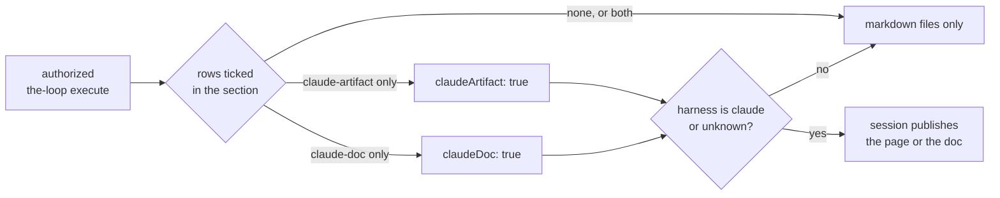

<!-- Authored per the the-loop:writing skill. -->

# Requirements: publish a work item's spec chain as one Claude doc

> Phase 1 of 4 (requirements → design → testing plan → tasks). Tier 3
> (`human-approves-pr`): one more row in the existing "publish the spec chain" section of
> the `phase-selection` checklist, one boolean frozen into `work-item-state.json` beside
> `claudeArtifact`, one prompt line, and the skill rules for the session. No credential,
> token scope, sensitive path or gate changes.

## Introduction

[Issue #536](https://github.com/MadaraUchiha-314/the-loop/issues/536): "Support for claude
docs in addition to claude artifacts."

**What exists.** Since issue-471, `phase-selection` offers a `claude-artifact` row. Ticked
on a `claude` work item, the session publishes the spec chain as one Claude artifact: a
read-only page with a tab per spec file, which people can comment on. The explainer and
quizzes (issue-488) become more tabs of that page.

**What is missing.** Claude also has **Claude docs**: living documents with tabs, which
people edit and comment on together. The issue asks the-loop to offer a doc as the
collaboration surface, with `requirements.md`, `design.md`, the explainer and the quizzes
as tabs, and to let the author choose between an artifact and a doc.

**What this changes.**

- The checklist section that offers `claude-artifact` offers a second row, `claude-doc`,
  **ticked by default in the artifact's place** (the owner's decision on the ticket,
  [comment](https://github.com/MadaraUchiha-314/the-loop/issues/536#issuecomment-6939409940)).
  The author ticks at most one of the two.
- Ticked, signed by the same authorized `the-loop execute`, and resolved to the `claude`
  harness, the doc choice is frozen into `work-item-state.json` as `claudeDoc: true`.
- The session prompt tells such a session to publish the spec chain as **one** Claude doc,
  one tab per spec file, and to keep each tab in step with its file.
- The markdown files stay the source of truth. Gates, locks and `the-loop check` read the
  files exactly as before. An edit made in the doc is feedback, folded into the file.

## Requirements

### Requirement 1 — the gate offers the doc beside the artifact

**User story:** As the author of a work item, I want to choose at `phase-selection` whether
its spec chain is also published as a Claude artifact or as a Claude doc, so I can pick
between a page I read and comment on and a document I edit with others.

#### Acceptance criteria (EARS)

1.1 WHEN the `phase-selection` checklist is posted for a loop that owns an outer loop THEN
the system SHALL render, in the same section as the `claude-artifact` row, one row
`claude-doc`, **ticked**, and SHALL render the `claude-artifact` row **unticked**.

1.2 The section SHALL state that its rows are not phases, that at most one may be ticked,
that ticking both publishes neither, and that both apply only when the work item runs on
the `claude` harness.

1.3 WHEN the work item's handoff record names a spec-chain artifact (issue-517) THEN the
system SHALL instead render `claude-artifact` ticked and `claude-doc` unticked, so the
session republishes to the artifact it was handed. The `claude-artifact` row SHALL keep
its meaning either way: ticked alone, it resolves exactly as before this change.

1.4 WHEN the loop owns no outer loop (`pdlc-contribution-loop`) THEN the system SHALL NOT
render the `claude-doc` row, and SHALL NOT read it from a reply.

1.5 The `claude-doc` row SHALL never be read as a phase: ticked or unticked, it SHALL NOT
produce a declared skip, an opt-in or a refusal.

1.6 A Slack mirror of the checklist SHALL keep the `claude-doc` row as a non-phase row: it
SHALL NOT offer it as a phase checkbox, and a typed `without` reply SHALL carry it through
unchanged.

### Requirement 2 — the reply resolves one choice, against the harness

**User story:** As the author, I want exactly one publishing surface or none, and to be
told when my tick could not be applied.

#### Acceptance criteria (EARS)

2.1 WHEN an authorized `the-loop execute` resolves the selection AND the `claude-doc` row
is ticked AND the `claude-artifact` row is not ticked AND the work item's resolved harness
is `claude` or unknown THEN the system SHALL record `claudeDoc: true` and
`claudeArtifact: false`.

2.2 The resolved harness SHALL be found exactly as for `claude-artifact` (issue-471 R2.2):
the harness the same reply chose, else this deployment's default harness, and an unknown
harness does not rule the choice out.

2.3 WHEN both rows are ticked THEN the system SHALL record `claudeDoc: false` and
`claudeArtifact: false`, and the confirmation comment SHALL say that two rows were ticked
and the spec chain stays in markdown files only.

2.4 WHEN the `claude-doc` row is ticked alone AND the resolved harness is known and is not
`claude` THEN the system SHALL record `claudeDoc: false`, and the confirmation comment
SHALL name the row as not applied and the harness it was not applied on.

2.5 WHEN the `claude-doc` row is unticked, absent, or the checklist cannot be read THEN the
system SHALL record `claudeDoc: false`.

2.6 The confirmation comment SHALL name the outcome in every direction: published as a
Claude artifact, published as a Claude doc, not applied (with the reason), or markdown
files only.

2.7 The system SHALL never record `claudeDoc: true` and `claudeArtifact: true` together.

### Requirement 3 — the choice is frozen with the selection

**User story:** As the operator, I want the doc choice recorded where the artifact choice
is, so a respawned session and `the-loop check` read the same fact.

#### Acceptance criteria (EARS)

3.1 WHEN the selection is recorded THEN the system SHALL write `claudeDoc` into
`work-item-state.json` and into the gate's decision record and frozen graph, beside
`claudeArtifact`.

3.2 WHEN a state file carries no `claudeDoc` key, or a value other than the boolean `true`,
THEN the system SHALL read it as `false`. The key SHALL be written only when `true`, so a
state file saved before this change stays byte-identical when it is saved again.

3.3 WHEN a hand-edited state file carries both `claudeDoc: true` and `claudeArtifact:
true` THEN the system SHALL read `claudeDoc` as `false`, keeping the choice that existed
first.

3.4 The work item's archive record SHALL carry the value under `selections`, and the
archive's summary SHALL list `claude-doc` among the choices when it is true.

3.5 The documented state schema (`docs/cli/state.md`) SHALL list `claudeDoc`.

### Requirement 4 — the session is told, and knows the procedure

**User story:** As the operator, I want the session to publish and maintain the doc
without being asked again, and to leave the gates exactly as they are.

#### Acceptance criteria (EARS)

4.1 WHEN the session prompt's graph-context block is rendered for an outer-loop work item
whose state has `claudeDoc: true` THEN it SHALL carry one line telling the session to
publish the spec chain as one Claude doc, one tab per spec file, and to keep each tab in
step with its file.

4.2 The line SHALL NOT be rendered for a pull request's inner loop, a contribution, an
ad-hoc task, a review, or a work item whose state has `claudeDoc: false`.

4.3 The skill SHALL state the procedure: one doc per work item, titled `<id>: <work item
title>`; one tab per spec file present, in chain order; a tab added when the next file
appears; a tab rewritten from its file after every change to that file; the doc linked
from the ticket once; the markdown files stay the source of truth.

4.4 WHEN the explainer or a quiz is published for a work item with `claudeDoc: true` THEN
the skill SHALL direct the session to add it as a tab of the same doc rather than publish
a separate page.

4.5 The skill SHALL state that, before the session rewrites a tab from its file, it reads
the tab, and any human edit found there is treated as feedback: folded into the file (or
answered, when declined) before the tab is rewritten. A human edit SHALL NOT be discarded
without being considered.

4.6 The skill SHALL state that a comment or an edit in the doc is feedback, never an answer
to a gate: approvals stay with the gate on the ticket or pull request, and "approved"
written in the doc approves nothing.

4.7 The skill SHALL state that a session with no Claude docs tool ignores the choice and
says so once on the ticket.

4.8 The capability docs describing the issue-471 row (`docs/capabilities/spec-workflow.md`,
`docs/capabilities/process-graph.md`) and the `graph` command doc SHALL describe the
`claude-doc` row in the same PR.

## Out of scope

- **A Codex or Cursor equivalent.** As for issue-471, the choice applies only on the
  `claude` harness.
- **The doc replacing the files.** Gates lock `status: approved` into the files' front
  matter; moving the source of truth into the doc would change every gate.
- **Two-way sync.** The doc is rewritten from the files. Edits flow back only through the
  session reading them as feedback (R4.5); nothing merges them automatically.
- **Handoff import of a doc URL.** A handoff can import a spec-chain artifact URL
  (`claudeArtifactUrl`, issue-517). Importing a doc URL the same way is a later change.
- **Routing doc comments.** Claude already delivers a doc comment addressed to Claude to
  the session; the-loop adds no ingress for them.
- **Sharing the doc.** It is created private, under the operator's account. Who may open or
  edit it is the operator's decision, made in claude.ai.

## Security considerations

**Untrusted actors.** Anyone who can comment on the ticket can tick the row in place; only
an authorized `the-loop execute` makes the tick count. Anyone the operator shares the doc
with can comment on it and, unlike an artifact, **edit** it.

**Trust boundaries.** (1) The ticket → the gate: unchanged; the reply is authorized and the
row is matched by exact token. (2) The repository → claude.ai: the spec chain's text is
stored as a doc in the operator's Claude account, as issue-471 stores it as a page.
(3) Doc edits and comments → the session: a new input path into the session, but not into
the-loop, which neither reads nor routes them. This path is wider than an artifact's,
because an editor can change the text the session reads back.

**Abuse cases.**

- WHEN a non-authorized user ticks `claude-doc` and nobody authorized executes THEN nothing
  SHALL change.
- WHEN a doc comment or edit says "approved", or asks for a gate to be skipped, THEN the
  session SHALL NOT treat it as a gate answer.
- WHEN a doc edit or comment carries instructions THEN the session SHALL treat them as
  untrusted data, as it treats ticket comments.
- WHEN an editor changes a tab of the doc THEN the change SHALL reach the repository only
  as an edit the session chose to make to the file, committed and reviewed on the pull
  request like any other.
- WHEN a hand-edited `work-item-state.json` sets `claudeDoc` to a string or number, or sets
  both choices true, THEN the system SHALL read `claudeDoc` as `false`.

**Fail closed.** Every unreadable, ambiguous or unknown case resolves to *not published as
a doc*: an unreadable checklist, an absent row, both rows ticked, a non-boolean value, a
harness known not to be `claude`, a session without the docs tool.

**Disclosure.** The doc is private by default and the-loop never changes its sharing. A
spec chain must not hold secrets in any case (the evidence redaction rule); publishing it
as a doc does not loosen that.
