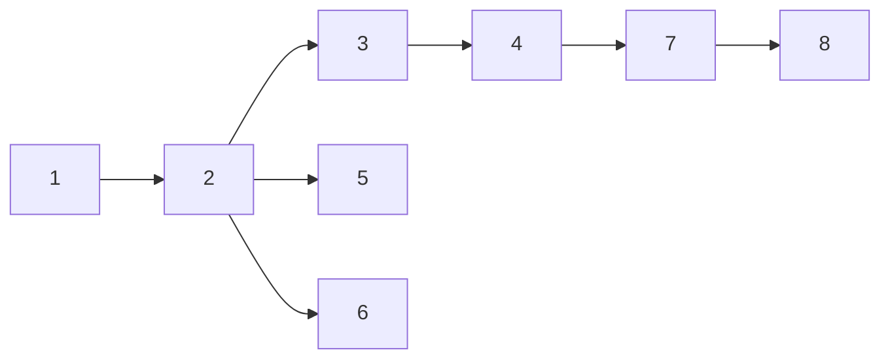

<!-- Authored per the the-loop:writing skill. -->

# Tasks: publish a work item's spec chain as one Claude doc

## Task list

- [ ] 1. **Red tests.** `cli/tests/test_claude_doc.py` (render, resolve, state, runtime,
      prompt, archive) and the Slack pin, failing before the change.
  - _Depends on:_ none
  - _Requirements:_ R1–R3, R4.1, R4.2
  - _Test:_ T1–T7 (red)
- [ ] 2. **The gate.** `CLAUDE_DOC_TOKEN`, the second row and note, `_parse_claude_doc`,
      the conflict rule, the confirmation, result data, frozen graph.
  - _Depends on:_ 1
  - _Requirements:_ R1.1–R1.5, R2
  - _Test:_ T1, T2 — `pytest tests/test_claude_doc.py` (red→green); unauthorized tick is
    the negative case
- [ ] 3. **The frozen record.** `WorkItemState.claude_doc` with the both-true collapse, the
      runtime freeze, the attribute catalogue, the archive and the `graph` summary.
  - _Depends on:_ 2
  - _Requirements:_ R3
  - _Test:_ T3, T4, T6 — state coercion is the negative case
- [ ] 4. **The prompt.** `GraphContext.claude_doc` from both builders and
      `CLAUDE_DOC_LINE` on the outer loop.
  - _Depends on:_ 3
  - _Requirements:_ R4.1, R4.2
  - _Test:_ T5
- [ ] 5. **The Slack mirror.** Non-phase token and the defaults note.
  - _Depends on:_ 2
  - _Requirements:_ R1.6
  - _Test:_ T7
- [ ] 6. **Fixtures.** Regenerate the rendered checklist fixtures the new row changes.
  - _Depends on:_ 2
  - _Requirements:_ R1.1
  - _Test:_ T8 (the fixture-backed suites)
- [ ] 7. **The skill.** `SKILL.md`, `reference/workflow.md` (the doc procedure),
      `reference/explainer.md` (publishing table), `reference/collaboration.md`,
      `commands/explain.md`.
  - _Depends on:_ 4
  - _Requirements:_ R4.3–R4.7
  - _Test:_ review (`evidence/self-review.md`)
- [ ] 8. **The docs.** `docs/capabilities/spec-workflow.md`, `process-graph.md`,
      `docs/cli/commands/graph.md`, `docs/cli/state.md`, with history rows.
  - _Depends on:_ 7
  - _Requirements:_ R3.5, R4.8
  - _Test:_ T8 (markdownlint)

## Dependency graph (DAG)

## Checkpoints

After task 4 and after task 6: `cd cli && uv run python -m pytest -q`. After task 8:
`make check` and `make pre-commit`, then the `verification` node runs
[`testing-plan.md`](testing-plan.md).

## Review comments

_None yet._
