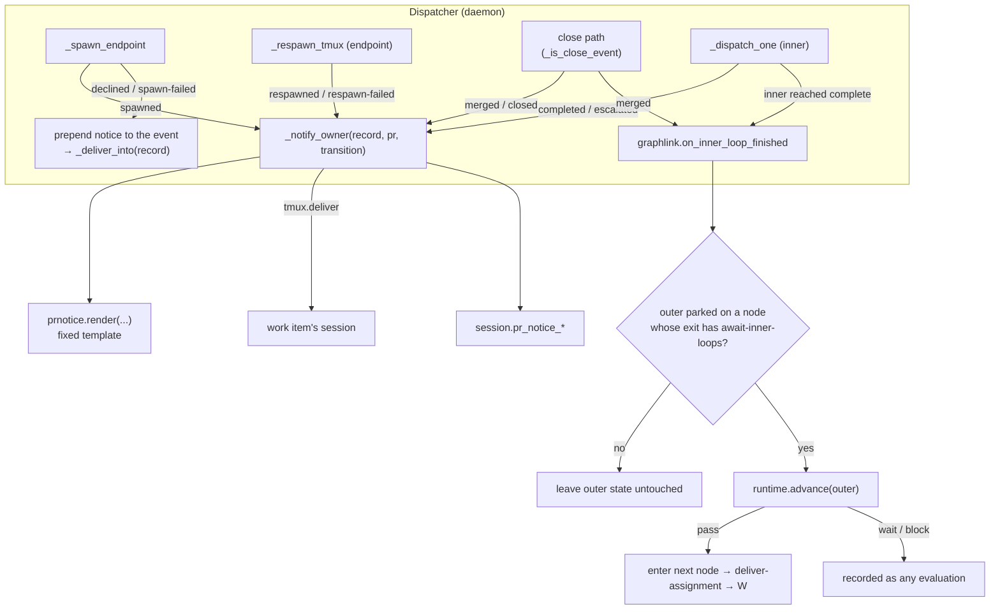

<!-- Authored per the the-loop:writing skill. -->

# Design: tell the work item's session what happens to its pull-request sessions

> Phase 2 of 4. Derived from [`requirements.md`](requirements.md). One new module
> (`the_loop/prnotice.py`, the notice text), one dispatcher method (`_notify_owner`) called
> from the six places an endpoint changes state, and one graphlink method
> (`on_inner_loop_finished`) that re-runs the outer exit chain when an inner loop reaches
> `complete`. No new dependency, no schema, no graph YAML change.

## Overview

Every place the dispatcher already changes a pull-request endpoint's state gets one more
line: tell the owner. The owner is the work item's own record in the session registry. The
text is rendered from a fixed template by a pure function that takes only parsed refs,
reason codes and node ids, so there is no argument through which payload text could reach
it. Delivery is a tmux paste into the record's session, guarded so it never raises.

When the transition means an inner loop has finished — a merge, or its `pr-approval` gate
approving — the dispatcher then asks graphlink to re-run the outer node's exit chain. That
re-run happens only when the outer pointer is parked on a node whose exit chain contains
`await-inner-loops`, which is exactly the situation the ticket describes: the session
claimed `implementation`, the gate answered `wait`, and nothing came back to it. A pass
advances the outer loop through the runtime's ordinary `advance`, so the next node's
`deliver-assignment` hook delivers its assignment, as every assignment is delivered.



## Architecture

The change sits entirely on the daemon side of the two-loop seam
([`docs/capabilities/process-graph.md`](../../capabilities/process-graph.md)). The inner
loop still writes only its own state under `pr-loops/`; the outer loop still moves only by
evaluating its own exit chain on those files. What is new is *who triggers* that
evaluation: before, only a session's claim or an event on the work item itself; now also
the dispatcher, right after it observed an inner loop finish.

The one-way rule is kept by construction:

| Act | Who | Moves the outer pointer? |
|---|---|---|
| A notice | `_notify_owner` → tmux paste | Never: it writes no state file |
| A re-evaluation | `GraphLink.on_inner_loop_finished` → `Runtime.advance` | Only if the outer node's own exit chain passes |
| An inner event | `GraphLink.on_pr_event` | Never (unchanged) |

## Components & interfaces

### `the_loop/prnotice.py` (new)

```python
TRANSITIONS = (
    "spawned", "declined", "spawn-failed", "respawned", "respawn-failed",
    "merged", "completed", "closed", "escalated",
)
DECLINE_REASONS = {               # reason code → fixed phrase
    "no-separate-checkout": "no routing.workspace.root, so it has no checkout of its own",
    "workspace-failed": "its checkout could not be prepared",
    "shared-worktree": "its checkout resolved to this session's own working tree",
    "harness-unavailable": "the harness could not be started",
    "hook-refused": "a session_spawn lifecycle hook refused it",
}

def render(
    transition: str,
    work_item: WorkItemRef,
    pull_request: WorkItemRef,
    *,
    tmux_target: str = "",
    reason: str = "",
    outer_node: str = "",
    outer_waits: bool = False,
    inner_node: str = "",
) -> str: ...
```

- **Pure.** No I/O. Raises `ValueError` for a transition not in `TRANSITIONS`, so a typo
  in a call site fails its test rather than pasting a malformed notice.
- **Inputs are typed and bounded.** `work_item`/`pull_request` are parsed `WorkItemRef`s,
  rendered by `.ref`. `reason` is looked up in `DECLINE_REASONS`; an unknown code renders
  as `unspecified`. `tmux_target`, `outer_node` and `inner_node` pass through
  `_identifier()`, which keeps `[A-Za-z0-9._:/#-]` and truncates to 120 characters — they
  come from `TmuxRunner.target_for` and the compiled graph, but the renderer does not rely
  on that.
- **Shape.** A heading line, one facts line, one sentence per transition, one "what this
  means for you" line, and a closing line stating that the notice moves no graph pointer:

  ```text
  ## the-loop: pull-request session notice

  Work item: github:octo/app#15 · Pull request: github:octo/infra#7 · Transition: merged

  github:octo/infra#7 merged. Its inner loop (pdlc-pr-loop) is complete.
  The daemon is re-checking `await-inner-loops` on your current node; if it passes you
  will receive the next node's assignment.

  This notice is informational. It moves no graph pointer; `the-loop graph status
  issue-15` shows where the work item stands.
  ```

### `Dispatcher._notify_owner` (new)

```python
def _notify_owner(
    self, owner: WorkItemRef, pull_request: WorkItemRef, transition: str, **facts
) -> str:   # "delivered" | "skipped" | "failed"
```

1. `record = self.registry.find_by_work_item(owner)`. `None`, not `is_live`, or no
   `tmux_target` → emit `session.pr_notice_skipped(reason="no-live-session")`.
2. `record.is_paused` → `session.pr_notice_skipped(reason="paused")`.
3. `text = prnotice.render(transition, owner, pull_request, **facts)`;
   `result = self.tmux.deliver(record, text, timeout=…)`.
4. `ok` → `session.pr_notice_delivered`; else `session.pr_notice_failed(error=…)`.
5. The whole body is inside `try/except Exception` → `session.pr_notice_failed`. Never
   releases a delivery, never retries, never touches the registry's dedup ring.

### `Dispatcher._decline_into` (new)

```python
def _decline_into(self, record, endpoint, routed, prompt, transition, reason="") -> bool
```

The four fallbacks in `_spawn_endpoint` that today call
`self._deliver_into(record, record, routed, prompt)` call this instead. It renders the
`declined`/`spawn-failed` notice, prepends it to `prompt` (notice, a `---` rule, then the
event), delivers through `_deliver_into` and emits `session.pr_notice_delivered` with
`via="with-event"` on success or `session.pr_notice_failed` on failure. One paste, one
event (R1.4). `_deliver_into`'s own failure handling (release for redelivery) is
unchanged: it is the *event* that failed, not the notice.

`_endpoint_cwd` returns an `EndpointCheckout(cwd: Optional[str], reason: str)` named tuple
instead of `Optional[str]`, so its one caller, `_spawn_endpoint`, knows which decline it
emitted. A "last reason" attribute on the dispatcher was rejected: the dispatcher is
threaded, and that would be shared mutable state.

### Call sites

| Where | Transition | Facts |
|---|---|---|
| `_spawn_endpoint`, after `session.pr_spawned` | `spawned` | `tmux_target` |
| `_spawn_endpoint`, adapter missing/unavailable | `declined` | `reason="harness-unavailable"` |
| `_spawn_endpoint`, `_endpoint_cwd` → no cwd | `declined` | the checkout's `reason` |
| `_spawn_endpoint`, `_before_launch` refused | `declined` | `reason="hook-refused"` |
| `_spawn_endpoint`, `tmux.spawn` failed | `spawn-failed` | — |
| `_respawn_tmux` with `owner` ≠ endpoint, success | `respawned` | `tmux_target` |
| `_respawn_tmux` with `owner` ≠ endpoint, adapter missing, launch refused, spawn failed | `respawn-failed` | — |
| close path, endpoint closed and it had a `tmux_target` | `merged` / `closed` | `outer_node`, `outer_waits` (closed only) |
| `_dispatch_one`, inner advance whose report is `escalated` | `escalated` | `inner_node` |
| `_dispatch_one`, inner pointer moved to `complete` | `completed` | — |

In the close path the endpoint's `tmux_target` is read **before** `_close_tmux`, and the
notice is sent after `on_pr_close`/`on_pr_state`, so it describes the state already
written. Then, for a merge only, `graphlink.on_inner_loop_finished` runs (R2.1, R2.6), on
a short-lived daemon thread (`Dispatcher._reevaluate_outer`). The close path runs inside
`handle`, before the receiver answers the webhook, and a passing re-run enters the next
node, whose entry chain makes a GitHub call and may run an operator's `verify-tests`
command. The graph's state lock serialises that thread against the session's own claims
(self-review F1).

In `_dispatch_one` the inner node is read from the context resolved before the advance and
from `pr_context` after it. A helper `_after_inner_advance(session, endpoint, before,
report)` compares them and sends at most one notice: `completed` when the pointer is now
`complete` and was not before (then `on_inner_loop_finished`), else `escalated` when
`report.status == "escalated"`. Both inner-advance sites (the consult-first gate and the
post-delivery advance) call it.

### `GraphLink.on_inner_loop_finished` (new) and `GraphLink.inner_loop_gate` (new)

```python
def on_inner_loop_finished(self, work_item: WorkItemRef, cwd: str) -> Optional[NodeReport]
def inner_loop_gate(self, work_item: WorkItemRef, cwd: str) -> Optional[Tuple[str, bool]]
```

Both run through `_guarded` on the **outer** runtime, so every existing skip applies
(graph disabled, unstarted item, foreign checkout, spec dir outside the checkout, no spec
dir). `on_inner_loop_finished` is an `advance` action (it holds the outer state lock);
`inner_loop_gate` is a `context` read.

```python
def call(rt, item):
    state = WorkItemState.load(rt.state_dir(rt.work_item(item)), item)
    node_id = state.current_node
    parked = state.parked or {}
    if not node_id or parked.get("node") != node_id:
        emit("graph.outer_reevaluated", outcome="not-parked"); return None
    if not waits_on_inner_loops(rt.graph.node(node_id)):
        emit("graph.outer_reevaluated", outcome="no-inner-gate"); return None
    report = rt.advance(item, ref=work_item.ref, event={"comments": []})
    emit("graph.outer_reevaluated", node=node_id, status=report.status,
         outcome=report.outcome or None)
    return report
```

`waits_on_inner_loops(node)` lives in `graph/hooks/loops.py` beside the hook it names:
true when any exit spec is the string `"await-inner-loops"` or a mapping whose `hook` is.
Matching by hook name (not by node id) means an operator's graph that puts the gate on a
different node gets the same behaviour.

`inner_loop_gate` returns `(current_node, waits_on_inner_loops(node))` for the `closed`
notice.

## UI/UX design

N/A — no user-facing surface. The notice is text pasted into a harness session.

## Data models

No persisted model changes. `work-item-state.json` (outer and inner) is written only by the
existing `advance`/`force` paths. Four event types are registered in
`eventlog.EVENT_TYPES`:

| Event | Fields |
|---|---|
| `session.pr_notice_delivered` | `work_item`, `pull_request`, `transition`, `via` (`paste` \| `with-event`) |
| `session.pr_notice_skipped` | `work_item`, `pull_request`, `transition`, `reason` (`paused` \| `no-live-session`) |
| `session.pr_notice_failed` | `work_item`, `pull_request`, `transition`, `error` |
| `graph.outer_reevaluated` | `work_item`, `node`, `status`, `outcome` (or `not-parked` \| `no-inner-gate`) |

## Error handling

| Failure | Response |
|---|---|
| No record, closed record, no tmux target | `pr_notice_skipped(no-live-session)`; the path continues |
| Record paused | `pr_notice_skipped(paused)`; the path continues |
| tmux paste fails, or rendering raises | `pr_notice_failed`; the path continues; nothing released or retried |
| Event-with-notice paste fails (declined/spawn-failed) | unchanged `dispatch.failed` + release for redelivery (the event failed); plus `pr_notice_failed` |
| Re-evaluation raises | `_guarded` logs and emits `graph.link_failed`; the close path continues |
| Re-evaluation waits/blocks | recorded by `advance` as for any evaluation; no retry loop (R2.5) |
| Outer state lock busy | `_guarded`'s existing handling; the next claim or event re-evaluates |

Logging uses the module's `logger` at the levels the neighbouring code uses: `info` for a
delivered notice, `warning` for a failed one, `debug` for a skip.

## Security design

- **AuthN/AuthZ:** unchanged. The close path already runs for any close event GitHub
  delivers (closing is not an instruction); the notice adds no capability beyond what the
  close path already exercises, and the re-evaluation is the same exit chain a session's
  claim runs.
- **Input validation & injection surfaces:** the one new surface is a paste into a harness
  session — a **prompt-injection** surface. `prnotice.render` takes no free text: its
  parameters are two parsed refs, a reason code looked up in a fixed table, and node ids /
  a tmux target filtered through `_identifier()`. No call site passes a payload field; the
  close path's refs come from `_closing_refs` (parsed numbers) and the registry.
- **Secrets handling:** none read or written. The notice never names an environment
  variable, token or credential.
- **Least privilege:** no new permission; tmux delivery to the record's own target only.
- **Fail-closed behaviour:** an unreadable record or outer state → no notice and no
  re-evaluation; the inner state file stays the durable record.
- **Abuse-case coverage:**

  | Abuse case (requirements) | Mechanism | Negative test |
  |---|---|---|
  | 1 — instructions in a PR title/body/branch/comment | `render` has no free-text parameter; `_identifier()` filter | an integration test sends a merge whose title, body and branch carry an instruction string and asserts it is absent from every paste; a unit test feeds `_identifier()` hostile text |
  | 2 — an unauthorized user closes a linked PR | the outer moves only on its own exit chain | a closed-without-merge test asserts the outer state file is byte-identical |
  | 3 — an unlinked PR closes | `close_endpoint` returns `None` → no notice, no re-evaluation | a test closes an unrelated PR and asserts no paste and no `graph.outer_reevaluated` |
  | 4 — redelivered close | `close_endpoint` returns `None` for a closed endpoint | a test posts the same merge twice (two delivery ids) and asserts one notice |

## Testing strategy

Unit tests pin the renderer (every transition renders, unknown transition raises, unknown
reason renders `unspecified`, hostile identifiers are filtered) and `waits_on_inner_loops`.
Integration tests (Gherkin docstrings, `cli/tests/test_pr_notices_integration.py`) drive a
real `Dispatcher` with `FakeTmux` through each transition and assert the paste and the
event; a graphlink integration test walks a real outer graph parked at `implementation`
with one inner loop, merges it, and asserts the outer pointer advanced to `verification`
without a claim. The existing issue-172 test that asserted *no* delivery on a linked PR's
merge is updated to assert exactly the one notice. Full detail in
[`testing-plan.md`](testing-plan.md).

## Alternatives considered

- **A background sweep of parked work items** (the issue's point 2, read broadly). Rejected
  for now: every way an inner loop reaches `complete` without an operator's `force` passes
  through the dispatcher, so an event-driven re-run covers it with no polling cost. Stated
  in the requirements' *Out of scope*.
- **A separate paste for declined/spawn-failed.** Rejected: the event is already being
  pasted into the same session at that moment; two pastes race the harness's input queue
  and split one fact across two messages.
- **Advancing the outer loop directly from the close path** (`force`). Rejected: it would
  bypass the outer exit chain — `validate-artifacts` on `tasks.md` and `verify-tests` —
  which is the hole the one-way rule exists to keep shut.
- **Gating the re-run on a recorded completion claim** (`state.completions`). Rejected: the
  runtime does not require a claim to evaluate an agent node (any event on the work item
  runs `advance`), so requiring one here would be stricter than the system it serves.
  "Parked on this node" is the precise signal that a previous evaluation waited.
