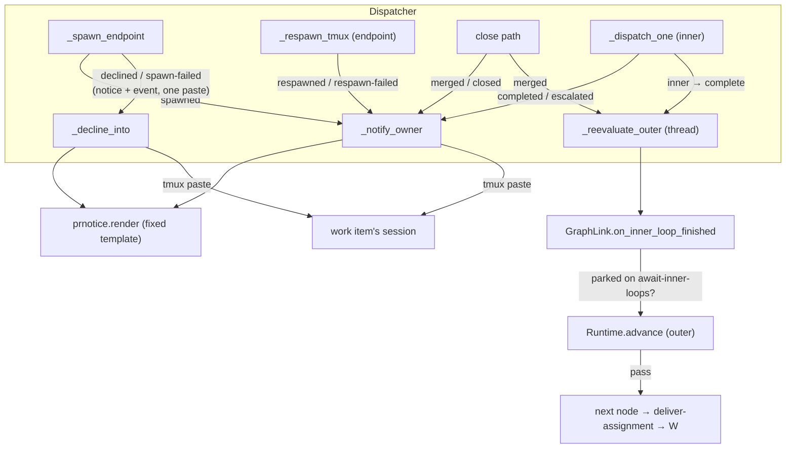

# feat(issue-538): tell the work item's session what happens to its pull-request sessions — reviewer briefing

## TL;DR

When a work item's pull request has a tmux session of its own, the daemon now pastes one
short, fixed-shape notice into the **work item's** session each time that session is
spawned, declined, fails, is respawned, merges, closes, completes or escalates. After an
inner loop finishes, it re-runs the outer `await-inner-loops` gate, so a multi-PR work item
no longer sits at `implementation` after its last merge.

No explainer page: the `explainer` row was declared away at `phase-selection`.

## Where to focus (in this order)

1. **The outer re-run cannot walk the work item past a gate it has not earned.**
   `cli/the_loop/graphlink.py` → `GraphLink.on_inner_loop_finished`. It runs only when
   `state.parked.node == current_node` *and* the node's exit chain contains
   `await-inner-loops`, and then calls the ordinary `Runtime.advance` with no comments.
   Check that the precondition is tight enough.
2. **Notice text cannot carry payload text (prompt injection).** `cli/the_loop/prnotice.py`
   → `render` / `_identifier`, and its two callers in `dispatcher.py` (`_notify_owner`,
   `_decline_into`). Check that no call site passes anything from a payload.
3. **The close path still behaves as before.** `dispatcher.py`, the `_is_close_event`
   branch of `handle`: the notice comes after `on_pr_close`/`on_pr_state`; the re-run is on
   a daemon thread (`_reevaluate_outer`), because `handle` runs before the receiver
   answers `202`.
4. **One change outside the feature: `runner.py` `deliver_to` now names its tmux paste
   buffers per delivery** (critic C1). The fixed names were server-global, so two
   concurrent deliveries could paste one conversation's text into another. That race
   predates this PR, which widened it.
5. Skim: the spawn/respawn wiring (`_spawn_endpoint`, `_respawn_tmux`), the
   `EndpointCheckout` return type, the four event types, and the docs.

## What changed (map)

## Key decisions & why (education)

- **Re-run the gate; never force the pointer.** Forcing the outer pointer would skip
  `validate-artifacts` on `tasks.md` and `verify-tests`. Re-running the node's own chain
  keeps the one-way rule: the pointer moves only if the gate passes on the checked-in inner
  states, exactly as a session's `graph complete` would.
- **"Parked on this node" as the precondition, not "a claim was recorded".** The runtime
  never requires a claim to evaluate an agent node. Parked is the exact signal that a
  previous evaluation answered `wait`.
- **Event-driven, no sweep.** Every way an inner loop reaches `complete` other than an
  operator's `force` passes through the dispatcher (a merge, or the `pr-approval` gate).
  A sweep would add polling for no added coverage. An escalation reached through a claim
  served by the API is out of scope; that session reports its own.
- **A declined or failed spawn rides with the event.** The event is pasted into the
  same session at that moment anyway; two pastes would race the harness's input queue.
- **The renderer takes no free text.** Typed refs, a reason-code table and a narrow
  identifier filter mean the injection question is answered by the function's signature.
- **Requirement corrected in review (critic C3).** Registry-only notices are sent even when
  the outer state is unreadable. What fails closed is the pointer, and the requirement now
  says so.

## Evidence

- Verification: [`testing-plan.md`](../testing-plan.md) § Verification results,
  [`verification.md`](verification.md), [`final-validation.md`](final-validation.md).
  There are 21 Gherkin scenarios, every task went red before green, and the affected suites
  re-run at `fbed45c` give 299 passed. `make test`: 6952 passed, plus one unrelated
  real-tmux test that fails intermittently.
- Reviews: [`self-review.md`](self-review.md) (2 rounds, F1 fixed),
  [`critic-review.md`](critic-review.md) (codex: C1, C2 fixed, C3 spec corrected),
  [`security-review.md`](security-review.md) (checklist and built-in pass: no findings).
- Docs: [`documentation.md`](documentation.md). The changed docs are `process-graph.md`,
  `webhook-triggers.md`, `routing-options.md` and the skill's `workflow.md`.
- Spec doc (a tab per file): https://claude.ai/artifact/2UieWRQ3j5dMCDe4myKNmH

## Open questions for the reviewer

1. **CI `gate` was red on every commit before the evidence landed** (escalated on this PR).
   Is that acceptable for a spec-chain PR, or should `gate` skip draft PRs? That would be a
   workflow change, and it is your call.
2. **The `runner.py` buffer fix** changes delivery for every session, not just notices.
   Are you comfortable carrying it here, or do you want it split into its own PR?
