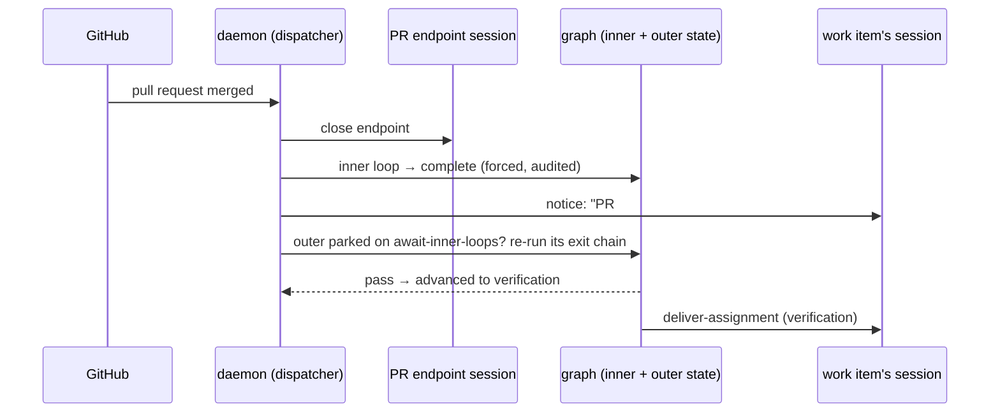

<!-- Authored per the the-loop:writing skill. -->

# Requirements: tell the work item's session what happens to its pull-request sessions

> Phase 1 of 4 (requirements → design → testing plan → tasks). Tier 3
> (`human-approves-pr`): the daemon's dispatcher gains one notice channel into the work
> item's own session and one re-evaluation of the outer `await-inner-loops` gate. No
> credential, token scope, sensitive path or graph definition changes.

## Introduction

[Issue #538](https://github.com/MadaraUchiha-314/the-loop/issues/538): "The work item's
session is never told what happens to its pull-request sessions."

**What is broken.** When a work item's pull requests get tmux sessions of their own
(`sessionPerPr: always`, or a cross-repository pull request under the default
`cross-repository`), the work item's own session hears nothing when one of them is
spawned, declined, fails, merges, closes or escalates. The outer loop learns about an inner
loop only when `await-inner-loops` is evaluated again, and nothing evaluates it when an
inner loop changes. So a work item sits at `implementation` after its last pull request
merged, until an unrelated event or a person nudges it. In an unattended deployment that
is indefinitely.

**What this changes.**

1. **A notice per child transition.** The daemon pastes one short, fixed-shape notice into
   the work item's live session whenever one of its pull-request endpoints changes state,
   and records the outcome as an event. The notice is built from registry and graph state
   only — never from an event payload.
2. **The outer gate is re-evaluated when an inner loop finishes.** When a pull request
   merges, or its inner loop otherwise reaches `complete`, the daemon re-runs the outer
   node's exit chain — but only when the outer pointer is parked on a node that waits on
   `await-inner-loops`. A passing gate advances the work item and the next node's
   assignment is delivered the way every assignment is.
3. **The one-way rule holds.** A notice informs; it never moves the outer pointer. The
   pointer moves only if the outer gate itself passes on the checked-in inner states,
   exactly as a session's own `the-loop graph complete` would.

## Requirements

### Requirement 1 — A notice for every child lifecycle transition

**User story:** As the agent running a work item's own session, I want to be told when one
of my pull requests' sessions is spawned, declined, fails, finishes, closes or escalates,
so that I know which session owns that pull request's work and can act without a person
prompting me.

#### Acceptance criteria (EARS)

1. WHEN the daemon spawns a session for a pull request delivering a work item THEN the
   system SHALL deliver one `spawned` notice into the work item's live session naming the
   pull request and the endpoint's tmux target.
2. WHEN the daemon declines to give a pull request a session of its own (no separate
   checkout, a workspace failure, a shared working tree, an unavailable harness, or a
   `session_spawn` hook refusal) THEN the system SHALL deliver one `declined` notice
   naming the pull request and the reason, stating that the work item's session now
   receives that pull request's events.
3. WHEN spawning a pull request's session fails THEN the system SHALL deliver one
   `spawn-failed` notice naming the pull request, stating that the work item's session now
   receives that pull request's events.
4. WHEN a declined or failed spawn causes the triggering event to be delivered into the
   work item's session THEN the system SHALL deliver the notice in the same paste as that
   event, ahead of it, rather than as a second paste.
5. WHEN a pull request that had a session of its own is merged THEN the system SHALL
   deliver one `merged` notice naming the pull request and stating that its inner loop is
   complete; WHEN an event delivered to its endpoint moves its inner loop to `complete`
   through its approval gate THEN the system SHALL deliver one `completed` notice.
6. WHEN a pull request that had a session of its own is closed without merging THEN the
   system SHALL deliver one `closed` notice naming the pull request, the outer node the work item
   is on, and — when that node waits on `await-inner-loops` — that the gate will keep
   waiting on this pull request's inner loop until the session reopens it, replaces it or
   escalates.
7. WHEN an event delivered to a pull request's endpoint leaves its inner loop escalated
   THEN the system SHALL deliver one `escalated` notice naming the pull request and the
   inner node.
8. WHEN a dead pull-request endpoint is respawned THEN the system SHALL deliver one
   `respawned` notice; WHEN that respawn fails THEN the system SHALL deliver one
   `respawn-failed` notice naming the pull request.
9. WHEN a notice is delivered, skipped or fails THEN the system SHALL emit exactly one
   event recording it (`session.pr_notice_delivered`, `session.pr_notice_skipped` or
   `session.pr_notice_failed`) naming the work item, the pull request and the transition.

### Requirement 2 — The outer gate is re-evaluated when an inner loop finishes

**User story:** As an operator running the-loop unattended, I want a work item to move on
from `implementation` as soon as its last pull request's inner loop finishes, so that a
multi-pull-request work item does not stall until someone looks.

#### Acceptance criteria (EARS)

1. WHEN a pull request delivering a work item is merged THEN the system SHALL, after
   driving its inner loop to `complete`, re-evaluate the work item's outer node without
   waiting for a further GitHub event.
2. WHEN an event delivered to a pull request's endpoint moves its inner loop to `complete`
   THEN the system SHALL re-evaluate the work item's outer node the same way.
3. The system SHALL re-evaluate the outer node only WHILE the outer pointer is parked on
   that node by a previous evaluation AND the node's exit chain contains
   `await-inner-loops`; otherwise it SHALL leave the outer state untouched.
4. WHEN the re-evaluation passes THEN the system SHALL advance the outer loop exactly as
   any other advance does, so the entered node's `deliver-assignment` hook delivers its
   assignment into the work item's session.
5. WHEN the re-evaluation waits or blocks THEN the system SHALL record that outcome as any
   other evaluation does and SHALL NOT retry it in a loop.
6. WHEN a pull request is closed without merging THEN the system SHALL NOT re-evaluate the
   outer node, because the inner state it reads has not changed.

### Requirement 3 — A notice never fails the path it rides on

**User story:** As an operator, I want the close and spawn paths to behave as they do
today when the work item's session cannot be told, so that a notice is never the reason a
pull request's closure or event is lost.

#### Acceptance criteria (EARS)

1. IF the work item's session is paused THEN the system SHALL skip the notice, emit
   `session.pr_notice_skipped` with reason `paused`, and complete the close or spawn path
   unchanged.
2. IF the work item has no live session (none registered, closed, or no tmux target) THEN
   the system SHALL skip the notice with reason `no-live-session` and complete the path
   unchanged.
3. IF pasting the notice fails THEN the system SHALL emit `session.pr_notice_failed` and
   complete the path unchanged; it SHALL NOT retry the notice or release the triggering
   delivery for redelivery on the notice's account.
4. WHEN a notice is skipped or fails THEN the inner loop's state SHALL remain readable from
   the checked-in inner state files exactly as today, and SHALL be rendered into the next
   prompt the work item's session receives.
5. IF the outer re-evaluation raises THEN the system SHALL log it as a graph link failure
   and complete the close path unchanged.

### Requirement 4 — The one-way rule

**User story:** As the-loop's maintainer, I want a pull request's events to stay unable to
walk the work item past gates it has not earned, so that this change does not reopen the
hole the inner/outer split closed.

#### Acceptance criteria (EARS)

1. A notice SHALL NOT, by itself, change the outer pointer, any gate verdict, or any state
   file.
2. The outer pointer SHALL move only as the outcome of the outer node's own exit chain,
   evaluated on the checked-in inner state files.
3. The system SHALL NOT post a notice to a GitHub thread; IF a later change ever posts one
   THEN it SHALL carry the loop-prevention marker `<!-- the-loop:agent-comment -->`.

## Non-functional requirements

- **Observability.** Every notice outcome and every re-evaluation is an event in the event
  log, registered in `EVENT_TYPES`, so `the-loop events` shows why a work item moved or
  did not.
- **Latency.** A notice is one tmux paste; the re-evaluation is one exit-chain run on the
  close path. Neither adds a network call.
- **Compatibility.** A work item whose pull requests have no sessions of their own
  (`sessionPerPr: never`, or a same-repository pull request under `cross-repository`)
  receives no notice: its pull requests' events already reach its own session. The only
  change it can see is the outer re-evaluation on a merge, which is gated by
  Requirement 2.3 and passes only where a claim would have passed.

## Security considerations

- **Actors & trust:** pull-request authors, commenters and reviewers are untrusted; their
  text arrives in webhook or poll payloads. The daemon, its session registry and the
  checked-in state files are trusted. The work item's own session is a trusted consumer
  that treats pasted text as instructions-adjacent input.
- **Trust boundaries & data:** the new boundary is *daemon → work item's session*: a paste
  into a harness conversation. Everything pasted is composed by the daemon from fixed
  templates filled with the pull request's parsed ref, the registry's endpoint fields, the
  reason codes the daemon itself chose, and the graph's node ids. No payload text (title,
  body, comment, branch name, commit message) crosses it. No secret, token or personal data
  is pasted.
- **Abuse cases (EARS):**
  1. WHEN a pull request's title, body, branch name or comment contains instructions THEN
     the system SHALL NOT include any of that text in a notice.
  2. WHEN an unauthorized user closes or reopens a linked pull request THEN the system
     SHALL deliver at most the one notice the closure already warrants, and SHALL NOT
     advance the outer loop unless its own gate passes on the checked-in inner states.
  3. WHEN a pull request that is not linked to the work item (no endpoint in its record) is
     closed THEN the system SHALL deliver no notice and SHALL NOT re-evaluate the outer
     node.
  4. WHEN close events for the same pull request are redelivered THEN the system SHALL NOT
     deliver a second `merged` or `closed` notice, because the endpoint is already closed
     and the close path reports nothing for a closed endpoint.
- **Fail closed:** when the owning record, its session or the outer state cannot be read,
  no notice is sent and the outer pointer is not moved. The notice is a nudge; the durable
  record is the inner state file, unchanged.

## Out of scope

- **A background sweep** of every work item parked on `await-inner-loops`. The inner loop
  reaches `complete` only through a merge or the `pr-approval` gate, and both arrive on the
  daemon's dispatch path, which is where this change re-evaluates. An operator's
  `the-loop graph force --pr` is an audited manual act and is not covered.
- **Escalations reached through a claim** (`the-loop graph complete --pr` from the pull
  request's own session, served by the API rather than the dispatcher). That session is
  live and reports its own escalation; the dispatcher only reports what passes through it.
- **Reacting to a notice.** What the work item's session does with a `closed` notice
  (reopen, replace, escalate) is the session's judgement under the skill's rules.
- **Posting notices to the ticket or a channel.** Channels already receive graph lifecycle
  events (issue-309).

## Open questions

None. The ticket's suggested direction and acceptance criteria were specific enough to
design against; the choices made where it was silent (prepend on declined/failed, the
parked-and-waits precondition, no sweep) are stated above and in `design.md`.

## Review comments
