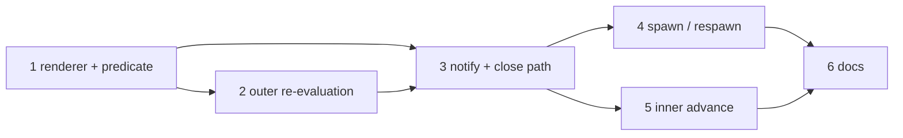

<!-- Authored per the the-loop:writing skill. -->

# Tasks: tell the work item's session what happens to its pull-request sessions

> Derived from [`design.md`](design.md) and [`testing-plan.md`](testing-plan.md). Each
> task is test-first: the named test goes red before the code that makes it green.

## Task list

- [x] 1. Notice renderer and gate predicate
  - `cli/the_loop/prnotice.py`: `TRANSITIONS`, `DECLINE_REASONS`, `_identifier()`,
    `render(...)`.
  - `waits_on_inner_loops(node)` in `cli/the_loop/graph/hooks/loops.py`.
  - Register `session.pr_notice_delivered|skipped|failed` and `graph.outer_reevaluated` in
    `eventlog.EVENT_TYPES`.
  - _Depends on:_ none
  - _Requirements:_ R1.1–R1.8 (text), R2.3, R4.1, abuse case 1
  - _Test:_ T1, T2 — `pytest tests/test_prnotice.py` (red→green)
- [x] 2. `GraphLink.on_inner_loop_finished` and `GraphLink.inner_loop_gate`
  - Re-run the outer exit chain only when parked on a node whose exit has
    `await-inner-loops`; emit `graph.outer_reevaluated`.
  - _Depends on:_ 1
  - _Requirements:_ R2.1–R2.6, R3.5, R4.2
  - _Test:_ T5 — `pytest tests/test_pr_notices_integration.py -k reevaluat` (red→green)
- [ ] 3. Dispatcher notice channel and the close path
  - `Dispatcher._notify_owner`; in the close path, read the endpoint's `tmux_target` before
    `_close_tmux`, notify `merged`/`closed`, then `on_inner_loop_finished` on a merge.
  - Update the issue-172 regression test that asserted no delivery on a linked PR's merge.
  - _Depends on:_ 1, 2
  - _Requirements:_ R1.5, R1.6, R1.9, R2.1, R2.6, R3.1–R3.4, R4.3, abuse cases 2–4
  - _Test:_ T4, T8, T9 — `pytest tests/test_pr_notices_integration.py tests/test_webhook_routing_integration.py` (red→green)
- [ ] 4. Spawn and respawn paths
  - `_endpoint_cwd` → `EndpointCheckout(cwd, reason)`; `_decline_into` prepends the notice
    to the event for the four fallbacks; `spawned` after a successful spawn;
    `respawned`/`respawn-failed` in `_respawn_tmux` when `owner` is not the endpoint.
  - _Depends on:_ 3
  - _Requirements:_ R1.1–R1.4, R1.8, R1.9
  - _Test:_ T3, T7 — `pytest tests/test_pr_notices_integration.py -k "spawn or declin or respawn"` (red→green)
- [ ] 5. Inner-advance path
  - `_after_inner_advance` at both inner-advance sites of `_dispatch_one`: `completed` +
    `on_inner_loop_finished` when the inner pointer reached `complete`, else `escalated`.
  - _Depends on:_ 3
  - _Requirements:_ R1.5, R1.7, R2.2
  - _Test:_ T6 — `pytest tests/test_pr_notices_integration.py -k "completed or escalat"` (red→green)
- [ ] 6. Capability and user-facing docs
  - `docs/capabilities/process-graph.md` (the one-way rule now has a daemon-side re-run) and
    the capability doc covering pull-request sessions; the skill's `reference/workflow.md`
    § Several repositories, if it states the old behaviour; `evidence/documentation.md`.
  - _Depends on:_ 3, 4, 5
  - _Requirements:_ all (documentation)
  - _Test:_ T10 — markdownlint

## Dependency graph (DAG)

## Checkpoints

- After each task: the task's own test command, then `make lint format-check`.
- After task 5: `make test` and `make typecheck` (the full suite; T9).
- After task 6: the `verification` node runs `testing-plan.md` V1–V5.

## Review comments
