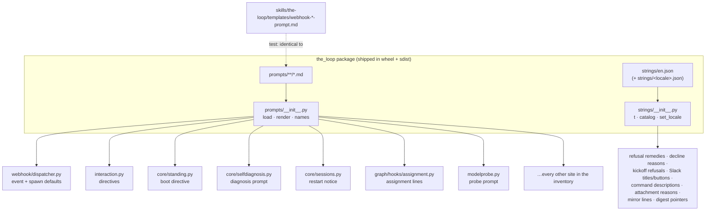

<!-- Authored per the the-loop:writing skill. -->

# Design: prompts in Markdown files, application strings in one JSON catalog

## Overview

Two small stdlib modules and two data directories inside the `the_loop` package:

| Piece | Path | Job |
|---|---|---|
| prompt loader | `cli/the_loop/prompts/__init__.py` | `load(name)` returns a prompt file's text; `render(name, **slots)` substitutes it |
| prompt files | `cli/the_loop/prompts/<area>/<name>.md` | one file per prompt or prompt fragment |
| string lookup | `cli/the_loop/strings/__init__.py` | `t(key, **vars)` returns one catalog message, formatted |
| string catalog | `cli/the_loop/strings/en.json` | the one catalog: dotted key → message |

Call sites keep their logic: which fragment, in which order, under which condition. Only
the prose moves. Rendered output stays byte-identical (requirements R1.4, R2.5), and the
existing tests that pin prompt and message text are the regression net.

## Architecture



## Components & interfaces

### `the_loop.prompts`

```python
def load(name: str) -> str
    """Text of prompts/<name>.md, cached. `name` is a slash path without `.md`,
    e.g. "webhook/event". FileNotFoundError naming the file when absent (R1.7)."""

def render(name: str, /, **slots: object) -> str
    """str.format-style substitution of {slot} for the prose prompts that used
    str.format before (standing, self-diagnosis, assignment)."""

def names() -> list[str]
    """Every shipped prompt name — for the tests."""
```

- Files are read with `importlib.resources.files("the_loop") / "prompts" / f"{name}.md"`
  and cached in a `functools.lru_cache`. `name` is checked against `^[a-z0-9_-]+(/[a-z0-9_-]+)*$`
  before use, so a name can never walk out of the directory.
- **Trailing newline.** A Markdown file ends in a newline (markdownlint `MD047`). `load`
  returns the file verbatim; each call site strips or keeps the trailing newline to match
  the literal it replaces. Where the old literal had none (`RESTART_NOTICE`,
  `PROBE_PROMPT`, the directive constants), the call site uses `load(...).rstrip("\n")`.
- **Two substitution styles, kept per call site.** The webhook templates are
  `string.Template` text (`$work_item`) — the operator's custom `promptTemplate` uses the
  same syntax, and `safe_substitute` is single-pass, so a `$x` inside a payload is never
  expanded (abuse case 1). The dispatcher keeps calling `string.Template(...).safe_substitute`
  on what `load` returns. Prompts that used `str.format` keep using it, via `render`.
  `str.format` is also single-pass: a `{x}` inside a substituted value is not re-read.
- **Composition.** Where one prompt embeds another (both interaction directives end with
  the artifact rule), the shared fragment is its own file and the Python composes it, as
  the f-string did. No include syntax is invented.
- **Markdown lint.** `prompts/**/*.md` is linted like every other Markdown file in the repo.
  A prompt whose exact bytes would trip a rule (a first line that is not a heading, a
  long line, a bare `$`) gets a file-level `<!-- markdownlint-disable -->` that the loader
  strips. Prompts are byte-for-byte contracts; the linter does not get to reflow them.
  The loader removes exactly one leading line matching
  `^<!-- markdownlint-disable[^>]*-->\n` and nothing else.

### `the_loop.strings`

```python
def t(key: str, /, **vars: object) -> str
    """Catalog text for `key` in the active locale, falling back to en, formatted
    with str.format(**vars). KeyError naming the key when absent from en (R2.4)."""

def catalog(locale: str = "en") -> Mapping[str, str]
    """The flat key → text mapping for one locale, cached."""

def set_locale(locale: str) -> None
    """Select the locale for t(). Default: THE_LOOP_LOCALE, else "en"."""
```

- **One file, flat keys.** `en.json` is a flat object of dotted keys
  (`"dispatcher.refusal.hook-refused": "…"`). Flat beats nested here: one key is one
  `grep`, a translator's tool reads it as-is, and a namespace is just a prefix
  (`dispatcher.`, `slack.`, `prnotice.`, later `ui.`).
- **Locale selection.** `THE_LOOP_LOCALE` (environment), else `en`. No config key in this
  item: adding one would touch the CLI-config schema for a locale nobody ships yet; the
  environment variable is enough to exercise the fallback.
- **Fallback (R2.3).** `t` looks in the active locale's catalog, then in `en`. A missing
  `strings/<locale>.json` or one that is not a JSON object of strings logs one warning
  and is treated as empty. `en.json` failing to load raises — it ships with the package.
- **Formatting.** `str.format(**vars)` with named fields only. Literal braces in a message
  are written `{{`/`}}`. Today's dictionaries contain no braces except the three
  `_MIRROR_LINES` templates (already `str.format`) and two f-strings in
  `channels/attachments.py` `_REASONS` whose values are module constants. Those become
  `{mib}` and `{max_files}` and the call site passes them.
- **Keys come from code.** `t` is only called with literal keys, or with a prefix plus a
  reason code that the module validates against a fixed tuple first, as the dictionaries
  do today (`reason in CONTROL_REFUSAL_REMEDIES`). Untrusted text is only ever a *value*.

### Keeping the dictionaries' public shape

Several of these dictionaries are imported elsewhere or iterated (`if reason in X`,
`X.get(code)`, tests pinning `X[...]`). They stay as module-level `Dict[str, str]`,
built from the catalog at import:

```python
CONTROL_REFUSAL_REMEDIES = strings.section("dispatcher.refusal")   # {"hook-refused": "...", ...}
```

`strings.section(prefix)` returns `{suffix: text}` for every key under `prefix.` in the
active locale with `en` fallback. Importers and tests are untouched. A module captures the
locale active at import; changing locale at runtime is out of scope.

## Inventory — what moves

### Prompts (R1) → `cli/the_loop/prompts/`

| Today | Becomes | Substitution |
|---|---|---|
| `webhook/dispatcher.py` `DEFAULT_PROMPT_TEMPLATE` | `webhook/event.md` | `string.Template` |
| `webhook/dispatcher.py` `DEFAULT_SPAWN_TEMPLATE` | `webhook/autoexecute.md` | `string.Template` |
| `interaction.py` `_ARTIFACT_RULE`, `_WORK_ITEM_DIRECTIVE`, `_CLI_DIRECTIVE` | `interaction/artifact-rule.md`, `interaction/work-item.md`, `interaction/cli.md` | composed in Python |
| `core/standing.py` `_DIRECTIVE` | `standing/directive.md` | `str.format` (`{name}`, `{surfaces}`) |
| `core/selfdiagnosis.py` `_PROMPT` | `selfdiagnosis/diagnose.md` | `str.format` |
| `core/sessions.py` `RESTART_NOTICE` | `sessions/restart-notice.md` | none |
| `modelprobe.py` `PROBE_PROMPT` | `modelprobe/probe.md` | none |
| `graph/hooks/assignment.py` `render_assignment`, `_surface` lines | `assignment/*.md` (one per line kind) | `str.format` |
| any further site the inventory sweep (task T1) finds: graph-context block, PR-session notices, CI-heal block, inbound channel wrappers | `<module>/<name>.md` | as at the site |

`skills/the-loop/templates/webhook-event-prompt.md` and `webhook-autoexecute-prompt.md`
stay where they are: the CLI config schema names them as the documented
`promptTemplate`/`spawnTemplate` defaults, and operators copy them. They become **copies
checked by a test** against `prompts/webhook/*.md` (R1.6). The "Kept in sync with…"
comments go away; the test replaces them.

The dispatcher's two `_DEFAULT_*_PROMPT` path constants still name the skill templates
for a repo-relative `promptTemplate` lookup; the fallback when that file is absent
becomes `prompts.load("webhook/event")` instead of the inline constant.
`DEFAULT_PROMPT_TEMPLATE` and `DEFAULT_SPAWN_TEMPLATE` stay as module attributes, assigned
from `prompts.load(...)`, so the tests and callers that import them are unchanged.

### Strings (R2.5) → `cli/the_loop/strings/en.json`

| Today (module · name) | Key prefix |
|---|---|
| `webhook/dispatcher.py` · `CONTROL_REFUSAL_REMEDIES` | `dispatcher.refusal.` |
| `prnotice.py` · `DECLINE_REASONS` | `prnotice.decline.` |
| `channels/slack.py` · `KICKOFF_REFUSALS` | `slack.kickoff-refusal.` |
| `channels/slack.py` · `COMMAND_DESCRIPTIONS` | `slack.command-description.` |
| `channels/slack.py` · `BUTTON_NAMES` (labels only; keys are computed action ids) | `slack.button.` |
| `channels/slack.py` · `_TITLES` | `slack.title.` |
| `channels/attachments.py` · `_REASONS` | `attachments.reason.` |
| `channels/bodies.py` · `_MIRROR_LINES` | `bodies.mirror.` |
| `channels/digest.py` · `_POINTERS` | `digest.pointer.` |

Every dictionary in this table maps a fixed code to the words a person reads on GitHub,
Slack or Jira. The others the survey found are machine vocabulary and stay in code:
`EVENT_TYPES`, `DEFAULT_KEYWORDS`, `REACTION_CONTENTS`, emoji maps and schema
retirements.

## Data models

- `prompts/**/*.md`: UTF-8 text. Optional first line `<!-- markdownlint-disable … -->`,
  stripped by the loader.
- `strings/<locale>.json`: one JSON object, `{ "<dotted.key>": "<text>" }`, string values
  only, keys matching `^[a-z0-9-]+(\.[a-z0-9_-]+)+$`.

## Error handling

| Condition | Behaviour |
|---|---|
| prompt file missing or unreadable | `FileNotFoundError` / `OSError` naming the path; the caller's existing error path handles it (a spawn fails loudly, it does not send an empty prompt) |
| prompt name fails the pattern | `ValueError` |
| `en.json` missing or invalid | exception at first lookup (the package is broken) |
| `<locale>.json` missing or invalid | one warning; fall back to `en` |
| key absent from `en` | `KeyError(key)` |
| `vars` missing a field the text uses | `KeyError` from `str.format`; the catalog test catches this before release (R2.6) |

## Security design

| Requirements boundary | Enforced by |
|---|---|
| untrusted payload vs prompt instructions | prompt text order is unchanged (byte-identical render tests); the directive still renders above the labelled payload excerpt |
| `$`/`{}` sequences in untrusted values (abuse 1) | single-pass `string.Template.safe_substitute` / `str.format`, as today; a test feeds a payload containing `$work_item` and `{name}` and asserts it comes out literal |
| keys from input (abuse 2) | `t`/`section` called with literal keys or validated codes; no call site passes request data as a key (reviewed in self-review) |
| custom template without `$interaction_directive` (abuse 3) | `apply_directive` unchanged; its existing tests keep running |
| prompt name path traversal | name pattern check before resolving under `prompts/` |
| fail closed | missing prompt or key raises; no blank prompt or message goes out |

No secret, token or personal data moves; both directories hold maintainer-authored text.

## Testing strategy

Detailed in `testing-plan.md`. In short: the existing suite pins today's text (the
regression net for byte-identical output); new unit tests cover the loader, the lookup,
fallback, placeholder parity and the skill-template sync; a guard test enforces R3.1;
packaging is checked by building the wheel and listing its contents.

### The guard (R3.1)

`cli/tests/test_prompts_guard.py` parses every module under `cli/the_loop` with `ast` and
fails when a **module-level** assignment whose target name matches
`PROMPT|DIRECTIVE|TEMPLATE|NOTICE|NUDGE` (case-insensitive) has a string-literal or
f-string value of more than one line. It reports `module:line`. This catches the shape
every inline prompt in the inventory had. It is a tripwire, not a proof: a prompt hidden
in a function-local f-string passes it. The capability doc states the rule for those
cases.

## Trade-offs & decisions

- **Scope split.** Every prompt moves now. For strings, the foundation plus the keyed
  catalogs move now, and the long tail goes to follow-up items. About 300 `print` calls
  and hundreds of inline f-strings in comment builders cannot be byte-checked in one
  reviewable diff. The keyed dictionaries already have the shape a catalog needs, so
  they prove the mechanism end to end. A follow-up issue is filed for the rest (CLI
  comment builders module by module, CLI stdout, the UI).
- **Catalog location.** `cli/the_loop/strings/en.json` ships in the wheel with no build
  step. The UI can import the same file at build time when its follow-up lands; a
  repo-root location would need a hatch `force-include` and a second copy in the wheel.
- **No i18n library** (`gettext`, `babel`). The requirement is one JSON file. `gettext`
  wants `.po`/`.mo`, and a 40-line lookup keeps the CLI's dependency list unchanged.
- **Flat dotted keys** over nested JSON. See above.
- **No include syntax in prompts.** Composition stays in Python, where it is today, so
  there is no template language to learn or secure.

## Open questions

None blocking.

## Review comments
