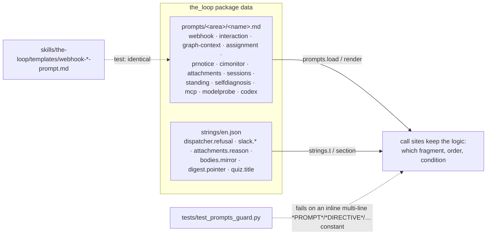

# feat(issue-540): prompts as Markdown files, application strings in one JSON catalog — reviewer briefing

## TL;DR

Every prompt and prompt fragment the CLI sends to an agent now lives in a Markdown file
under `cli/the_loop/prompts/` (101 files, one loader). The human-facing message
dictionaries now come from one JSON catalog, `cli/the_loop/strings/en.json` (42 keys, one
lookup, locale fallback). Rendered output is byte-identical to `main`, and the
remaining strings are left to follow-up [#542](https://github.com/MadaraUchiha-314/the-loop/issues/542).

No explainer page: the `explainer` row was declared away at `phase-selection`.

## Where to focus (in this order)

1. **The scope split — the one decision that is yours.** Requirements § *Out of scope*.
   The ticket says "any strings … from one json file". This PR moves **every prompt**, but
   only the **keyed message dictionaries** (10 of them) onto the catalog. The long tail
   (inline f-strings in comment builders, CLI stdout and `argparse` help, the UI) is in
   #542. That is roughly 300 `print` calls and hundreds of composed f-strings, which can't
   be byte-checked in one reviewable diff. Please confirm the split, or say what must land here.
2. **Byte-identity of the prompt renderers.** `cli/the_loop/graphlink.py`
   (`render_graph_context`), `graph/hooks/assignment.py`, `prnotice.py`,
   `webhook/cimonitor.py`. Prose moved into many small fragment files, and the
   indentation and `\n` glue stayed in code. The full suite and a 66,174-case old-vs-new
   hash comparison agree (`evidence/verification.md` V2). Spot-check one fragment file
   against its old literal.
3. **The two new modules.** `cli/the_loop/prompts/__init__.py` (name regex,
   `importlib.resources`, `inline=`) and `cli/the_loop/strings/__init__.py` (flat keys,
   `section()`, locale fallback, `en` must parse).
4. **Skim:** the 101 `.md` files, `en.json`, the guard test, and the docs.

## What changed (map)

## Key decisions & why (education)

- **Logic stays in Python, prose goes to files.** No include syntax or template language
  was invented. Conditional lines are separate fragment files, so there is nothing new to
  learn or secure. The cost is many small files (26 in `graph-context/`).
- **Two substitution styles, kept per call site.** The webhook templates stay
  `string.Template` (`$work_item`), because an operator's custom `promptTemplate` uses that
  syntax. Everything else stays `str.format`. Both are single-pass, so `$x`/`{x}` inside
  untrusted payload text is inserted literally (tested).
- **`inline=True`** drops a file's one trailing newline. Markdown files end in a newline,
  and most of the replaced literals did not.
- **Prompt files are excluded from markdownlint.** A prompt is a byte-for-byte contract,
  and a lint fix ("first line must be a heading", trailing blank line) would change what
  the agent reads.
- **Flat dotted keys in one JSON file.** One key is one `grep` and translator tools read
  it as-is. A namespace is a prefix, which leaves room for `ui.*` later. No `gettext` or
  `babel`: the ticket asks for one JSON file, and the CLI keeps its dependency list.
- **Dictionaries keep their public shape.** `CONTROL_REFUSAL_REMEDIES = strings.section("dispatcher.refusal")`,
  so importers and tests are untouched. The trade-off: a module captures the locale active
  at import (documented).
- **Locale by `THE_LOOP_LOCALE`, not a config key.** That avoids a schema change, which is
  a sensitive path, for a locale nobody ships yet. `en` must parse, and any other locale
  degrades to `en` with a warning.
- **Left inline on purpose:** MCP tool docstrings (pinned by the API/SDK parity tests),
  `hooks/the-loop-gate.py` (runs without the package), the Codex conversation marker (a
  machine token), and CLI envelopes. The first two are in #542.

## Evidence

- **Tests:** full suite **6992 passed** (CI-equivalent environment). 36 new tests cover the
  loader, catalog, fallback, sync, abuse cases and guard. The guard flags the six inline
  prompts on `origin/main`.
- **Byte-identity:** 66,174 renders hash identically, old vs new.
- **Packaging:** the wheel ships 101 `.md` files and `en.json`, and a fresh-venv import
  renders them.
- **Static:** ruff, pyright, markdownlint and config validation are clean. No new dependency.
- **Reviews:** self-review (2 rounds, 2 findings, both fixed), codex critic (no findings),
  security review (no findings).
- Records: `docs/specs/issue-540/evidence/`.
- **CI note:** the red `gate` runs were process position (spec and verification not yet
  done), not code. See the PR comments.

## Open questions for the reviewer

1. **Is the scope split acceptable** (focus item 1), with the rest tracked in #542?
2. **Catalog location:** `cli/the_loop/strings/en.json` ships in the wheel with no build
   step, and the UI would import it from there in #542. Is that fine, or do you want it at
   the repo root?
