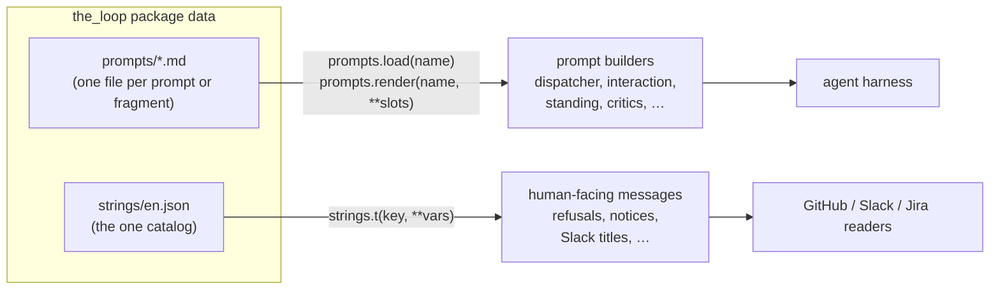

<!-- Authored per the the-loop:writing skill. -->

# Requirements: prompts in Markdown files, application strings in one JSON catalog

> Phase 1 of 4 (requirements → design → testing plan → tasks). Tier 3
> (`human-approves-pr`). `requirements-approval` and `design-approval` were skipped at
> phase-selection, so the pull-request approval is the one human gate — the scope
> decision below is surfaced there for the reviewer.

## Introduction

[Issue #540](https://github.com/MadaraUchiha-314/the-loop/issues/540) asks for two things:

- every prompt, or fragment of a prompt, that the-loop sends to an LLM lives in a
  **Markdown file**, not in a Python string literal;
- the application's strings come from **one JSON file**, so the-loop can be
  internationalised and localised.

**What is wrong today.** The CLI (`cli/the_loop`, ~100k lines) builds its prompts from
inline literals: `webhook/dispatcher.py` keeps `DEFAULT_PROMPT_TEMPLATE` and
`DEFAULT_SPAWN_TEMPLATE` as hand-synced mirrors of
`skills/the-loop/templates/webhook-*-prompt.md`, `interaction.py` holds the interaction
directives, and further prompt text is spread across the standing-session boot prompt,
self-diagnosis, critic review and the notices pasted into live sessions. A prompt edit is
a code edit, and the mirrors drift. Human-facing message text — refusal reasons, notice
phrases, Slack titles and button names — sits in per-module dictionaries, with nowhere a
translator could work.

**What this changes.**

1. **Prompts become files.** Every LLM-bound prompt and fragment the CLI composes is a
   Markdown file under the package's `prompts/` directory, read through one loader. No
   Python module keeps a copy.
2. **One string catalog.** `strings/en.json` is the single source of human-facing
   message text, read through one lookup with named placeholders and a locale fallback.
3. **A first migration slice, plus a rule that holds the line.** This work item moves
   every prompt and the CLI's keyed human-message catalogs (the dictionaries of reasons,
   titles and phrases listed in the design). Tests keep new prompts and new catalog
   entries from being written inline again. The long tail — free-form f-strings across
   the CLI, CLI stdout, and the UI — is migrated in follow-up work items (see *Out of
   scope*), because doing it in one pull request would make it unreviewable.

## Requirements

### Requirement 1 — Prompts live in Markdown files

**User story:** As a maintainer of the-loop, I want every prompt the CLI sends to an
agent to be a Markdown file, so that I can read, review and edit prompts as documents
rather than as Python string literals.

#### Acceptance criteria (EARS)

1. The system SHALL keep every prompt and prompt fragment that the CLI sends to an agent
   harness — spawn and event prompts, interaction directives, the standing-session boot
   prompt, self-diagnosis and critic prompts, and the notices and nudges pasted into a
   live session — as a `.md` file under `cli/the_loop/prompts/`.
2. WHEN the CLI composes a prompt THEN the system SHALL read its text through a single
   loader module, never from a Python string literal holding the prompt's prose.
3. WHEN a prompt has variable parts THEN the system SHALL fill them through named
   placeholders declared in the Markdown file, with the substitution semantics each call
   site has today (`string.Template` `$name` slots for the webhook templates).
4. The system SHALL produce byte-identical rendered prompts to today's for the same
   inputs, except where the design names a deliberate wording change.
5. The system SHALL ship the `prompts/` files inside the installed wheel and sdist, so
   an installed CLI renders the same prompts as a checkout.
6. WHERE a prompt is also published as a skill template
   (`skills/the-loop/templates/webhook-event-prompt.md`,
   `webhook-autoexecute-prompt.md`) THEN the system SHALL keep exactly one source of its
   text, and a test SHALL fail if the two copies differ.
7. IF a prompt file is missing or unreadable at runtime THEN the system SHALL raise an
   error naming the file, rather than sending an empty or partial prompt.

### Requirement 2 — One JSON catalog for application strings

**User story:** As a translator or operator, I want the-loop's human-facing messages in
one JSON file keyed by stable identifiers, so that I can localise the-loop without
editing code.

#### Acceptance criteria (EARS)

1. The system SHALL keep one string catalog, `cli/the_loop/strings/en.json`, mapping
   stable dotted keys to message text with named `{placeholder}` variables.
2. WHEN code needs a migrated human-facing message THEN the system SHALL obtain it
   through one lookup function, `strings.t(key, **vars)`.
3. WHERE a locale is selected and its catalog (`strings/<locale>.json`) lacks a key THEN
   the system SHALL fall back to the `en` text for that key.
4. IF a key is absent from the `en` catalog THEN the system SHALL raise an error naming
   the key — a missing string is a bug, not a blank message.
5. The system SHALL move the CLI's keyed human-message dictionaries named in the design
   (refusal remedies, kickoff refusals, Slack titles and button names,
   command descriptions, attachment reasons, mirror lines, digest pointers) into the
   catalog, rendering the same text as today.
6. A test SHALL verify that every key the code looks up exists in `en.json`, that the
   catalog is valid JSON with string values only, and that each entry's placeholders
   match the variables its call sites pass.

### Requirement 3 — The rule holds for new code

**User story:** As a reviewer, I want a failing test when someone adds a prompt or a
catalog-style message inline again, so that the migration does not erode.

#### Acceptance criteria (EARS)

1. WHEN a Python module under `cli/the_loop` defines a multi-line string literal that
   the guard recognises as prompt prose THEN the test suite SHALL fail, naming the
   module and line.
2. The system SHALL document both conventions — where prompts live and how strings are
   looked up — in the capability docs and in the contributor guidance read by agents
   working on this repository.

## Non-functional requirements

- **No new runtime dependency.** Loading uses the standard library (`importlib.resources`,
  `json`, `string.Template`); the CLI's dependency list is unchanged.
- **Cost.** Each file is read once per process and cached; a prompt render costs no more
  disk reads after the first.
- **Operator overrides unchanged.** `routing.promptTemplate` and `routing.spawnTemplate`
  keep working as today; the built-in default they fall back to becomes the packaged
  Markdown file.

## Security considerations

- **Actors & trust:** prompt and catalog files are part of the shipped package, written
  by maintainers — trusted. Untrusted actors are unchanged: webhook payloads, ticket
  bodies and comments, and Slack/Jira messages that reach the prompt slots
  (`$payload_excerpt` and friends).
- **Trust boundaries & data:** the boundary that matters is between untrusted payload
  text and prompt instructions. Today's templates label the payload excerpt as
  untrusted and render the interaction directive *above* it, with no interpolation into
  the directive. Moving text to files must keep that order and that labelling. No
  secret, token or personal data is stored in either file type.
- **Abuse cases (EARS):**
  1. WHEN an untrusted payload contains `$name` or `{name}` sequences THEN the system
     SHALL insert it literally, never expand it as a further placeholder (single-pass
     substitution, as today).
  2. WHEN an untrusted value is passed to `strings.t` THEN the system SHALL treat it as
     a value only; catalog lookup keys SHALL come from code, never from input.
  3. WHEN an operator's custom template omits `$interaction_directive` THEN the system
     SHALL still append the directive (today's `apply_directive` fail-safe holds).
- **Fail closed:** a missing prompt file or catalog key raises rather than sending a
  prompt or posting a message with its instructions missing. A locale file that is
  invalid JSON is ignored with a warning, falling back to `en`; the `en` catalog being
  invalid is an error at load.

## Out of scope

- **Free-form strings elsewhere in the CLI** — f-strings composed inline in comment
  builders, CLI `print` output, `argparse` help, log lines and exception messages. Log
  lines and exceptions stay in English by design (they are for operators debugging, and
  are grepped). The rest is a follow-up work item that migrates module by module onto
  the catalog this one creates.
- **The UI (`ui/src`).** It gets its own follow-up; the catalog's dotted-key shape lets
  it share the file (`ui.*` keys) when it does.
- **Translations.** This work item ships `en` only. The fallback path is tested with a
  fixture locale.
- **The skill and command Markdown** (`skills/`, `commands/`) — already Markdown.
- **Prompt text the design leaves inline, each with a stated reason** (`design.md` §
  *Left inline*): MCP tool docstrings (pinned by the API/SDK parity tests),
  `hooks/the-loop-gate.py` (runs without the package installed), the Codex
  conversation marker (a machine token, not prose), graph hook messages and CLI
  envelopes (CLI output), and prompts the caller supplies. The first two are in
  follow-up [#542](https://github.com/MadaraUchiha-314/the-loop/issues/542), along with
  the string long tail and the UI.

## Open questions

None blocking. The scope split above (foundation + every prompt + keyed message
catalogs now; long-tail strings and the UI later) is this item's main judgement call and
is called out in the pull request for the reviewer.

## Review comments

> Appended by the-loop's `record-feedback` hook when a human gate approves with
> comments (issue-109).
