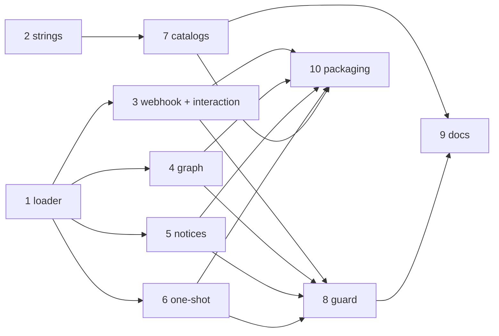

<!-- Authored per the the-loop:writing skill. -->

# Tasks: prompts in Markdown files, application strings in one JSON catalog

> Derived from [`design.md`](design.md) and [`testing-plan.md`](testing-plan.md). Each
> task is test-first. For the migration tasks, the existing tests that pin today's text
> are the red/green signal: they must stay green across the move, and a new test asserts
> the module no longer holds the prose.

## Task list

- [x] 1. `the_loop.prompts` loader
  - `load(name, inline=False)`, `render(name, **slots)`, `names()`; name pattern check;
    `lru_cache`; `importlib.resources`.
  - Add `cli/the_loop/prompts/**` to `.markdownlint-cli2.jsonc` `ignores`.
  - _Depends on:_ none
  - _Requirements:_ R1.2, R1.7, security (path traversal)
  - _Test:_ T1, T6 — `pytest tests/test_prompts.py` (red→green)
- [x] 2. `the_loop.strings` catalog and lookup
  - `t(key, **vars)`, `section(prefix)`, `catalog(locale)`, `set_locale`; `THE_LOOP_LOCALE`;
    locale-directory injection for tests; `en.json` created.
  - _Depends on:_ none
  - _Requirements:_ R2.1–R2.4
  - _Test:_ T1, T14 — `pytest tests/test_strings_catalog.py` (red→green)
- [x] 3. Webhook templates and interaction directives → prompts
  - `prompts/webhook/event.md`, `webhook/autoexecute.md`, `webhook/truncated.md`,
    `interaction/{artifact-rule,work-item,cli}.md`; dispatcher, excerpt and interaction read
    them; sync test against `skills/the-loop/templates/webhook-*-prompt.md`.
  - _Depends on:_ 1
  - _Requirements:_ R1.1, R1.3–R1.6, abuse cases 1 and 3
  - _Test:_ T2, T3, T6 — `pytest tests/test_interaction.py tests/test_prompts.py` (stay green; new sync + literal-payload tests red→green)
- [x] 4. Graph prompts → prompts (`graphlink.render_graph_context` and its lines, `assignment.render_assignment`)
  - _Depends on:_ 1
  - _Requirements:_ R1.1, R1.3, R1.4
  - _Test:_ T2 — `pytest tests/test_graph*.py tests/test_claude_*.py tests/test_handoff_pickup.py tests/test_graphlink_integration.py` (stay green)
- [x] 5. Session-bound notices → prompts (`prnotice`, `cimonitor.render_section`, `attachments` section frame, `sessions` frames + `RESTART_NOTICE`, `standing` directive/surfaces/frame)
  - _Depends on:_ 1
  - _Requirements:_ R1.1, R1.3, R1.4
  - _Test:_ T2 — `pytest tests/test_prnotice.py tests/test_pr_notices_integration.py tests/test_cimonitor.py tests/test_attachments*.py tests/test_core_sessions.py tests/test_channels_mentions*.py tests/test_standing*.py` (stay green)
- [x] 6. One-shot prompts → prompts (`selfdiagnosis` prompt + dossier lines, `mcp-call` hook prompt, `modelprobe.PROBE_PROMPT`, `codex_support` marker + AGENTS.md block, `api/mcp.py` server instructions)
  - _Depends on:_ 1
  - _Requirements:_ R1.1, R1.3, R1.4
  - _Test:_ T2 — `pytest tests/test_selfdiagnosis*.py tests/test_modelprobe.py tests/test_codex*.py tests/test_mcp*.py tests/test_graph_hooks*.py` (stay green)
- [x] 7. Keyed human-message catalogs → `en.json`
  - dispatcher `CONTROL_REFUSAL_REMEDIES`; slack `KICKOFF_REFUSALS`, `COMMAND_DESCRIPTIONS`,
    `BUTTON_NAMES` labels, `_TITLES`; attachments `_REASONS`; bodies `_MIRROR_LINES`; digest
    `_POINTERS` — each built with `strings.section(...)`.
  - _Depends on:_ 2
  - _Requirements:_ R2.5, R2.6, abuse case 2
  - _Test:_ T2, T3 — existing slack/dispatcher/attachments/bodies/digest tests stay green; `pytest tests/test_strings_catalog.py` placeholder-parity and used-keys tests red→green
- [x] 8. Guard test
  - AST scan for multi-line prompt-named module constants; planted-fixture self-test.
  - _Depends on:_ 3, 4, 5, 6
  - _Requirements:_ R3.1
  - _Test:_ T4 — `pytest tests/test_prompts_guard.py` (red on the pre-migration tree, green after)
- [x] 9. Docs
  - New capability doc `docs/capabilities/prompts-and-strings.md` (conventions, the
    left-inline list, how to add a locale); `CLAUDE.md`/`AGENTS.md` contributor note;
    `docs/capabilities` index; follow-up issue filed for the long tail.
  - _Depends on:_ 7, 8
  - _Requirements:_ R3.2
  - _Test:_ T7 — `make lint`
- [x] 10. Packaging check
  - Build the wheel and confirm the data files ship; smoke-import from the installed wheel.
  - _Depends on:_ 3–7
  - _Requirements:_ R1.5
  - _Test:_ T5

## Dependency graph (DAG)

## Checkpoints

Full suite (`make test`) after tasks 3, 5 and 7, and `make check` after task 9. Each task
lands as its own commit. The verification node then executes `testing-plan.md`.
