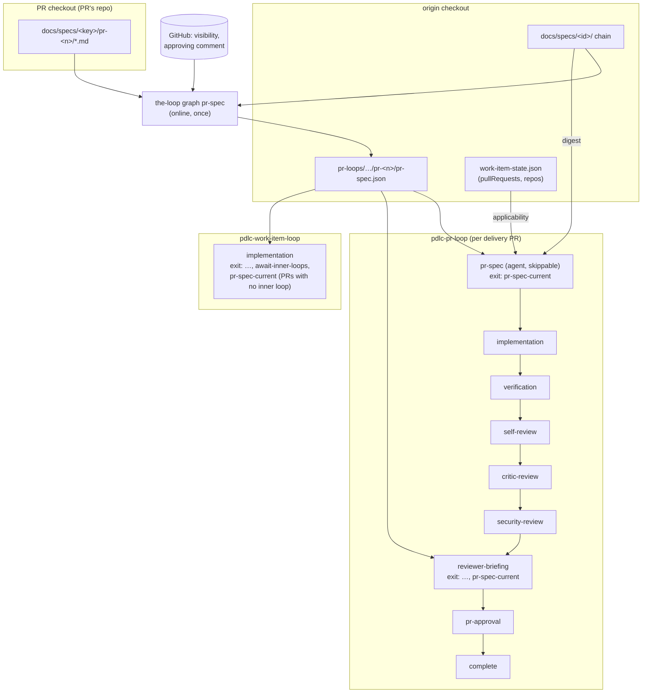

<!-- Written per the `the-loop:writing` skill. -->

# Design: give each pull request of a multi-PR work item its own scoped spec

> Phase 2 of 4. Derives from the approved [requirements](requirements.md); reviewed with
> [`testing-plan.md`](testing-plan.md) at the `design-approval` gate.

## The short version

The inner loop gains a first node, **`pr-spec`**. The session writes four scoped files
into its PR's branch and then records them with a new verb, **`the-loop graph pr-spec`**.
The verb checks the files, the citations, the path and the disclosure. It writes a small
**record** beside the inner loop's state in the origin repository. One offline hook,
**`pr-spec-current`**, gates on that record in three places:

- leaving `pr-spec`;
- leaving `reviewer-briefing`, which catches staleness before review;
- leaving the outer `implementation`, which covers PRs that walk no inner loop.

The record exists because of what the survey of the code found. Inner-loop hooks run
against the **origin** checkout, while the PR spec lives in **another** checkout. So the
check that needs the PR's files and the network runs once, at record time. The gate
afterwards reads only checked-in files, which keeps `the-loop check` offline (NFR 3).

Start at **Architecture** and **Security design**. **Technology choices** explains why
there is a record rather than a gate that reads the PR checkout.

## Interfaces

### CLI

**New: `the-loop graph pr-spec <id> --pr N [--pr-repo OWNER/REPO] --checkout PATH`.**
It verifies and records one delivery PR's PR spec. Like `graph complete`, the session
runs it from the origin checkout (`--repo` as for the other graph verbs). `--checkout` is
the PR's working tree.

| Flag | Meaning |
|---|---|
| `--checkout PATH` | The PR's working tree. Required. Its `origin` remote must be the PR's repository and its `HEAD` must be on the PR's head branch, or the verb refuses. |
| `--disclosure-approval URL` | A comment on the work item that grants the disclosure (Security design). Needed only when the PR's repository is more visible than the origin. |
| `--still-valid URL` | A comment on the PR in which an authorized user declares that a change to the work-item chain does not affect this PR (R5.2). It re-records the current chain digest without re-deriving. |
| `--json` | Machine output: the record as written, or the findings. |

The verb runs these checks, in this order, and reports every finding at once:

1. **The checkout is the PR's.** Its remote and branch match the PR.
2. **Is a PR spec required?** It reads applicability from `work-item-state.json`
   (Architecture). The answer `spec-only` comes from the checkout's
   `git diff --name-only <merge-base>..HEAD`.
3. **The chain may be derived from.** `requirements.md`/`bugfix.md`, `design.md` and
   `testing-plan.md` are each `status: approved`, or their gate is skipped by declaration
   in the outer state (R3.3).
4. **The path is safe.** See Security design, AC4.
5. **The four files are complete.** Each exists, its front matter names this work item,
   this PR and the current `chainDigest` (R2.7), and each section its template marks
   required is non-empty (R4.2).
6. **The citations resolve,** and every item that must carry one does (R3.1, R3.2).
7. **There are no secrets** (AC5).
8. **The disclosure is allowed** (AC1, AC2).

Exit status: 0 when recorded. 1 when there are findings; each one names a file, and a
line where it has one. 2 on a usage error. A PR that needs no PR spec is still recorded,
as `required: false` with its reason, so the outer gate has an answer for every PR.

**Changed: `the-loop graph complete <id> --pr N`.** No new flag. The assignment for
`pr-spec` names `graph pr-spec` first, then `graph complete`.

**Changed: `the-loop check`.** No new flag. The `pr-spec` node and the hook's other two
placements report their verdict, as every node does (R4.5). A stale record shows as a
block whose message is *stale: chain changed since `<rev>`*.

### Configuration

No change. The verb reads `routing.authorizedUsers` from the operator's CLI config, which
it already loads, to authorize the two comment URLs. No key is added, so no schema
changes.

### API and schema

`pr` and `prRepo` already reach the control-plane API's graph endpoints (issue-172 D7).
The verb is one more graph action on that same surface: `POST /api/v1/graph/pr-spec`, beside
`/graph/complete` and `/graph/skip` in the authored contract
(`docs/api-specs/openapi/the-loop.v1.yaml`), with `workItem`, `pr`, `prRepo`,
`checkout`, `disclosureApproval` and `stillValid` fields. No event type changes. The verb
emits `graph.pr_spec_recorded` / `graph.pr_spec_refused` through the existing event
log's open `graph.*` namespace.

### Persisted formats

1. **The PR spec, in the PR's repository.** Four files at
   `docs/specs/<key>/pr-<n>/{requirements,design,testing-plan,tasks}.md`. `<key>` depends
   on where the PR is:

   | PR in | `<key>` | Example |
   |---|---|---|
   | the origin repository | the work item's id | `docs/specs/issue-543/pr-546/` |
   | any other repository | `<owner>__<repo>__<id>` of the **origin** | `docs/specs/MadaraUchiha-314__the-loop__issue-543/pr-12/` |

   The `pr-<n>` level keeps two PRs of one work item in one repository from colliding
   when both merge. The origin form sits beside `pr-loops/` and never overwrites the
   chain (R4.4). The qualified form cannot collide with that repository's own
   `docs/specs/<id>/`. It merges with the PR (R4.7).

   Each file's front matter:

   ```yaml
   type: pr-requirements          # pr-design | pr-testing-plan | pr-tasks
   workItem: "github:octo/origin#15"
   pullRequest: "github:octo/api#12"
   sourceRevision: "3f9c2e1"      # origin commit of the chain it was derived from
   chainDigest: "sha256:…"        # what the gate compares
   ```

   The files carry no `status` key (R3.5).

2. **The record, in the origin repository.** `pr-spec.json` sits in the PR's inner-loop
   directory: `docs/specs/<id>/pr-loops/[<owner>__<repo>/]pr-<n>/pr-spec.json`. That is
   the directory `PullRequest.stateDir` already names, and it is created even when no
   inner loop runs (`never` mode). The record is committed with the work item, like the
   inner state beside it.

   ```json
   {"version": 1, "pullRequest": "github:octo/api#12", "required": true,
    "reason": "multi-pr", "path": "docs/specs/octo__origin__issue-15/pr-12/",
    "headSha": "a1b2…", "sourceRevision": "3f9c2e1", "chainDigest": "sha256:…",
    "citations": 23,
    "disclosure": {"origin": "private", "target": "public", "verdict": "approved",
                   "by": "@owner", "comment": "https://…"},
    "stillValid": null, "recordedAt": "…"}
   ```

   `required: false` takes one of two reasons: `single-pr` (R1.2), or `spec-only` (the
   PR's diff touches nothing outside `docs/specs/<id>/`, so it is the outer surface's
   spec PR and not a delivery of code).

3. **Templates.** These are new: `skills/the-loop/templates/pr-spec/{requirements,
   design,testing-plan,tasks}.md`. They are registered in `.the-loop/manifest.yaml`, the
   way every template is.

### Citation grammar

A PR-spec item cites the work-item item it came from inline, for example `[wi:R2.3]`.
Five forms:

| Cites | Form | Resolves when the chain has |
|---|---|---|
| a requirement | `[wi:R2]` | `### Requirement 2` |
| an acceptance criterion | `[wi:R2.3]` | item 3 of Requirement 2's EARS list |
| a design section | `[wi:design#security-design]` | a `design.md` heading with that slug |
| a testing-plan row | `[wi:TP-T2]` | a Test matrix row whose `#` is `T2` |
| a task | `[wi:task-4]` | task `4.` in `tasks.md` |

The verb parses every `[wi:…]` token. **Any** token that does not resolve is a finding
(R3.2). Some items must carry at least one citation (R3.1):

- every `###` entry in PR `requirements.md`;
- every task line in PR `tasks.md`;
- every Test matrix row in PR `testing-plan.md` that is in scope.

A design section cites as it goes and is not counted, because prose has no "item"
boundary to check.

### User-visible behaviour

- **A contributing repository's maintainer** opens the PR and finds
  `docs/specs/<key>/pr-<n>/` in the diff. The reviewer briefing links that folder first
  (R4.6). Each file opens with a **Context** section: the work item, the source revision
  and the sibling PRs with what each delivers (R2.6).
- **The session** gets the `pr-spec` assignment. Its command, `/the-loop:derive-pr-spec`,
  says which work-item items are this PR's and gives the exact two commands.
- **A stale PR spec** blocks `reviewer-briefing` with a message that names the chain
  files that changed. The block repeats on the next claim until the PR spec is
  re-derived, or `--still-valid` records a human's declaration.
- **A narrowing disclosure** blocks with the reason. The session then asks on the work
  item with `the-loop ask`, naming both visibilities, and waits for an authorized reply.

## Architecture



**Why two halves.** The verb does everything that needs the PR checkout or the network.
The hook does everything that must hold at every later evaluation. The split follows
from where code runs:

- The daemon evaluates inner-loop hooks with `ctx.repo` set to the **origin** checkout.
  The PR checkout of a cross-repository PR is somewhere else, and CI never has it.
- Validation hooks are offline by rule.

So the verb produces a checked-in fact, and the hook re-reads that fact against the
**current** chain. This is the shape `await-inner-loops` already has: a hook over files
that other actors write.

**Applicability (R1).** `pr-spec-current` reads the outer `work-item-state.json`. A work
item is **multi-PR** when either of these holds:

- `pullRequests` holds two or more rows that are not `self`;
- any row, or any declared `repos` entry, names a repository other than the origin.

Under that rule:

- **A single-PR item** passes vacuously with `outcome: not-required` (R1.2).
- **An item that becomes multi-PR later** (R1.3): the hook at `reviewer-briefing`
  re-evaluates applicability. An inner loop that passed `pr-spec` as `not-required` is
  blocked there until a record exists, which covers the first PR too. An inner loop
  already at `pr-approval` or `complete` is not reopened. The outer `implementation`
  gate still holds the work item until every open PR has a record.
- **The origin repository's PR** (R1.6) is a delivery PR like any other. It has no inner
  loop under the default `cross-repository` mode, so the outer `implementation`
  placement is what checks it. That same placement covers every PR under `never` mode
  (R1.4).

**Staleness (R5).** `chainDigest` is a SHA-256 over these files, read from the origin
checkout:

- the bytes of `requirements.md`/`bugfix.md`, `design.md`, `testing-plan.md` and
  `tasks.md`;
- with each file's front matter removed first. The approval gates rewrite the front
  matter, and a lock alone must not mark every PR stale.

The hook recomputes the digest on every evaluation, so a changed chain blocks
`reviewer-briefing`, and `pr-approval` behind it (R5.1, R5.2). Re-deriving overwrites
the files in the PR branch. The previous revision stays in the PR's git history (R5.3).
`sourceRevision` is for people: it is what the Context section links. The gate never
reads it.

**One-way rule (decision-065 D5) kept.** The verb writes only inside the PR's own
inner-loop directory. The hook only reads the outer state. No inner event writes outer
state or moves the outer pointer.

**Feedback routing (R6)** is session behaviour and needs no code. The
`/the-loop:derive-pr-spec` command and `reference/workflow.md` say it. Feedback within
scope goes into the PR spec on that PR. Feedback that would change the chain is raised
on the work item with `the-loop comment`, and the PR spec waits for the chain to change
through its gates.

## Technology choices

| Choice | Chosen | Alternatives | Why |
|---|---|---|---|
| Where the PR-spec check runs | an online verb that writes a checked-in record, plus an offline hook over it | (a) a hook that reads the PR checkout; (b) a hook that fetches the files from GitHub | (a) has no path to the checkout on the daemon side or in CI. (b) breaks the offline rule for validation hooks. The record is the pattern the inner state already uses. |
| Staleness signal | a content digest of the chain with front matter stripped | the latest commit that touched the chain (`git log`) | A digest needs no git, survives rebases and squash merges, and ignores lock-only edits. The commit is still recorded for people. |
| How a disclosure is authorized | the verb verifies a work-item comment URL: author in `routing.authorizedUsers`, body containing `allow-disclosure <owner>/<repo>` | a new control keyword in `routing.control.commands`; an inner human gate node | A control keyword means a CLI-config schema change, which raises the item to tier 4, for an act that happens rarely. An inner human gate would ask on the PR, but the requirement (abuse case 1) puts the approval on the work item. The verb already holds a GitHub client and the authorized list. |
| Is `pr-spec` skippable? | yes: `skippable: true`, with an `on: skipped` edge to `implementation`, declared with `the-loop graph skip <id> --pr N --node pr-spec` | `required: true` | R1.5 defines what a declared skip looks like. An operator with a PR that is trivially scoped can declare one, and it is audited. The shipped inner loop has had no skippable node until now, so the test that asserts that changes on purpose. |
| Templates | four new, lighter templates under `templates/pr-spec/` | reusing the chain's templates with a flag | A PR spec has a Context section and citations but no approval front matter, Review comments section or risk tier. Reusing the full templates would invite the gates to treat it as a chain. |
| Slash command | new `/the-loop:derive-pr-spec` | folding the step into `execute-tasks` | A node's instructions live in the command its `command:` names. That is the existing convention (no per-node prompt files), and it keeps the derivation rules (scope, citations, feedback routing) in one place. |

New dependencies: none. SHA-256 comes from `hashlib`, the GitHub reads from the existing
`ghapi`, and the front-matter parsing from `the_loop.graph.frontmatter`.

This is recorded as **decision-153**: the PR spec refines decision-065 D2/D4 (R7.1).

## UI/UX design

N/A. the-loop has no product UI. What people see is files and comments, described in
Interfaces.

## Security design

| Boundary / abuse case | Mechanism | Negative test |
|---|---|---|
| **AC1 private → public disclosure** | Before writing, the verb fetches both repositories (`GET /repos/{o}/{r}`, the `visibility` field). It orders `private` < `internal` < `public`. When the target is wider than the origin, it refuses unless `--disclosure-approval` names a comment that passes the authorization check below. A refusal writes no record, and with no record the hook blocks. | verb refuses private→public with no approval; refuses with an approval comment by an unauthorized author; records with an authorized one |
| **AC2 visibility unknown** | A fetch error, a missing field or an unrecognised value maps to `unknown`, which is treated as narrowing. The verb never reads silence as "same". | verb with the API failing → refused, reason `visibility-unknown` |
| **Authorizing a comment URL** (AC1 approval, R5.2 `--still-valid`) | The URL must parse to a comment on the **work item** (AC1) or on **this PR** (R5.2), not a comment anywhere else. The verb fetches the comment through the API, never from the session's text. Three checks follow: the author must be in `routing.authorizedUsers`; the comment must not carry the loop-prevention marker (the agent's own words never authorize); and for AC1 the body must contain `allow-disclosure <owner>/<repo>` naming this PR's repository. The author, URL and time go into the record. | marked comment refused; comment naming another repo refused; comment on another issue refused |
| **AC3 PR commenter asks to change the chain** | No code path writes the chain from an inner loop: the verb writes one file in the PR's inner directory, and the hook only reads. The command and the skill tell the session to raise such a request on the work item. | hook/verb never touch outer chain files (assert the file set written) |
| **AC4 path from the ref** | `<key>` and `pr-<n>` are built by the same `repo_state_key` validation that `pr-loops/` already uses: owner, repo and id are each checked against the ref grammar, and `/`, `..`, empty and leading-dot parts are refused. The verb then resolves the PR-spec path inside `--checkout` and refuses any path that escapes it, including a symlinked `docs/`. | `..` in repo, symlinked `docs/specs` escaping the checkout → refused |
| **AC5 redaction** | The verb scans the four files for a fixed set of secret shapes: GitHub token prefixes (`ghp_`, `gho_`, `ghs_`, `github_pat_`), Slack `xox[abp]-`, AWS `AKIA…`, `Authorization:`/`Bearer` values, `Cookie`/`Set-Cookie` headers, and email addresses. A hit is a finding, not an automatic rewrite. Internal hostnames have no machine-checkable shape: the command tells the session to derive from the chain alone, never from comments, and to drop hostnames. The PR's own reviewer is the final check. | a seeded `ghp_…` token in a PR-spec file → finding |
| **Forged record** | `pr-spec.json` is agent-writable, like the inner state. The hook re-validates every field on read (`pullRequest` must match the directory, and the digest must be well formed), and the digest is recomputed, never trusted. A forged `required: false` holds only while the hook's own applicability check agrees, because the hook re-derives applicability from `work-item-state.json` every time and ignores the record's claim. | hand-edited `required:false` on a multi-PR item → still blocks |

**Least privilege.** The verb needs only reads: repository metadata and one comment. It
uses the service's existing GitHub client, so no new token or scope. **Secrets.** None
are introduced, and none are written to the record. **Fail closed.** A missing,
unreadable or malformed record, an unresolved citation, a missing PR checkout, or a
checkout whose remote or branch does not match the PR all block.

## Testing strategy

The hook and the verb are tested as units against fixture trees: an origin checkout with
a chain and a work-item state, and a PR checkout with a PR spec. The GitHub client is
stubbed for visibility and comments. Graph shape is tested in `test_graph_loops.py`
(`pr-spec` is the start node, its edges, the three placements of the hook) and in
`test_graph_skips.py`, where the "no skippable inner node" test changes on purpose.
Integration scenarios, each with a Gherkin docstring:

- `Scenario: a cross-repository PR cannot start implementation without a recorded PR spec`
- `Scenario: a changed chain blocks the PR at reviewer-briefing until it is re-derived`
- `Scenario: a single-PR work item walks past pr-spec untouched`
- `Scenario: under never mode the outer implementation holds until every PR has a record`
- `Scenario: a private origin will not publish a PR spec to a public repository without an authorized grant`

The executable detail is in [`testing-plan.md`](testing-plan.md).

## Open questions

None open. The three requirement questions were settled on PR #546.

## Review comments

> Appended by the-loop's `record-feedback` hook when a human gate approves with
> comments (issue-109). Append-only and attributed.
