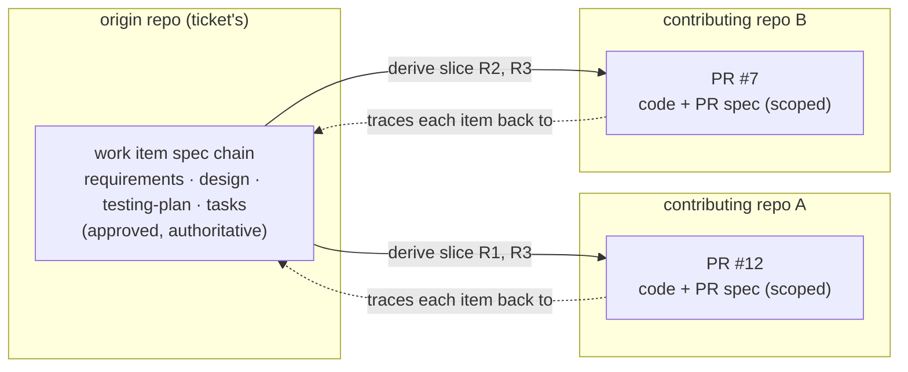

<!-- Written per the `the-loop:writing` skill. -->

# Requirements: give each pull request of a multi-PR work item its own scoped spec

> Phase 1 of 4 (requirements → design → testing plan → tasks). Tier 3
> (`human-approves-pr`): the inner loop (`pdlc-pr-loop`) gains a step and a gate, and the
> skill, templates and capability docs change with it. No credential, token scope or
> workflow file is touched.

## The short version

A pull request that delivers **part** of a work item currently carries code and nothing
that says what that part is for. The work item's one spec chain lives in the origin
repository, so the maintainer of a contributing repository has to leave their own PR,
find the work item, and work out which of its requirements their PR is meant to satisfy.

This item makes every such PR carry a **PR spec**: a `requirements.md`, `design.md`,
`testing-plan.md` and `tasks.md` scoped to that PR, **derived from** the work item's
approved chain, committed in the PR's own diff, and linked first in its reviewer
briefing. The work item's chain stays the only source of truth; a PR spec is a traced
projection of it, never a fork.

Read closely: **Requirement 3** (derived, not forked — the rule decision-065 D4 protected,
kept in a new form), **Requirement 5** (what happens when the work item's chain moves
after a PR spec was derived) and the **private-origin abuse case** in Security
considerations.

## Introduction

[Issue #543](https://github.com/MadaraUchiha-314/the-loop/issues/543): "When a work-item
spans multiple PRs across multiple repositories, each PR should have a scoped
requirements.md, design.md etc."

**What is broken.** Since issue-183 a work item that needs code in *n* repositories opens
*n* pull requests, each walking its own inner loop (`pdlc-pr-loop`). By deliberate choice
([decision-065](../../decisions/decision-065.md) D2/D4: "No per-PR spec chain") the inner
loop starts at `implementation` and resolves every artifact against the work item's one
chain in the origin repository. That choice kept the spec from forking, and it left each
PR's reviewer with no in-PR statement of scope. The ticket names the cost: a contributing
repository's maintainer cannot accept the PR without first reconstructing its scope from
somewhere else.

**What this changes.** The inner loop gains one step before `implementation`: derive this
PR's slice of the work item's chain into a PR spec, commit it in the PR, and gate on its
shape and its traceability. The PR's own review (`pr-approval`) reviews the PR spec with
the code; no new human stop is added. The decision-065 rule survives in a stronger form:
the PR spec may narrow the work item's chain, never extend or contradict it, and every
item in it names the work-item item it came from.

## Glossary

| Term | Meaning |
|---|---|
| **Work-item chain** | The work item's `requirements.md`/`bugfix.md`, `design.md`, `testing-plan.md`, `tasks.md` under the origin repository's `docs/specs/<id>/`. Authoritative. |
| **Delivery PR** | A pull request recorded against a work item (`the-loop pr create --work-item …` or `sessions link-pr`). |
| **PR spec** | The four scoped files committed in one delivery PR's diff, derived from the work-item chain. |
| **Multi-PR work item** | A work item with two or more delivery PRs, or with any delivery PR in a repository other than the origin. |
| **Source revision** | The commit, in the origin repository, of the work-item chain a PR spec was derived from. |

## Requirements

### Requirement 1 — Which pull requests carry a PR spec

**User story:** As a maintainer reviewing one pull request of a larger work item, I want
that PR to say in its own diff what it is for, so that I can review it without leaving it.

#### Acceptance criteria (EARS)

1. WHEN a delivery PR of a multi-PR work item enters its inner loop THEN the system SHALL
   require that PR to carry a PR spec before its `implementation` step can complete.
2. WHEN a work item has exactly one delivery PR AND that PR is in the origin repository
   THEN the system SHALL NOT require a PR spec, because the work-item chain is already in
   that PR's diff or on its base branch.
3. WHEN a work item becomes multi-PR after its first delivery PR was opened (a second PR,
   or a declared contributing repository) THEN the system SHALL require a PR spec of every
   delivery PR whose inner loop has not reached `complete`, including the first.
4. WHILE a work item's PR sessions are `never` (no inner loop is walked) the system SHALL
   still require each delivery PR of a multi-PR work item to carry a PR spec, checked at
   the outer `implementation` node instead of an inner one.
5. WHERE a declared skip removes the inner loop's PR-spec step, the system SHALL record it
   as *skipped by declaration* with its provenance, as every other declared skip is, and
   SHALL NOT report it as a pass.
6. WHEN the origin repository's own delivery PR belongs to a multi-PR work item THEN the
   system SHALL require a PR spec of it too, as of any other delivery PR (resolved
   question 3).

### Requirement 2 — What a PR spec contains

**User story:** As that maintainer, I want the PR spec to read like a small spec of its
own — what this PR satisfies, how it is built, how it is proved, what it does — so that I
can approve it on the same terms as a single-repository change.

#### Acceptance criteria (EARS)

1. The PR spec SHALL consist of four files with the work-item chain's names
   (`requirements.md`, `design.md`, `testing-plan.md`, `tasks.md`), each produced from a
   bundled template.
2. The PR-spec `requirements.md` SHALL list only the work-item requirements and acceptance
   criteria this PR satisfies, wholly or in part, and for a partial one SHALL state which
   part.
3. The PR-spec `design.md` SHALL describe the components this PR changes in its own
   repository and every interface it provides to, or consumes from, another delivery PR or
   repository, naming that PR or repository.
4. The PR-spec `testing-plan.md` SHALL list only the work-item testing-plan rows this PR
   proves in its own checkout, and SHALL name the outer `verification` node as where
   cross-repository rows are proved.
5. The PR-spec `tasks.md` SHALL list only the work-item tasks this PR delivers, keeping
   their identifiers.
6. Each PR-spec file SHALL carry a **context section** stating the work item (ref and
   link), the source revision, and every other delivery PR of the work item with what it
   delivers, so a reader sees where the rest of the work lives.
7. Each PR-spec file SHALL carry front matter that identifies it as a PR spec, names the
   work item, the delivery PR and the source revision, and is machine-readable by the
   gate in Requirement 4.

### Requirement 3 — Derived, not forked

**User story:** As the work item's owner, I want a PR spec to be a faithful narrowing of
the approved chain, so that scoping a PR can never quietly change what was approved.

#### Acceptance criteria (EARS)

1. Every requirement, acceptance criterion, design element, testing-plan row and task in
   a PR spec SHALL cite the work-item item it was derived from by its identifier in the
   work-item chain.
2. IF a PR spec cites an identifier that does not exist in the work-item chain at the
   source revision THEN the system SHALL block the PR-spec step and name the citation.
3. The system SHALL derive a PR spec only from a work-item chain whose `requirements.md`
   (or `bugfix.md`), `design.md` and `testing-plan.md` are approved by their gates, or
   whose gates were skipped by declaration.
4. WHEN deriving a PR spec reveals that the work-item chain is missing something this PR
   needs THEN the agent SHALL raise it on the work item (the outer loop's surface) and
   SHALL NOT add it to the PR spec alone.
5. The PR spec SHALL NOT carry `status: approved` of its own; its approval is the PR's
   `pr-approval`, and the work-item chain's approvals are unchanged by it.

### Requirement 4 — The inner loop derives, commits and gates the PR spec

**User story:** As an operator, I want the PR spec to be a step the graph enforces, so
that it exists because the process requires it, not because a session remembered.

#### Acceptance criteria (EARS)

1. The inner loop (`pdlc-pr-loop`) SHALL include a PR-spec step before `implementation`
   whose assignment tells the session which work-item items are this PR's, where to write
   the PR spec, and the claim command.
2. WHEN the PR-spec step is claimed THEN the system SHALL pass it only IF all four PR-spec
   files exist in the PR's checkout at the expected path, each has the sections its
   template marks required, each declares the work item, the PR and a source revision,
   and every citation resolves (Requirement 3.2).
3. The system SHALL commit the PR spec in the delivery PR's own branch, so it is part of
   that PR's diff and reviewed with its code.
4. The PR spec SHALL live at a path in the PR's repository derived from the work item's
   ref, such that two work items never share a path and a single-repository work item's
   `docs/specs/<id>/` is never overwritten.
5. WHEN `the-loop check` evaluates an inner loop THEN it SHALL report the PR-spec step's
   verdict the same way it reports every other node's.
6. WHEN the reviewer briefing of a delivery PR is written THEN it SHALL link the PR spec
   first, before the work-item chain.
7. WHEN a delivery PR merges THEN its PR spec SHALL merge with it and stay in that
   repository as the record of the change's scope (resolved question 1).

### Requirement 5 — A PR spec that falls behind its work item is caught

**User story:** As a maintainer, I want to know when the PR spec I approved no longer
matches the work item, so that I do not merge against a scope that has since changed.

#### Acceptance criteria (EARS)

1. WHEN the work-item chain changes after a PR spec was derived (the source revision no
   longer matches the chain's latest revision) THEN the system SHALL report that PR spec
   as stale in `the-loop check` and in the PR's next assignment.
2. WHILE a PR spec is stale the system SHALL hold that PR's inner loop before
   `pr-approval` until the PR spec is re-derived, or a human declares the change
   irrelevant to that PR on the PR (paper trail).
3. WHEN a PR spec is re-derived THEN the system SHALL update its source revision and
   SHALL keep the earlier revision recoverable from the PR's history.

### Requirement 6 — Feedback on a PR spec flows to the right artifact

**User story:** As the work item's owner, I want feedback a maintainer leaves on a PR spec
to reach the work-item chain when it is really about the work item, so that the two never
disagree silently.

#### Acceptance criteria (EARS)

1. WHEN review feedback on a delivery PR concerns only that PR's scope or design within
   the approved work-item chain THEN the agent SHALL fold it into the PR spec and the code
   on that PR.
2. WHEN review feedback on a delivery PR would change the work-item chain THEN the agent
   SHALL raise it on the work item and SHALL NOT apply it to the PR spec until the
   work-item chain has changed through its own gates.

### Requirement 7 — Documentation and decision record

**User story:** As a reader of the-loop's docs, I want them to describe the PR spec, so
that the documented process matches the one the graph runs.

#### Acceptance criteria (EARS)

1. The system SHALL record a decision that refines decision-065 D2/D4 ("No per-PR spec
   chain") with the derived-not-forked rule, and link it from decision-065.
2. The skill (`SKILL.md`, `reference/workflow.md` § Several repositories), the
   `pdlc-pr-loop.yaml` header comment and the affected capability docs
   (`process-graph.md`, `spec-workflow.md`) SHALL describe the PR spec in the same PR as
   the change.

## Non-functional requirements

- **No new human stop.** The PR spec is reviewed inside the PR's existing `pr-approval`;
  the outer loop's gates are unchanged.
- **Single-repository work items are unaffected.** A work item with one delivery PR in
  the origin repository walks exactly the steps it walks today (Requirement 1.2).
- **The gate is offline.** Like every validation hook, the PR-spec gate reads checked-in
  files only (no network, no GitHub), so `the-loop check` in CI gives the daemon's verdict.
- **Prompts and strings** follow issue-540: the PR-spec step's assignment text is a
  Markdown prompt file under `cli/the_loop/prompts/`, and any human-facing message is in
  `cli/the_loop/strings/en.json`.

## Security considerations

- **Actors & trust:** the agent (trusted to write, not to approve); the work item's
  authorized users (approve the work-item chain and the PR); a contributing repository's
  maintainers and any commenter on a delivery PR (**untrusted** with respect to the
  work-item chain — they may not be the-loop authorized users); the work item's title,
  body and comments (untrusted data, as always).
- **Trust boundaries & data:** the PR spec copies text **out of the origin repository
  into another repository**. That crossing is new. When the origin repository is private
  and a contributing repository is public, or the two have different readers, the PR spec
  would disclose the work item's requirements and design to people who could not read
  them before. The PR spec is also written to a path built from the work item's ref,
  which is external input.
- **Abuse cases (EARS):**
  1. IF the origin repository's visibility is narrower than the delivery PR's repository
     (private → public, or internal → public) THEN the system SHALL NOT commit a PR spec
     until an authorized user has approved the disclosure on the work item, and SHALL
     block the PR-spec step with that reason meanwhile.
  2. IF the visibility of either repository cannot be determined THEN the system SHALL
     treat it as the narrowing case in abuse case 1 (fail closed).
  3. WHEN a commenter on a delivery PR who is not an authorized user of the work item
     asks for a change to the work-item chain THEN the system SHALL treat it as feedback
     to raise on the work item, and SHALL NOT change the work-item chain or any gate's
     verdict on its account.
  4. IF the path derived from the work item's ref contains a path separator, `..`, or any
     character outside the ref grammar after qualification THEN the system SHALL refuse to
     write the PR spec and block the step.
  5. WHEN a PR spec is derived THEN the system SHALL carry over no content the work-item
     chain marks redacted, and SHALL apply the evidence redaction rules (tokens, cookies,
     personal data, internal hostnames) to the PR spec as to any committed evidence.
- **Fail closed:** a PR spec whose source revision, work item or citations cannot be
  resolved fails the gate; an undeterminable repository visibility blocks the write; a
  stale PR spec holds the PR before approval rather than passing silently.

## Out of scope

- **Publishing PR specs to the work item's Claude doc or artifact.** The work-item chain's
  doc keeps one tab per work-item file; a PR spec lives in its PR.
- **A separate approval gate for the PR spec**, inner or outer.
- **Re-planning the work item from a PR.** A PR can surface that the chain is wrong; only
  the outer loop changes it.
- **Contribution, ad-hoc and review loops.** They own no work-item chain to derive from.
- **Back-filling PR specs** for work items that completed before this ships.

## Resolved questions

Settled by @MadaraUchiha-314 on PR #546 at the `requirements-approval` gate; each kept
the default.

1. **Does the PR spec merge with the PR?** Yes — it merges and stays in the
   contributing repository ([thread](https://github.com/MadaraUchiha-314/the-loop/pull/546#discussion_r4632992038)).
   Recorded as AC 4.7.
2. **Four files, or one?** Four
   ([thread](https://github.com/MadaraUchiha-314/the-loop/pull/546#discussion_r4632994097)),
   as AC 2.1 states.
3. **Does the origin repository's own delivery PR carry a PR spec?** Yes
   ([thread](https://github.com/MadaraUchiha-314/the-loop/pull/546#discussion_r4632997244)).
   Recorded as AC 1.6.

## Review comments

> Appended by the-loop's `record-feedback` hook when a human gate approves with
> comments (issue-109). Append-only and attributed.

### 2026-11-19 — approved

**@MadaraUchiha-314** wrote:

LGTM. Minor comments
