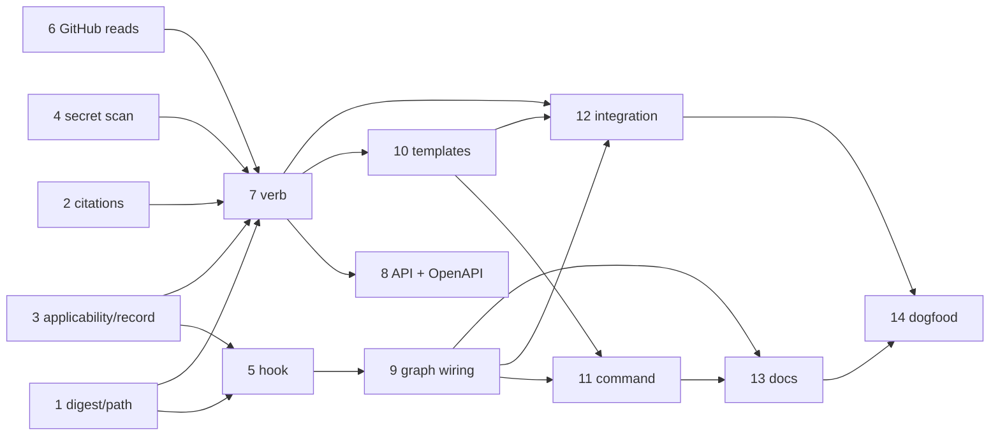

<!-- Written per the `the-loop:writing` skill. -->

# Tasks: give each pull request of a multi-PR work item its own scoped spec

> Derived from the approved [requirements](requirements.md), [design](design.md) and
> [testing plan](testing-plan.md). Each task names the requirement(s) it satisfies and
> the testing-plan row that proves it. TDD throughout: the named test is written first
> and seen red.

## The short version

Fourteen tasks in four layers. The pure functions come first: digest, citations,
applicability and path. Then the offline hook, the online verb and its API route, which
build on them. The graph wiring, templates and command depend on those. Docs come last.
All code lands in this repository, so no repository is declared beyond the origin.

## Task list

### Layer 1 — pure building blocks (`cli/the_loop/graph/prspec.py`)

- [x] 1. Chain digest and PR-spec key/path
  - `chain_digest(spec_dir)` is a SHA-256 over requirements/bugfix, design,
    testing-plan and tasks, each with its front matter stripped (via
    `the_loop.graph.frontmatter`) and taken in a fixed order. A missing file
    contributes a fixed marker, so a later `tasks.md` changes the digest.
  - `pr_spec_key(origin_ref, pr_repo, id)` gives `<id>` for the origin and
    `<owner>__<repo>__<id>` elsewhere. `pr_spec_dir(key, n)` gives
    `docs/specs/<key>/pr-<n>/`. Both reuse `repo_state_key`'s part validation: no `/`,
    no `..`, no empty part, no leading dot.
  - _Depends on:_ none
  - _Requirements:_ R2.7, R4.4, R5.1, AC4
  - _Test:_ T1 and T8 — `tests/test_pr_spec.py::test_digest_*`, `::test_key_*`,
    `::test_abuse_path_parts_refused` (red→green)
- [x] 2. Citation parser and resolver
  - Parse every `[wi:…]` token in five forms: `R2`, `R2.3`, `design#slug`, `TP-T2`
    and `task-4`. Resolve each against the chain: requirement headings, EARS list
    items, the design heading slugs, testing-plan matrix `#` cells and `tasks.md`
    numbers.
  - `missing_citations(files)` returns every required item with no citation: each
    `###` in PR requirements, each task line in PR tasks, and each in-scope matrix row
    in PR testing-plan.
  - _Depends on:_ none
  - _Requirements:_ R3.1, R3.2
  - _Test:_ T1 — `tests/test_pr_spec.py::test_citation_*` (red→green)
- [x] 3. Applicability and the record model
  - `applicability(outer_state, origin_repo)` returns `multi-pr` when there are ≥2
    non-`self` rows, or when any row or declared repo lies outside the origin.
    Otherwise it returns `single-pr`.
  - The `PrSpecRecord` dataclass (version 1) has a strict loader. It rejects a
    `pullRequest` that disagrees with its directory, a malformed digest and unknown
    reasons.
  - _Depends on:_ none
  - _Requirements:_ R1.1–R1.3, R1.6
  - _Test:_ T1 and T8 — `tests/test_pr_spec.py::test_applicability_*`,
    `::test_forged_record_*` (red→green)
- [x] 4. Secret scan
  - Use a fixed pattern list: `ghp_`, `gho_`, `ghs_`, `github_pat_`, `xox[abp]-`,
    `AKIA`, `Authorization:`/`Bearer` values, `Cookie`/`Set-Cookie`, and email
    addresses (reusing `redact._EMAIL_RE`).
  - It reports findings with file and line, and never rewrites. `redact._TOKEN_RE` is
    not reused because it would flag SHA digests.
  - _Depends on:_ none
  - _Requirements:_ AC5
  - _Test:_ T8 — `tests/test_pr_spec.py::test_abuse_seeded_token_is_finding`
    (red→green)

### Layer 2 — the hook, the verb, the API

- [x] 5. Offline hook `pr-spec-current`
  - Registered with `@hook("pr-spec-current")` in `graph/hooks/prspec.py` and imported
    in `hooks/__init__.py`.
  - Inner placement (with `prRef` in config): re-derive applicability; for
    `single-pr`, pass with outcome `not-required`; otherwise load `pr-spec.json` from
    the inner-loop dir, validate it and compare the digest. A stale record blocks with
    "stale: chain changed since `<rev>`" and names the changed files.
  - Outer placement: every non-`self` PR row needs a valid, current record.
  - It writes nothing. Its messages stay in code: `docs/capabilities/prompts-and-strings.md` exempts graph hook messages from the strings catalog.
  - _Depends on:_ 1, 3
  - _Requirements:_ R1.2–R1.4, R4.5, R5.1, R5.2, AC3, NFR offline
  - _Test:_ T1 and T8 — `tests/test_pr_spec.py::test_hook_*`,
    `::test_forged_required_false_still_blocks`, `::test_abuse_hook_writes_nothing`
    (red→green)
- [x] 6. GitHub reads for the verb
  - `graph/prspec_github.py` adds `repository_visibility(client, repo)` over the
    existing `GitHubApi.repository`, mapping errors, missing values and unknown values
    to `unknown`. Comments are found with the existing `list_comments`, so `ghapi`
    gains no new read.
  - `authorize_comment(url, kind, expected_target, pr_repo)` checks four things: that
    the URL targets the work item (disclosure) or this PR (still-valid); that the
    author is in `routing.authorizedUsers`; that the comment carries no
    loop-prevention marker; and, for disclosure, that the body contains
    `allow-disclosure <owner>/<repo>`.
  - _Depends on:_ none
  - _Requirements:_ R5.2, AC1, AC2
  - _Test:_ T8 — `tests/test_pr_spec.py::test_abuse_disclosure_*`,
    `::test_abuse_visibility_unknown`, `::test_abuse_comment_*` with a stubbed client
    (red→green)
- [ ] 7. Verb `the-loop graph pr-spec`
  - Lives in `commands/graph_cmd.py`. Flags: `--pr`, `--pr-repo`, `--checkout`,
    `--disclosure-approval`, `--still-valid`, `--json`. Exit codes: 0 recorded,
    1 findings, 2 usage.
  - Runs the eight checks in design order and reports every finding at once.
  - `spec-only` comes from `git diff --name-only <merge-base>..HEAD` in the checkout.
  - Resolving the checkout path refuses a symlink that escapes it.
  - On success it writes exactly one `pr-spec.json`, creating the inner dir if absent,
    and emits `graph.pr_spec_recorded`; a refusal emits `graph.pr_spec_refused`.
  - With `--still-valid`, it re-records the current digest without the file checks
    being re-run against a new derivation.
  - _Depends on:_ 1, 2, 3, 4, 6
  - _Requirements:_ R1.2, R2.7, R3.1–R3.3, R4.2, R4.3, R5.2, AC1–AC5
  - _Test:_ T1 and T8 — `tests/test_pr_spec.py::test_verb_*`,
    `::test_abuse_symlink_escape`, `::test_abuse_writes_only_record` (red→green)
- [ ] 8. API route and OpenAPI contract
  - Add `POST /api/v1/graph/pr-spec` to `api/routes.py` beside `/graph/skip`, calling
    the same function as the verb.
  - Add the path and request schema (six fields) to
    `docs/api-specs/openapi/the-loop.v1.yaml`.
  - _Depends on:_ 7
  - _Requirements:_ design § API and schema
  - _Test:_ T3 — `tests/test_api_contract_parity.py` (red→green)

### Layer 3 — graph, templates, command

- [ ] 9. Graph wiring
  - In `pdlc-pr-loop.yaml`, add a new start node `pr-spec`: an agent with
    `skippable: true`, `command: /the-loop:derive-pr-spec`, exit hook
    `pr-spec-current`, and edges to `implementation` (including `on: skipped`).
  - Add `pr-spec-current` to `reviewer-briefing`'s exit chain.
  - In `pdlc-work-item-loop.yaml`, add `pr-spec-current` to `implementation`'s exit
    chain after `await-inner-loops`.
  - Inner states already at `implementation` or later load unchanged.
  - Update `test_graph_skips.py`'s "no skippable inner node" tests on purpose, so that
    `pr-spec` is the one.
  - _Depends on:_ 5
  - _Requirements:_ R1.5, R4.1, R4.5, R5.1
  - _Test:_ T6 and T10 — `tests/test_graph_loops.py`, `tests/test_graph_skips.py`,
    `tests/test_graph_multirepo_integration.py` (red→green)
- [ ] 10. PR-spec templates
  - Create `skills/the-loop/templates/pr-spec/{requirements,design,testing-plan,tasks}.md`
    with PR-spec front matter (`type`, `workItem`, `pullRequest`, `sourceRevision`,
    `chainDigest`) and no `status`.
  - Each starts with a required **Context** section (work item, source revision, and
    the sibling PRs with what each delivers).
  - The required-section markers are the ones the verb's check 5 reads.
  - Register them in `.the-loop/manifest.yaml`.
  - _Depends on:_ 7 (check 5 reads their markers)
  - _Requirements:_ R2.1–R2.6, R3.5
  - _Test:_ T6 — `tests/test_manifest_schemas.py`, `tests/test_writing_parity.py`
    (red→green)
- [ ] 11. `/the-loop:derive-pr-spec` command and assignment text
  - Create `commands/derive-pr-spec.md`. It covers:
    - choosing this PR's items from the chain;
    - citing in every item;
    - deriving from the chain only, never from comments, and dropping hostnames;
    - the two commands to run;
    - asking with `the-loop ask` when disclosure narrows;
    - feedback routing (R6).
  - Any agent-facing text the CLI adds goes in `cli/the_loop/prompts/`.
  - _Depends on:_ 9, 10
  - _Requirements:_ R4.1, R6.1–R6.3, AC3
  - _Test:_ T6 — `tests/test_graph_loops.py` assignment render names both commands
    (red→green)

### Layer 4 — integration, docs, dogfood

- [ ] 12. Integration scenarios
  - Create `tests/test_pr_spec_integration.py` with the five Gherkin scenarios from
    design § Testing strategy. Each is driven through the real graph runtime and the
    CLI, against a temp PR checkout and a stubbed GitHub client.
  - _Depends on:_ 7, 9, 10
  - _Requirements:_ R1.1, R1.2, R1.4, R1.6, R4.1, R4.5, R5.1–R5.3, AC1, AC2
  - _Test:_ T2 — `cd cli && uv run python -m pytest -q tests/test_pr_spec_integration.py`
- [ ] 13. Docs and decision
  - Write `docs/decisions/decision-153-*.md`, which refines decision-065 D2/D4.
  - Update `docs/capabilities/process-graph.md` and `spec-workflow.md`.
  - Update `skills/the-loop/SKILL.md` and `reference/workflow.md`, including feedback
    routing.
  - Change `templates/pr-briefing.md` so it links the PR spec first.
  - _Depends on:_ 9, 11
  - _Requirements:_ R4.6, R6, R7.1, R7.2
  - _Test:_ T6 and T12 — `tests/test_writing_parity.py`, `make lint`
- [ ] 14. Dogfood on PR #546
  - Write the PR spec at `docs/specs/issue-543/pr-546/`, run
    `the-loop graph pr-spec issue-543 --pr 546 --checkout .`, and commit the record.
  - Show the stale report after a local, discarded chain edit.
  - _Depends on:_ 12, 13
  - _Requirements:_ R4.3, R4.6, R4.7, R5.1
  - _Test:_ T11 (run at verification), then T12 — `make check`

## Dependency graph (DAG)

## Checkpoints

- **After each task:** run its named test, commit with the red→green noted, and tick the
  box.
- **After task 9:** run the full graph suite (T10).
- **After task 14:** run `make check` (T12), then the verification node executes
  `testing-plan.md`.

## Review comments

> Appended by the-loop's `record-feedback` hook when a human gate approves with
> comments (issue-109). Append-only and attributed.
