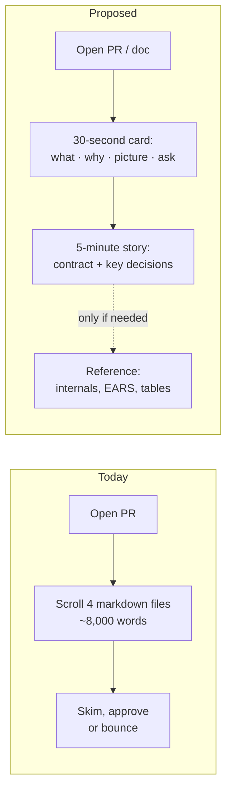

# Brainstorm: make what the-loop writes easy to read and review

## The short version

The specs and comments the-loop writes are too hard to read. They are long and dense,
they tell no story, and they mix the *what* with the *how*. People skim them instead of
reading them, which defeats the purpose of a review gate.

My leaning is to **fix how much we write before fixing how we write it**. That means:

1. Make the review surface easy to read: a short story up front, a picture, and the detail
   folded away below.
2. Split `design.md` into the **contract** (what changes for whoever uses it) and the
   **internals** (how it is built).
3. Stop pointing at tickets and specs from code comments.
4. Use rich HTML views (Claude docs, artifacts and diagrams) as a *view* of the markdown,
   not a replacement for it.
5. Try slides and flashcards later, as opt-in experiments.

I want your call on the six questions under [Open questions](#open-questions) before I
write requirements.

## Problem / opportunity

A reviewer at a gate has one job: to say yes or no. Today the-loop makes that job slow.

- **The documents are long.** Recent work items wrote 1,100–2,800 words per spec file,
  with four or five files per item (issue-529, 533, 536 and 538). A reviewer reads a book
  for each change.
- **They are written as reference, not as a story.** Our [writing
  skill](../../../skills/writing/SKILL.md) optimises for *density*: "can any sentence come
  out?" That cuts the connective tissue, the *because* and *so* that make an argument
  easy to follow. What is left is accurate but hard to take in.
- **`design.md` mixes contract and implementation.** Its template runs Overview →
  Architecture → Components → Data models → Error handling → Security → Testing. A
  reviewer who only needs to approve the *interface* has to dig it out from among the
  internals.
- **Code comments cite the process.** Of the 8,724 comment lines in `cli/`, **2,034
  (23%)** mention an `issue-N`, a `decision-N`, an `R<n>` or a critic. Examples:
  `# issue-475 (R4.4): a label the-loop would write to Jira…`. The code should explain
  itself. Its history belongs in git and the PR.

We are not alone in this. Every independent report on spec-driven tools names the same
complaint: **too much text to review**.

- Martin Fowler's team found Spec Kit's files "very verbose and tedious to review". In
  Kiro they saw one bug turn into 4 user stories with 16 acceptance criteria ([Fowler,
  SDD tools](https://martinfowler.com/articles/exploring-gen-ai/sdd-3-tools.html)).
- Marmelab needed 8 files and 1,300 lines to show the current date
  ([Marmelab](https://marmelab.com/blog/2025/11/12/spec-driven-development-waterfall-strikes-back.html)).
- INNOQ saw a simple story grow to 1,070 lines: "at some point, nobody reads it properly
  anymore" ([INNOQ](https://www.innoq.com/en/blog/2026/04/versteckte-kosten-spec-driven-development/)).

## How a reviewer meets our output today, and how they could

The idea is **layers**. Each layer is complete on its own, and the reader stops as soon
as they have enough to decide.

## What I found

### Simplified Technical English: take three rules, not the language

STE (ASD-STE100) is a controlled language built for aircraft maintenance manuals. It has
about 900 approved words, each with one meaning, a 20-word cap on procedure sentences and
a 25-word cap on description sentences, active voice only, and at most 3 words in a noun
cluster ([overview](https://en.wikipedia.org/wiki/Simplified_Technical_English)). It
shines on **procedures** for non-native readers. It has no tools for **argument**:
trade-offs, rationale and "we chose X because Y", which are exactly what `design.md` is
for. Untrained writers produce stilted, ungrammatical STE, and most organisations outside
aerospace use plain language instead.

**My take: don't switch. Borrow three of its rules.**

- Keep sentences to about 25 words.
- Put one idea in each sentence.
- Never stack more than three nouns ("work item state graph node outcome").

On top of those, adopt **plain-language** habits: write to "you", use the present tense
and short words, and don't hide verbs in nouns
([digital.gov](https://digital.gov/guides/plain-language/writing),
[Google style highlights](https://developers.google.com/style/highlights)). STE's
strictness *does* fit one place: the numbered steps in `testing-plan.md` and `tasks.md`.

### Storytelling: put the conclusion first, then tell it as a story

Two well-tested ideas fit together:

- **BLUF** (bottom line up front) for the first screen: the decision and the ask.
- **Narrative** for the reasoning, with connected sentences instead of bullet dumps. This
  is Amazon's six-pager argument: narrative "forces better thought"
  ([CNBC](https://www.cnbc.com/2018/04/23/what-jeff-bezos-learned-from-requiring-6-page-memos-at-amazon.html)).

Our writing skill already has the four-question spine ("what was broken / what we did /
what it costs / what to check"). The gap is the *voice*: we need permission to explain
and to link ideas, and the density rule as worded discourages both.

### Diagrams and archify

- We already say "3+ named parts → a mermaid diagram", but nothing checks it, and nothing
  asks for a picture at the *top* of the document.
- [archify](https://github.com/tt-a1i/archify) is an agent skill for Claude Code, Codex,
  opencode and Cursor. It turns a plan or a repository into **self-contained interactive
  HTML diagrams**: 10 types, including architecture, sequence, data flow, ERD and
  timeline. The agent writes a typed JSON description of the diagram. The skill validates
  it, lays it out, and renders HTML whose nodes link to `file:line` pinned to a commit.
  It is Apache-2.0, has about 98k stars, and was created in April 2026. Very active, very
  young.
- Our rule for third-party skills is **register, don't vendor**
  ([decision-062](../../decisions/decision-062.md)). So the fit is: recommend archify as
  an *optional* renderer for the HTML view when it is installed, and fall back to mermaid
  in the markdown. Never make it a dependency.

### Rich HTML: Claude docs and artifacts as the reading layer

We already publish the spec chain as one Claude doc, with a tab per file (issue-536), and
the explainer as an artifact (issue-488). Today those tabs are the markdown copied
across. The opportunity is to make them **better than the markdown**: a cover card,
diagrams rendered in place, collapsed reference sections, and a "where to look first"
list. The markdown stays the source of truth, because the gates, locks and diffs all read
it, and an HTML-first spec would make PR review of the spec itself very hard.

### Contract vs internals in `design.md`

Kiro, Spec Kit and OpenSpec all split *what* from *how* in some way. OpenSpec goes
furthest: each change is a delta (ADDED / MODIFIED / REMOVED requirements), so a reviewer
reads only what changed ([OpenSpec](https://github.com/Fission-AI/OpenSpec)). A two-part
`design.md` fits us:

| Part | Audience | Holds | Reviewed how |
|---|---|---|---|
| **Contract** | anyone using the change: users, callers, operators | CLI flags, config keys, API/schema, events, behaviour changes, security boundaries | read closely, approved at the gate |
| **Internals** | the engineer and the critic | modules, data flow, algorithms, error paths | skimmed by the human; checked mainly by critics and tests |

### Code comments

The industry consensus is clear and citable:

- Google: comments "explain why some code exists", and hold information "the code itself
  can't possibly contain" ([eng-practices](https://google.github.io/eng-practices/review/reviewer/looking-for.html)).
- Bug numbers and design-doc links go in the **change description**
  ([CL descriptions](https://google.github.io/eng-practices/review/developer/cl-descriptions.html)).
- *Clean Code* calls journal and attribution comments anti-patterns.
- WiredTiger's style guide bans ticket and PR numbers in comments.

Our own rule today: the writing skill says outright that it does **not** cover code
comments, and nothing else does.

One real tension: our harness config sets `testing.linkRequirements: true`, so test
docstrings link back to requirements on purpose. Tests are traceability artifacts, so I
would keep that exception and apply the new rule to production code only.

### Review experience in the industry

| Tool | Idea worth taking |
|---|---|
| CodeRabbit walkthrough | summary, file table, sequence diagram, **1–5 review-effort score** |
| Graphite stacks | small dependent PRs, reviewed in order |
| VS Code CodeTour | an ordered tour of `file:line` stops, each with a short note |
| Litt's explain-diff, codebase-to-course | plain-language explainer plus a quiz (we already have this: issue-488) |

Our PR briefing already says "where to focus first". A **guided tour** adds an ordered
list of stops, each linking to a line in the diff with one sentence on why it matters. It
is cheap, works in plain markdown, and is the "curated walkthrough" the issue asks for.

### Slides, flashcards and reels

There is no evidence yet that these help in code or design review; I found only
anecdotes. They are cheap to try with artifacts, though:

- a **slide deck** of the spec (one decision per slide);
- **flashcards** drawn from the requirements, which suit onboarding more than review.

I'd treat them as **opt-in experiments** behind the existing `explainer` setting, not
part of this item's core.

## Options

- **A — Writing rules only.** Rewrite the writing skill around plain language, a story
  and layers, add the code-comment rule, and change nothing else. *Cheap, but the files
  stay as long and the review surface stays the same.*
- **B — Rules, templates and review surface (leaning).** Option A, plus:
  - `design.md` restructured into contract and internals;
  - every spec opening with a summary card;
  - the Claude doc and artifact rendering layers instead of copying the files;
  - a guided tour in the PR briefing;
  - archify as an optional renderer.

  *Fixes both "how much" and "how". A medium-sized change across skills and templates.*
- **C — Option B plus format experiments.** Slides and flashcards as opt-in outputs.
  *Fun, but not proven. Better as follow-up items.*
- ~~**D — Adopt full STE.**~~ Rejected: it is built for procedures, stilted for
  rationale, and its 900-word dictionary fights technical vocabulary.
- ~~**E — Make HTML the source of truth.**~~ Rejected: the gates, locks and PR diffs read
  markdown, and reviewing HTML source in a PR is worse, not better.
- ~~**F — Word limits per file.**~~ The writing skill rejected hard caps for good reason.
  A soft budget on the **top layer only** (the summary card) keeps the cap where it helps
  and nowhere else.

## Open questions

1. **Scope.** Should this item cover Option B, with the experiments (C) filed as a
   follow-up? Or should B itself be split into an epic (writing rules / design template /
   code comments / review surface)?
2. **STE.** Is "borrow three rules plus plain language" enough, or do you want stricter
   controlled language somewhere specific (for example, the tasks and testing-plan steps)?
3. **Existing code comments.** Should the new rule apply going forward only, or should
   this item also sweep the ~2,000 existing comment lines that cite the process? A sweep
   is large and touches most of `cli/`. I'd file it as its own item.
4. **Test docstrings.** Do you agree they keep their `Requirement:` links as the one
   exception?
5. **archify.** Optional, recommended when installed, mermaid otherwise. Or skip it
   entirely for now?
6. **Summary-card budget.** Is a soft cap of about 120 words on each artifact's opening
   card right?

## Hand-off → requirements

If the leaning holds, `requirements.md` will cover:

- a rewritten writing skill: plain language, the three borrowed STE rules, BLUF plus
  story, and layers;
- a summary-card section in every spec template;
- `design.md` split into contract and internals;
- a code-comment rule for production code, with the test-docstring exception;
- the Claude doc and artifact as a layered reading view of the markdown;
- a guided tour in the PR briefing;
- archify as an optional diagram renderer;
- the experiments filed as follow-ups.

## Review comments

> Appended by the-loop's `record-feedback` hook when a human gate approves with
> comments (issue-109). Append-only and attributed.
