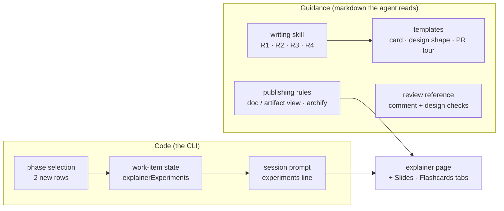
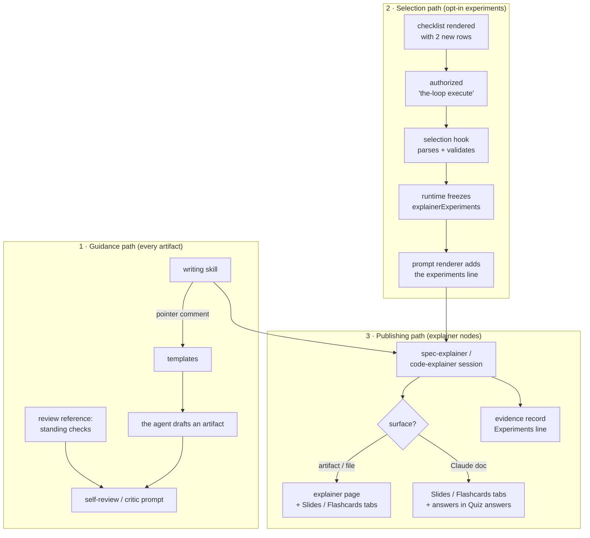

<!-- Written per the `the-loop:writing` skill. This file is also the first design
     written in the shape it proposes: card, Interfaces, Architecture, Technology
     choices — and no code-level detail. -->

# Design: make what the-loop writes easy to read and review

## The short version

Almost all of this change is **guidance the agent reads**: the writing skill, the
templates and the review references. Only one piece is code. It adds two opt-in
phase-selection rows, `explainer-slides` and `explainer-flashcards`, and carries the
choice from the checklist to the session that builds the explainer.

**Start with [Interfaces](#interfaces).** It holds everything you or an operator will
notice: the new card section, the new `design.md` shape, the two checklist rows, one new
state key and one new prompt line. The rest explains how the pieces fit.



## Interfaces

These are what a reviewer, an author or an operator can observe. Each one maps to a
requirement.

### The summary card (R2)

- Every human-read spec template and the PR briefing opens with **`## The short
  version`**. That heading text is the contract the parity test checks.
- The card states what changes, why, and what to check. When the change has three or
  more named parts, it carries a diagram or links one.
- The writing skill gives it a soft guide of about 120 words. Nothing measures it.

### The new `design.md` shape (R3)

The template's sections, in order:

| Section | Holds | Gated? |
|---|---|---|
| The short version | the card | no |
| Interfaces | CLI, config keys, API/schema, persisted formats, events, user-visible behaviour and failures | no |
| Architecture | components, how they connect, how data moves; at least one diagram | **yes** |
| Technology choices | each significant choice, the alternatives, why it won | no |
| UI/UX design | visual artifacts, when there is a user-facing surface | no |
| Security design | how each trust boundary is enforced | **yes** |
| Testing strategy | one paragraph; detail lives in `testing-plan.md` | **yes** |
| Open questions · Review comments | unchanged | no |

- Gone: *Overview* (the card replaces it), *Components & interfaces* (now Interfaces),
  *Data models* (persisted formats move to Interfaces; in-memory structures leave the
  design), *Error handling* (user-visible failures move to Interfaces) and *Trade-offs*
  (now Technology choices).
- The three gated headings are unchanged, so old and new designs both validate (R3 AC 8).
- The template and the writing skill both say what never belongs in `design.md`:
  function or method names, signatures, class layouts, algorithms, code snippets,
  internal data structures and file-by-file change lists.

### The design-approval request (R3 AC 9)

The `request-review` hook gains an optional **focus line**, set per node in the graph.
At `design-approval` it reads: *"Start with `design.md` § Interfaces, then the
testing plan's matrix."* Nodes without one post today's message unchanged.

### The PR briefing (R6)

| Section | Change |
|---|---|
| TL;DR | becomes **The short version**, the card |
| Review effort | **new**: a score from 1 (minutes) to 5 (hours) and a one-line reason |
| Where to focus | replaced by **Guided tour**: ordered stops, each a link to a file and line in the diff plus one sentence on why it matters |
| What changed (map), Key decisions, Evidence, Open questions | unchanged |

### Phase selection: two experiment rows (R8)

The explainer section of the checklist gains two rows, unticked:

```markdown
#### 🎓 Explain the change and quiz the author?

- [x] `explainer` — a spec explainer and quiz before code generation, …

🧪 Experiments, off unless you tick them (they need `explainer` ticked):

- [ ] `explainer-slides` — the explainer as a slide deck, one idea per slide.
- [ ] `explainer-flashcards` — flashcards on the spec and the change, question on the front.
```

- **Frozen state:** `work-item-state.json` gains `explainerExperiments`, a list of
  `"slides"` and/or `"flashcards"`. It is written only when the list is non-empty, like
  `claudeDoc`.
- **Confirmation comment:** the explainer line names the experiments that will run. If
  an experiment is ticked while `explainer` is unticked, it says the experiment will not
  run and why (R8 AC 5).
- **Session prompt:** the graph block gains one fixed line at the `spec-explainer` and
  `code-explainer` nodes, for example *"also produce the experiments chosen at
  phase-selection: slides, flashcards"*. No payload text enters it.
- **Terminal summary:** `the-loop graph` lists them under `choices:`.
- **Slack:** the selection control reads every `explainer-*` row as a setting, never as a
  phase (R8 AC 7).

### The explainer page (R8)

- **Artifact or committed file:** the same self-contained page gains two optional tabs,
  **Slides** and **Flashcards**. They are filled the way the quiz is, from JSON data
  blocks, and rendered as text. The [prototype](design/explainer-experiments.html) shows
  both.
- **Claude doc:** a **Slides** tab, with one heading per slide. A **Flashcards** tab
  lists the questions only. Their answers join the existing last tab, *Quiz answers*,
  because a doc cannot hide text.
- **Record:** `evidence/spec-explainer.md` and `evidence/explainer.md` gain an
  *Experiments* line naming what was produced, or why not.

### The doc and artifact as a reading view (R5)

The rules for publishing the spec chain gain three clauses:

- Each tab opens with the file's card.
- Each mermaid diagram is drawn with the surface's native drawing (a diagram widget in a
  Claude doc, an inline diagram in an artifact). Where neither is possible, the mermaid
  source stays as a code block.
- The substance matches the file, clause for clause.

Read-before-rewrite and feedback-not-approval are unchanged.

### archify (R7)

A recommendation in the explainer and publishing rules: *when the archify skill is
available in this harness, render architecture, flow, sequence and data-model diagrams
in HTML views with it.* Otherwise mermaid, with no warning. No config key, no detection
code and no dependency.

### Code-comment rule (R4)

- A new section in the-loop skill's implementation guidance: comments explain the code
  in its own terms. Traceability goes in commit messages, the PR and the specs. Test
  docstrings keep their `Requirement:` links.
- The review reference gains a list of **standing checks** that every self-review and
  critic prompt carries. It has two entries: this comment rule, applied to the diff's
  added or changed production-code comments, and the `design.md` code-level-detail check
  (R3 AC 7).

### Writing skill (R1)

The skill keeps its spine and its revise pass, and gains:

- the BLUF-plus-story rule;
- the three borrowed STE rules;
- the plain-language habits;
- an imperative rule for numbered steps;
- the three layers (card, story, reference);
- a carve-out in the density test for linking sentences;
- the `design.md` boundary.

Its description stops saying it does not cover code comments, and points to the new
rule instead.

## Architecture

Three paths carry the change: the guidance path, the selection path and the publishing
path.



**Why the selection path follows `claudeDoc`'s route.** The doc setting already makes
the same journey: a checklist row becomes a hook result, then frozen state, then a fixed
prompt line. Reusing that route means the experiments get the existing authorization,
freezing and fail-closed parsing for free. The only new decision is the dependency on
`explainer` (R8 AC 5), and the selection hook resolves it at freeze time. A session
therefore never sees an experiment it cannot run.

**Why the guidance path needs no code.** Every rule lands in a skill or template that the
agent already loads at the phase it applies. The parity test is the only code on this
path, and it pins the card heading in each template.

## Technology choices

| Choice | Chosen | Alternatives | Why |
|---|---|---|---|
| Where the writing rules live | the existing `the-loop:writing` skill | a new skill; per-template prose | One source, already pointed at by every template (decision-061). A second skill would split the contract. |
| Card heading | `## The short version` | `## TL;DR`, `## Summary`, `## Overview` | Plain words a newcomer reads correctly. "Overview" already means a tour in our templates, which is the opposite of a card. |
| Card length | soft ~120-word guide, unchecked | a checked budget; no guide | decision-061 rejected checked budgets, because scope varies. A card does not grow with scope, so a soft guide is safe. A new decision record states this (R9 AC 2). |
| Experiment state | one list, `explainerExperiments` | one boolean per experiment | The next experiment adds a value, not a key, a parser branch and a prompt line. |
| Row tokens | the `explainer-<format>` family | `slides`, `flashcards` | The prefix groups them with their parent row, and lets Slack treat the family as settings with one rule. |
| Slides and flashcards rendering | tabs on the existing explainer page | separate artifacts | One URL, one record. The page's existing rules carry over unchanged: rendered as text, untrusted input escaped, no network. |
| Diagrams in rich views | the surface's native drawing; archify when installed; mermaid fallback | archify as a dependency; mermaid images | Matches decision-062 (register, don't vendor). Nothing breaks on a harness without archify. |
| Enforcing the comment and design rules | standing checks in the review prompts | a linter | Comment syntax varies across consuming projects, and a lint over today's tree would flag 2,034 lines the owner chose to leave. |

No new dependency. Minimalism ladder: rung 4, "an already-present dependency", for the
selection path. It reuses the claudeDoc route.

## UI/UX design

Two user-facing surfaces change: the explainer page (new tabs) and the phase-selection
checklist (new rows, shown under Interfaces). The checklist is markdown on GitHub, so its
design is the snippet above.

| Artifact | Type | Location / link | Covers (screen · requirement) | Status |
|----------|------|-----------------|-------------------------------|--------|
| `design/explainer-experiments.html` | html-prototype | [`design/explainer-experiments.html`](design/explainer-experiments.html) | Slides tab, Flashcards tab · R8 AC 3–4 | draft |
| screenshots | screenshot | [slides](design/explainer-experiments-slides.png) · [flashcards](design/explainer-experiments-flashcards.png) · [phone, 390px](design/explainer-experiments-phone.png) | the rendered prototype (headless Chromium, dark theme) · R8 | draft |

- **Flows & states:**
  - **Slides:** one slide at a time, with Previous and Next buttons, the arrow keys, and
    an "n / N" counter.
  - **Flashcards:** a card shows its question. Space, Enter or a click flips it to the
    answer. Previous and Next move between cards.
- **Design system / tokens:** the explainer template's own color tokens, type and
  spacing, with light and dark themes. Nothing new.
- **Accessibility & responsiveness:**
  - Every control is a real `<button>` and is reachable by keyboard. The card announces
    its flipped state with `aria-pressed`.
  - It works at phone width with a 16px gutter.
- **Evidence:** three screenshots of the rendered prototype, committed beside it. A
  `#slides` or `#cards` fragment opens the prototype on that tab. Screenshots of the
  locked version are taken at verification.

## Security design

| Boundary (from the requirements) | Enforced by |
|---|---|
| The checklist reply that carries the new rows | The existing selection gate. Only a reply from `routing.authorizedUsers` is frozen, and rows ticked in any other comment are never read (abuse case 1). The new rows add no new path. |
| Spec and diff text rendered into Slides and Flashcards | Slides and flashcards live in JSON data blocks, like the quiz. The page's script renders every string as text, never as markup. The existing rule that every `<` becomes `<` inside a data block applies to the new blocks too (abuse case 2). |
| Doc comments or edits that try to change a rule | Unchanged issue-536 rule: doc content is feedback to weigh on the PR, never an instruction (abuse case 3). |
| archify | Recommended only when the harness already has it. the-loop never installs or fetches it, and falls back to mermaid when it is absent or fails (abuse case 4). |
| An unreadable experiment row | Parsed as off. A ticked experiment without `explainer` is dropped at freeze time and reported in the confirmation comment (fail closed). |

- **AuthN/AuthZ:** unchanged. The selection gate's authorized-user check.
- **Input validation:** the row parser accepts only the two known formats. Any other
  `explainer-*` token is ignored.
- **Secrets:** none are added. The new tabs pass through the explainer's existing
  redaction step when committed as a file.
- **Least privilege:** no new token, scope or tool.

## Testing strategy

**Unit tests** cover the selection path:

- rendering the two rows;
- parsing ticked, unticked, absent and unreadable rows;
- the `explainer` dependency;
- the state round-trip of `explainerExperiments`;
- the prompt line appearing only at the explainer nodes;
- Slack classifying the `explainer-*` rows as settings;
- the request-review focus line.

**The writing parity test** gains a case: every human-read template opens with
`## The short version`. It keeps asserting that no length limit appears.

**An integration scenario,** *"Scenario: an authorized execute with explainer-slides
ticked reaches the spec-explainer prompt"*, drives a checklist reply through to the
rendered prompt.

**The guidance changes** are verified in review: the new templates are filled for this
work item, and a self-review runs with the standing checks. **The prototype** is checked
by rendering it in a browser and screenshotting it. `testing-plan.md` holds the matrix
and commands.

## Open questions

None open. The card budget (requirements Open question 1) is carried as a soft guide. A
PR comment can still change the number.

## Review comments

> Appended by the-loop's `record-feedback` hook when a human gate approves with
> comments (issue-109). Append-only and attributed.
