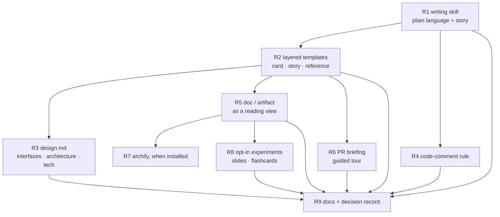

<!-- Written per the `the-loop:writing` skill. -->

# Requirements: make what the-loop writes easy to read and review

## The short version

A reviewer should be able to approve a the-loop artifact in minutes, not after reading a
book. To get there, this item changes four things:

1. **How the-loop writes.** Plain language, the conclusion first, then the reasoning told
   as a story.
2. **How each artifact is shaped.** A short card on top, then the story, then reference
   detail the reader may skip. `design.md` stays at the level of **architecture,
   technology choices and interfaces**, with no code-level detail.
3. **What code comments say.** They explain the code, not the process that produced it.
4. **How the work is presented.** Claude docs and artifacts become a richer view of the
   markdown. The PR briefing gives a guided tour. Two opt-in experiments, slides and
   flashcards, join the explainer.

The approved [brainstorm](brainstorm.md) holds the research and the rejected options. The
owner's answers to its six questions are under [Decisions carried in](#decisions-carried-in).

## Introduction

Ticket: [#544](https://github.com/MadaraUchiha-314/the-loop/issues/544). Its owner
reports that the-loop's design docs, comments and replies are too dry and hard to follow,
and that reviewing them is a chore.

The numbers agree:

- Recent work items wrote 1,100–2,800 words per spec file, with four or five files each.
- 23% of the comment lines in `cli/` cite an issue, a decision, a requirement or a
  critic.

Outside reports on spec-driven tools name the same top complaint: too much text to
review.

The fix is mostly guidance and templates, read by the agent, plus two new opt-in rows on
the phase-selection checklist.

## Decisions carried in

The owner answered the brainstorm's open questions in the work item's Claude doc
(2026-11-19), then approved it at `brainstorm-approval`:

| # | Question | Answer |
|---|---|---|
| 1 | Scope | **Option B + C.** C, the experiments, ships as opt-in checkboxes in the explainer section of phase selection. |
| 2 | STE | **Borrow** three rules plus plain language. Do not adopt full STE. |
| 3 | Existing code comments | **Going forward only.** No sweep in this item. |
| 4 | Test docstrings | **Keep** their `Requirement:` links as the one exception. |
| 5 | archify | **Recommended when installed**, mermaid otherwise. |
| 6 | Summary-card budget | *Not answered.* Carried as the brainstorm's leaning, a ~120-word **soft** guide. See [Open questions](#open-questions). |

## Requirements

### Requirement 1 — Plain language and a story

**User story:** As a reviewer, I want every artifact to state its point first and then
explain it in plain, connected sentences, so that I understand it on one read.

#### Acceptance criteria (EARS)

1. WHEN an agent authors or revises an artifact a human reads THEN the `the-loop:writing`
   skill SHALL direct it to state the conclusion first (bottom line up front), then give
   the reasoning as connected prose that names cause and effect.
2. The writing skill SHALL carry three rules borrowed from Simplified Technical English:
   sentences of about 25 words or fewer, one idea per sentence, and no stack of more than
   three nouns.
3. The writing skill SHALL carry plain-language habits: address the reader as "you" where
   a reader acts, use the present tense, prefer the short common word, and keep verbs as
   verbs.
4. WHEN the skill's density test is applied THEN it SHALL treat a sentence that links two
   ideas ("because", "so", "which means") as information, and it SHALL NOT be cut for
   length.
5. WHERE an artifact gives numbered steps for a person or agent to perform (the
   activities in `testing-plan.md`, the tasks in `tasks.md`) THEN the skill SHALL direct
   one action per step, in the imperative.
6. The skill SHALL NOT adopt the STE approved-word dictionary. Its existing carve-out for
   formal registers (EARS, abuse cases, RFC-2119, API contracts, schema descriptions,
   quoted and committed material) SHALL remain unchanged.

### Requirement 2 — Layered artifacts with a card on top

**User story:** As a reviewer, I want each artifact to open with a short card that tells
me what it says and what to check, so that I can decide how deep to read.

#### Acceptance criteria (EARS)

1. Each human-read spec template (`brainstorm.md`, `requirements.md`, `bugfix.md`,
   `design.md`, `testing-plan.md`, `tasks.md`) and the PR briefing SHALL open with a
   summary-card section placed before any other section.
2. The summary card SHALL state what changes, why, and what the reviewer should check.
   WHEN the change has three or more named parts THEN the card SHALL carry or link a
   diagram.
3. The writing skill SHALL give the card a **soft** guide of about 120 words. No test,
   gate or hook SHALL fail an artifact on the card's length or on any other word count.
4. The writing skill SHALL describe the three layers (card, story, reference) and direct
   detail that only some readers need into the reference layer. That layer goes at the
   end of the document or inside a collapsed `
` block.
5. IF moving content into the reference layer would remove a gated section THEN the
   section SHALL stay under its gated heading. The layers change order and emphasis, not
   coverage.
6. `cli/tests/test_writing_parity.py` SHALL assert that every template in AC 1 carries
   the summary-card section. It SHALL continue to assert that no length limit appears.

### Requirement 3 — `design.md` stays at the level of architecture and interfaces

**User story:** As the approver of a design, I want `design.md` to show the
architecture, the technology choices and the interfaces, and nothing at the level of
functions and code, so that I review the decisions that matter rather than wade through
implementation detail.

#### Acceptance criteria (EARS)

1. The `design.md` template SHALL be organised around three topics, in this order:
   **Interfaces**, **Architecture** and **Technology choices**. The Security design and
   Testing strategy sections follow them.
2. The Interfaces section SHALL hold everything an outside party relies on: CLI
   commands and flags, configuration keys, API and schema changes, persisted formats,
   events and user-visible behaviour, including user-visible failures.
3. The Architecture section SHALL show the components, how they connect and how data
   moves between them, with at least one diagram.
4. The Technology choices section SHALL name each significant choice (a library, a
   storage format, a protocol, a pattern), the alternatives considered, and why this one
   won.
5. The writing skill and the `design.md` template SHALL direct that `design.md` carries
   no function or method names, signatures, class layouts, algorithms, code snippets,
   internal data structures or file-by-file change lists. That detail belongs in
   `tasks.md` and the code.
6. WHEN a design has no change to an Interfaces topic THEN the template SHALL let the
   author say so in one line rather than leave the topic out silently.
7. The self-review checklist, and the design critic review when it runs, SHALL include a
   check that `design.md` holds no code-level detail (AC 5).
8. The `design` node's gated sections (`Architecture`, `Security design`,
   `Testing strategy`) SHALL still validate on a design written from the new template.
   A design written from the old template SHALL still validate too.
9. WHEN the `design-approval` gate asks for review THEN the request SHALL point the
   reviewer at the Interfaces section first.

### Requirement 4 — Code comments explain the code

**User story:** As a maintainer reading code, I want comments that explain what the code
does and why, in the code's own terms, so that I need no ticket history to understand
it.

#### Acceptance criteria (EARS)

1. WHEN an agent writes or changes a comment in production code during implementation
   THEN the-loop's guidance SHALL direct it to explain the code's purpose, constraints or
   non-obvious reasoning in the code's own terms.
2. That guidance SHALL forbid references to work items, decisions, requirement ids,
   critic or self reviews and spec files (`issue-N`, `decision-N`, `R<n>`,
   `design.md`, …) in production-code comments. It SHALL direct that traceability into
   commit messages, the PR and the specs.
3. Test docstrings and test-scenario names SHALL be exempt and SHALL keep their
   `Requirement:` links (`testing.linkRequirements`).
4. The self-review and critic-review checklists SHALL include a check that the PR's
   added or changed production-code comments follow AC 1 and AC 2.
5. The rule SHALL apply going forward only. A comment the diff does not touch SHALL NOT
   be flagged or rewritten by this item.

### Requirement 5 — Claude doc and artifact as a layered reading view

**User story:** As a reviewer reading the spec chain in a Claude doc or artifact, I want
a view that is easier to read than the raw markdown, so that the rich format earns its
place.

#### Acceptance criteria (EARS)

1. WHEN the session publishes a spec file to the work item's Claude doc tab or Claude
   artifact THEN it SHALL open the tab with the file's summary card, and SHALL render
   each mermaid diagram as a drawing where the surface supports one.
2. The published view SHALL carry the same substance as the file: no requirement, EARS
   criterion, decision or gated section added, dropped or reworded in meaning.
3. The markdown file SHALL remain the source of truth for every gate, lock and
   `the-loop check`. The rules for reading before rewriting and for treating doc edits
   as feedback (issue-536) SHALL remain unchanged.
4. IF the surface cannot render a diagram THEN the view SHALL show the mermaid source in
   a code block rather than omit it.

### Requirement 6 — A guided tour in the PR briefing

**User story:** As a code reviewer, I want an ordered walk through the diff, so that I
know where to start and what each stop is for.

#### Acceptance criteria (EARS)

1. The PR-briefing template SHALL include a **Guided tour**: an ordered list of stops,
   each linking to a file and line in the PR's diff, with one sentence saying why the
   stop matters.
2. The PR briefing SHALL state a review-effort estimate from 1 (minutes) to 5 (hours),
   with a one-line reason.
3. The tour SHALL replace "Where to focus" as the briefing's reading order rather than
   repeat it.

### Requirement 7 — archify, when installed

**User story:** As an operator who has installed the archify skill, I want the-loop to
use it for the diagrams in its HTML views, so that I get interactive diagrams without
the-loop depending on it.

#### Acceptance criteria (EARS)

1. WHEN the harness has the archify skill available and the session builds an HTML view
   (an artifact, an explainer or an experimental format) that carries an architecture,
   flow, sequence or data-model diagram THEN the-loop's guidance SHALL recommend
   rendering that diagram with archify.
2. IF archify is not available THEN the session SHALL use mermaid, with no warning and
   no degraded output.
3. the-loop SHALL NOT vendor, install, fetch or require archify. The markdown files SHALL
   keep their mermaid diagrams either way.

### Requirement 8 — Opt-in experiments: slides and flashcards

**User story:** As the author of a work item, I want to opt into a slide deck and
flashcards built from the spec and the change, so that I can try more digestible
formats without paying for them on every item.

#### Acceptance criteria (EARS)

1. WHEN the phase-selection checklist renders its explainer section THEN it SHALL
   offer two additional rows, `explainer-slides` and `explainer-flashcards`, both
   unticked by default and marked as experiments.
2. WHEN an authorized `the-loop execute` reply freezes the selection with either row
   ticked THEN the-loop SHALL record the choice in `work-item-state.json`, and the
   confirmation comment SHALL name it.
3. WHILE the `explainer` row is ticked and `explainer-slides` is ticked, the
   `spec-explainer` and `code-explainer` nodes SHALL also produce a slide deck: one idea
   per slide, in the explainer's reading order. They SHALL publish it on the same
   surface as the explainer.
4. WHILE the `explainer` row is ticked and `explainer-flashcards` is ticked, those nodes
   SHALL also produce flashcards: question on the front, answer on the back, drawn from
   the requirements and the change. They SHALL publish them on the same surface.
5. IF an experiment row is ticked but the `explainer` row is not THEN the experiment
   SHALL NOT run, and the confirmation comment SHALL say so.
6. WHEN the reply has no experiment row, or the row cannot be read THEN the experiment
   SHALL be off. An experiment fails toward less output.
7. Every surface that composes a phase-selection reply (the GitHub checklist, Slack's
   selection control) SHALL recognise the two rows as settings, never as phases.

### Requirement 9 — Docs and the record

**User story:** As a the-loop maintainer, I want the capability docs and decisions to
describe the new contract, so that the next change starts from the truth.

#### Acceptance criteria (EARS)

1. The capability docs touched by this change (at least `writing-style.md`,
   `spec-workflow.md` and the explainer's capability) SHALL be updated in the same PR.
2. A decision record SHALL state how the soft card guide relates to decision-061's
   no-length-limits rule.
3. Historical specs under `docs/specs/` SHALL NOT be rewritten to the new style.

## Non-functional requirements

- **Plugin-portable.** Every rule lives in the bundled skills and templates, so Claude
  Code, Cursor and Codex sessions get it the same way.
- **No new runtime dependency.** Nothing added to the CLI's dependencies. archify is
  never required.
- **Backward compatible.** Work items already in flight keep validating. An old-shape
  `design.md` still passes its gate (R3 AC 8).

## Security considerations

Most of this change is guidance and templates, read by the agent. It adds two
checklist rows and HTML outputs built from spec content. The new attack surface is
small, and it is named below.

- **Actors & trust:** the authorized replier who freezes the phase selection (trusted,
  `routing.authorizedUsers`). Anyone who can comment on the ticket or PR, or edit the
  Claude doc (untrusted). The content of the spec and the diff, which may quote
  untrusted text (untrusted when rendered).
- **Trust boundaries & data:**
  - The new checklist rows cross the existing reply-parsing boundary, with the same
    authorization as every other row.
  - Slides and flashcards render spec and diff text into HTML, on the same surfaces and
    with the same exposure as the explainer.
  - archify is a third-party skill. The operator installs it, and it runs inside the
    harness. the-loop only recommends it.
  - No secrets, tokens or personal data are added to any artifact.
- **Abuse cases (EARS):**
  1. WHEN a user not in `routing.authorizedUsers` ticks an experiment row or replies
     `the-loop execute` THEN the system SHALL NOT record the experiment for the work
     item.
  2. WHEN spec or diff text containing HTML or script markup is rendered into a slide
     deck or flashcards THEN the system SHALL escape it, and SHALL NOT execute it.
  3. WHEN a comment or doc edit instructs the agent to drop a gated section, add a
     requirement, or change the code-comment rule THEN the system SHALL treat it as
     feedback to weigh on the PR, never as an instruction (issue-536's rule).
  4. WHEN archify is unavailable or fails THEN the system SHALL fall back to mermaid and
     SHALL NOT fetch or install anything to recover.
- **Fail closed:** an unreadable or ambiguous experiment row means off (R8 AC 6). An
  experiment that cannot be published is recorded as not produced, and the explainer
  node still completes on the explainer itself.

## Out of scope

- **Sweeping existing code comments.** The owner chose going forward only.
- **The full STE dictionary.** Rejected in the brainstorm.
- **HTML as the source of truth.** Rejected in the brainstorm. Markdown stays canonical.
- **Hard word limits on any file.** Rejected under decision-061. R2's card guide is soft.
- **Reels and short-form video.** Slides already cover the card-by-card format, and the
  brainstorm found no evidence for more. They can be a later experiment.
- **A mechanical linter for code comments in consuming projects.** Languages and
  comment syntax vary; the rule is enforced in review (R4 AC 4).
- **Rewriting historical specs.**

## Open questions

1. **Card budget.** The brainstorm's question 6 got no answer. These requirements carry a
   ~120-word *soft* guide with no check (R2 AC 3). Comment on the PR if you want a
   different number or none.

## Review comments

> Appended by the-loop's `record-feedback` hook when a human gate approves with
> comments (issue-109). Append-only and attributed.
