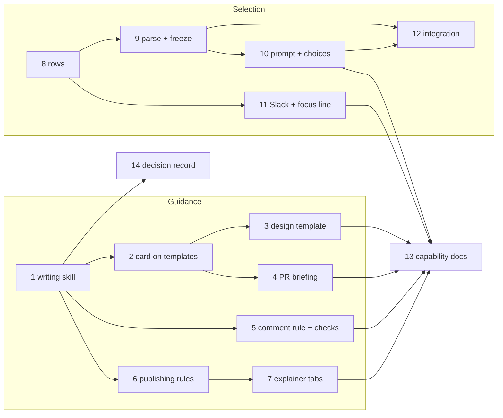

<!-- Written per the `the-loop:writing` skill. -->

# Tasks: make what the-loop writes easy to read and review

## The short version

Fourteen tasks in three tracks that meet at the end. **Guidance** (tasks 1–7) rewrites
the writing skill, the templates and the review and publishing rules. **Selection**
(tasks 8–12) is the one code track: the two experiment rows, from checklist to prompt.
**Record** (tasks 13–14) updates the capability docs and adds the decision record.

Every code task starts with a failing test. Every guidance task is proved by the parity
test (T6) or the dogfood review (T11). New production-code comments follow the new rule:
they explain the code, and cite no issue, decision or requirement.

## Task list

- [ ] 1. Writing skill: plain language, story and layers
  - Add to `skills/writing/SKILL.md`: BLUF plus story, the three borrowed STE rules,
    the plain-language habits, imperative numbered steps, the three layers (card,
    story, reference), the linking-sentence carve-out in the density test, and the
    `design.md` boundary.
  - Change its description: it no longer disclaims code comments; it points at the new
    comment rule (task 5).
  - Keep the spine, the revise pass and "no length limit". The card guide (~120 words)
    is described as soft and unchecked.
  - _Depends on:_ none
  - _Requirements:_ R1, R2 (AC on the soft guide), R3 (the boundary)
  - _Test:_ T6 — `cd cli && uv run python -m pytest -q tests/test_writing_parity.py`
    (new case: the skill names the card heading and asserts no checked limit; red→green)
- [ ] 2. A `## The short version` card on every human-read template
  - Add the card section first in `brainstorm.md`, `requirements.md`, `bugfix.md`,
    `design.md`, `testing-plan.md`, `tasks.md`, `decision.md`, `capability.md` and
    `pr-briefing.md` under `skills/the-loop/templates/` (whichever of these the parity
    test lists as human-read).
  - _Depends on:_ 1
  - _Requirements:_ R2
  - _Test:_ T6 — new parity case "every human-read template opens with
    `## The short version`" (red first, then green)
- [ ] 3. The new `design.md` template shape
  - Reorder to: The short version, Interfaces, Architecture, Technology choices, UI/UX
    design, Security design, Testing strategy, Open questions, Review comments.
  - Drop Overview, Components & interfaces, Data models, Error handling and
    Trade-offs; say where their content goes now.
  - State what never belongs in `design.md`, and the one-line "no change" per Interfaces
    topic.
  - _Depends on:_ 2
  - _Requirements:_ R3 AC 1–6
  - _Test:_ T6 (parity case on the section order) and T10 — a unit test runs the
    `design` node's section check on `docs/specs/issue-538/design.md` and on the new
    template; both pass (R3 AC 8)
- [ ] 4. PR briefing: the card, review effort and a guided tour
  - In `pr-briefing.md`: TL;DR becomes The short version, add Review effort (1–5 plus
    a reason), and replace Where to focus with Guided tour (ordered `file:line` stops,
    one sentence each).
  - Update the references that describe the briefing (`reference/workflow.md`,
    `reference/reviewing.md` and the `work-on` skill text) to the new section names.
  - _Depends on:_ 2
  - _Requirements:_ R6
  - _Test:_ T6 — parity case: the briefing template carries Review effort and Guided
    tour, and no reference still names "Where to focus"
- [ ] 5. Code-comment rule and the standing review checks
  - Add the comment rule to the-loop skill's implementation guidance (production code
    only; test docstrings keep their `Requirement:` links; going forward only).
  - Add **Standing checks** to `reference/reviewing.md`: the comment rule on added or
    changed production-code comments, and the `design.md` code-level-detail check.
    Make the self-review and critic prompts carry them.
  - _Depends on:_ 1
  - _Requirements:_ R4, R3 AC 7
  - _Test:_ T6 — parity case: the review reference lists both standing checks, and the
    critic prompt text includes them; T11 applies them to this item
- [ ] 6. Publishing rules: the doc and artifact as a reading view, and archify
  - In `reference/explainer.md` (and wherever the Claude-doc publishing rule lives):
    each tab opens with the card; diagrams use the surface's native drawing, falling
    back to the mermaid source; substance matches the file clause for clause.
  - Add the archify recommendation: use it when the harness has it, otherwise mermaid
    with no warning. Name no install step.
  - _Depends on:_ 1
  - _Requirements:_ R5, R7
  - _Test:_ T6 — parity case: the reference says "fall back to mermaid" and names no
    install step (T8 abuse case 4)
- [ ] 7. Explainer template: Slides and Flashcards tabs
  - Port the prototype's tabs into `skills/the-loop/templates/explainer.html`: optional
    JSON blocks for slides and cards, the stepper, the flip card with `aria-pressed`, a
    live counter. Tabs are hidden when their block is empty.
  - Every string is set as text. The data-block `<` rule covers the new blocks.
  - Describe the tabs, the doc layout (Slides tab, Flashcards questions, answers in
    Quiz answers) and the evidence *Experiments* line in `reference/explainer.md`.
  - _Depends on:_ 6
  - _Requirements:_ R8 AC 3–4
  - _Test:_ T5, T9 and T8 abuse case 2 — a unit check that the template's script never
    assigns markup (`innerHTML`, `outerHTML`, `insertAdjacentHTML`) and a headless
    render where a slide title holding `` shows as text
- [ ] 8. Experiment rows in the checklist
  - Render `explainer-slides` and `explainer-flashcards` unticked under the explainer
    row, with the "Experiments" lead-in.
  - _Depends on:_ none
  - _Requirements:_ R8 AC 1
  - _Test:_ T1 — `tests/test_explainer_experiments.py::test_rows_render_unticked_in_explainer_section`
    and the layout case in `tests/test_selection_layout.py` (red→green)
- [ ] 9. Parse, validate and freeze the experiments
  - Parse ticked rows into a list of known formats; ignore unknown `explainer-*`
    tokens; treat absent or unreadable rows as off.
  - Drop experiments when `explainer` is unticked, and say why in the confirmation.
  - Freeze `explainerExperiments` into `work-item-state.json` only when non-empty;
    state without the key loads unchanged.
  - Confirmation text goes in the string catalog (`cli/the_loop/strings/en.json`), not
    inline.
  - _Depends on:_ 8
  - _Requirements:_ R8 AC 2, 5, 6; NFR backward compatibility
  - _Test:_ T1 and T10 — parse, dependency, confirmation and round-trip cases in
    `tests/test_explainer_experiments.py`; T8 abuse case 1 rides on T2 (task 12)
- [ ] 10. Carry the experiments to the session and the terminal
  - Add the fixed prompt line at `spec-explainer` and `code-explainer` only, as a
    Markdown fragment beside `cli/the_loop/prompts/graph-context/claude-doc.md`; list the
    experiments under `choices:` in `the-loop graph`.
  - _Depends on:_ 9
  - _Requirements:_ R8 AC 3–4
  - _Test:_ T1 — prompt-line cases in `tests/test_graphlink.py` (present at the two
    explainer nodes, absent elsewhere and when the list is empty) and a `choices:` case
- [ ] 11. Slack and the design-approval focus line
  - Slack's selection control classifies every `explainer-*` row as a setting.
  - The `request-review` hook takes an optional per-node focus line from the graph;
    `design-approval` sets "Start with `design.md` § Interfaces, then the testing
    plan's matrix." Other gates' messages are unchanged; any new text goes in the
    string catalog or a prompt file. Keep any graph-mirroring doc in step.
  - _Depends on:_ 8
  - _Requirements:_ R8 AC 7, R3 AC 9
  - _Test:_ T1 — Slack classification and request-review focus-line cases in
    `tests/test_explainer_experiments.py`
- [ ] 12. Integration scenarios
  - Add `tests/test_explainer_experiments_integration.py` with Gherkin docstrings:
    `Scenario: an authorized execute with explainer-slides ticked reaches the spec-explainer prompt`,
    `Scenario: an experiment ticked without the explainer never reaches a prompt`,
    `Scenario: an unauthorized commenter's ticked experiment row is never frozen`.
  - _Depends on:_ 9, 10
  - _Requirements:_ R8 AC 2–3, 5; abuse case 1
  - _Test:_ T2, T8 — `cd cli && uv run python -m pytest -q tests/test_explainer_experiments_integration.py`
- [ ] 13. Capability docs
  - Update `docs/capabilities/writing-style.md`, the spec-workflow and explainer
    capability docs, and the process-graph doc for the new rows, state key, prompt line
    and focus line.
  - _Depends on:_ 1–7, 10, 11
  - _Requirements:_ R9 AC 1
  - _Test:_ T12 — `make check` (doc parity tests included)
- [ ] 14. Decision record: the soft card guide
  - Add the next `docs/decisions/decision-<n>.md`: a soft, unchecked ~120-word card
    guide alongside decision-061's rejection of checked budgets; note the
    `design.md` boundary and the comment rule. Index it.
  - _Depends on:_ 1
  - _Requirements:_ R9 AC 2
  - _Test:_ T12 — `make check`

## Dependency graph (DAG)

Tracks Guidance and Selection are independent and can run in either order.

## Checkpoints

- After tasks 1–4: T6.
- After task 7: T6 plus a headless render of the filled template.
- After each of tasks 8–12: T1 (and T2 from task 12).
- After tasks 13–14: `make check` (T12).

Each task's red→green is recorded in the commit that carries it. After task 14 the
`verification` node runs `testing-plan.md`, then the self, critic and security reviews
run with the standing checks from task 5.

## Review comments

> Appended by the-loop's `record-feedback` hook when a human gate approves with
> comments (issue-109). Append-only and attributed.
