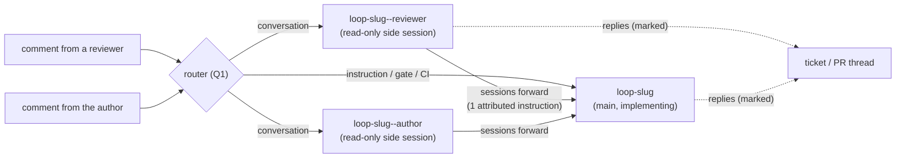

# Brainstorm: give each collaborator's back-and-forth its own context window

## The short version

Today **every** comment on a work item, whoever writes it, is pasted into the **one**
session that implements the item. A reviewer asking "why did you do X?" or an author
trying to understand the change fills the implementer's context window with talk the
implementer does not need. The talk also waits in line behind the implementer's current
turn.

I lean towards **a side session for each person, on demand** (Option C below). This is a
separate tmux and harness session that holds one person's conversation about the work
item. It can read the code, but it cannot change the code or advance the graph. When the
person asks for a *change*, the side session sends **one short, attributed instruction**
to the main session through the-loop's CLI. Sub-agents (Option B) solve less of the
problem: the main session still receives every event, still has to be idle to hand the
event on, and the harnesses do not all have sub-agents.

Before requirements, I need answers to three questions: how a comment is routed to a side
session or to the main session (Q1), who gets a side session (Q2), and whether this is
opt-in at first (Q3).

## Problem / opportunity

- Collaborators give input at every phase: brainstorming, requirements, design, review
  after implementation, and "help me understand this" questions after the code exists.
- All of that input reaches one conversation. `cli/the_loop/prompts/webhook/event.md` is
  the template for every routed event, and it pastes the payload excerpt (the comment
  body) into the work item's session. No route goes anywhere else
  ([interactive-sessions](../../capabilities/interactive-sessions.md): one tmux session
  per work item, and a linked PR's events go to the issue's session, decision-036).
- This causes two problems:
  1. **Pollution.** The window holds Q&A and explanations that do not change what gets
     built. Compaction then has to throw away either that talk or the work around it. The
     context protocol ([`reference/context.md`](../../../skills/the-loop/reference/context.md))
     tries to keep the window to "the locked spec plus the current task", and this talk
     works against that.
  2. **Head-of-line blocking.** Delivery is FIFO into one pane. A reviewer's question
     waits until the implementer finishes its turn, which can take many minutes during
     implementation. The answer is slow, and the question interrupts the work.
- This applies to the **author or driver** as well as to other collaborators: "explain
  this diff to me" is the same kind of talk.

The outcome we want: **the main thread receives only the instructions people want acted
on, with who asked and why. Everything else happens somewhere else.**

## Context & constraints

What exists today and what this idea can reuse:

| Existing piece | What it gives us |
|---|---|
| One work item, one session (`loop-<slug>`), `sessions register` | The main session and its registry record |
| Per-PR sessions (`sessionPerPr`, `pdlc-pr-loop`) | Precedent: a **second session** on one work item. The outer loop learns about it only through **state files** (`await-inner-loops`), never through its events |
| Standing sessions (`standing say`, issue-277) | Precedent: a named, long-lived session that you **message through the CLI**. This gives a ready shape for "say this to that session" |
| `the-loop review` loop (issue-279) | Precedent: a session that **reads a change, answers questions and changes no code by contract** |
| `the-loop do` / `contribute` | Other arming modes. Each is still one work item and one session |
| `context.added` → `context.md` | Precedent: an attributed, append-only way to give a session new input |
| `spec-explainer` / `code-explainer` + quizzes | The written answer to "help me understand". A side session would be its conversational partner |
| Gates (approval, feedback) run by the daemon's hooks | An approval does **not** need the agent's context, so a side session must never swallow one |

Constraints that do not change:

- **Paper trail.** Every question and decision stays on the ticket or PR, so a side
  session's replies are posted comments, marked with the loop-prevention marker.
- **Trust.** Comment bodies are untrusted. A side session that reads them and then
  messages the main session could **launder** an injected instruction. The forwarded
  instruction must carry its source (the authorized author and a link to the comment),
  and the main session must treat it like any routed event: as data with an authorized
  source.
- **Harness-portable.** The design must work on `claude` and `codex` sessions (the two
  harnesses that can host a session today). Cursor is a critic only.
- **No new runner.** tmux is the only runner (issue-156).

## Ideas & options

- **Option A: do nothing new and lean on compaction.** Keep one session and let the
  agent summarise and compact. *Struck:* this does not fix head-of-line blocking, and the
  talk still reaches the window first. Compaction is the safety net, not the design.

- **Option B: sub-agents inside the main session.** The main session hands each
  collaborator's message to a persistent, named sub-agent (in Claude Code, the Agent tool
  plus `SendMessage` to continue it), and only the sub-agent's summary returns.
  - Pros: no daemon change. It is quick to try as guidance in the skill.
  - Cons:
    - The **event is still pasted into the main pane**, so the comment body enters the
      main window anyway. Only the follow-up reasoning is isolated.
    - The main session must be **idle** to receive the event and hand it on, so the
      blocking remains.
    - A sub-agent cannot wait across events. Each reply comes back through the main
      session.
    - Sub-agent support and semantics differ by harness. Codex's support needs to be
      checked (Q5).
    - A sub-agent ends with its parent session. A respawn with `--resume` may not bring it
      back.
  - Verdict: useful as a **fallback** for a session that already has the event, but it is
    not the answer to "isolate the main thread".

- **Option C (leaning): a side session for each person, on demand.** The daemon routes a
  "conversation" comment to a sibling session, `loop-<slug>--<person>`, instead of the
  main session.
  - The side session:
    - starts with the work item's spec chain, the diff and the person's thread as context;
    - can **read** the work-item checkout (a read-only view, or its own worktree at the
      branch head);
    - has **no write path**: no push, no `graph` verbs and no gate answers;
    - replies on the ticket or PR in its own marked comments;
    - when the person asks for a change, runs a new verb (working name
      `the-loop sessions forward --work-item … --from <person> --comment <url>`). The
      verb delivers **one distilled instruction** into the main session through the
      normal FIFO, attributed and linked.
  - Pros:
    - Real isolation: the main pane never sees the chat.
    - No blocking: the side session answers while the implementer works.
    - It reuses existing parts: the PR-session spawn path, the standing-session messaging
      shape and the review loop's no-code contract.
    - It does not depend on harness features.
  - Cons:
    - A new routing decision (Q1). This is the hard part.
    - More sessions per item to watch and close.
    - Cost: each side session is a full harness session, though an idle one costs no
      tokens.
    - The side session can describe stale state while the main session is mid-edit.
  - Lifecycle: spawn on the first routed comment. Close after a period of inactivity or
    when the work item closes, like every session today. Resume with `--resume` on the
    next comment.

- **Option D: one shared "discussion" session for each work item.** This is Option C with
  one side session for everybody. It is simpler (one extra session), but people's threads
  mix again, so it only moves the pollution. It is worth keeping as the **first slice** if
  Q2 comes back "start small".

- **Option E: a side session for each thread, not each person.** Map a PR review thread
  (GitHub threads them) to its own side session. This fits PR review well, but issue
  comments have no threads, and one person's reasoning would be spread over many
  sessions. Possibly as a *routing key inside C* rather than a rival to C.

## Sketches & notes

Candidate routing rules for Q1, from most explicit to most automatic:

1. **Explicit keyword.** A comment that starts `the-loop discuss …` (or a reply in a
   thread that one started) goes to the side session. Everything else goes to the main
   session, as today. This is predictable and safe, but people must remember it.
2. **By phase.** During `implementation` and `verification`, any authorized comment that
   is not a gate answer goes to the person's side session. In other phases it goes to the
   main session, because the main session is *drafting* the artifact that the comment is
   about. This is automatic and mostly right, but it guesses.
3. **Classifier.** The daemon classifies each comment as an instruction or a
   conversation (as `classify-adhoc-reply` does for "done"). This is the most automatic
   option, but a mistake in either direction is costly, and an LLM in the router is a new
   cost.

Rule 1 can be the floor that the others build on. Rule 2 is a strong default for the
implementation-time pain that started this issue.

### Routing across transports (Slack, the gateway, future ones)

The author asked this on [PR #548](https://github.com/MadaraUchiha-314/the-loop/pull/548#issuecomment-7091825285).
Routing is already two steps, and Option C changes only the second:

1. **Which work item?** This belongs to the gateway or the local ingress, and it does
   not change. A GitHub comment resolves through its issue or linked PR. A Slack message
   resolves through the thread or room **binding** of its work item (one thread per work
   item, issue-312, or a declared room). The gateway stores the event on that subject. It
   judges no person and sees no session (decision-145).
2. **Which session inside the work item?** This step is new. It runs on the instance,
   after the authorized-actor guard. The key is **(work item, person)**, and the person
   comes from `routing.authorizedUsers`, which maps one person to their `github` and
   `slack` ids ("identity in one place", [channels](../../capabilities/channels.md)). So a
   person's GitHub comment and their Slack reply reach the **same** side session.

All three Q1 rules run on the instance, so they work the same on every transport: the
control grammar, the work item's phase and a classifier all live there.

The gaps are on the **way back**, and they are mostly Slack's:

- **Where a side session replies.** Slack has one thread per work item and no nested
  threads. If side sessions reply in that thread, the reader sees the conversations mixed
  again, even though the agents stay isolated. There are two choices:
  - Reply in the shared thread with an @mention. This is cheap, but readers see the mix.
  - Open one thread per (work item, person). The binding then grows a person
    dimension: `thread → (work item, person)`. This adds to the binding record, and the
    gateway still routes on the work item alone.

  Lean: the shared thread with @mentions for v1 (Q7).
- **Reply where the question was asked.** A side session asked on Slack answers on
  Slack. The event's origin says which transport it came from, so the side session's
  reply needs a `--reply-to <origin>` and not "always the ticket".
- **An unmapped person** (a Slack member with no `slack` id in `authorizedUsers`) is
  dropped today, before routing, so nothing new leaks. Anything the router cannot place
  goes to the **main** session, as it does today.

**The contract for any future transport:** it resolves the work item and passes an
authenticated actor id that maps to a person in `authorizedUsers`. A transport that
cannot name the person gets no side session, and its events go to the main session.

## Open questions

These go to the author on the brainstorm PR. Q1–Q3 need a human. Q4–Q6 are things I
will check before requirements.

1. **Q1: routing.** Which rule decides that a comment goes to a side session and not the
   main session: an explicit keyword, by phase, a classifier, or a combination?
2. **Q2: granularity.** One side session per person (Option C), or one shared discussion
   session per work item as a first slice (Option D)? Does the **author** get a side
   session too, or does the author's "help me understand" go to the main session because
   the author *owns* it?
3. **Q3: rollout.** Opt-in through a `phase-selection` setting (like `pr-sessions-*`), on
   for everyone, or off by default?
4. **Q4: read access.** Should the side session read the main worktree as it is right now
   (live, possibly mid-edit) or its own checkout at the last pushed commit (stable, but
   possibly behind)?
5. **Q5: harness support.** Check what sub-agents Codex and Cursor offer today, to keep
   Option B honestly scoped as a fallback (not a blocker for C).
6. **Q6: side session in the outer loop.** During requirements and design, should
   artifact feedback still go straight to the main session, which is the one drafting the
   file? My leaning is yes: artifact iteration lives on the PR, and the drafting session
   needs it.
7. **Q7: Slack reply placement.** Should side sessions reply in the work item's one
   Slack thread with an @mention (v1 lean), or should each person get their own Slack
   thread, with a binding keyed by (work item, person)? See *Routing across transports*.

## Leaning / working hypothesis

The author also leans towards Option C
([PR #548](https://github.com/MadaraUchiha-314/the-loop/pull/548#issuecomment-7091825285)).
Q1–Q3 are still open.

Option C, with the routing floor from rule 1 (an explicit keyword) and rule 2 (by phase)
as the default during implementation and verification. The side session has no write
path and reaches the main session through one attributed CLI verb. It is opt-in at
`phase-selection` for the first release. Option B (sub-agents) is written into the skill
only as advice for talk that has already reached the main session.

## Hand-off → requirements

To be filled in when the open questions are answered. It will likely carry forward:

- User stories for the reviewer ("ask about the change without waiting for or derailing
  the implementer"), the author ("understand my own change in a separate thread"), and
  the implementer ("receive only attributed instructions").
- EARS criteria for: routing (Q1), spawning, reusing and closing side sessions, the
  side session's read-only contract, the `forward` verb and its provenance, gate answers
  never being swallowed, and the `phase-selection` setting (Q3).
- Security: a laundering abuse case (an injected comment → a side session → a forwarded
  instruction), only authorized authors able to cause a forward, and fail-closed routing
  (anything unclear goes to the main session, as today).

## Review comments

> Appended by the-loop's `record-feedback` hook when a human gate approves with
> comments (issue-109). Append-only and attributed.
