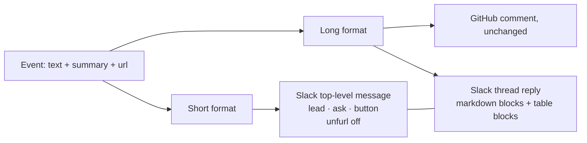

# Brainstorm: a better Slack collaboration experience

## The short version

Today the-loop writes one message, in GitHub markdown, and squeezes it into Slack. Above
`maxChars` (1,500 characters by default) the message is digested: tables and code become
a pointer such as _⟨a table of 4 rows⟩_. Under the cap, a table still arrives as raw `|`
pipes, because `to_mrkdwn` has no way to draw it. Every link also unfurls into a preview
card.

I lean to **two formats from one event**. The **short format** goes to Slack: the ask,
the state and the link, written for a phone. The **long format** goes to GitHub, as it
does today. To honour "show me the whole message" as well, the full text goes in **one
thread reply** under the short message. It is drawn with Slack's own blocks (the
`markdown` block and the `table` block), so nothing is cut. Link previews are switched
off on every post.

Before requirements, I need these answers: is the full text in the thread what you want,
or do you want it in the top-level message? Does the short format come from the agent's
summary or from a fixed per-event layout? Should the digest stay as an operator option?

## Problem / opportunity

The issue names four problems:

1. **Messages are cut.** `fit()` in `cli/the_loop/channels/digest.py` digests any text
   section longer than `maxChars` (default 1,500, hard ceiling 2,900 because of
   Slack's 3,000-character `section` limit). The digest keeps only the author's
   sentences, but it still leaves things out, and a table or a code fence becomes a
   pointer.
2. **Markdown is drawn badly.** `to_mrkdwn` converts bold, headings, links, task boxes
   and bullets. It cannot draw a table: mrkdwn has no table syntax, so under the cap
   a table is posted as raw pipes. Nested lists, numbered lists and long code also
   look poor inside a 3,000-character `section`.
3. **One text serves two very different readers.** A GitHub comment is read at a desk
   and is the paper trail. A Slack message is read on a phone, where the question is
   "do I need to act, and on what?" Today both readers get the same body.
4. **Link previews.** We send no `unfurl_links` or `unfurl_media` flag, so Slack
   unfurls the GitHub links in every message. The preview card is often bigger than
   the message.

## Context & constraints

- **What exists.** `render_blocks()` in `cli/the_loop/channels/slack.py` builds a header
  (or a room lead in agentic rooms, issue-393), a text `section`, an optional
  agent-authored `summary` section, an excerpt, a context line and buttons. Every text
  section goes through `fit(text, cap, long_messages, url)`. `longMessages` is
  `digest | truncate` (issue-338, decision-118).
- **An agent summary already exists.** issue-393 added `event.summary` (2–3 sentences,
  capped at 600 characters, mentions defused). Where it is present it leads the message
  and replaces the excerpt. That is a first short format, but only on some events.
- **Slack's limits** (to be verified in design against docs.slack.dev):
  - `section` text: 3,000 characters.
  - `markdown` block: standard markdown, about 12,000 characters per block.
  - `table` block: about 100 rows, 20 columns, and reportedly one table per message.
  - A message holds 50 blocks and about 40,000 characters in total.
  - `unfurl_links=false` and `unfurl_media=false` on `chat.postMessage` and
    `chat.update` stop previews.
- **Security is unchanged in kind.** Whatever renders the text still has to strip
  the-loop's HTML-comment markers, neutralise `<!here>`, `<!channel>` and similar
  broadcasts, and defuse user mentions. The `markdown` block parses text we do not
  control, so the same defusing applies to it. A longer message also means more
  untrusted text in a room, so the abuse cases from issue-338 (A1: a crafted 64 KB
  comment) still bound the cost.
- **Prompts and strings (issue-540).** Any new human-facing wording goes in
  `cli/the_loop/strings/en.json`. Any instruction to the agent about writing a short
  form goes in `cli/the_loop/prompts/`.
- **Compatibility.** `maxChars` and `longMessages` are documented operator keys. Removing
  or repurposing them needs a migration note in `docs/config/` and the channels
  capability doc.

## Ideas & options

### Where the whole text goes

- **Option A: the whole text in the top-level message.** Swap the `section` for a
  `markdown` block (up to about 12 k) and split anything longer over several blocks.
  *Pro:* exactly "show me everything". *Con:* a channel full of long walls of text,
  which works against the short-format goal. The phone notification is the first
  line only.
- **Option B: short top-level message, full text as one thread reply** (lean).
  The top-level message is the short format. The full text is posted once as a reply
  in that message's thread, drawn as `markdown` and `table` blocks. *Pro:* both goals
  hold: the channel scans well and nothing is lost. *Con:* the reply costs one more API
  call. In a room (issue-378), where updates are top-level and not threaded, each
  update grows its own small thread.
- **Option C: short message plus "Show full text" button** that opens a modal or posts
  the full text on demand. *Pro:* zero noise. *Con:* it needs interactivity (Socket
  Mode with the `gate.feedback` grant). Not every operator has that, and a modal is
  not searchable later. ~~Rejected as the default~~; it could come later as an addition.
- ~~**Option D: keep the digest, raise the cap.**~~ This changes nothing about tables or
  previews, and the ticket asks for the cut to go.

### How markdown is drawn

- **M1: use Slack's `markdown` block for prose** and let Slack draw standard
  markdown. This removes most of `to_mrkdwn`'s hand conversion for these sections.
  Open: does the `markdown` block draw tables? Early reports say it does not, so
  tables need M2.
- **M2: turn each markdown table into a `table` block.** This is a real table on
  phone and desktop. If only one table is allowed per message, the second and later
  tables either go in a further thread reply, one per table, or become an aligned
  code block (M3).
- **M3: a table as a monospace code block** (columns padded). This works everywhere,
  including the notification fallback `text`. It is ugly on narrow phones. Useful as
  the fallback.
- Keep `to_mrkdwn` for the places that must stay mrkdwn: the `text` fallback,
  `context` elements and button labels.

### Short format vs long format

- **S1: the agent writes both.** Every comment the session posts through
  `the-loop comment` or `the-loop ask` takes an optional `--summary`, which becomes
  the short format. Extends issue-393's `summary` to every event. *Pro:* the best words.
  *Con:* it depends on the agent; the fallback is needed anyway.
- **S2: a fixed short layout per event type**, built from the event's fields:
  `<emoji> <one-line lead> · <what I need from you> · [Open on GitHub]`. *Pro:*
  deterministic, no model. *Con:* generic.
- **Lean: S1 with S2 as the fallback**, and the digest's "ask first" logic (the first
  question, or *reply `…`*) reused to fill "what I need from you" when there is
  no summary.

### Other improvements (the issue asks "what else?")

1. **No link previews**: `unfurl_links=false, unfurl_media=false` on every post and
   update. Small and certain; could ship first.
2. **Edit in place, not re-post**: progress for one phase updates a single message.
   This is partly done in rooms (issue-393 `EDIT`); extend it to the central channel's
   thread.
3. **Mention the person who must act**: a gate waiting on a human `@`-mentions that
   human's Slack id (from `routing.authorizedUsers[].slack`) instead of posting to
   no one.
4. **Status emoji on the root message** (👀 in review, ⏳ waiting on you, ✅ done),
   so a channel scan shows state without opening threads.
5. **A short "what changed since you last looked" line** when a thread resumes after
   a long gap.
6. **Collapse the-loop's own bookkeeping messages** (session started, label changed)
   into one context line, or keep them out of Slack entirely.

## Sketches & notes

Today's path for the same event: `text → fit() → to_mrkdwn or condense() → one section ≤ 1,500 chars`.

## Open questions

1. **Where should the whole text live on Slack?** In the top-level message (A), or as a
   thread reply under a short message (B, my lean)?
2. **What writes the short format?** The agent (S1), a fixed layout (S2), or S1 with S2
   as the fallback (lean)?
3. **Do `maxChars` and `longMessages` stay?** I propose to deprecate `digest` and
   `truncate` but keep them for one minor version as an opt-out. Or remove them now.
4. **Rooms vs the central channel.** Should a declared room (issue-375) also get the
   short-plus-thread shape, or the whole text top-level because the room is the
   item's own conversation?
5. **Which of the "other improvements" are in scope** for this work item, and which
   become follow-up issues? I suggest 1 (no previews) is in scope, and 2–6 are
   follow-ups unless you want them here.
6. **Jira**: out of scope for this item (Jira comments are drawn separately, as ADF by
   `jiraformat.py`). Agreed?

## Leaning / working hypothesis

- Remove the cut. The long format reaches Slack whole, as one thread reply drawn with
  `markdown` and `table` blocks, split across blocks or replies at Slack's limits,
  never mid-table.
- The top-level message becomes the short format: the agent's summary when present,
  else a fixed per-event layout with the ask first.
- Link previews off everywhere.
- The same defusing (markers, broadcasts, mentions) on every new block type, with a
  negative test for each.

## Hand-off → requirements

To be filled once the open questions are answered. The expected carry-forward is:
user stories for the phone reader (short format) and the desk reader (full text on
Slack); EARS criteria for no truncation, table rendering, the split at Slack's limits,
no unfurls and the short-format fallback; and the security considerations above.

## Review comments

> Appended by the-loop's `record-feedback` hook when a human gate approves with
> comments (issue-109).
