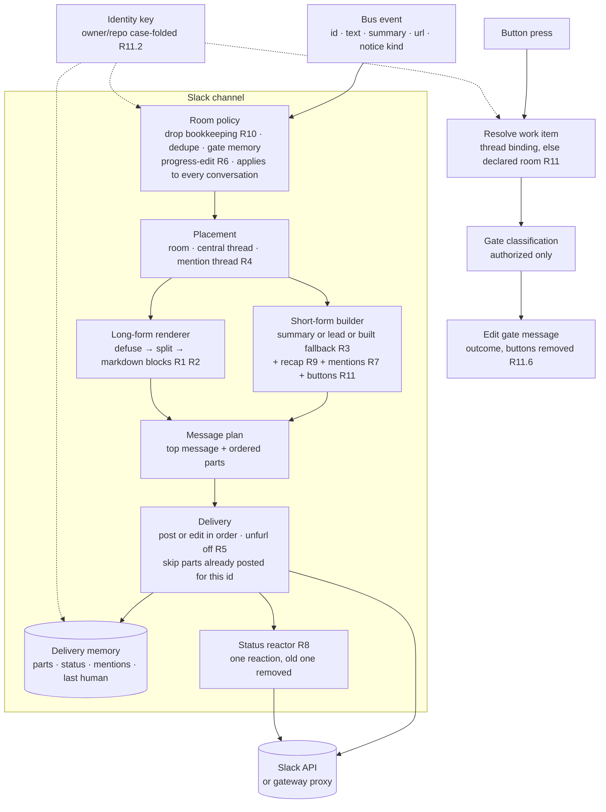

# Design: a better Slack collaboration experience

> Phase 2 of 3. Derives from the approved [`requirements.md`](requirements.md) and is
> reviewed with `testing-plan.md` at the `design-approval` gate.

## The short version

The Slack channel stops sending one squeezed message. It plans each delivery as a
**short message** plus, in a declared room, the **long form** in that message's thread.

- **Rendering.** The long form goes to Slack as **`markdown` blocks**. Slack draws
  standard markdown in them, tables and task lists included, so the-loop no longer
  translates tables. The digest, `maxChars` and `longMessages` go.
- **Placement.** One placement rule decides where each part lands: room, central
  thread, or mention thread.
- **Delivery.** One delivery step posts the parts in order, turns link previews off,
  and remembers what it posted so a retry never posts twice.
- **Approve buttons.** The Approve buttons failed on this work item for two reasons,
  and both get fixed:
  - **Ref case.** Work-item refs are compared without regard to the letter case of the
    GitHub owner or repository, and the graph verbs stop deriving a lowercased ref
    from the git remote.
  - **Room presses.** A press in a declared room resolves its work item through the
    room, not only through a thread.

**Start with:**

- **Interfaces:** one new CLI flag, two deprecated config keys, one API field, and
  new fields in two state files.
- **Architecture diagram:** shows where each requirement lands.
- **Security design:** shows how text from GitHub is defused before Slack parses it.

## Interfaces

### CLI

- `the-loop comment` gains `--summary <text>`. It is the event's short form, as
  `the-loop ask --summary` already is (R3.1). It is optional, and leaving it out still
  posts (R3.4).
- `the-loop channels status` drops its `maxChars` and `longMessages` lines (R1.4). It
  gains no new line: placement and previews are fixed behaviour, not settings.
- `the-loop graph check|complete|advance|force` keep their flags. With no `--ref`, they
  now derive the work-item ref with the owner and repository **as the work item's
  registration spells them**. They no longer use the lowercased slug of the git remote
  (R11.2).

### Configuration

- `channels.slack.maxChars` and `channels.slack.longMessages` are **deprecated and
  ignored** (R1.2, R1.3).
  - They stay in the CLI config schema, marked deprecated, so an existing config still
    validates.
  - The loader logs one warning per process naming each key that is present, with a
    link to the migration note.
  - They leave the shipped templates, the configuration reference and the guides,
    apart from that migration note (R1.5).
- Nothing new is configurable. The recap threshold (12 hours), the status emoji set
  and the long-form budget are fixed and documented in the channels capability doc
  (R9.4).

### API and schema

- `POST /api/v1/work-items/comments` accepts an optional `summary` string. It carries
  the same meaning and the same 600-character cap as `/sessions/ask`. The contract is
  updated first in `docs/api-specs/openapi/the-loop.v1.yaml`.
- Every bus event carries an **event id**, minted when it is published. It is kept
  when the outbox replays the event. Delivery uses it to recognise an event it has
  already posted.
- The daemon's session-started notice on GitHub carries a machine-read **notice
  kind** (`session-started`) in its hidden marker. The GitHub mirror passes the kind
  on with the `comment.agent` event, so R10 recognises it by kind instead of by
  matching words in the comment (today's `operator-docs` heuristic). The other R10
  bookkeeping is not posted to Slack today and stays that way:
  - session resumed or registered, PR linked, and CI checks are event-log lines
    only;
  - label changes are the runtime's `phase.started` and `phase.completed` events,
    which R10 now drops from Slack.
- The Slack gateway's method allow-list gains `reactions.remove` (R8) and
  `chat.delete` (R6.2). Both need no new bot scope beyond `reactions:write` and
  `chat:write`, which the shipped manifest already requests.

### Persisted formats

- **Outbox entries** store the event id with the event.
- **Channel state, per-work-item delivery memory**, is now kept for every conversation,
  the central channel included, where today only agentic rooms keep it. It gains:
  - the parts posted per event id (top message and reply timestamps), capped to the
    most recent events;
  - the status message and the status emoji currently on it;
  - the waits already announced with a mention;
  - when an authorized human last spoke in the conversation.
- **Conversation bindings and per-work-item records** are keyed by the work item's
  **identity key**: the ref with the GitHub owner and repository case-folded. An
  existing record under another casing is found on read and merged on the next write.
  The binding opened first wins (R11.3).

### User-visible behaviour

| Where | Top-level / thread reply | Thread under it |
|---|---|---|
| Declared room | short form, recap line, mentions, buttons, status reaction | long form, 1–n parts, `(2/3)` marks |
| Central channel | reply in the work item's thread: short form, recap, mentions, buttons, *Open on GitHub* | none (R4.2) |
| Mention in a room thread | reply in that thread: short form | long form follows in the same thread |

- No message carries a link preview (R5).
- A gate message has Approve / Request changes buttons where the channel can receive a
  press. Elsewhere it has one line saying how to approve on GitHub (R11.5). Once
  answered, it is edited to show the outcome and who answered (R11.6).
- Phase starts and ends no longer post messages. The status reaction and the recap
  carry them (R8, R9, R10).
- The status reaction is one of five, one at a time: ⚙️ working, ⏳ waiting on a
  human, 👀 in review, 🛑 blocked or failed, ✅ complete.

## Architecture

Data moves through five stages:

1. **Policy.** Every event first passes the room policy. It applies to **every**
   conversation now, not only agentic rooms, so that progress-edit (R6), gate memory
   (R11.6) and the bookkeeping filter (R10) act in the central channel too. The rules
   that exist to make a room conversational (session-wins, transition-collapse) keep
   their current scope.
2. **Placement.** One rule decides which parts an event gets and where they go (R4).
   Both builders and the delivery step read it, so no other component knows whether
   it is in a room.
3. **Two builders.**
   - The **short form**: the agent's summary; else the fixed lead for runtime events
     (R3.5); else a built line from the first question or sentence, which also logs
     `channels.short_form_missing` (R3.4). It is drawn as mrkdwn and capped at 600
     characters, with the recap line and mentions counted inside the cap.
   - The **long form**: defused (see Security design), then split into parts at
     top-level markdown block boundaries, each part one `markdown` block within
     Slack's per-message limit.
4. **Delivery.** The delivery step turns the plan into API calls, in order: the top
   message first, then each part as a thread reply. Each call sets
   `unfurl_links=false` and `unfurl_media=false`. Each posted timestamp is recorded
   against the event id **before** the next call, so a replay resumes after the last
   part that landed (non-functional: idempotent retries).
   - **Edits.** `chat.update` documents no unfurl flags. An edit is made only to a
     message that was posted with them, and verification checks that the edit keeps
     previews off.
   - **Rate limits.** A Slack 429 waits for `Retry-After` and retries that part; it
     never skips it.
5. **Status reactions.** The status reactor runs after delivery, best effort. It
   computes the state from the event (working, waiting on a human, in review,
   blocked, complete). If the state or the status message changed, it adds the new
   reaction and removes the old one, and only ever one it added itself (R8.5).

**Identity key.** One rule decides when two refs name the same work item: provider,
host and number must match exactly, and the GitHub owner and repository match
case-insensitively. Every lookup above keys on it: bindings, delivery memory,
declarations, portable records and the button-press resolver. The graph verbs are
fixed at the source as well: with no `--ref` they take the owner and repository from
the registered work item, falling back to the remote only when nothing is registered.
That keeps events, labels and the event log in the ticket's own spelling.

**Why this arrangement.** Today the room policy, rendering and posting are spread
across one long posting path. Every new rule there had to know whether it was in a
room or in the central channel. A placement decision followed by a plan and one
delivery step keeps that knowledge in one place. The plan is also what makes retries
idempotent and edits of multi-part messages possible (R6.2).

**Removed.** The digest (condensing and truncation) and its configuration go. The
mrkdwn drawing of GitHub markdown stays, for the short form, the `text` fallback and
context lines. `docs/architecture/architecture.md` gets one line pointing at the
channels capability doc for this pipeline.

## Technology choices

| Choice | Chosen | Alternatives | Why |
|---|---|---|---|
| Long-form block type | Slack `markdown` block | mrkdwn `section` blocks with our own conversion; `table` blocks for tables | Slack draws standard markdown, tables and task lists included, so the words reach Slack as written. `section` text is limited to 3,000 characters and cannot draw tables. A `table` block needs a cell-by-cell conversion and has its own 10,000-character limit. |
| Long-form size budget | Parts of at most ~11,000 characters, one `markdown` block each | Several `markdown` blocks in one message | Slack caps all `markdown` blocks in one payload at 12,000 characters together. One block per message keeps a split visible and leaves margin for the defusing rewrite. |
| Oversized single block | A fenced code block is split at lines, closing and reopening the fence. A table too large for one part becomes a code block, then splits the same way (R2.3, R2.5). | Splitting a table by rows with the header repeated | The requirements forbid a split inside a table. The code fallback keeps every cell. |
| Markdown parsing | The existing line-based block parser (from the digest) is reused to find top-level block boundaries. | A markdown library | No new dependency (minimalism ladder: reuse what is there). Only block boundaries are needed, not a syntax tree. |
| Link previews | `unfurl_links` / `unfurl_media` set to false on every post | Rewriting links as `<url\|text>` without previews | Slack documents both flags as the way to stop unfurls in Block Kit messages. |
| Bookkeeping detection | A notice kind in the-loop's own hidden marker | Matching the comment's words (today's `operator-docs` rule) | Words change with every string edit, while a marker kind is a contract the mirror can trust. Only marker-stamped comments carry it. |
| Ref identity | Case-fold the GitHub owner and repository in an identity key; fix the graph verbs to keep the registered spelling | Lowercasing refs everywhere | GitHub treats them as case-insensitive. Keeping the display spelling means tickets, labels and logs still read as the user wrote them. |

This is logged as **decision-154**, which supersedes **decision-118** (the structural
digest).

## UI/UX design

The surface is Slack messages. The visual contract is one self-contained HTML mock-up
of the four message shapes, iterated with the author (the designer for this work item).

| Artifact | Type | Location / link | Covers (screen · requirement) | Status |
|----------|------|-----------------|-------------------------------|--------|
| `design/slack-messages.html` | html-prototype | [`design/slack-messages.html`](design/slack-messages.html) | room message + long-form thread · R2, R3, R4.1; central-channel thread reply · R4.2; gate message with buttons, and after the answer · R7, R11; status reaction and recap · R8, R9 | draft |

- **Flows & states:** a gate opens, a person is mentioned, and the message shows
  buttons. A press edits the message to show the outcome. The status reaction moves
  from waiting to working.
- **Design system:** Slack's own rendering. The mock-up imitates it only as far as
  layout goes and uses no Slack assets.
- **Accessibility:** every message's `text` fallback is the short form (R2.7), which
  is what screen readers and notifications read.
- **Evidence:** screenshots of the locked mock-up, and screenshots from a real
  workspace at verification.

## Security design

- **AuthN/AuthZ.**
  - A button press counts only from a member id in the allow-list, resolved from
    `routing.authorizedUsers[].slack` through the Slack directory, as today (abuse
    case 7).
  - The press resolver adds one fallback: the declared room's work item. It is used
    only when the room is bound to exactly one work item, the rule the room
    declaration already enforces.
  - Strangers get an ephemeral refusal and a recorded drop.
- **Input validation and injection surfaces.** Untrusted text enters in the long form
  (GitHub comments and reviews, quoted CI output) and in the short form
  (session-written). Before Slack parses anything, the renderer applies these steps,
  in this order and to both forms, including table cells, headings and link labels:
  1. **Strip the-loop's markers** and other HTML comments (R2.8).
  2. **Neutralise broadcast sequences**: `<!here>`, `<!channel>`, `<!everyone>`,
     `<!subteam^…>` (abuse case 1).
  3. **Defuse user mentions**: `<@U…>` and `<@W…>` become inert text. The only live
     mentions are the ones R7 inserts afterwards, from configuration (abuse case 2).
  4. **Keep only safe link schemes**: `http`, `https` and `mailto` stay links; any
     other scheme is rendered as text (abuse case 4).
  5. **Escape Slack's angle-bracket syntax** in the remaining text, so that a cell
     cannot open a link or a mention.

  How Slack's `markdown` block treats each of these is checked against a real
  workspace at verification, because the docs do not state it.
- **Secrets handling.**
  - No new secret. The bot token stays where it is: the instance's environment, or
    the gateway.
  - Logs carry event ids, conversation ids and part counts. They never carry message
    text.
- **Least privilege.**
  - No new Slack scope. `reactions.remove` falls under `reactions:write`, and
    `chat.delete` of the bot's own messages falls under `chat:write`.
  - The gateway allow-list grows by exactly those two methods.
- **Fail-closed behaviour.**
  - **Unbuildable part.** A part the renderer cannot build is posted as escaped plain
    text with every word kept, never as raw markup.
  - **Unresolvable mention.** An authorized user whose Slack id cannot be resolved
    gets no mention (abuse case 6).
  - **Stale or forged press.** A press whose action value names a gate that is not
    open changes nothing, and only the presser is told (abuse case 8).
  - **Removed config keys.** They widen nothing, because they only ever limited output.
- **Abuse-case coverage.**

| Abuse case | Mechanism | Negative test |
|---|---|---|
| 1 broadcast in cell, heading, label | neutralise step on both forms, before splitting | renderer test per position; live check in verification |
| 2 user mention in text | defuse step; R7 inserts mentions after it | a summary and a long form holding `<@U…>` notify nobody |
| 3 64 KB comment | linear parser and splitter; parts bounded by length ÷ budget, plus code fallbacks | timing bound and part count on a generated 65,536-character body |
| 4 breakout markup, unsafe scheme | scheme allow-list and bracket escaping | `javascript:` link and `<x\|y>` in a cell render as text |
| 5 URL in the short form | the button's URL is the event's own | a summary with a foreign link still yields the event URL on the button |
| 6 unresolvable Slack identity | resolver returns nothing, so no mention | config with an unknown handle: message posted without a mention |
| 7 stranger presses Approve | allow-list check before classification | press from a non-allow-listed id: ephemeral refusal, gate unchanged |
| 8 stale or forged press | the gate must be open at the named node | press on an answered gate: nothing changes |
| 9 case-fold scope | identity key folds owner and repo only; host, provider and number exact | refs differing in number or host stay distinct |

## Testing strategy

- **Unit tests** cover each component against its requirement: the placement table,
  the short-form choice and cap, the defusing steps and the splitter, the identity
  key, the status-reaction state machine, the recap line and the bookkeeping filter.
  Every abuse case above gets its negative test.
- **Integration tests** drive a channel against a recorded Slack client. Each test
  carries a Gherkin docstring linking its requirement:
  - **R4, R2.6:** `Scenario: a long comment in a declared room posts a short message
    and its long form in the thread`.
  - **R4.2:** `Scenario: the central channel gets the short form only`.
  - **R11:** `Scenario: a gate opened under a lowercased ref posts its buttons in the
    work item's own thread`.
  - **R11:** `Scenario: a press in a declared room approves the gate`.
  - **Idempotent retries:** `Scenario: an outbox replay after a partial delivery posts
    only the missing parts`.
  - **R6.2:** `Scenario: a progress edit with fewer parts deletes the surplus`.
  - **R10:** `Scenario: a session-started notice reaches GitHub and not Slack`.
- **Contract.** The OpenAPI file changes for `summary`, and the contract tests follow
  it.
- **Live checks.** Because Slack's rendering of `markdown` blocks and its handling of
  unfurls on edit are not fully documented, verification includes a live check in a
  test workspace, with screenshots: tables, task lists, nested lists, the defused
  sequences, and no previews after an edit.

The executable detail is in `testing-plan.md`.

## Open questions

None. The decisions that shaped this design are on PR #550 and in the requirements'
decision table.

## Review comments

> Appended by the-loop's `record-feedback` hook when a human gate approves with
> comments (issue-109).

### 2026-11-19 — approved

**@MadaraUchiha-314** wrote:

approved
