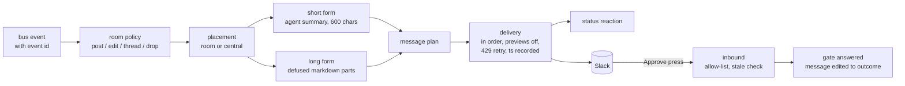

# Make the Slack collaboration experience better: reviewer briefing

## The short version

the-loop's Slack messages are rebuilt so a person can follow and steer a work item from
their phone:

- **Each update is a short message** of at most 600 characters, written by the agent
  through `comment --summary`.
- **The full text goes in the message's thread** as Slack-drawn markdown (tables, task
  lists, code), split in order into parts of at most 11,000 characters. Nothing is cut.
- **No link previews**, on posts or edits.
- **One status reaction** shows the item's state: ⚙️ working, ⏳ waiting, 👀 in
  review, 🛑 blocked, ✅ done.
- **The person who must act is mentioned once per wait.**
- **A recap line** opens the next message after a 12-hour gap.
- **Every human gate has Approve buttons.**

Untrusted GitHub text is defused before Slack sees it: no `@channel`, no user pings,
no `javascript:` links. The digest and the `maxChars` and `longMessages` keys are
removed. The keys still validate and warn once.

The root cause of "Approve did nothing" is fixed. A ref spelled in different case
(`Owner/Repo` vs `owner/repo`) missed the work item's binding, and owner and repo are
now case-folded.

## Review effort

**4.** About 3,300 lines over 40 files, a new posting pipeline, and a security boundary:
untrusted text reaching Slack, and button presses that approve gates. Most of the risk
is in the five stops below.

## Guided tour

1. [`channels/inbound.py:2105`](https://github.com/MadaraUchiha-314/the-loop/blob/d2ba0b4710755e8094b402247f1b2d57ec43bcbf/cli/the_loop/channels/inbound.py#L2105): **who can approve.**
   The allow-list is checked before anything else. A stale, forged, wrong-gate or
   wrong-channel press is refused and only the presser is told. This is the
   security-critical stop.
2. [`channels/defuse.py:131`](https://github.com/MadaraUchiha-314/the-loop/blob/d2ba0b4710755e8094b402247f1b2d57ec43bcbf/cli/the_loop/channels/defuse.py#L131): **what untrusted text can
   do.** Five steps in order: strip markers, neutralise broadcasts, defuse mentions, keep
   only http, https and mailto links, escape `<`. Two review rounds found bypasses
   here; check the fallback that breaks any unsafe `](`.
3. [`graph/refs.py:117`](https://github.com/MadaraUchiha-314/the-loop/blob/d2ba0b4710755e8094b402247f1b2d57ec43bcbf/cli/the_loop/graph/refs.py#L117): **the identity key.** Owner and repo
   are lower-cased, and nothing else is: not the host, the number or Jira refs. Check
   that two repos can't collide.
4. [`channels/delivery.py:263`](https://github.com/MadaraUchiha-314/the-loop/blob/d2ba0b4710755e8094b402247f1b2d57ec43bcbf/cli/the_loop/channels/delivery.py#L263) and
   [`:383`](https://github.com/MadaraUchiha-314/the-loop/blob/d2ba0b4710755e8094b402247f1b2d57ec43bcbf/cli/the_loop/channels/delivery.py#L383): **posting and editing.** Each ts is recorded
   before the next call. A 429 is retried. An edit falls back to a fresh post only when
   the message is gone. Check the one accepted window (below).
5. [`channels/render.py:326`](https://github.com/MadaraUchiha-314/the-loop/blob/d2ba0b4710755e8094b402247f1b2d57ec43bcbf/cli/the_loop/channels/render.py#L326): **the splitter.** It is
   linear, never splits inside a table or code block, and keeps every character. Three
   review findings were hangs or floods here.
6. [`channels/slack.py:2726`](https://github.com/MadaraUchiha-314/the-loop/blob/d2ba0b4710755e8094b402247f1b2d57ec43bcbf/cli/the_loop/channels/slack.py#L2726): **the pipeline in one
   place:** short form, placement, long form, plan. Lower risk; skim.
7. [`channels/shortform.py:233`](https://github.com/MadaraUchiha-314/the-loop/blob/d2ba0b4710755e8094b402247f1b2d57ec43bcbf/cli/the_loop/channels/shortform.py#L233),
   [`placement.py:79`](https://github.com/MadaraUchiha-314/the-loop/blob/d2ba0b4710755e8094b402247f1b2d57ec43bcbf/cli/the_loop/channels/placement.py#L79),
   [`status.py:137`](https://github.com/MadaraUchiha-314/the-loop/blob/d2ba0b4710755e8094b402247f1b2d57ec43bcbf/cli/the_loop/channels/status.py#L137): the pure pieces. Skim.

## What changed (map)

## Key decisions & why (education)

- **The agent writes the summary.** A heuristic first line read badly. `--summary`
  makes the author say what happened and what is needed. A built line is the fallback,
  and it is logged as `channels.short_form_missing`.
- **No long form in the central channel.** Slack has no collapsible block, so the
  central channel stays a list of short messages and the room's threads carry the
  detail.
- **Slack's `markdown` block, not mrkdwn, for the long form.** Slack draws real
  tables from it. The live check proved this, along with no previews after an edit. A
  table too big for one part falls back to an aligned code block.
- **Fail closed on defusing.** Code fences are defused too, because Slack doesn't
  document whether it parses inside them. The cost: `f[k](a)` in code shows as
  `f[k] (a)`.
- **Edits fall back to a fresh post only when the message is gone.** Any other failure
  raises, and the outbox retries, so a rate limit never duplicates a message.
- **The digest is retired.** decision-154 supersedes decision-118.

## Evidence

- **CI:** `pre-commit run --all-files`: 7,377 passed. One unrelated server-spawning test
  failed under load and passes when run alone.
- **Verification:** see `docs/specs/issue-549/testing-plan.md` § Verification results.
  - Unit tests: 824.
  - Integration tests: 111, covering 12 traced scenarios, among them a lowercased ref
    whose press approves the gate.
  - Contract tests: 7.
  - Abuse-case tests: 334.
  - Live Slack: the table drawn natively, parts in order, no previews after post or
    edit, defused sequences inert, the reaction moving.
- **Reviews:**
  - self-review: 2 rounds, 13 fixed;
  - critic (Codex): 5 fixed, 1 accepted;
  - security: a cubic-time regex fixed, and 2 hardening notes acted on.

  The records are in `docs/specs/issue-549/evidence/`.

## Open questions for the reviewer

1. **Security sign-off (risk tier 4).** Please read `evidence/security-review.md` and
   reply **security sign-off**. This is separate from approving the PR.
2. **Accept the residual re-post window?** If the process crashes, or Slack's reply is
   lost, after Slack accepted a post but before its ts was recorded, that one message is
   posted again on retry. Closing the window would cost a history search per message.
3. **After merge:** I'll report on the ticket the first real gate approved from Slack,
   with screenshots of the shapes. These checks were moved out of pre-merge testing so
   that test messages never land in a room.
