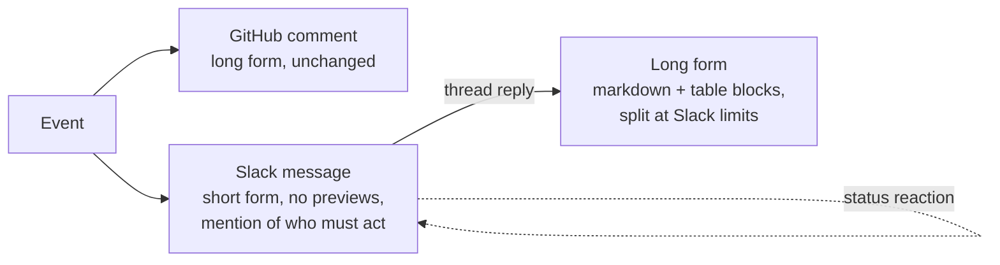

# Requirements: a better Slack collaboration experience

## The short version

Every Slack message from the-loop becomes **two parts**:

- **Short form.** The top-level message, written by the agent for a phone: what
  happened and what is needed from you.
- **Long form.** The whole text, as a reply in that message's thread, drawn with
  Slack's own blocks, with tables as real tables. Nothing is cut. This applies in a
  declared room. The central channel, where each work item already lives in one
  thread, gets the short form only and links to GitHub for the rest.

The `maxChars` and `longMessages` keys are removed, and with them the digest and the
truncation. Link previews are switched off. Six smaller changes ship with this:

- progress edits one message;
- the person who must act is mentioned;
- the work item's state is shown as an emoji;
- after a long gap, a one-line recap comes first;
- bookkeeping stays out of Slack;
- GitHub keeps the long form, unchanged.

**R11** makes every human approval gate show its Approve button in the work item's
own Slack conversation. On this work item the gate messages went to a second thread,
because their ref was lowercased.

Read R1–R4 closely: they replace the issue-338 digest, and R4 says where each form
goes. There are no open questions.

## Introduction

[Issue #549](https://github.com/MadaraUchiha-314/the-loop/issues/549) reports that
Slack messages are cut, render GitHub markdown badly (tables come out as raw pipes),
serve the phone reader and the desk reader the same text, and carry large link
previews. The approved [`brainstorm.md`](brainstorm.md) explored the options. The
author settled them on PR #550:

| Question | Decision | Thread |
|---|---|---|
| Where the whole text goes | short form as the main message, long form in its thread | [r4637605955](https://github.com/MadaraUchiha-314/the-loop/pull/550#discussion_r4637605955) |
| Who writes the short form | the agent | [r4637606698](https://github.com/MadaraUchiha-314/the-loop/pull/550#discussion_r4637606698) |
| Keep `maxChars` / `longMessages` | no, remove them now | [r4637607269](https://github.com/MadaraUchiha-314/the-loop/pull/550#discussion_r4637607269) |
| Same shape in declared rooms | yes | [r4637609992](https://github.com/MadaraUchiha-314/the-loop/pull/550#discussion_r4637609992) |
| The long form in the central channel | Slack has no collapsible section we control, so post none there | [7029208160](https://github.com/MadaraUchiha-314/the-loop/pull/550#issuecomment-7029208160) |
| Other improvements in scope | all six | [r4637738970](https://github.com/MadaraUchiha-314/the-loop/pull/550#discussion_r4637738970) |
| Jira out of scope | yes | [r4637740172](https://github.com/MadaraUchiha-314/the-loop/pull/550#discussion_r4637740172) |

Terms used below:

- **Short form**: the top-level part of a Slack message. It is meant to be read on a
  phone in a few seconds.
- **Long form**: the event's whole text, the same words GitHub receives.
- **Conversation**: where a work item's messages land, either a declared room
  (issue-375) or the central channel.
- **Awaiting message**: a message that waits on a human, such as a gate's review
  request or a `the-loop ask` question.
- **Bookkeeping event**: an event that records the loop's own housekeeping and asks
  nothing of a person. R10 lists them.

## Requirements

### Requirement 1 — The whole text reaches Slack

**User story:** As a collaborator reading on Slack, I want the whole message, so that I
never have to open GitHub just to read what was cut off.

#### Acceptance criteria (EARS)

1. WHEN the-loop posts the long form of an event to Slack (R4.1, R4.3) THEN the system
   SHALL deliver every word of it. It SHALL NOT digest, truncate or replace any part
   of it with a pointer.
2. The system SHALL NOT read the `channels.slack.maxChars` or
   `channels.slack.longMessages` keys, and it SHALL NOT offer the `digest` or
   `truncate` modes.
3. IF a CLI config still sets `channels.slack.maxChars` or
   `channels.slack.longMessages` THEN the system SHALL load the config, ignore the
   key, and log one warning per process that names the removed key and its
   migration note.
4. WHEN `the-loop channels status` describes the Slack channel THEN it SHALL NOT print
   a `maxChars` or `longMessages` line.
5. The configuration reference (`docs/config/`), the CLI config schema and the shipped
   templates SHALL NOT document either key, except in a migration note.

### Requirement 2 — Markdown drawn natively on Slack

**User story:** As a collaborator, I want tables, lists, code and headings to look
right on Slack, so that a message written for GitHub is just as readable there.

#### Acceptance criteria (EARS)

1. WHEN a long form is posted THEN the system SHALL render it with Slack blocks that
   draw standard markdown: headings, bold, italic, strikethrough, links, ordered and
   unordered lists (nested included), task boxes, block quotes, inline code and
   fenced code blocks.
2. WHEN a long form contains a GitHub markdown table THEN the system SHALL render it
   as a Slack table, with its header row and its cells in their original order. It
   SHALL NOT render it as raw `|` characters.
3. IF a table is larger than Slack allows in one table, or a message already holds
   as many tables as Slack allows, THEN the system SHALL render that table as an
   aligned monospace code block. It SHALL keep every cell and SHALL NOT drop a row.
4. IF a long form is larger than Slack allows in one block or one message THEN the
   system SHALL split it into several blocks or several thread replies, in the
   author's order. The split SHALL fall between top-level markdown blocks. It SHALL
   NOT fall inside a table, a code block, a list item or a word.
5. IF a single top-level markdown block is larger than one Slack block on its own
   THEN the system SHALL split it at a line boundary. A fenced code block split this
   way SHALL be closed and reopened with the same fence and language, so that each
   part renders as code.
6. WHEN a long form is split into several thread replies THEN they SHALL be posted in
   order. Each reply after the first SHALL be marked as a continuation (for example
   "(2/3)").
7. The text sent as each message's `text` fallback (the push notification and
   accessibility text) SHALL be the short form drawn as mrkdwn.
8. WHEN the-loop's own markers appear in the text (`<!-- the-loop:… -->` and other
   HTML comments) THEN the system SHALL remove them from both forms, as it does today.

### Requirement 3 — A short form the agent writes

**User story:** As a collaborator on my phone, I want each message to tell me in a
glance what happened and what is needed from me, so that I can act or move on
without reading the whole document.

#### Acceptance criteria (EARS)

1. `the-loop comment` and `the-loop ask` SHALL each accept a short form (`--summary`).
   `the-loop ask` already accepts one. The short form SHALL travel with the event to
   every channel.
2. WHEN an event carries a short form THEN the Slack top-level message SHALL be that
   short form, with an *Open on GitHub* button when the event has a URL.
3. WHEN an event carries a long form that is more than its short form, in a
   conversation where R4 posts the long form, THEN the system SHALL post the long form
   as a reply in the thread of the short message, under R2.
   WHEN the long form adds nothing to the short form THEN the system SHALL post no
   reply.
4. IF a session-authored event carries no short form THEN the system SHALL build one
   from the long form: the first question, or else the first sentence, followed by
   the work item's link. It SHALL record a `channels.short_form_missing` event so the
   gap is visible.
5. WHEN an event is published by the runtime, a graph hook or the daemon, so that no
   agent writes its words, THEN its short form SHALL be the fixed line for its event
   type that exists today (the room lead, issue-393) or that line's replacement in
   `cli/the_loop/strings/en.json`.
6. The short form SHALL be capped at 600 characters, as the issue-393 summary is
   today. Above the cap it SHALL be cut at a sentence boundary, and the long form
   SHALL still be posted whole.
7. The-loop's prompts SHALL tell the session to write a short form for every comment
   and question it posts. The prompts SHALL state its purpose (what happened and what
   is needed, read on a phone) and its cap. The instruction SHALL live in
   `cli/the_loop/prompts/` (issue-540).
8. WHEN the-loop posts the same event to GitHub THEN the GitHub comment SHALL carry the
   long form exactly as it does today. The short form SHALL NOT change the GitHub
   comment body.

### Requirement 4 — Where each form goes

**User story:** As a collaborator, I want a work item's own room to carry the whole
conversation, and the shared central channel to stay scannable, so that I read
details where I work on the item and only headlines where every item meets.

#### Acceptance criteria (EARS)

1. WHEN the-loop posts an event in a declared room THEN the short form SHALL be a
   top-level message in the room, and the long form SHALL be in that message's thread.
2. WHEN the-loop posts an event in the central channel THEN the system SHALL post only
   the short form, as a reply in the work item's thread, with an *Open on GitHub*
   button when the event has a URL. It SHALL NOT post the long form there. Slack
   offers no collapsible section whose fold the-loop controls, and a thread reply
   cannot have a thread of its own (decided on PR #550).
3. WHEN the-loop is answering a mention in a thread of a declared room (issue-507)
   THEN the short form SHALL be the reply in that thread, and the long form SHALL
   follow it in the same thread. In the central channel, the answer to a mention SHALL
   follow R4.2.
4. Gate messages and their Approve / Request changes buttons, command buttons and the
   phase-selection control (issue-393 R9) SHALL be part of the short message, so that
   a decision is taken from the top-level message.

### Requirement 5 — No link previews

**User story:** As a collaborator, I want no preview cards under the-loop's messages,
so that the message itself is what I see.

#### Acceptance criteria (EARS)

1. WHEN the system posts or updates any Slack message THEN it SHALL ask Slack not to
   unfurl links or media (`unfurl_links=false`, `unfurl_media=false`). This covers
   both forms, every reply, edits, and the channel's own notices.

### Requirement 6 — Progress edits one message

**User story:** As a collaborator, I want progress within a phase to update one
message, so that a phase does not fill the conversation with near-duplicates.

#### Acceptance criteria (EARS)

1. WHEN a within-phase progress event is delivered to a conversation that already
   holds that phase's progress message THEN the system SHALL edit that message in
   place. This applies in the central channel as well as in rooms (issue-393
   progress-edit).
2. WHEN a progress message is edited THEN its long-form reply, if it has one, SHALL be
   edited too, or replaced when its number of parts changed. A second copy SHALL NOT
   be added.
3. IF the message to edit is gone or cannot be edited THEN the system SHALL post a new
   one and remember it, as it does in rooms today.

### Requirement 7 — Mention the person who must act

**User story:** As the person a gate is waiting on, I want to be mentioned, so that I
get a notification when I am the one who must act.

#### Acceptance criteria (EARS)

1. WHEN the system posts an awaiting message THEN its short form SHALL mention, by
   Slack member id, each authorized user who can answer it and who has a Slack
   identity in `routing.authorizedUsers[].slack`.
2. IF no authorized user who can answer has a Slack identity THEN the system SHALL
   post the message with no mention. It SHALL NOT mention anyone else.
3. WHEN an awaiting message is edited, or the same wait is announced again, THEN the
   system SHALL NOT mention the same person a second time for the same wait.
4. The system SHALL NOT mention anyone in a message that is not an awaiting message.

### Requirement 8 — The work item's state at a glance

**User story:** As a collaborator scanning a channel, I want an emoji that shows each
work item's state, so that I can see where things stand without opening threads.

#### Acceptance criteria (EARS)

1. WHILE a work item has a conversation THEN the system SHALL keep exactly one
   the-loop status reaction on that work item's status message. The reaction SHALL
   come from a fixed set, one per state: working, waiting on a human, in review,
   blocked or failed, and complete.
2. The status message SHALL be the work item's thread root in the central channel, and
   the latest short message the-loop posted in a declared room.
3. WHEN the work item's state changes, or the status message in a room moves to a
   newer message, THEN the system SHALL remove the previous status reaction before or
   after adding the new one, so that one status reaction remains.
4. IF adding or removing a reaction fails THEN the system SHALL log it and continue.
   A reaction failure SHALL NOT fail, delay or drop the message delivery.
5. The system SHALL NOT remove reactions it did not add.

### Requirement 9 — A recap after a long gap

**User story:** As a collaborator coming back to a work item after a while, I want a
one-line summary of what happened since I last spoke, so that I can catch up without
reading the thread.

#### Acceptance criteria (EARS)

1. WHEN the system posts a short form in a conversation and the last message there from
   an authorized human is older than the recap threshold THEN the short form SHALL
   begin with one line that lists what changed since that message: phase changes,
   gate outcomes, PRs opened or merged, and failed checks.
2. IF nothing changed since that message, or no human has spoken in the conversation,
   THEN the system SHALL add no recap line.
3. The recap line SHALL be built from the loop's own event record, not from model
   output, and SHALL count toward the short form's cap.
4. The recap threshold SHALL be fixed in code and documented in the channels
   capability doc. This work item adds no config key for it.

### Requirement 10 — Bookkeeping stays out of Slack

**User story:** As a collaborator, I want only messages that matter to me, so that the
conversation reads as a conversation, not a log.

#### Acceptance criteria (EARS)

1. WHEN a bookkeeping event is published THEN the system SHALL NOT post a Slack message
   for it. Bookkeeping events are:
   - a session started, resumed or registered;
   - a `loop:<phase>` label change;
   - a PR linked to the work item;
   - a reaction acknowledgement;
   - a CI check that started, or that passed after no earlier failure.
2. WHEN a bookkeeping event is suppressed THEN it SHALL still reach GitHub, the event
   log and the R9 recap exactly as before.
3. WHEN a bookkeeping event changes the work item's state THEN the R8 status reaction
   SHALL still be updated.

### Requirement 11 — Approve from Slack at every human gate

**User story:** As the approver, I want an Approve button on Slack for every gate
that waits on me, so that I can approve where I read the work, without opening GitHub.

Added on PR #550 by the author
([comment](https://github.com/MadaraUchiha-314/the-loop/pull/550#issuecomment-7028547970)).
On this work item, both gate messages were posted with their buttons, but to a second
Slack thread. The runtime published them under `github:madarauchiha-314/the-loop#549`,
and the channel keyed them apart from `github:MadaraUchiha-314/the-loop#549`
([analysis](https://github.com/MadaraUchiha-314/the-loop/pull/550#issuecomment-7028580719)).

#### Acceptance criteria (EARS)

1. WHEN any human approval gate opens THEN the system SHALL post its Approve and
   Request changes buttons in the work item's own conversation, as part of the short
   message (R4.4). This covers `brainstorm-approval`, `requirements-approval`,
   `design-approval`, the PR's `human-approval`, the security sign-off, and any
   operator-declared gate that publishes an approval event.
2. WHEN two work-item refs differ only in the letter case of the GitHub owner or
   repository THEN the system SHALL treat them as one work item for every Slack
   conversation lookup, binding and delivery. A gate message SHALL NOT open a second
   thread for its work item.
3. WHEN a channel holds two conversations for one work item that differ only in that
   case THEN the system SHALL deliver the next message to the conversation bound
   first. It SHALL leave the other one readable and attributed to the same work item.
4. WHEN an authorized user presses Approve or Request changes THEN the gate SHALL
   classify the press exactly as the same answer typed on the ticket or PR. It SHALL
   record the approver and lock the artifact as it does for a GitHub approval, and
   acknowledge the press in the conversation.
5. IF the channel cannot receive a button press (no Socket Mode or gateway delivery,
   or no `gate.feedback` grant) THEN the gate message SHALL show no approval buttons.
   It SHALL instead say in one line how to approve on GitHub, with the link.
6. WHEN a gate is answered on GitHub or on Slack THEN the gate's Slack message SHALL be
   edited to show the outcome and who answered, and its buttons SHALL be removed.

## Non-functional requirements

- **Order.** For one event the short message SHALL be posted before its long-form
  replies, and the replies in order. Events for one conversation SHALL be delivered
  in the order the outbox holds them.
- **Retries are idempotent.** A retried delivery (outbox replay, a Slack 429 or 5xx)
  SHALL NOT post a second short message or a second copy of a long-form part. Parts
  already posted are remembered against the event.
- **Rate limits.** Long-form parts SHALL respect Slack's per-channel posting rate. A
  rate-limited part SHALL be retried, never dropped.
- **Cost.** Rendering a long form SHALL be linear in its length, as the issue-338
  digest is today (abuse case A1 below).
- **Observability.** Each delivery SHALL log, at `info`, the event id, the conversation,
  the number of long-form parts and any fallback taken (a table as code, a built
  short form). It SHALL do so at dev time and at run time alike.
- **Strings.** Every new human-facing string (the continuation mark, the recap line,
  the warnings) SHALL live in `cli/the_loop/strings/en.json` (issue-540).

## Security considerations

- **Actors & trust.** Long forms carry text from people we do not control: GitHub
  commenters, PR reviewers, CI logs quoted by a session. The session writes the short
  form, so the short form is untrusted-adjacent. Operators and authorized users are
  trusted for configuration only.
- **Trust boundaries & data.** The boundary is the renderer: untrusted markdown enters
  and Slack blocks leave, posted with the operator's bot token into rooms people
  watch. Three paths are new. First, the long form now reaches Slack whole, where
  before it was digested. Second, it reaches Slack as `markdown` and table blocks,
  where Slack parses the syntax itself. Third, the-loop now places mentions. No
  secrets are added or moved; the bot token and the `reactions:write` and `chat:write`
  scopes already exist.
- **Abuse cases (EARS).**
  1. WHEN a long form or short form contains a broadcast sequence (`<!here>`,
     `<!channel>`, `<!everyone>`, `<!subteam^…>`), including inside a table cell,
     a heading or a link label, THEN the system SHALL neutralise it so that it notifies
     no one.
  2. WHEN a long form or short form contains a user mention (`<@U…>`, `<@W…>`) THEN the
     system SHALL render it inert. The only mentions that notify SHALL be those R7
     adds from the operator's configuration.
  3. WHEN a crafted 64 KB comment, at GitHub's maximum length, is delivered THEN
     rendering SHALL finish in time linear in its length. Its long form SHALL be posted
     in a bounded number of replies, at most ⌈length ÷ Slack's per-message limit⌉
     plus one per table that falls back to code.
  4. WHEN a table cell, link label or link target carries markup meant to break out
     of its block (mrkdwn control characters, `<…|…>` link syntax, a URL with a
     `javascript:` or other non-`http(s)`/`mailto` scheme) THEN the system SHALL
     escape it or render it as plain text.
  5. WHEN a short form names the work item's link THEN the button and link SHALL carry
     the event's own URL, never a URL taken from the short form's text.
  6. WHEN an authorized user's configured Slack identity cannot be resolved to a
     member id THEN the system SHALL mention no one for them. It SHALL NOT guess an id
     from a display name.
  7. WHEN someone who is not an authorized user presses Approve or Request changes
     THEN the gate SHALL NOT count the press. The system SHALL tell only that person
     (an ephemeral reply) that the press was not accepted, and record the refusal.
  8. WHEN a button press names a work item or gate that is not open (a stale message,
     or a forged action value) THEN the system SHALL change nothing and say so to the
     presser only.
  9. Case-insensitive matching of refs (R11.2) SHALL apply only to the GitHub owner and
     repository. The issue or PR number and the provider SHALL match exactly. A ref on
     another host SHALL NOT match a `github.com` ref.
- **Fail closed.** If the renderer cannot produce valid blocks for a part, the system
  SHALL post that part as escaped plain text, keeping every word. It SHALL NOT post
  raw, unescaped markup, and it SHALL NOT drop the part. If a removed config key is
  present, the config SHALL load without it (R1.3). The keys only ever limited
  output, so ignoring them widens nothing.

## Out of scope

- **Jira.** Jira comments are rendered separately (ADF, `jiraformat.py`) and keep
  their current behaviour (decided on PR #550).
- **Slack modals or "show more" buttons.** The long form lives in the thread; nothing
  here needs interactivity.
- **A recap or short form written by a model at post time.** The short form comes from
  the session that wrote the message, and the recap comes from the event record.
- **Changing what reaches GitHub.** The GitHub comment stays the long form and the
  paper trail.

## Open questions

None. Where the long form goes in the central channel was settled on PR #550: nowhere
(R4.2).

## Review comments

> Appended by the-loop's `record-feedback` hook when a human gate approves with
> comments (issue-109). Append-only and attributed: an approval never silently
> discards a reviewer's suggestions, and the feedback travels with the document
> it concerns rather than living in a side-channel tracker.

### 2026-11-19 — approved

**@MadaraUchiha-314** wrote:

approved
