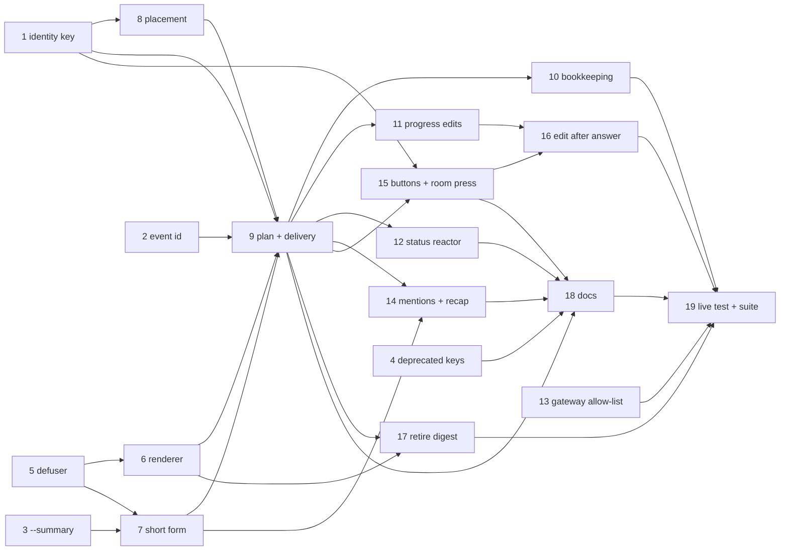

<!-- Written per the `the-loop:writing` skill. -->

# Tasks: a better Slack collaboration experience

> The last spec artifact. Derived from the approved [`requirements.md`](requirements.md),
> [`design.md`](design.md) and [`testing-plan.md`](testing-plan.md). There is no gate
> after it: the graph advances on its shape. All work lands in this repository, on PR
> #550's branch.

## The short version

19 tasks in four tracks that meet at delivery:

- **Foundations (1–4)** have no dependencies: the identity key, the event id, the
  `--summary` flag with its API field, and the deprecated config keys.
- **Rendering (5–8)** builds the defuser, the long-form splitter, the short form and
  placement as pure functions, each proved by unit tests.
- **Delivery (9–14)** is the risky track. It replaces the posting path in
  `channels/slack.py` with the message plan and one delivery step, then adds progress
  edits, status reactions, mentions and the recap on top.
- **Gates (15–16)** fix the Approve buttons: the press resolver falls back to the
  declared room, and the gate message is edited after an answer.

Tasks 17–19 retire the digest, update the docs and run the full suite. Review closely
tasks 5 (the security-relevant defuser) and 9 (the delivery rewrite).

## Task list

Every task is test-first: the named test is written and seen failing before the code.
Tests are named so the T8 `-k` filter in `testing-plan.md` finds the abuse cases.

### Foundations

- [x] 1. Identity key for work-item refs, and graph verbs that keep the registered spelling.
  - Add an identity-key function to `graph/refs.py`: the GitHub owner and repository
    case-folded; provider, host and number exact.
  - Key channel bindings, delivery records, declarations and portable records in
    `channels/state.py` by it. A record under another casing is found on read and
    merged on the next write; the first bound conversation wins.
  - `the-loop graph check|complete|advance|force` with no `--ref` take owner and repo
    from the registered work item, and fall back to the git remote only when nothing is
    registered (`core/graphs.py`, `graph/bootstrap.py`).
  - _Depends on:_ none
  - _Requirements:_ R11.2, R11.3, abuse case 9
  - _Test:_ T1 — `tests/test_graph_refs.py::test_identity_key_casefold_*`,
    `tests/test_channels.py::test_casefold_binding_first_wins`; T8 —
    `test_casefold_scope_number_and_host_stay_distinct`; T10 — two bindings differing
    only in case resolve to the first (red→green)
- [x] 2. An event id on every bus event, kept across outbox replay.
  - Mint the id at publish in `channels/bus.py` / `channels/base.py` (`Event`); store it
    in `channels/outbox.py` entries; an entry written before this change gets one on
    read.
  - _Depends on:_ none
  - _Requirements:_ NFR idempotent retries
  - _Test:_ T1 — `tests/test_channels_outbox.py::test_event_id_survives_replay`; T10 —
    `test_legacy_outbox_entry_without_id_replays` (red→green)
- [x] 3. `the-loop comment --summary`, and `summary` on `POST /api/v1/work-items/comments`.
  - OpenAPI first: `docs/api-specs/openapi/the-loop.v1.yaml`. Then `api/routes.py`,
    the `comment` verb, and the event's `summary` field, with the 600-character cap
    shared with `the-loop ask --summary`.
  - The agent prompts under `cli/the_loop/prompts/` tell the session to pass a summary
    written for a phone (R3.7).
  - _Depends on:_ none
  - _Requirements:_ R3.1, R3.7, R3.8
  - _Test:_ T3 — `tests/test_api_contract_parity.py`; T1 — comment verb test that the
    summary reaches the event and the whole text reaches GitHub (red→green)
- [x] 4. Deprecate `channels.slack.maxChars` and `channels.slack.longMessages`.
  - Mark them deprecated in `schemas/cli-config.schema.json`; warn once per process with
    a link to the migration note (string in `strings/en.json`); `channels status`
    prints neither (`commands/channels_cmd.py`).
  - _Depends on:_ none
  - _Requirements:_ R1.2, R1.3, R1.4
  - _Test:_ T1/T10 — `tests/test_configschema.py::test_deprecated_slack_keys_validate`,
    `test_deprecated_slack_keys_warn_once`; channels status output test (red→green)

### Rendering

- [x] 5. The defuser, applied to both forms. **Security-relevant.**
  - A new module (`channels/defuse.py`), in the order design.md fixes: strip markers
    and HTML comments → neutralise broadcasts → defuse user mentions → keep only
    `http`/`https`/`mailto` links → escape angle-bracket syntax. It covers table cells,
    headings and link labels.
  - _Depends on:_ none
  - _Requirements:_ R2.8, abuse cases 1, 2, 4
  - _Test:_ T8 — `tests/test_channels_defuse.py::test_defuse_broadcast_*` (cell, heading,
    label), `test_defuse_user_mention`, `test_defuse_unsafe_scheme`,
    `test_defuse_breakout_markup`, `test_defuse_strips_markers` (red→green)
- [x] 6. The long-form renderer and splitter.
  - Reuse the digest's line-based block parser to find top-level blocks; pack them into
    parts of at most ~11,000 characters, one `markdown` block each; never split inside
    a table, code block, list item or word.
  - An oversized code block splits at lines with the fence reopened; an oversized table
    becomes a code block first. Parts carry `(n/m)` marks.
  - _Depends on:_ 5
  - _Requirements:_ R1.1, R2.1–R2.6, abuse case 3
  - _Test:_ T1 — `tests/test_channels_render.py::test_split_*`; T7/T8 —
    `test_abuse_64k_body_bounded_parts_and_time` (red→green)
- [x] 7. The short-form builder.
  - Order: the agent's summary, else the fixed runtime lead, else a line built from the
    first question or sentence, which logs `channels.short_form_missing`. Drawn as
    mrkdwn, defused, capped at 600 characters on a sentence. It is also every message's
    `text` fallback.
  - _Depends on:_ 3, 5
  - _Requirements:_ R2.7, R3.2–R3.6, abuse cases 2, 5
  - _Test:_ T1/T9 — `tests/test_channels_shortform.py::test_summary_wins`,
    `test_runtime_lead`, `test_built_fallback_logs`, `test_cap_600_on_sentence`,
    `test_text_fallback_is_short_form`; T8 — `test_abuse_summary_foreign_link_keeps_event_url`
    (red→green)
- [x] 8. Placement.
  - One pure rule: declared room → short top-level and long form in its thread; central
    channel → short form only, as a reply in the item's thread, with _Open on GitHub_;
    mention thread in a room → both in that thread. Buttons go on the short message.
  - _Depends on:_ 1
  - _Requirements:_ R4.1–R4.4
  - _Test:_ T1 — `tests/test_channels_placement.py` (the placement table, one case per
    row) (red→green)

### Delivery

- [x] 9. The message plan and the delivery step in `channels/slack.py`.
  - Replace the posting path: room policy (now for every conversation) → placement →
    builders → plan → delivery. Post the top message, then each part in order; set
    `unfurl_links=false` and `unfurl_media=false` on every post; record each timestamp
    against the event id before the next call; a 429 waits for `Retry-After` and
    retries the same part.
  - Delivery memory is kept for every conversation, central included.
  - _Depends on:_ 1, 2, 6, 7, 8
  - _Requirements:_ R1.1, R4, R5, NFR order, idempotent retries, rate limits
  - _Test:_ T1 — `test_every_post_sets_unfurl_off`; T2 —
    `Scenario: a long comment in a declared room posts a short message and its long form in the thread`,
    `Scenario: the central channel gets the short form only`,
    `Scenario: the-loop comment with a summary posts the summary to Slack and the whole text to GitHub`,
    `Scenario: an outbox replay after a partial delivery posts only the missing parts`
    (red→green)
- [x] 10. Bookkeeping filter (R10).
  - The daemon's session-started notice carries the `session-started` kind in its hidden
    marker; the GitHub mirror passes it on; the room policy drops it, and drops
    `phase.started` / `phase.completed` from Slack. The `operator-docs` word match goes.
  - _Depends on:_ 9
  - _Requirements:_ R10.1–R10.3
  - _Test:_ T1 — `tests/test_room_policy.py::test_bookkeeping_dropped_*`; T2 —
    `Scenario: a session-started notice reaches GitHub and not Slack` (red→green)
- [x] 11. Progress edits, multi-part.
  - A progress edit edits the one message, central included; a long form with fewer
    parts deletes the surplus (`chat.delete`), more parts posts the extra; a message that is gone or cannot be edited gets a new one.
  - _Depends on:_ 9
  - _Requirements:_ R6.1–R6.3
  - _Test:_ T2 — `Scenario: a progress edit in the central channel edits one message`,
    `Scenario: a progress edit with fewer parts deletes the surplus` (red→green)
- [x] 12. The status reactor.
  - One reaction from the five (⚙️ ⏳ 👀 🛑 ✅) on the status message (the thread root in
    central, the latest short message in a room); remove only the one it added; a
    reaction failure never fails delivery.
  - _Depends on:_ 9
  - _Requirements:_ R8.1–R8.5
  - _Test:_ T1 — `tests/test_channels_status.py::test_state_per_event`,
    `test_one_reaction_old_removed`, `test_never_removes_foreign_reaction`,
    `test_failure_does_not_fail_delivery` (red→green)
- [x] 13. Gateway allow-list gains `reactions.remove` and `chat.delete`.
  - `gateway/slack_proxy.py` and `channels/slack_gateway.py`.
  - _Depends on:_ none
  - _Requirements:_ R6.2, R8
  - _Test:_ T2 — `Scenario: the gateway proxy forwards reactions.remove and chat.delete`
    (red→green)
- [x] 14. Mentions and the recap line.
  - An awaiting message mentions the authorized users whose Slack ids resolve, once per
    wait (remembered in delivery memory); none resolved → no mention.
  - The recap line opens the short form when the last authorized human message in the
    conversation is older than 12 hours and something changed; it counts toward the cap.
  - _Depends on:_ 7, 9
  - _Requirements:_ R7.1–R7.4, R9.1–R9.4, abuse case 6
  - _Test:_ T1 — `tests/test_channels_mentions.py::test_once_per_wait`,
    `tests/test_channels_recap.py::test_recap_after_12h`, `test_no_recap_when_nothing_changed`;
    T8 — `test_abuse_unresolvable_identity_no_mention` (red→green)

### Gates

- [x] 15. Buttons in the item's own conversation, and room presses. **Security-relevant.**
  - Gate messages publish under the identity key, so they land in the work item's
    thread (task 1); buttons only when the channel can receive a press, else one line
    saying how to approve on GitHub.
  - `inbound.handle_socket_action` resolves a press by thread binding, else by the
    declared room bound to exactly one work item. A press counts only from an
    allow-listed member and only on an open gate.
  - _Depends on:_ 1, 9
  - _Requirements:_ R11.1, R11.2, R11.4, R11.5, abuse cases 7, 8
  - _Test:_ T2 — `Scenario: a gate opened under a lowercased ref posts its buttons in the work item's own thread`,
    `Scenario: a press in a declared room approves the gate`,
    `Scenario: a channel that cannot receive a press shows how to approve on GitHub`;
    T8 — `test_unauthorized_press_refused`, `test_stale_press_changes_nothing`
    (red→green)
- [x] 16. The gate message is edited after its answer.
  - Answered from Slack or GitHub, the gate message shows the outcome and who answered,
    and the buttons go.
  - _Depends on:_ 15, 11
  - _Requirements:_ R11.6
  - _Test:_ T2 — `Scenario: a gate answered on GitHub edits its Slack message to show the outcome`
    (red→green)

### Finish

- [x] 17. Retire the digest.
  - Remove condensing and truncation from `channels/digest.py` (the block parser moves
    to the renderer in task 6), its config readers and its tests; mark decision-118
    superseded and decision-154 accepted.
  - _Depends on:_ 6, 9
  - _Requirements:_ R1.1, R1.2
  - _Test:_ T1 — the full channels suite still passes; no test imports the removed code
- [ ] 18. Docs in the same PR.
  - `docs/capabilities/channels.md` (the pipeline, the recap threshold, the status
    emoji, the long-form budget), the configuration reference and guides (keys removed,
    one migration note), the templates, one line in
    `docs/architecture/architecture.md`.
  - _Depends on:_ 4, 9, 12, 14, 15
  - _Requirements:_ R1.5, R9.4
  - _Test:_ T12 — markdownlint in `uv run pre-commit run --all-files`
- [ ] 19. The live Slack test and the full suite.
  - Add `tests/test_slack_live.py` with the `live_slack` marker (skipped unless
    `THE_LOOP_LIVE_SLACK=1`): post, read back, edit, read back, react, delete.
  - Run the whole suite and pre-commit.
  - _Depends on:_ 1–18
  - _Requirements:_ R2.1, R2.2, R5, R8, abuse cases 1–2
  - _Test:_ T4 (run at verification); T12 — `uv run pre-commit run --all-files`

## Dependency graph (DAG)

## Checkpoints

- **After each task:** its named tests go red then green; the commit carries the task
  number and the test command.
- **After task 9:** T1 and T2 in full (`testing-plan.md` matrix commands). It is the
  largest change to the posting path.
- **After task 16:** T8 in full (`-k "abuse or defuse or unauthorized or stale_press or casefold"`).
- **After task 19:** `uv run pre-commit run --all-files`. Then the verification node
  runs `testing-plan.md`, including T4 live, and the review phases run the
  self/critic rounds and the security review gate (`evidence/security-review.md`).

## Review comments

> Appended by the-loop's `record-feedback` hook when a human gate approves with
> comments (issue-109).
