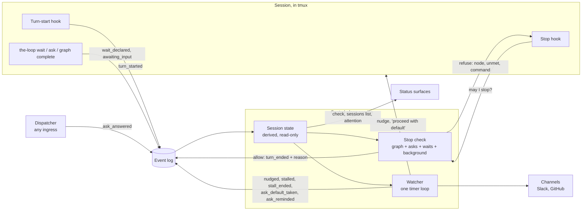
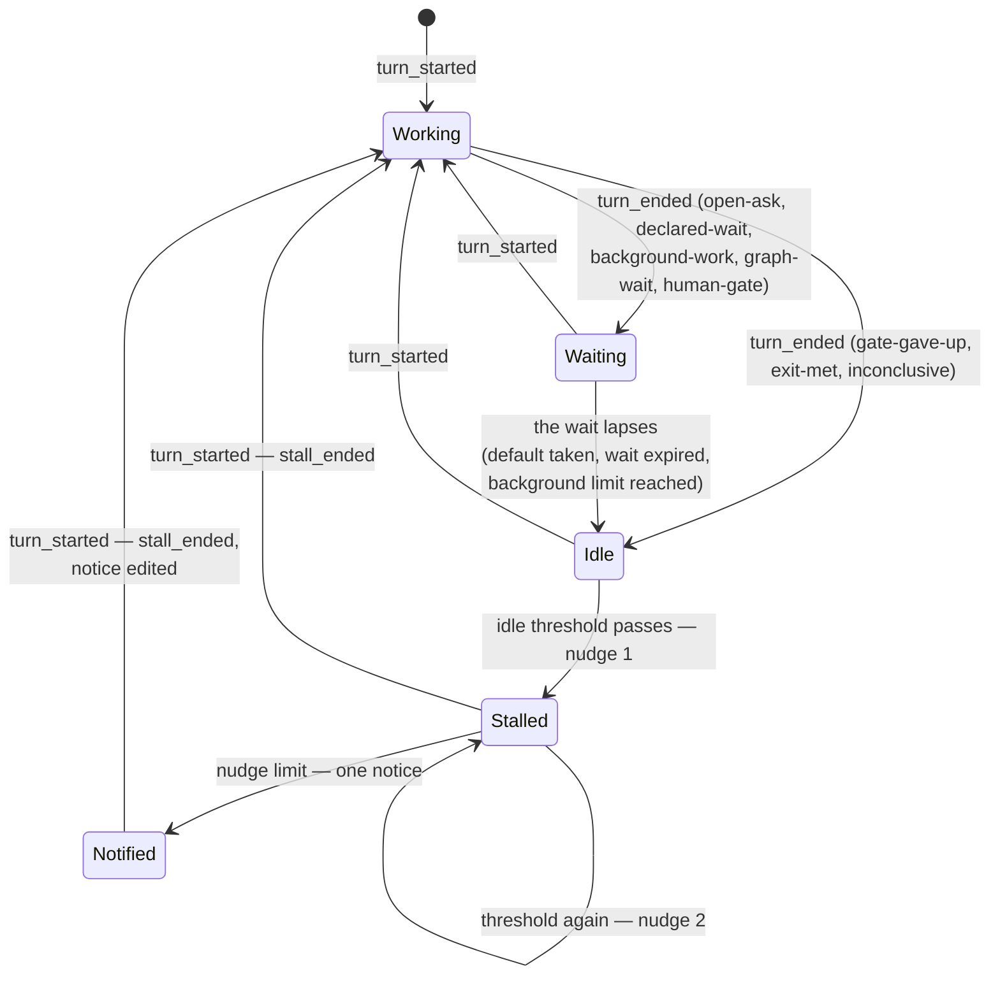
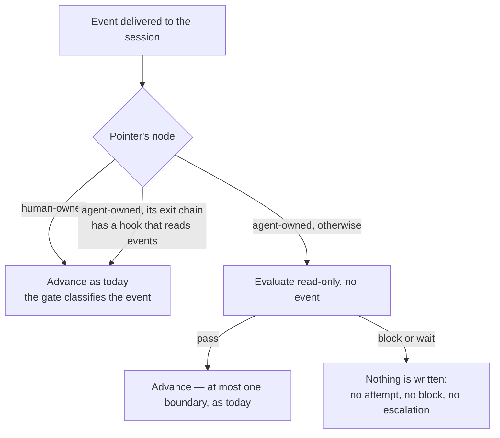

# Design: a session never goes idle unnoticed

> Phase 2 of 3. Derives from the approved [`requirements.md`](requirements.md) and is
> reviewed with `testing-plan.md` at the `design-approval` gate.

## The short version

The session's harness hooks start telling the-loop when a turn starts and when it
ends. Everything else is built on those two records.

- **One verdict, made by the service.** When a session wants to stop, the Stop hook
  asks the control-plane service "may this session stop?". The service answers from
  the graph, the open ask, the declared wait and the harness's own list of background
  work. It records the turn's end with the reason (R3).
- **One watcher, in the service.** A single timer loop in the control-plane service
  reads the event log. It nudges stalled sessions, posts the stall notice, takes ask
  defaults at their deadline and sends ask reminders (R4, R6). It runs whichever
  ingress is on.
- **No new store.** Stalls, waits and deadlines are all derived from events, so a
  restart loses nothing and repeats nothing.
- **Three small corrections.** A claim's answer carries the next assignment (R1).
  An inbound comment evaluates an agent-owned node read-only (R5). The skill text
  changes (R2).

**Start with:**

- **Interfaces:** two new verbs (`the-loop wait`, `the-loop sessions stop-check`),
  one new flag (`ask --after`), two config blocks, eight events.
- **Architecture:** the first diagram shows who writes each record and who reads it.
- **What it costs:** one more harness hook (turn start), and one service call at
  every turn end. A session whose hooks are not installed is not watched, and says
  so.

## Interfaces

### CLI

| Verb | Change | Requirement |
|---|---|---|
| `the-loop graph complete` | The JSON envelope gains `assignment` (the entered node's assignment text) and `next` (`node`, `actor`, `command`, and `continue`: `true` for an agent-owned node, `false` for a human-owned one). Both are present only when the claim moved the pointer and the daemon did not deliver the assignment itself. | R1 |
| `the-loop wait` | **New.** `--work-item <ref> --for <condition> --until <duration>`. Records a declared wait. Refuses a duration over the wait limit, and refuses when the pointer is on a human-owned node. Prints when the wait ends. | R4.7 |
| `the-loop ask` | Gains `--after <duration>`. It needs `--default`. A duration under the operator's minimum is raised to it, and the output says so. | R6.1, R6.5, R6.6 |
| `the-loop sessions stop-check` | **New, for hooks.** `--work-item <ref>`, reads the harness's hook payload on stdin, answers `allow` or `refuse` as JSON. On `allow` it records the turn's end. `--gave-up` records a stop the hook allowed after its attempts ran out. | R3 |
| `the-loop sessions turn-start` | **New, for hooks.** Records that a turn started. Always exits 0. | R4.5, R4.6 |
| `the-loop check` | Gains one `session:` line (and a `session` object in JSON): `working`, `idle`, `stalled`, `waiting` or `asked`, with the node, the time and the detail. | R7 |
| `the-loop sessions list` | Gains the same state per session, and `not watched` for a session with no turn records. | R7 |
| The attention list (API, MCP, SDK, control-plane UI) | Gains the kinds `stalled` and `declared-wait` (informational). An `awaiting-input` row gains the default and its time. | R7 |

Durations are a number with a unit: `45s`, `30m`, `2h`.

### Configuration

Two new blocks in the operator's `cli-config.yaml`. A config without them behaves as
the defaults say. A value that is not a positive whole number fails validation.

| Key | Default | Meaning |
|---|---|---|
| `routing.watchdog.enabled` | `true` | `false` sends no nudge and no stall notice. The Stop gate and the turn records are not affected (R4.12). |
| `routing.watchdog.idleSeconds` | `600` | Idle threshold. |
| `routing.watchdog.maxNudges` | `2` | Nudge limit for one stall. `0` skips the nudges and goes to the notice. |
| `routing.watchdog.maxWaitSeconds` | `3600` | Wait limit for a declared wait. Also the longest time background work is believed without a new turn. |
| `routing.asks.minDefaultWaitSeconds` | `1800` | Minimum wait before a default is taken. |
| `routing.asks.reminderSeconds` | `7200` | Reminder interval for an ask without a default. `0` sends no reminder. |

The Stop gate's attempt cap stays an environment variable of the hook, unchanged.

### API and schema

The contract changes first, in `docs/api-specs/openapi/the-loop.v1.yaml`.

- `POST /api/v1/sessions/ask` accepts an optional `defaultAfterSeconds`.
- `POST /api/v1/sessions/wait` — new. Body: work item, condition, seconds.
- `POST /api/v1/sessions/stop-check` — new. Body: work item, whether the harness
  reports background work, whether the hook gave up. Response: verdict, reason, and
  on a refusal the node, the unmet checks and the resume command.
- `POST /api/v1/sessions/turn-start` — new.
- The graph-claim response gains `assignment` and `next`.
- The check response gains `session`. The attention response gains the two kinds.

**Events.** Eight new registered types:

| Event | Written by | Carries |
|---|---|---|
| `session.turn_started` | turn-start hook | work item, node |
| `session.turn_ended` | stop-check | work item, node, node status, reason |
| `session.wait_declared` | `the-loop wait` | condition, end time |
| `session.nudged` | watcher | stall id, node, nudge number |
| `session.stalled` | watcher, at the nudge limit | stall id, node, idle since |
| `session.stall_ended` | watcher | stall id, idle duration |
| `session.ask_default_taken` | watcher | ask id, default text |
| `session.ask_reminded` | watcher | ask id |

One more closes an ask from GitHub, which nothing records today:
`session.ask_answered`, written by the dispatcher when it delivers an authorized
human comment to a session that has an open ask.

`session.awaiting_input` gains the default text, the time the default is taken and an
ask id. `session.stalled`, `session.stall_ended`, `session.ask_default_taken` and
`session.ask_reminded` also go on the channel bus. `session.stalled` joins the default
channel subscription beside `session.awaiting_input`, because it is the other event
that needs a person.

The reasons a turn's end can carry are a closed list: `human-gate`, `complete`,
`exit-met`, `graph-wait`, `open-ask`, `declared-wait`, `background-work`,
`inconclusive`, `gate-gave-up`.

### Persisted formats

- **Event log:** the events above. Nothing else is stored for this work item's
  features.
- **Work-item state:** no new field. An inbound comment stops writing `lastBlock`
  and attempts for an agent-owned node (R5), so those fields now change only on a
  claim.
- **Channel delivery memory** (issue-549) remembers the stall notice per stall id, so
  the notice can be edited when the stall ends.
- **Hooks:** the plugin's hook manifests for Claude Code, Codex and Cursor gain a
  turn-start entry.

### User-visible behaviour

The mock-up [`design/messages.html`](design/messages.html) is the wording contract
for every message below.

- **Stall notice.** One Slack message and one GitHub comment per stall, after the
  nudges failed. Both are edited in place when the stall ends. The Slack status
  reaction is 🛑 while stalled and returns to ⚙️.
- **Ask with a default.** the-loop adds the default and the time it is taken below
  the session's question. When the deadline passes, it posts "default taken" on the
  thread and edits the Slack question.
- **Reminder.** One, on the question's thread.
- **In the session.** A refused stop reads: the node, what is unmet, the command to
  resume, and the three ways out (continue, `the-loop ask`, `the-loop wait`). A
  nudge reads the same, with "you have been idle for N minutes" first.
- **Failures.** A nudge that cannot be delivered is retried on the next tick and
  counts toward the nudge limit. A notice that cannot be posted goes through the
  channel outbox, as any channel event does.

### Skill and prompts

- `reference/context.md`: the daemon row of the harness table and the paragraph
  under it are rewritten. A daemon session compacts or hands the next node to a
  subagent, and continues. The sentence about a fresh session goes (R2.1, R2.2).
- `SKILL.md` and `commands/work-on.md`: the context-window bullet and the
  implementation step say "clear" only for an interactive session.
- `reference/collaboration.md` § Where questions go: the three ask cases of R6.9, the
  list of legitimate stops (R2.3), and "take the step you announce" (R2.4).
- The interaction prompt (`prompts/interaction/`) names `--default … --after …` and
  `the-loop wait` beside `the-loop ask`.
- New prompt files: the "continue in this turn" assignment line, the refusal text,
  the nudge, the "proceed with your default" message. New strings: the notice, its
  resolved form, the reminder, the "default taken" comment, the `session:` lines.

## Architecture

### Who writes what, who reads it

**Session state is one derivation, used three times.** The stop check, the watcher
and the status surfaces all read the same function of the event log and the graph.
That is what keeps "idle" on a status line and "idle" in the watcher from ever
disagreeing (R7).

**The service hosts the watcher because it is the only process every deployment
has.** Today each timer lives in one ingress, and an instance that runs only the
gateway client starts none of them. A daemon session already needs the service for
`graph complete`, so the service is always there (R4.11). The watcher follows the
existing watcher pattern: one thread, a fixed 30-second tick, one cycle guarded so a
failure is logged and the next tick runs.

### The state of a session

- **Working** means the last turn record is a start. The watcher never touches a
  working session (R4.6).
- **Waiting on a human gate or an unanswered ask has no time limit.** Waiting on a
  declared wait or on background work ends at its stated time, or at the wait limit.
- **Idle starts at the moment the reason lapsed**, not at the turn's end. A session
  whose CI wait expired at 17:40 is idle from 17:40 (R4.8).
- **A stall is named by its start.** The stall id is the work item plus the time the
  idle period began. Every nudge, notice and resolution carries it, and the watcher
  acts only when the log has no record of that act for that id (R4.10).
- **Only a turn start ends a stall** (R4.9). A delivered comment does start a turn,
  so it ends the stall. A comment that is refused before delivery does not.
- **The nudge limit and the one notice are budgets of the node visit, not of the
  idle period.** A nudge starts a turn, so it ends the stall it answered. If the
  session goes idle again on the same node, the new stall inherits what was already
  spent: after two nudges on a node, the next idle period goes straight to the
  notice, and after the notice nothing more is sent. The budget resets when the
  pointer moves or when a person's event is delivered to the session. Without this
  rule a session that answers every nudge with one empty turn would be nudged
  forever.

### The stop check

The Stop hook stays a clock. It forwards the harness's hook payload and the service
decides, in this order:

1. The work item or its pointer cannot be resolved: **allow** (`inconclusive`).
2. The pointer is on a human-owned node, a code node or a finished graph: **allow**.
3. An agent-owned node *before* the pointer reports `block`: **refuse**, naming it
   (the issue-429 rule). A human-owned node before the pointer is treated as passed,
   whatever it reports. This is the P3 fix (R3.3, R3.4).
4. The pointer's node reports `pass`: **allow** (`exit-met`). The watcher then
   treats the session as idle, and its nudge says "claim the node".
5. The pointer's node reports `wait`: **allow** (`graph-wait`).
6. The node reports `block`. **Allow** when the work item has an open ask, a
   declared wait made during this turn, or background work the harness reports.
   Otherwise **refuse**.

A declared wait covers **one stop**: the one that ends the turn it was made in. The
next turn must declare again or the gate judges the node afresh. That stops one wait
from excusing every later stop until it expires.

**Background work** comes from the harness, not from the session's word. Claude
Code's Stop payload lists the background tasks still running. Where a harness gives
no such list (Codex, Cursor), the session uses a declared wait instead, and the
refusal text says so.

**The attempt cap stays in the hook.** It must work when the service is down. When
the cap is reached, the hook allows the stop and reports it with `--gave-up`, so the
record says `gate-gave-up` and the watcher takes over (R3.6).

**Version skew.** The plugin and the CLI ship separately. When the CLI has no
`stop-check`, or the service does not answer, the hook falls back to today's
`the-loop check` path, with the P3 fix applied locally: a `wait` before the pointer
counts as passed. That fallback knows nothing of asks or waits, exactly as today.

### The watcher's cycle

Each tick, for every live, active, daemon-driven session, including a pull request's
own session:

1. Derive the session state.
2. **Idle past the threshold**, with nudges left in the node visit's budget: paste
   the nudge, record it.
3. **Idle past the threshold, budget spent, no notice yet for this node visit:**
   publish `session.stalled`. The Slack and GitHub channels post the notice.
4. **A stall whose session is working again:** record `stall_ended`. The channels
   edit the notice.
5. **An open ask past its default time:** paste "proceed with your default" into the
   session, post the comment, record `ask_default_taken`.
6. **An open ask with no default, past the reminder interval, not yet reminded:**
   publish `session.ask_reminded`.

A session with no turn record at all is skipped and shown as `not watched`. The
watcher never guesses from tmux or from the transcript: the harness documents the
transcript as written late, so its age is not a safe signal.

### The claim's answer (R1)

The assignment text has one renderer, already used for daemon delivery. The claim
path calls the same renderer for the node the pointer ends on and returns the text
in the envelope. For an agent-owned node it appends the "continue in this turn"
line. For a human-owned node the text says which gate the session now waits for.

Double delivery cannot happen, because the two paths are exclusive by construction:
the daemon delivers only on advances it drives itself, and the envelope exists only
on a claim (R1.5).

### Inbound events and agent-owned nodes (R5)

- A hook declares that it reads the inbound event where it is registered. The
  shipped hooks that do are the feedback classifiers and the quiz attestation. No
  graph file changes.
- The same rule applies to a pull request's inner loop.
- "Blocked" and "escalated" now come only from the session's own claims, so the
  status a prompt or a person sees needs no new wording (R5.6).

## Technology choices

| Choice | Chosen | Alternatives | Why |
|---|---|---|---|
| How the-loop knows a turn is running | Harness hooks: turn start and Stop | tmux pane activity; transcript file age; "the daemon delivered something" | The hooks are the harness's own statement and exist on all three harnesses. The transcript is written late. A background task can start a turn with no delivery. |
| Where the stop verdict is made | In the service, behind one verb | In the hook script, with more `check` fields | The verdict needs the event log (asks, waits). The hook is stdlib-only by contract and must stay a clock. |
| Where the watcher runs | The control-plane service | Each ingress; the dispatcher | Every ingress would mean three copies and a gap for gateway-only instances. |
| Where stall and deadline state lives | Derived from the event log | A watchdog state file; fields on the session record | The log already holds asks and replies the same way. Derived state cannot drift and survives a restart. |
| How background work is known | The harness's Stop payload; a declared wait elsewhere | Trust the session's word everywhere | A harness fact beats a claim. The declared wait is the one fallback, and it is bounded. |
| What an ask's default does at its deadline | Tell the session and record it | Post the default as if a human had answered | A synthetic answer would look like a person's. The session is told plainly that nobody answered. |
| Nudge content | A fixed prompt plus the graph's own node and command | Include recent comments or the ask text | Nothing untrusted may ride a message the daemon types on its own initiative. |

A decision record is added under `docs/decisions/` for the first three rows: they
change how the-loop observes a session.

## UI/UX design

The surfaces are Slack messages, GitHub comments and three status lines. The visual
contract is one self-contained HTML mock-up, reviewed by the author (the designer
for this work item) at the `design-approval` gate.

| Artifact | Type | Location / link | Covers (screen · requirement) | Status |
|----------|------|-----------------|-------------------------------|--------|
| `design/messages.html` | html-prototype | [`design/messages.html`](design/messages.html) | stall notice and its resolved form · R4.4, R4.5, R7.4; ask with a default, default taken · R6.1, R6.2; reminder · R6.7; `check` line and attention rows · R7.1–R7.3 | draft |

- **Flows & states:** idle → notice → resolved; question → default taken; question →
  reminder.
- **Design system:** Slack's and GitHub's own rendering, in the issue-549 message
  shape (short form, mention of who must act, status reaction). The control-plane UI
  shows the new attention kinds with its existing row component; no new screen.
- **Accessibility:** every Slack message's `text` fallback is its short form. State
  is carried by words, never by the emoji alone.
- **Evidence:** a screenshot of the locked mock-up, and captures from a real
  workspace at verification.

## Security design

- **AuthN/AuthZ:**
  - An ask is closed, and its default cancelled, only by a reply that already passed
    the authorized-actor guard: a Slack reply through the existing inbound check, or
    a GitHub comment the dispatcher delivered. A comment the dispatcher refuses
    writes no `ask_answered`.
  - The two hook verbs and `the-loop wait` act only on the work item the session is
    bound to. The service checks the ref against the session registry and refuses
    any other.
  - No gate reads `ask_default_taken`. The "default taken" comment carries the
    agent-comment marker, so the feedback classifiers skip it as they skip every
    agent comment (R6.8).
- **Input validation & injection surfaces:**
  - *Prompt injection into the session.* The nudge and the refusal are fixed prompt
    files with two inserted values, the node id and the node's command, both from
    the graph definition. The "proceed with your default" message inserts the
    default text inside a fenced block marked as the session's own earlier words.
  - *Markup injection into channels.* The wait's condition and the default text are
    length-capped (200 and 600 characters) and pass through the existing channel
    defusing (mentions, links, markup) before Slack or GitHub renders them.
  - *Durations* are parsed strictly. Anything else is refused.
  - *The hook payload* is read only for the list of background tasks. An unreadable
    payload means "no background work".
- **Secrets handling:** none added. The new events carry refs, node ids, times, the
  condition and the default text.
- **Least privilege:** the watcher uses the paste path and the channel bus that the
  service already has. It gains no GitHub or Slack scope.
- **Fail-closed behaviour:**
  - A default whose time is missing or unparsable is never taken.
  - A session that is paused, closed, dead, unbound or without turn records is never
    nudged.
  - A stall that cannot name its node gets the notice without a nudge.
  - The Stop gate's fail-open cases are kept on purpose (R3.6, R3.7). Each one is
    recorded as a turn end with its reason, which the watcher then covers.
- **Abuse-case coverage:**

| Abuse case | Mechanism | Negative test |
|---|---|---|
| 1. Unauthorized reply to an ask with a default | Only a delivered, authorized reply writes the closing event | An unauthorized comment arrives; the default is still taken on time |
| 2. Unauthorized comments on a stalled item | Only a turn start ends a stall; refused comments start no turn | Refused comments arrive; the nudges and the notice still fire |
| 3. Text steering a default into an approval | Gates skip agent-marked comments and never read ask events | A default of "approved" is taken at a human gate's neighbour node; the gate stays unanswered. `the-loop wait` at a human-owned node is refused |
| 4. Endless declared waits | Wait limit; one wait covers one stop; each wait is an event | A wait over the limit is refused; a second stop on an old wait is refused |
| 5. Token burn on a stuck session | Nudge limit per node visit, read back from the log | A session that takes one empty turn per nudge gets two nudges and one notice, then nothing; the same holds across a watcher restart |
| 6. Markup in the condition or default | Length cap and channel defusing | A condition with a mention and a link renders as inert text |
| 7. A Stop gate that never lets go | Attempt cap in the hook, independent of the service | With the service refusing forever, the stop is allowed after the cap and recorded |

## Testing strategy

Unit tests cover the three pure pieces: the session-state derivation (one test per
transition of the state diagram), the stop-check order, and duration parsing. The
regression test the requirements name runs the stop check on a real graph with the
pointer past an approved human gate. Integration tests drive the watcher with a fake
clock and a fake tmux runner, through these scenarios: *A claim returns the next
assignment*, *A stop with work owed is refused past an approved gate*, *A stop with an
open ask is allowed*, *An idle session is nudged, then a person is told once*, *A
restart repeats no nudge*, *A stall ends when the session takes a turn*, *A comment
does not block an agent node*, *A met exit gate still advances on a comment*, *A
default is taken at its deadline*, *An answer cancels the default*, *A question with
no default is reminded once*. Each abuse case in the table above is a negative test.
The OpenAPI contract tests cover the four changed endpoints. The hook scripts are
tested end to end against the CLI, including the fallback for an older CLI. Live
evidence is one real stall and one real ask deadline on this work item's own
session, with the Slack messages captured.

## Open questions

None that block.

One thing to confirm at verification, not before: Claude Code documents that its
prompt-submit hook also fires on turns the harness starts by itself, such as a
background task reporting back. The design depends on it for "working again". If a
harness turns out not to fire it, the stop check at that turn's end still records
the truth, and the cost is one unneeded nudge into a session that is already
working.

## Review comments

> Appended by the-loop's `record-feedback` hook when a human gate approves with
> comments (issue-109). Append-only and attributed: an approval never silently
> discards a reviewer's suggestions, and the feedback travels with the document
> it concerns rather than living in a side-channel tracker.
