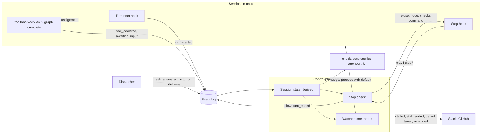

# issue-551: a session never goes idle unnoticed — reviewer briefing

## The short version

A daemon-driven session could stop with work still owed, and nothing noticed. On
issue #549 it stopped twice, for 43 and 36 minutes, right after it advanced the graph
itself.

This pull request closes that in three layers:

- **Prevent.** A claim's answer carries the next assignment. The Stop gate refuses a
  stop while agent work is owed, also after an approved human gate. The skill no
  longer tells a daemon session to end at a boundary.
- **Detect.** Two harness hooks record each turn's start and end. One watcher in the
  control-plane service nudges an idle session, then tells a person once.
- **Tell the truth.** A comment no longer marks a node "blocked". A question can carry
  a default taken at a deadline. `check` shows working, waiting, idle and stalled.

**What I need from you:** the security sign-off and two decisions, asked
[here](https://github.com/MadaraUchiha-314/the-loop/pull/552#issuecomment-7053645871).

## Review effort

**5** — a new subsystem and a security boundary. About 5,000 lines of production
code in 65 files, 9,700 lines of tests, and the docs. The three files in stops 1 to 3
hold most of the risk; reading those and their tests is the core of the review.

## Guided tour

1. [`cli/the_loop/core/watchdog.py:344`](https://github.com/MadaraUchiha-314/the-loop/blob/the-loop/issue-551/cli/the_loop/core/watchdog.py#L344)
   — **the daemon types into a session on its own initiative.** Check that the nudge
   inserts nothing a commenter controls, that the record is written before the paste,
   and the re-check just before each act (`_still_owed`, line 276).
2. [`cli/the_loop/core/sessionstate.py:285`](https://github.com/MadaraUchiha-314/the-loop/blob/the-loop/issue-551/cli/the_loop/core/sessionstate.py#L285)
   — **every decision reads this one derivation.** Check what resets the nudge
   budget, how several asks are tracked, and what an old log yields.
3. [`cli/the_loop/core/stopcheck.py:73`](https://github.com/MadaraUchiha-314/the-loop/blob/the-loop/issue-551/cli/the_loop/core/stopcheck.py#L73)
   — **may this session stop?** Check the order, and that no path refuses when it
   must allow: a wedged session is the worst outcome.
4. [`hooks/the-loop-gate.py:376`](https://github.com/MadaraUchiha-314/the-loop/blob/the-loop/issue-551/hooks/the-loop-gate.py#L376)
   — the Stop hook. It runs at every turn end on every harness. Check the attempt
   cap, the fallback for an older CLI (`blocking_node`, line 245), and the worst-case
   time with the service down (55 seconds).
5. [`cli/the_loop/webhook/dispatcher.py:4305`](https://github.com/MadaraUchiha-314/the-loop/blob/the-loop/issue-551/cli/the_loop/webhook/dispatcher.py#L4305)
   — which deliveries close an ask and reset a budget. Only an authorized person's.
6. [`cli/the_loop/graph/runtime.py:1435`](https://github.com/MadaraUchiha-314/the-loop/blob/the-loop/issue-551/cli/the_loop/graph/runtime.py#L1435)
   — an inbound event reads an agent-owned node without grading it; line 1392 builds
   the claim's `assignment` and `next`.
7. [`cli/the_loop/core/sessions.py:802`](https://github.com/MadaraUchiha-314/the-loop/blob/the-loop/issue-551/cli/the_loop/core/sessions.py#L802)
   — the ask's deadline: the cap, the bound, one timed ask per step.
8. [`cli/the_loop/channels/sessionnotes.py`](https://github.com/MadaraUchiha-314/the-loop/blob/the-loop/issue-551/cli/the_loop/channels/sessionnotes.py),
   [`cli/the_loop/core/sessionsurface.py`](https://github.com/MadaraUchiha-314/the-loop/blob/the-loop/issue-551/cli/the_loop/core/sessionsurface.py),
   the skill and the docs — lower risk; skim.

## What changed (map)

## Key decisions & why (education)

- **The harness says when a turn runs.** Two hooks record a turn's start and end.
  tmux output and the transcript's age were rejected: the transcript is written late.
  Cost: a session without the hooks is "not watched", and says so.
  [decision-155](../../../decisions/decision-155.md).
- **The service decides a stop; the hook stays a clock.** The verdict needs the event
  log (asks, waits), and the hook must work with no Python package. The hook keeps
  its attempt cap, so a dead service can never wedge a session.
- **No new store.** Stalls, waits, budgets and deadlines are derived from the event
  log. A restart repeats nothing. The price: with the log disabled or unwritable, the
  watcher does nothing, because acting without a record would mean nudging without
  bound.
- **The nudge budget belongs to the visit to a node, not to the idle period.** A nudge
  starts a turn, which ends the stall it answered. Without this rule a session that
  answers each nudge with an empty turn would be nudged forever.
- **A declared wait covers one stop.** Otherwise one wait would excuse every later
  stop until it expired.
- **A default at its deadline is told to the session, never posted as an answer.** A
  synthetic answer would look like a person's. No gate reads it.
- **Each act is re-checked just before it happens.** The critic found the watcher
  acting on a snapshot. The fix narrows the race to the paste itself; it cannot close
  it, because the dispatcher and the watcher share no lock.
- **An inbound event evaluates an agent-owned node read-only**, unless a hook of the
  node declared that it reads events. "Blocked" and "escalated" now come only from the
  session's own claim.

## What the reviews found

| Round | Reviewer | Findings | Outcome |
|---|---|---|---|
| Self-review 1 | `claude/fable-5.2` | 26 (8 major) | 25 fixed, 1 fixed in part |
| Self-review 2 | `claude/fable-5.2` | 8 (1 major), 10 doc statements | all fixed; 2 parts recorded |
| Critic | `codex/gpt-6.1-sol` | 3 (2 major) | 2 fixed; 1 about the locked design, flagged |
| Security | `claude/fable-5.2`, the checklist | 6 (2 medium) | 4 fixed, 1 recorded, 1 open (F2) |

Records: [`self-review.md`](self-review.md), [`critic-review.md`](critic-review.md),
[`security-review.md`](security-review.md).

## Evidence

- Whole suite at `a0b978dd`: 7928 passed, 2 skipped. `pre-commit run --all-files`
  exit 0. [`ci-parity.md`](ci-parity.md).
- Each acceptance criterion mapped to its proof:
  [`final-validation.md`](final-validation.md).
- End to end with the real hooks, a real tmux pane and a stub harness:
  [`e2e.md`](e2e.md).
- Each abuse case mapped to its negative test:
  [`security-tests.md`](security-tests.md).

## Known limits

1. **A pull request's own session** (a PR in another repository) gets the stall
   notice and ask handling, but no nudge, and its Stop gate does not judge the PR's
   inner loop. It needs a design decision.
2. **The service authenticates no caller.** See the security record.
3. **A turn that ends with no Stop hook** (an interrupt, a usage-limit cut-off) leaves
   the session marked "working". This is finding F2.
4. **A stall on a real harness is not proved before merge.** The daemon runs released
   code. The first real nudge will be reported on the ticket.
5. **The event log never rotates.** Reads are streamed and filtered, and still grow
   with the file.
6. **An answered question's Slack message is not edited.** Nothing edits one today.
7. **GitHub shows a stall's end as a follow-up comment**, where Slack edits the notice.

## Open questions for the reviewer

1. Security sign-off, accepting the binding check as built.
2. F2: bound "working" now, with one notice after four hours in one turn, or keep it
   out of scope.
3. C3: leave the locked `design.md`, or move two passages to `tasks.md`.
4. After merge: do you want follow-up tickets for limits 1, 2 and 5, and for the two
   defects of `the-loop critic run` (wrong default checkout; client timeout)?
