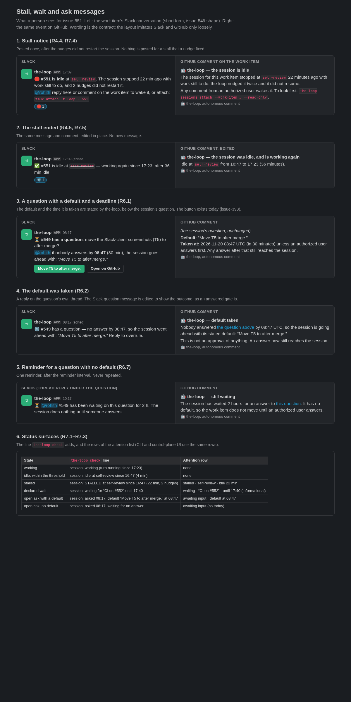

# Mock-up and message wording (T5)

| Row | Procedure | Result |
|---|---|---|
| T5 | `chromium --headless=new --window-size=1200,2400 --screenshot=… design/messages.html` | [`ui/mockup.png`](ui/mockup.png) |
| T5 | wording asserted in `tests/test_channels_sessionnotes.py`, `tests/test_channels_shortform.py` and `tests/test_ask_deadline_integration.py` | passed (whole suite) |

## Where the built messages differ from the mock-up

- **GitHub, stall ended.** GitHub comments cannot be edited in place by the GitHub
  channel, so the stall's end is a short follow-up comment. Slack edits the notice.
- **Slack mentions** sit on their own first line, not inside the sentence.
- **Default taken, Slack.** The question keeps its text and gains an outcome line,
  as an answered gate does. The mock-up strikes the title.
- **Times** read `HH:MM UTC` on both surfaces.
- **Raised wait.** When a wait is raised to the operator's minimum, GitHub and the
  CLI say so. The Slack line shows only the effective time.
