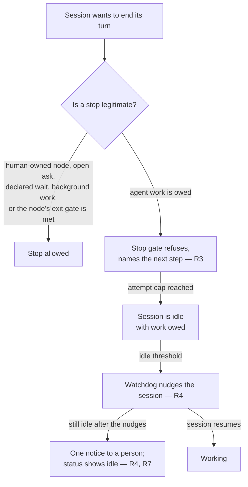

# Requirements: a session never goes idle unnoticed

## The short version

A daemon-driven session can stop with work still owed, and today nothing notices. On
#549 it stopped twice, for 43 and 36 minutes, right after it advanced the graph
itself. It also waited 8.5 hours on a question that did not need to block. Each time
the author had to ask "what's happening?".

This work item closes that gap in three layers:

- **Prevent.** An advance tells the session what to do next (R1). The skill stops
  telling daemon sessions to end at a boundary (R2). The Stop gate refuses a stop
  while agent work is owed (R3).
- **Detect.** A watchdog nudges an idle session, then tells a person (R4).
- **Tell the truth.** A comment no longer marks a node "blocked" (R5). A question
  can carry a default that is taken after a stated wait (R6). Status surfaces show
  "idle" and "waiting" as what they are (R7).

Read **R3** and **R4** closely: they define when a stop is legitimate, and they add
one new idea, the *declared wait*. Check the default numbers in the
[table of defaults](#defaults). Two things are left out on purpose; see
[Out of scope](#out-of-scope).

## Introduction

[Issue #551](https://github.com/MadaraUchiha-314/the-loop/issues/551) carries a
diagnosis of why issue-549 kept looking stuck. I checked each of its code claims
against this checkout before writing these requirements, and they hold:

| Gap | What happens today | Where |
|---|---|---|
| P1 | `the-loop graph complete` answers only "advanced to *node*". The assignment for the next node is skipped on this path. | `cli/the_loop/graph/hooks/assignment.py`, `graph/runtime.py` |
| P2 | The skill tells a daemon session to end at a phase boundary because "the next session starts fresh". Nothing starts one. | `skills/the-loop/reference/context.md` |
| P3 | The Stop gate walks the graph from its start and gives up at the first node that is not `pass` or `skip`. An approved human gate reports `wait`, so the gate never blocks again after the first approval. | `hooks/the-loop-gate.py` |
| P4 | Nothing detects a session that is idle on an agent-owned node. | — |
| P5 | Every inbound comment grades the current node's exit gate, records a block, and escalates on the second comment. | `cli/the_loop/webhook/dispatcher.py`, `graph/runtime.py`, `graphlink.py` |
| P6 | `the-loop ask` always means "stop and wait". It has no timeout and no reminder. | `cli/the_loop/commands/ask_cmd.py` |

The brainstorm phase was declared skipped for this item, so the ticket's diagnosis
stands in for it.

Terms used below:

- **Agent-owned node**: a node of the process graph whose work the session does, such
  as `design` or `implementation`. A **human-owned node** is an approval gate.
- **Claim**: the session saying a node is done, with `the-loop graph complete`.
- **Open ask**: a `the-loop ask` question with no authorized answer yet.
- **Declared wait**: a record, written by the session, that it is waiting on a named
  condition other than a person (CI, another session's pull request) until a stated
  time. R4 introduces it.
- **Idle**: the session's turn has ended, nothing it started is still running, and
  no reason in R3.2 applies.
- **Stall**: an idle session on an agent-owned node, past the idle threshold.

## Requirements

### Requirement 1 — an advance says what comes next

**User story:** As a session that just claimed a node, I want the command's answer
to carry my next assignment, so that I continue in the same turn and do not guess.

#### Acceptance criteria (EARS)

1. WHEN a session's claim advances the work item into an agent-owned node THEN the
   command's output SHALL carry that node's assignment, with the same content the
   daemon delivers after a human gate.
2. WHEN the output carries an assignment for an agent-owned node THEN it SHALL also
   state that the session continues with that node in the same turn.
3. WHEN a session's claim advances the work item into a human-owned node THEN the
   output SHALL state that the session now waits, and for which gate.
4. WHEN a claim advances through several nodes in one call THEN the output SHALL
   carry the assignment of the node the work item ends on, and only that one.
5. WHEN the daemon delivers an assignment for a node THEN the session SHALL NOT
   receive the same assignment a second time from the claim path.
6. WHEN the output is requested as JSON THEN the assignment SHALL be a field of its
   own, so a caller does not parse prose.

### Requirement 2 — the skill never tells a daemon session to stop at a boundary

**User story:** As the author of a work item, I want the skill and the runtime to
agree, so that a session following the skill to the letter keeps working.

#### Acceptance criteria (EARS)

1. WHEN a daemon-driven session crosses a boundary between two agent-owned nodes
   THEN the skill SHALL instruct it to checkpoint, reduce its context by compaction
   or by handing the next node to a fresh subagent, and continue in the same turn.
2. The skill SHALL NOT state, anywhere, that ending a daemon-driven session starts a
   fresh one.
3. WHEN the skill describes where a session may end its turn THEN it SHALL list
   exactly the legitimate reasons of R3.2.
4. WHEN a session announces a next step THEN the skill SHALL require it to take that
   step in the same turn, or to record why it cannot (an ask or a declared wait).

### Requirement 3 — the Stop gate refuses a stop while agent work is owed

**User story:** As an operator, I want the Stop gate to hold on every agent-owned
node, so that a session cannot end its turn silently with work to do.

#### Acceptance criteria (EARS)

1. WHEN a session tries to end its turn AND the work item's pointer is on an
   agent-owned node whose exit gate is unmet AND no reason of R3.2 applies THEN the
   Stop gate SHALL refuse the stop.
2. The Stop gate SHALL allow the stop WHEN any of these holds:
   1. the pointer is on a human-owned node, or the work item is complete;
   2. the work item has an open ask;
   3. the work item has a declared wait that has not expired;
   4. work the session started is still running in the background;
   5. the pointer's node is waiting on a condition the graph itself reports as a
      wait, such as unfinished inner loops.
3. WHEN a human-owned node before the pointer reports `wait` THEN the Stop gate
   SHALL treat it as passed and SHALL judge the pointer's own node.
4. WHEN an agent-owned node before the pointer reports `block` THEN the Stop gate
   SHALL still refuse the stop and name that node, as it does today (issue-429).
5. WHEN the Stop gate refuses a stop THEN its message SHALL name the node, the unmet
   checks and the command that resumes the node.
6. WHEN the Stop gate has refused the same work item the maximum number of times in
   a row THEN it SHALL allow the stop, as it does today, AND the-loop SHALL record
   that the gate gave up.
7. IF the Stop gate cannot tell where the work item stands THEN it SHALL allow the
   stop, as it does today.
8. WHEN a session's turn ends on a registered work item THEN the-loop SHALL record
   the turn's end with the node, the node's status and the reason the stop was
   allowed.

### Requirement 4 — a watchdog notices an idle session

**User story:** As the author of a work item, I want the-loop to notice when its
session stalls, so that I never have to ask "what's happening?".

#### Acceptance criteria (EARS)

1. WHILE a daemon-driven session is idle on an agent-owned node AND the idle
   threshold has passed THEN the daemon SHALL deliver one resume nudge into the
   session AND record the stall.
2. WHEN a nudge is delivered THEN it SHALL name the node and the command that
   resumes it, and SHALL tell the session to continue, to ask, or to declare a wait.
3. WHEN the session is still idle one idle threshold after a nudge AND fewer nudges
   than the nudge limit were sent for this stall THEN the daemon SHALL nudge again.
4. WHEN the nudge limit is reached AND the session is still idle THEN the daemon
   SHALL post one notice where the work item's updates go, naming the node and how
   long the session has been idle, AND SHALL send no further nudge for this stall.
5. WHEN a stalled session starts a turn again THEN the daemon SHALL record that the
   stall ended AND SHALL mark the notice, if one was posted, as resolved.
6. The daemon SHALL NOT nudge WHILE any reason of R3.2 applies, WHILE the session is
   paused or closed, or WHILE the session's turn is running.
7. WHEN a session records a declared wait THEN it SHALL state the condition and an
   end time AND the-loop SHALL refuse a wait longer than the wait limit.
8. WHEN a declared wait expires AND the session is idle THEN the watchdog SHALL
   treat the session as idle from that moment.
9. WHEN an inbound event reaches an idle session THEN that event alone SHALL NOT
   reset the stall; only a turn of the session does.
10. WHEN the daemon restarts THEN it SHALL resume watching every stall from the
    recorded events AND SHALL NOT send a nudge or a notice a second time.
11. The watchdog SHALL work under every ingress the daemon supports (webhook
    receiver, poller, gateway).
12. IF the watchdog is switched off in the operator's config THEN the daemon SHALL
    send no nudge and no notice, AND R3 SHALL still apply.

### Requirement 5 — a comment does not grade the node

**User story:** As a human commenting on a work item, I want my comment to leave
the node's status alone, so that "blocked" and "escalated" mean something.

#### Acceptance criteria (EARS)

1. WHEN an inbound event is delivered to a session whose pointer is on an
   agent-owned node AND the node's exit gate is unmet THEN the daemon SHALL NOT
   count an attempt, SHALL NOT record a block and SHALL NOT escalate.
2. WHEN an inbound event is delivered AND the node's exit gate is met THEN the
   daemon SHALL advance the work item, as it does today.
3. WHEN an inbound event is one that a hook of the node consumes, or the pointer is
   on a human-owned node, THEN the daemon SHALL evaluate the node as it does today.
4. WHEN a session's own claim fails the node's exit gate THEN the-loop SHALL record
   the block and count the attempt, as it does today.
5. The-loop SHALL escalate a node only WHEN a claim of the session repeats a block
   or the node's attempts are spent.
6. WHILE an agent-owned node has no failed claim THEN every status surface SHALL
   show it as in progress, and SHALL NOT show it as blocked.

### Requirement 6 — a question can carry a default and a deadline

**User story:** As a session with a reversible choice to make, I want to ask without
blocking, so that a person can overrule me but the work does not wait for them.

`the-loop ask --default <text>` exists already (issue-393): it names the answer a
one-tap button sends. This requirement adds the wait after which that answer is
taken, and a reminder for a question that has no default.

#### Acceptance criteria (EARS)

1. WHEN a session asks with a default answer and a wait THEN the posted question
   SHALL state the default and the time at which it will be taken.
2. WHEN the wait ends AND no authorized answer has arrived THEN the daemon SHALL
   tell the session to proceed with the default, SHALL post on the same thread that
   the default was taken, AND SHALL record the event and close the ask.
3. WHEN an authorized answer arrives before the wait ends THEN the-loop SHALL
   deliver it as it does today AND SHALL NOT take the default.
4. WHEN an answer arrives after the default was taken THEN the-loop SHALL deliver it
   to the session as a comment, so the session can correct course.
5. IF the requested wait is shorter than the operator's minimum THEN the-loop SHALL
   use the minimum AND SHALL say so in the command's output and in the question.
6. IF a wait is given without a default answer THEN the command SHALL fail with a
   message that says why.
7. WHEN an ask without a default has been open for the reminder interval THEN the
   daemon SHALL post one reminder where the question was asked, AND no more.
8. The-loop SHALL NOT accept a default answer as the answer to a human gate.
9. The skill SHALL state three cases:
   1. a reversible choice with a recommended option: take it, say so, do not ask;
   2. a choice where a person's view is worth having but not worth blocking for:
      ask with a default and a wait, and keep working on what does not depend on it;
   3. an irreversible act, a security decision, or anything that needs a person's
      authority: ask without a default, and wait.
10. WHEN the daemon restarts THEN every pending default and reminder SHALL still
    fire once, at its recorded time.

### Requirement 7 — status says what is really happening

**User story:** As someone watching a work item, I want its status to separate
"working", "waiting" and "idle", so that I know whether I need to act.

#### Acceptance criteria (EARS)

1. WHEN a work item has a stall THEN `the-loop check`, the attention list and the
   control plane SHALL show it as idle, with the node and the time the stall began.
2. WHEN a work item has a declared wait THEN the same surfaces SHALL show the
   condition and the end time.
3. WHEN a work item has an open ask with a default THEN the same surfaces SHALL
   show the default and the time it will be taken.
4. WHEN a stall notice is posted in Slack THEN it SHALL follow the message shape of
   issue-549 (a short form, in the work item's conversation).
5. WHEN a stall ends THEN the work item SHALL leave the attention list without a
   person's action.

## Non-functional requirements

- **Cost.** A healthy session costs no extra turn. The watchdog reads recorded state
  and events only, and it spends tokens only when it nudges. One stall spends at
  most the nudge limit.
- **Configuration.** The numbers below are keys of the operator's `cli-config.yaml`,
  with a schema entry and a page in `docs/config/`. A config without them behaves
  as the defaults say.
- **Events.** Each new record (a turn's end, a stall, a nudge, a stall's end, a
  declared wait, a default taken, a reminder, the gate giving up) is a registered
  event type and appears in the event reference.
- **Prompts and strings.** The nudge and the new assignment line are prompt files.
  The notice, the reminder and the "default taken" comment are strings (issue-540).
- **Harnesses.** R1, R2, R4, R5, R6 and R7 hold on every harness. R3 holds as far
  as each harness lets a hook refuse a stop, as today: Claude Code and Codex block,
  Cursor sends a follow-up.
- **Tests.** A regression test covers "the pointer is past an approved human gate".
  Each abuse case below is a negative test.
- **Documentation.** The capability docs for the process graph, interactive
  sessions, channels and the CLI change in the same pull request, with the skill.

### Defaults

| Setting | Default | Why |
|---|---|---|
| Idle threshold | 10 minutes | Shorter than both stalls on #549 (43 and 36 minutes). Longer than a normal pause between a turn's end and the event that resumes it. |
| Nudge limit for one stall | 2 | One nudge fixes a forgotten step. A second covers a failed delivery. More would spend tokens on a session that cannot recover alone. |
| Wait limit for a declared wait | 60 minutes | Long enough for a CI run. A longer wait must be renewed, which is a recorded act. |
| Minimum wait before a default is taken | 30 minutes | A person needs a real chance to answer. |
| Reminder interval for an ask without a default | 2 hours | The #549 question waited 8.5 hours with no reminder. |
| Stop-gate attempts | 3 (unchanged) | The existing cap. |

## Security considerations

This change adds one privileged behaviour: the daemon types into a session without a
human event (the nudge, and the "proceed with the default" message). It adds no new
ingress, no new credential and no new network call.

- **Actors & trust:**
  - *Authorized users* answer asks and approve gates. Trusted, as today.
  - *Any commenter* on the ticket or pull request. Untrusted. Their text may tell
    the session to take defaults, to declare waits, or to stop.
  - *The session itself*. It writes the default answer, the declared wait and the
    turn-end record. It is partly trusted: it can be steered by untrusted text, so
    nothing it writes may widen its own authority.
  - *Anyone who can write the daemon's state directory*. Already able to forge
    events; unchanged by this work item.
- **Trust boundaries & data:**
  - The nudge crosses from the daemon into the session's prompt. Its text is a
    fixed prompt file plus the node id and the resume command. It carries no ticket
    text, no comment text and no default-answer text.
  - The default answer is session-written text that returns to the session and is
    posted on the thread. It is treated as data when rendered and never as a gate
    answer.
  - No secret, token or personal data is stored or moved. Events carry the work
    item ref, the node id, timestamps and the wait's stated condition.
- **Abuse cases (EARS):**
  1. WHEN a user who is not authorized replies to an ask that has a default THEN
     the-loop SHALL NOT treat the reply as the answer AND the default's timer SHALL
     run on.
  2. WHEN a user who is not authorized comments repeatedly on a stalled work item
     THEN the stall SHALL NOT be reset (R4.9).
  3. WHEN ticket or comment text tells the session to pass a default for an
     approval THEN no human gate SHALL accept that default (R6.8).
  4. WHEN a session declares a wait longer than the wait limit THEN the-loop SHALL
     refuse it (R4.7), AND each accepted wait SHALL be a recorded, visible event.
  5. WHEN a session stays idle after every nudge THEN the daemon SHALL stop nudging
     at the nudge limit (R4.4), so a stuck session cannot spend tokens without end.
  6. WHEN the stated condition of a declared wait or the text of a default answer
     contains markup or mentions THEN the-loop SHALL render it as inert text in
     every channel.
  7. WHEN a Stop-gate refusal repeats THEN the attempt cap SHALL still end it
     (R3.6), so the gate cannot wedge a session.
- **Fail closed:**
  - A default with no wait recorded, or a wait that cannot be parsed, is never
    taken: the ask stays an ordinary ask.
  - An answer whose author cannot be shown to be authorized does not stop a
    default and does not answer an ask.
  - A stall whose work item, node or session cannot be resolved gets no nudge. The
    daemon posts the notice to a person instead when it can name the work item.
  - A session that is paused, closed, or bound to another work item is never
    nudged.
  - The Stop gate's two existing fail-open cases stay (R3.6, R3.7), because a hook
    that wedges a session is worse than one that gives up. The watchdog is what
    covers them.

## Out of scope

- **A session that hangs in the middle of a turn** (a harness waiting on an
  interactive prompt, a hung tool call). The observed failures were ended turns.
  Telling a hung turn from a long test run needs a different signal, so it is a
  separate work item.
- **A progress heartbeat in Slack** (one message, edited while agent work runs),
  recommended as a separate step in the ticket. With R4, silence shorter than the
  idle threshold means "working", and a stall produces a notice. A heartbeat adds
  channel traffic for the same information.
- **Starting a fresh session at a phase boundary.** R2 removes the claim instead of
  building it. A context reset inside one session uses compaction and subagents.
- **Where test messages go.** The session's use of the work item's own room for
  live-test messages on #549 was a judgment error, fixed there.
- **Jira-specific wording.** The ask and notice changes apply to whichever ticketing
  provider the work item uses, with no provider-specific behaviour.

If you want either of the first two in this work item, say so at the gate.

## Open questions

None that block. The two scope cuts above and the numbers in the
[table of defaults](#defaults) are my recommendations and are yours to change at
the gate.

## Review comments

> Appended by the-loop's `record-feedback` hook when a human gate approves with
> comments (issue-109). Append-only and attributed: an approval never silently
> discards a reviewer's suggestions, and the feedback travels with the document
> it concerns rather than living in a side-channel tracker.

### 2026-11-20 — approved

**@MadaraUchiha-314** wrote:

approved
