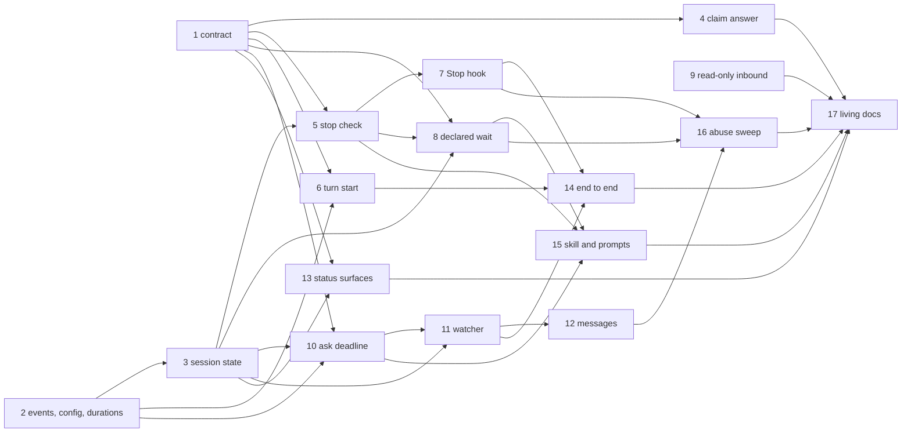

# Tasks: a session never goes idle unnoticed

> The last spec artifact. A DAG derived from the approved
> [`design.md`](design.md) and [`testing-plan.md`](testing-plan.md). It has no gate
> of its own (issue-281).

## The short version

Seventeen tasks in five tracks, all in this repository and on pull request #552.

- **Foundation (1–3):** the contract, the events and config, and the session-state
  derivation that everything else reads.
- **Prevent (4–8):** the claim's answer, the stop check, the hooks, the declared wait.
- **Detect (9–12):** read-only inbound evaluation, the ask deadline, the watcher,
  the channel messages.
- **Show (13):** the status surfaces.
- **Prove and document (14–17):** the end-to-end test, the abuse-case sweep, the
  skill and the docs.

The risky ones are **3** (every later decision reads it), **7** (the hook must keep
working against an older CLI and a dead service) and **11** (the daemon types into a
session on its own initiative).

## Task list

Every task is test-first: the named test goes red before the code that makes it
green.

- [x] 1. Put the contract first
  - Add to `docs/api-specs/openapi/the-loop.v1.yaml`: `defaultAfterSeconds` on the
    ask; the wait, stop-check and turn-start endpoints; `assignment` and `next` on
    the claim response; `session` on the check response; the two attention kinds.
  - _Depends on:_ none
  - _Requirements:_ R1.6, R3, R4.7, R6.1, R7
  - _Test:_ T3 — `tests/test_api_contract_parity.py` (red until tasks 4–13 add the routes)
- [x] 2. Register the events, the config blocks and the duration parser
  - Nine event names with their descriptions in `strings/en.json`.
  - `routing.watchdog` and `routing.asks` in the CLI config schema (both copies),
    their defaults, and the page under `docs/config/cli/`.
  - A strict parser for `45s`, `30m`, `2h`.
  - _Depends on:_ none
  - _Requirements:_ NFR configuration, NFR events, R6.5
  - _Test:_ T1 — `tests/test_eventlog.py`, `tests/test_configschema.py`, `tests/test_durations.py`; T10 — a config without the blocks loads with the defaults
- [x] 3. Derive the state of a session from the event log
  - One read-only derivation: working, waiting (with its reason and end), idle,
    stalled, notified, not watched. It also yields the stall id, the idle start and
    the nudge budget left for the node visit.
  - Open asks close on `reply_sent`, `ask_answered` or `ask_default_taken`.
  - _Depends on:_ 2
  - _Requirements:_ R4.1–R4.10, R7
  - _Test:_ T1 — `tests/test_session_state.py`, one test per arrow of the design's state diagram; T7 — `-k cycle_budget`; T10 — `-k legacy`
- [x] 4. Return the next assignment from a claim
  - The claim envelope gains `assignment` and `next`. A new prompt file carries the
    "continue in this turn" line; the human-gate text names the gate.
  - _Depends on:_ 1
  - _Requirements:_ R1
  - _Test:_ T1 — `tests/test_graph_claim_assignment.py`; T2 — `Scenario: a claim returns the next assignment and says to continue`, `Scenario: an advance the daemon drives delivers the assignment once`
- [x] 5. Decide a stop in the service
  - The stop check, in the design's order, behind `the-loop sessions stop-check` and
    its endpoint. It records `session.turn_ended` with the reason on every allow,
    and on `--gave-up`. It refuses a work item the calling session is not bound to.
  - The refusal text is a prompt file: node, unmet checks, resume command, the three
    ways out.
  - _Depends on:_ 1, 3
  - _Requirements:_ R3.1–R3.5, R3.7, R3.8
  - _Test:_ T1 — `tests/test_stop_check.py`; T2 — `Scenario: a stop with work owed is refused past an approved gate` (the P3 regression), `Scenario: a stop with an open ask is allowed`; T8 — `foreign_work_item`
- [x] 6. Record a turn's start
  - `the-loop sessions turn-start` and its endpoint. A new stdlib-only hook script
    calls it and always exits 0. The Claude Code, Codex and Cursor hook manifests
    gain the entry.
  - _Depends on:_ 1, 2
  - _Requirements:_ R4.5, R4.6
  - _Test:_ T1 — `tests/test_session_state.py -k turn_started`; T10 — `tests/test_harness_gate.py -k turn_start_without_cli`
- [x] 7. Make the Stop hook ask the service
  - The hook forwards the harness payload to `stop-check`, keeps its attempt cap,
    and reports a give-up. When the verb is missing or the service is silent, it
    falls back to `the-loop check` with a `wait` before the pointer counted as
    passed.
  - _Depends on:_ 5
  - _Requirements:_ R3.3, R3.4, R3.6, R3.7
  - _Test:_ T2 — `tests/test_gate_pointer_integration.py`, `Scenario: the gate gives up after its attempts and records why`; T10 — `tests/test_harness_gate.py` fallback cases; T8 — abuse case 7
- [x] 8. Add the declared wait
  - `the-loop wait` and its endpoint. Refused over the wait limit and on a
    human-owned node. The condition is capped at 200 characters. A wait covers the
    one stop that ends the turn it was made in.
  - _Depends on:_ 1, 3, 5
  - _Requirements:_ R3.2.3, R4.7, R4.8
  - _Test:_ T1 — `tests/test_stop_check.py -k declared_wait`; T8 — abuse case 4
- [x] 9. Evaluate an agent-owned node read-only on an inbound event
  - A hook declares, where it is registered, that it reads the inbound event. The
    dispatcher advances as today for a human-owned node or such a hook. Otherwise it
    evaluates without an event and advances only on a pass. Same rule for a pull
    request's inner loop.
  - _Depends on:_ none
  - _Requirements:_ R5
  - _Test:_ T2 — `tests/test_inbound_readonly_integration.py`: `Scenario: a comment does not block an agent node`, `Scenario: a met exit gate still advances on a comment`, `Scenario: a human gate still classifies the comment it receives`
- [x] 10. Give an ask a deadline
  - `the-loop ask --after`. `session.awaiting_input` carries the default, its time
    and an ask id in the event log. The posted question states the default and the
    time. The dispatcher writes `session.ask_answered` when it delivers an
    authorized human comment to a session with an open ask.
  - _Depends on:_ 1, 2, 3
  - _Requirements:_ R6.1, R6.3, R6.5, R6.6
  - _Test:_ T1 — `tests/test_durations.py -k minimum`; T2 — `tests/test_ask_deadline_integration.py`: `Scenario: an answer cancels the default`; T8 — abuse case 1
- [ ] 11. Run the watcher in the control-plane service
  - One thread on a 30-second tick, started and stopped with the service. Each
    cycle: nudge within the node visit's budget, publish `session.stalled` when the
    budget is spent, record `stall_ended`, take ask defaults, send ask reminders.
    Each act is skipped when the log already holds it.
  - The nudge and the "proceed with your default" message are prompt files. The
    nudge inserts only the node id and the node's command.
  - `routing.watchdog.enabled: false` sends no nudge and no notice.
  - _Depends on:_ 3, 10
  - _Requirements:_ R4.1–R4.6, R4.9–R4.12, R6.2, R6.4, R6.7, R6.10
  - _Test:_ T2 — `tests/test_watchdog_integration.py`: `Scenario: an idle session is nudged, then a person is told once`, `Scenario: a restart repeats no nudge and no notice`, `Scenario: a stall ends when the session takes a turn, and the notice is edited`, `Scenario: a switched-off watchdog sends nothing and the gate still holds`; `tests/test_ask_deadline_integration.py`: `Scenario: a default is taken at its deadline, once, across a restart`, `Scenario: an answer after the default still reaches the session`, `Scenario: a question with no default is reminded once`; T8 — abuse cases 2, 5, `nudge_is_fixed`
- [ ] 12. Post and edit the messages
  - Slack and GitHub render `session.stalled`, `session.stall_ended`,
    `session.ask_default_taken` and `session.ask_reminded` with the wording of
    `design/messages.html`. The stall notice is remembered per stall id and edited
    when the stall ends. `session.stalled` joins the default subscription and maps
    to the 🛑 status reaction. All text is in `strings/en.json`.
  - The condition and the default text pass through the channel defusing.
  - _Depends on:_ 11
  - _Requirements:_ R4.4, R4.5, R6.2, R6.7, R6.8, R7.4
  - _Test:_ T2 — `Scenario: the stall notice is a short form in the work item's conversation`; T9 — the `text` fallback; T8 — abuse cases 3, 6
- [x] 13. Show the state on the status surfaces
  - The `session:` line and object of `the-loop check`, the state in
    `the-loop sessions list`, the `stalled` and `declared-wait` attention kinds, the
    default on an `awaiting-input` row, and the control-plane UI's mirror of the
    open-ask rule.
  - _Depends on:_ 1, 3
  - _Requirements:_ R5.6, R7.1–R7.3, R7.5
  - _Test:_ T1 — `tests/test_session_state.py -k surfaces`; T3 — contract parity for the check and attention shapes; the UI's own unit tests (`ui/`, `npm test`)
- [ ] 14. Prove the path end to end
  - A stub harness script and `tests/test_idle_watchdog_e2e.py`: its own service, its
    own tmux server, the real hook scripts. It skips with a reason where `tmux` is
    missing.
  - _Depends on:_ 6, 7, 11
  - _Requirements:_ R3, R4, R4.11
  - _Test:_ T4 — `tests/test_idle_watchdog_e2e.py`
- [ ] 15. Rewrite the skill and the prompts
  - `reference/context.md` (the daemon row and the paragraph under it), `SKILL.md`,
    `commands/work-on.md`, `reference/collaboration.md` (the three ask cases, the
    legitimate stops, "take the step you announce"), and the interaction prompt.
  - _Depends on:_ 5, 8, 10
  - _Requirements:_ R2, R6.9
  - _Test:_ T12 — the grep returns nothing; `tests/test_docs_parity.py`
- [ ] 16. Close the abuse-case sweep
  - Check that each of the seven abuse cases and the two extra boundary tests has a
    named negative test, and add any that tasks 5–12 left out.
  - _Depends on:_ 5, 7, 8, 10, 11, 12
  - _Requirements:_ Security considerations, abuse cases 1–7
  - _Test:_ T8 — `pytest -q -k "abuse or unauthorized or foreign_work_item or nudge_is_fixed"`
- [ ] 17. Update the living docs
  - Capability docs: process graph (the Stop gate, what an inbound event does),
    interactive sessions (turn records, the watcher, the declared wait), channels
    (the four events), CLI. The CLI command pages for `wait`, `ask`, `sessions`,
    `check`. The observability reference's event list. One decision record for how
    the-loop observes a session. The README where it describes the Stop gate.
  - _Depends on:_ 4–13
  - _Requirements:_ NFR documentation
  - _Test:_ T12 — `tests/test_docs_parity.py`; T13 — `uv run pre-commit run --all-files`

## Dependency graph (DAG)

Tasks 1, 2 and 9 have no dependency and can start together. Tasks 4, 9 and 13 touch
files no other track touches.

## Checkpoints

- **After 3:** `cd cli && uv run python -m pytest -q tests/test_session_state.py tests/test_eventlog.py tests/test_configschema.py tests/test_durations.py`.
- **After 8 (Prevent is complete):** the T1 command of the testing plan, plus
  `tests/test_harness_gate.py tests/test_gate_pointer_integration.py`.
- **After 12 (Detect is complete):** the T2 command of the testing plan.
- **After 14:** the whole CLI suite, `cd cli && uv run python -m pytest -q`.
- **After 17:** `uv run pre-commit run --all-files`.

Each task's commit carries its test and names the red-to-green run. After the last
task, the `verification` node executes `testing-plan.md`.

## Review comments

> Appended by the-loop's `record-feedback` hook when a human gate approves with
> comments (issue-109). Append-only and attributed: an approval never silently
> discards a reviewer's suggestions, and the feedback travels with the document
> it concerns rather than living in a side-channel tracker.
