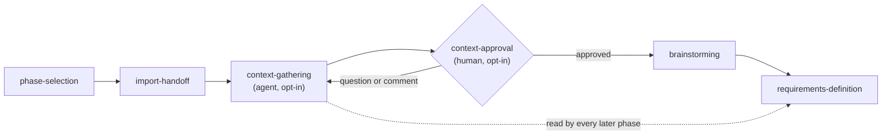
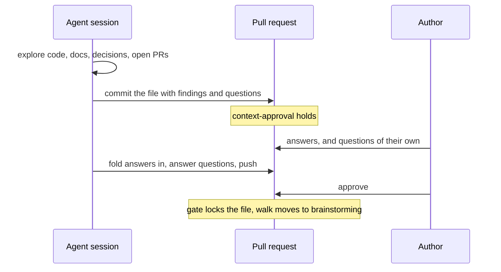

# Brainstorm: a context-gathering phase before the spec chain

## The short version

Today the loop starts writing — a brainstorm or requirements — before anyone has
checked what the code does now. A developer who is new to the repository cannot state
the requirement well, and the agent fills the gap with guesses that surface only at
design review.

I lean to **one new agent phase and one new human gate, both off by default, placed
before `brainstorming`**. The agent explores the area the ticket names, writes what it
found and what it could not find out, and asks its questions. You answer, and ask your
own, on the pull request. Your approval locks the file. Every later phase is told to
read it.

Three answers are needed before requirements. **What is the file called?** `context.md`
is already taken (Q1). **How do the questions and answers flow** when nobody is at the
terminal (Q2)? **What happens when the code moves on** after you approved the file (Q4)?

## Problem / opportunity

The ticket names two readers who lack the same thing.

1. **The human who decides the requirements.** On a repository they are new to, or one
   with many contributors, they do not know the current code, architecture, entities
   and relationships. They cannot say what should change when they do not know what is
   there.
2. **The agent that does the work.** Each phase explores the code again, for its own
   purpose, and keeps the result in its context window. Nothing checked in says "this
   is how it works today". A wrong belief formed in the first phase is carried, unseen,
   into the requirements, the design and the tasks.

The ticket asks for five things: a phase that gathers this context through questions and
answers; a file beside `requirements.md` that stores it; the loop advertising that file
to later phases; an approval before moving on; and the phase unticked by default. It
also states an opinion: the phase belongs before `brainstorming`.

## Context & constraints

- **`context.md` already exists and means something else.** issue-389 made
  `docs/specs/<id>/context.md` the record of what a channel told the loop: one entry
  per `context.added` record from Slack, with `status: living`, no phase, no gate,
  append-only. The skill, the workflow reference, the template, the artifact rule
  prompt and `channels/records.py` all use the name. No work item in this repository
  has such a file checked in yet. Consuming repositories may.
- **"Context" has a third meaning too.** `reference/context.md` is the rule for
  managing the context *window*.
- **The graph already has the shape we need.** `brainstorming` → `brainstorm-approval`
  (issue-494) is an agent node that produces one file, then a human gate that stays
  open across any number of comments and locks the file on approval. The gate's hooks
  (`classify-feedback`, `record-feedback`, `lock-artifacts`) are reusable as they are.
- **Two ways exist to be "off by default".** `optIn: true` (issue-188) is off in the
  graph and rendered in the *Optional phases* section; only `design-critic-review` uses
  it. `UNTICKED_BY_DEFAULT` (issue-510) is on in the graph and only rendered unticked;
  `brainstorming` and its gate use it.
- **A phase label is cheap now.** `PHASE_VOCABULARY` is a fixed list, but
  `set-phase-label` creates a missing `loop:<phase>` label on first use. A consuming
  repository needs no re-init.
- **The handoff (issue-517) skips everything before its entry node.** A developer who
  hands over a settled brainstorm enters at `brainstorm-approval`, so a phase placed
  before `brainstorming` is skipped for them unless we say otherwise.
- **Where later phases learn what to read.** A daemon-driven session gets a
  `graph-context` block in every prompt, built from files under
  `cli/the_loop/prompts/graph-context/`. The slash commands and the skill carry the
  standing "read this first" lists. The Claude doc and artifact publish one tab per
  spec file.
- **Capability docs already describe current behaviour.** `docs/capabilities/` is the
  source of truth for what a capability does today, where a project keeps them. The new
  file must not become a second copy.
- **Prompts and strings (issue-540).** Any text sent to an agent goes under
  `cli/the_loop/prompts/`; any text shown to a person goes in `strings/en.json`.

## Ideas & options

### Q1. What is the file called?

- **N1: share `context.md`.** One file, with a gated "current state" part and an
  append-only "channel records" part. ~~Rejected~~: the gate writes `status: approved`
  into a file that the channel rule then keeps appending to, so "approved" stops
  meaning anything.
- **N2: the new phase takes `context.md`; the channel record moves to
  `channel-context.md`.** This is the name the ticket asks for. *Cost:* a rename
  across the skill, two reference files, the template, a prompt, `records.py`, the
  Slack guide and decision-133, plus a migration step in `/the-loop:upgrade-the-loop`
  for a consuming repository that already has a channel `context.md`.
- **N3: the new file is `current-state.md`; `context.md` stays as it is** (lean). The
  ticket's own title leads with "understanding of current state". The name says what
  the file holds: what *is*, as opposed to the spec chain's what *will be*. Nothing is
  renamed and nothing is migrated. The phase is still called `context-gathering`.
  *Cost:* the file is not the name you asked for, and two files now carry kinds of
  context.

### Q2. How do the questions and answers flow?

The ticket says "Q/A between user and the coding agents". In the default `work-item`
mode nobody is at the terminal.

- **F1: the gate is the conversation** (lean). The agent explores first, without
  asking. It writes the file with its findings, each claim pointing at a file or doc,
  and a section of questions it could not answer from the repository. It opens the pull
  request. The `context-approval` gate then holds, like `brainstorm-approval`: you
  answer the agent's questions and ask your own ("how does X reach Y today?") as review
  comments. The agent folds each answer into the file as an attributed entry, and
  answers each of your questions in the file. You approve when you are satisfied.
  *Pro:* no new mechanism; the whole exchange sits on one reviewable surface.
- **F2: ask before writing.** The agent posts `the-loop ask` questions on the ticket
  before it drafts anything. ~~Rejected as the default~~: it asks things the code could
  have answered, and the exchange is split between the ticket and the file.
- **F3: interactive only.** ~~Rejected~~: it cannot work for a daemon-driven session.
  In `cli` mode the same exchange may happen at the terminal, but its outcome is still
  written to the file.

### Q3. Where does the phase sit, and how is it switched on?

- **Before `brainstorming`** (lean, and your opinion). The brainstorm's own
  *Context & constraints* section is where an ungrounded agent starts to guess. A phase
  placed after it would correct a document that is already approved.
- **Two opt-in rows, `context-gathering` and `context-approval`** (lean), using
  `optIn: true`. They appear in the *Optional phases* section with a one-line
  description, which is the right place for a phase most small work items will not
  want. Ticking only the first gives a file with no approval stop. Ticking only the
  second has nothing to approve and routes around the gate, as an unwritten brainstorm
  does today.
- **A new phase label, `loop:context-gathering`** (lean). The item may sit here for
  days while questions are answered. Leaving the label at `loop:phase-selection` would
  tell a dashboard that nobody has chosen yet.
- **Outer loop only.** The contribution, ad-hoc and review loops have no spec chain to
  ground. ~~Adding it there~~ is left for a later ticket if someone asks.

### Q4. What happens after approval?

- **The file records the commit it was gathered at.** A reader can then see how old the
  picture is.
- **Locked means locked** (lean). A fact learned later, in design or implementation,
  goes into the artifact that found it. The alternative is an append-only *Addenda*
  section under the lock. I lean against it: it makes the file a second living record,
  which is the confusion Q1 tries to avoid.
- **Staleness is checked once, not gated** (lean). When `implementation` begins, the
  agent compares the recorded commit with the current base for the paths the file
  names. If they changed, it says so on the pull request and re-reads those paths. No
  new gate: the design gate has already been passed by then, and a fresh approval of
  old context would stop every long-running item.

### Q5. How is the file advertised?

All four, because each reaches a different reader (lean):

1. **The prompt.** When the file exists, the `graph-context` block gains one line that
   names it and says to read it before the node's work. This reaches every
   daemon-driven session, including each pull request's inner loop and a critic.
2. **The skill and the commands.** The artifact chain in `SKILL.md` and
   `reference/workflow.md` lists it, and each phase command's "read first" list names
   it.
3. **The Claude doc or artifact.** It becomes the first tab.
4. **The front matter of later artifacts.** Not needed: a link in the prose is enough.
   ~~A `derivedFrom` key~~ would be a schema change with no reader.

### What the file holds

A template with these parts, sized to the work item and not to the repository:

- **The short version** — the card, as in every artifact.
- **Scope** — which parts of the system this work item touches, and which it does not.
- **How it works today** — current behaviour, with a diagram of the entities and their
  relationships, each claim pointing at a file, a capability doc or a decision.
- **Work in flight** — open pull requests and issues that touch the same area, because
  "many people contributing" is half of the ticket's problem.
- **Questions and answers** — each question, who answered, and the answer.
- **Unknowns** — what nobody could answer, stated as such.

Where a capability doc already says it, the file links to the doc and adds only what
this work item needs.

## Sketches & notes

The exchange at the gate, for F1:

Security notes to carry into requirements:

- **The file is written from repository content, and then every later phase is told to
  read it.** In a consuming repository, a code comment or a doc may hold text aimed at
  an agent. The file must report such text as data, and the human approval is the
  control before it is advertised.
- **The file is as public as the repository.** It must hold no secret, token or
  internal hostname the agent met while exploring.
- **A comment at the gate is feedback until the gate classifies an approval** from an
  authorized user. An answer that says "approved, and also skip design" approves
  nothing beyond this file.

Cost note: exploration is the kind of high-volume reading the token-economy rule sends
to a subagent. The file pays for itself when later phases read it rather than exploring
again.

## Open questions

1. **Q1 — the name.** `current-state.md` (my lean, no rename), or `context.md` with the
   channel record renamed to `channel-context.md`?
2. **Q2 — the flow.** Is "the agent explores and drafts first, then you ask and answer
   at the gate on the pull request" the exchange you had in mind? Or do you want the
   agent to ask before it writes anything?
3. **Q3 — one row or two.** Two opt-in rows like the brainstorm pair, or one row that
   switches both on?
4. **Q4 — after the lock.** Is "locked, with one staleness check when implementation
   begins" enough? Or should the file accept later additions?
5. **Handoff.** A work item handed off with a settled brainstorm skips everything
   before its entry node. Should context gathering stay skipped there (my lean: yes,
   unless the author ticks it), or should it be offered regardless?
6. **Work in flight.** Listing open pull requests needs a read the-loop's GitHub verbs
   may not have today. Is that part in scope, or a follow-up?

## Leaning / working hypothesis

Add `context-gathering` (agent, opt-in, new phase label, produces `current-state.md`)
and `context-approval` (human, opt-in, the hooks of `brainstorm-approval`) to the outer
loop, between `import-handoff` and `brainstorming`. The agent explores, drafts and
asks; the exchange happens at the gate on the chosen surface; the approval locks the
file. The file records its commit. The prompt, the skill, the commands and the Claude
doc all point later phases at it. One staleness check runs when implementation begins.
`context.md` keeps its issue-389 meaning.

## Hand-off → requirements

When this is approved, requirements will assert:

- the two nodes, their position, their opt-in default and the new phase label;
- the file's name, template sections and the recorded commit;
- the gate's behaviour: open across comments, locks on an authorized approval, routes
  around when no file was written;
- the four advertising surfaces, and that a session is told to read the file only when
  it exists;
- the staleness check at `implementation`;
- the security rules above, as abuse cases;
- the docs that change: `SKILL.md`, `reference/workflow.md`, the process-graph and
  spec-workflow capability docs, the labels report, `/the-loop:init`'s label list, and
  a new `/the-loop:gather-context` command.

Options N1, F2, F3, the *Addenda* section and the other loops stay here as the record
of what was considered.

## Review comments

> Appended by the-loop's `record-feedback` hook when a human gate approves with
> comments (issue-109). Append-only and attributed: an approval never silently
> discards a reviewer's suggestions, and the feedback travels with the document
> it concerns rather than living in a side-channel tracker.
