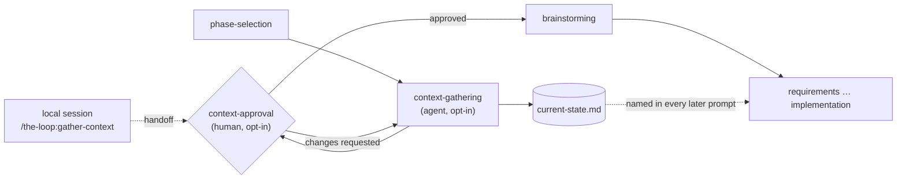

# Requirements: a context-gathering phase before the spec chain

> Phase 1 of the spec chain for
> [issue #553](https://github.com/MadaraUchiha-314/the-loop/issues/553). Derived from
> the approved [`brainstorm.md`](brainstorm.md), including the decisions its author made
> in review on pull request #554.

## The short version

The outer loop gains an optional first step: before any spec is written, the agent
records how the affected part of the system works today, and a person confirms it.

Two nodes are added before `brainstorming`, both off unless ticked at
`phase-selection`. `context-gathering` produces `current-state.md`. `context-approval`
holds it open for questions in both directions, and locks it on an authorized approval.
Every later phase is told to read the file. A developer can also gather context on
their own machine with `/the-loop:gather-context` and hand it over.

Read Requirement 4 (how the file reaches later phases) and Requirement 6 (the handoff)
most closely: they touch the most existing behaviour. `context.md` keeps its issue-389
meaning and is not changed.

## Introduction

A developer who is new to a repository, or who works in one that many people change,
cannot state a requirement well: they do not know what is there. The agent has the
same gap, and fills it with guesses that surface at design review. Today nothing
checked in says "this is how it works today" for a work item.

This work item adds a context-gathering phase to `pdlc-work-item-loop`. The brainstorm
settled its shape:

| Point | Decision |
|---|---|
| File | `current-state.md`, beside the spec files. `context.md` stays the channel record. |
| Position | Before `brainstorming`, after `import-handoff`. |
| Default | Off. Two opt-in rows at `phase-selection`. |
| After approval | Locked. One staleness check when implementation begins. |
| Exchange | The agent explores and drafts first; questions and answers happen at the gate. |
| Open pull requests | Not listed. The file describes the code, not the work in flight. |

## Requirements

### Requirement 1 — two opt-in nodes before brainstorming

**User story:** As the author of a work item, I want to switch on a context-gathering
step for this item, so that small items do not pay for it and large ones can have it.

#### Acceptance criteria (EARS)

1. The outer loop SHALL contain an agent node `context-gathering` and a human node
   `context-approval`, in that order, after `import-handoff` and before `brainstorming`.
2. Both nodes SHALL be opt-in: `phase-selection` SHALL render each as an unticked row
   in its optional-phases section, with a one-line description, and each SHALL run only
   WHEN an authorized user ticks it.
3. WHEN neither row is ticked THEN the work item SHALL walk exactly as it does today.
4. WHEN only `context-gathering` is ticked THEN the loop SHALL move from it to the next
   selected node without a human stop.
5. WHEN only `context-approval` is ticked and no `current-state.md` exists THEN the loop
   SHALL route around the gate and SHALL NOT wait at it.
6. `context-gathering` SHALL declare the phase `context-gathering`. WHILE the pointer
   is on either node, the ticket's label SHALL be `loop:context-gathering`.
7. The phase SHALL be part of the fixed phase vocabulary, in walk order after
   `phase-selection`. `/the-loop:init` SHALL create its label with the others.
8. Neither node SHALL be a member of the `spec-chain` skip set.
9. WHEN a work item's selection was frozen before these nodes existed THEN the loop
   SHALL treat both as not offered and SHALL NOT enter them.
10. The contribution, ad-hoc, review and pull-request loops SHALL NOT change.

### Requirement 2 — `current-state.md` records how things work today

**User story:** As a person deciding requirements, I want one file that says how the
affected part of the system works now, so that I can say what should change.

#### Acceptance criteria (EARS)

1. `context-gathering` SHALL produce `docs/specs/<id>/current-state.md` from a bundled
   template.
2. The template SHALL carry these sections: *The short version*, *Scope*, *How it works
   today*, *Questions and answers*, *Unknowns* and *Review comments*.
3. The template SHALL NOT carry a section for open pull requests or issues, and the
   phase SHALL NOT require the agent to list them.
4. The template SHALL tell the agent to support each claim in *How it works today*
   with a pointer to a file, a capability doc or a decision record, and to draw the
   entities and their relationships WHEN there are three or more.
5. The template SHALL tell the agent to link a capability doc that already states a
   behaviour rather than copy it.
6. The front matter SHALL record the commit the context was gathered at.
7. The exit of `context-gathering` SHALL check shape only: the file exists, *Scope* and
   *How it works today* are present and not empty, and the file passes the artifact
   lint. It SHALL NOT require `status: approved`.
8. WHEN `context-gathering` completes without producing the file THEN the loop SHALL
   route past `context-approval`, unless that gate was already entered, in which case
   the missing file SHALL block.
9. The agent SHALL explore the repository before it asks a person anything, and SHALL
   write the questions it could not answer from the repository into *Questions and
   answers*.

### Requirement 3 — the gate holds the exchange and locks the file

**User story:** As the author, I want to answer the agent's questions and ask my own
for as long as I need, so that I approve only when the picture is right.

#### Acceptance criteria (EARS)

1. WHEN `context-gathering` passes with the file present THEN the loop SHALL enter
   `context-approval` and post one review request on the surface chosen at
   `phase-selection`.
2. WHILE the pointer is on `context-approval`, WHEN a comment arrives that does not
   decide the review THEN the gate SHALL keep waiting, and the session SHALL fold the
   answer or the reply into the file, attributed to its author.
3. WHEN an authorized user approves THEN the gate SHALL record any feedback under
   *Review comments*, write `status: approved` and the approver into the front matter,
   and move to the next selected node.
4. WHEN an authorized user requests changes THEN the loop SHALL return to
   `context-gathering`.
5. The gate SHALL reuse the existing human-gate hooks, so that its authorization and
   classification are identical to `brainstorm-approval`'s.
6. A session SHALL NOT set `status: approved` on the file and SHALL NOT post an
   approval request of its own.
7. AFTER the gate locks the file, the session SHALL NOT edit it. A fact learned later
   SHALL go into the artifact of the phase that found it.

### Requirement 4 — every later phase is told to read the file

**User story:** As a reviewer of the design, I want the agent that wrote it to have
read the approved context, so that the design does not contradict it.

#### Acceptance criteria (EARS)

1. WHEN `current-state.md` exists for a work item THEN the process-state block of every
   prompt the-loop sends for that item SHALL name the file and say to read it before
   the node's work. This SHALL include the prompts of each delivering pull request's
   inner loop.
2. WHEN the file does not exist THEN no prompt SHALL mention it.
3. The line SHALL describe the file as a description of the current state, not as
   instructions.
4. The `the-loop` skill, its workflow reference and each phase command SHALL list the
   file among what is read at the start of a phase.
5. WHEN the spec chain is published as a Claude doc or a Claude artifact THEN
   `current-state.md` SHALL be its first tab.
6. The artifact rule in the prompts SHALL name `current-state.md` among the files that
   are iterated only on the durable surface.

### Requirement 5 — one staleness check when implementation begins

**User story:** As the author, I want to know when the code moved after I approved the
context, so that the work is not built on an old picture.

#### Acceptance criteria (EARS)

1. WHEN `implementation` begins and `current-state.md` exists THEN the session SHALL
   compare the recorded commit with the current base for the paths the file points at.
2. IF any of those paths changed THEN the session SHALL say which on the pull request,
   re-read them, and continue.
3. The check SHALL NOT add a gate, SHALL NOT reopen `context-approval`, and SHALL NOT
   edit the locked file.

### Requirement 6 — gather locally, then hand off

**User story:** As a developer, I want to work out the context with my own agent on my
machine and then hand it to the-loop, so that the loop starts from what I already
settled.

#### Acceptance criteria (EARS)

1. The plugin SHALL offer `/the-loop:gather-context <title or id>` in Claude Code,
   Cursor and Codex. Before a ticket exists it SHALL write `current-state.md` in the
   draft spec folder, as `/the-loop:brainstorm` does for `brainstorm.md`.
2. In an interactive session the command MAY ask its questions in the conversation. It
   SHALL write each answer into the file.
3. The handoff SHALL accept `current-state.md` as a carried artifact, first in chain
   order, and verify it like every other carried artifact.
4. The handoff SHALL offer a stage for "context settled, nothing later written". A
   work item handed off at that stage SHALL enter at `context-approval`, and
   `phase-selection` SHALL render that row ticked.
5. WHEN a handoff at a later stage also carries `current-state.md` THEN the loop SHALL
   import it, SHALL NOT enter the two context nodes, and SHALL advertise the file per
   Requirement 4.
6. IF a carried `current-state.md` fails verification THEN the loop SHALL start no
   later than `context-gathering`.
7. WHEN a handoff carries no `current-state.md` THEN the two rows SHALL be offered as
   for any other work item, unticked.

### Requirement 7 — the documentation says what the graph does

**User story:** As a user of the-loop, I want the docs to describe the new phase, so
that I know when to tick it.

#### Acceptance criteria (EARS)

1. The `the-loop` skill, `reference/workflow.md`, the handoff skill and the phase list
   of `/the-loop:work-on` SHALL describe the two nodes, the file, the command and the
   label.
2. The process-graph and spec-workflow capability docs, the labels report, the README
   and the documentation site SHALL be updated in the same pull request.
3. The docs SHALL state the difference between `current-state.md` and `context.md` in
   one place and link to it from the others.
4. Text sent to an agent SHALL live under `cli/the_loop/prompts/`, and text shown to a
   person in `cli/the_loop/strings/en.json` (issue-540).

## Non-functional requirements

- **No cost when off.** A work item that ticks neither row gets no extra prompt text,
  no extra comment and no extra label.
- **Compatibility.** Work items already in flight, and an operator's own graphs, behave
  as before.
- **Token cost.** The gathering command directs high-volume exploration to a subagent
  where the harness has one, per the token-economy reference. This is guidance, not a
  gate.
- **Tests.** Graph walks cover each tick combination of Requirement 1, the gate
  behaviours of Requirement 3 and the handoff cases of Requirement 6. Prompt tests
  cover Requirement 4.1 and 4.2.

## Security considerations

The change adds one new path for untrusted text: repository content is summarised into
a file, and the-loop then tells every later session to read that file. The controls are
the human approval, the wording of the prompt line, and the existing gate
authorization. No new credential, network call or external service is involved.

- **Actors & trust:** the repository's content (code comments, docs, file names) is
  untrusted in a consuming repository, and so is every comment on the ticket and the
  pull request. The handoff's carried file is untrusted until verified. Authorized
  users, as the CLI config names them, are the only actors whose approval counts.
- **Trust boundaries & data:** (1) repository content → `current-state.md`; (2)
  `current-state.md` → the prompt of every later phase; (3) a comment → the gate's
  verdict; (4) a handoff record → the spec folder. The file is as public as the
  repository, so secrets met while exploring must not be copied into it. That last
  rule is an instruction to the agent and a matter for the human review; nothing
  enforces it mechanically.
- **Abuse cases (EARS):**
  1. WHEN repository content read during gathering holds text addressed to an agent
     THEN the gathering instructions SHALL have told the session to report it as data
     and not to act on it.
  2. WHEN `current-state.md` holds text that reads as an instruction THEN the prompt
     line that advertises the file SHALL have described it as a description of the
     current state that never overrides the-loop's rules.
  3. WHEN a user who is not authorized writes "approved" at `context-approval` THEN the
     gate SHALL keep waiting and SHALL NOT lock the file.
  4. WHEN an approval comment also asks for something else, such as skipping a phase,
     THEN the gate SHALL lock this file only and SHALL change no selection.
  5. WHEN `current-state.md` is deleted after `context-approval` was entered THEN the
     gate SHALL block and SHALL NOT pass.
  6. WHEN a session writes an opt-in entry for either node into the work item's state
     THEN the loop SHALL honour it only as it does for any opt-in node today: an entry
     counts only for a node the compiled graph marks opt-in, and never after the node
     was entered.
  7. WHEN a handoff record names a `current-state.md` whose bytes do not match its
     hash THEN the import SHALL reject the file and demote the walk per Requirement
     6.6.
  8. The prompt line SHALL name the file by its fixed name only. It SHALL NOT include
     any text taken from the file, the ticket or the repository.
- **Fail closed:** a missing or unreadable file means no advertising line. An
  unclassifiable comment means the gate waits. A handoff stage the CLI does not know
  is rejected, as today.

## Out of scope

- Listing open pull requests or issues that touch the same area.
- Context gathering in the contribution, ad-hoc, review and pull-request loops.
- Additions to `current-state.md` after it is locked.
- Any change to `context.md`, the channel record of issue-389.
- Generating or repairing capability docs from what the phase finds.
- Mechanical secret scanning of the file.

## Open questions

None blocks the design. Three assumptions are stated here so that a reviewer can reject
them:

1. The question-and-answer flow is the one the brainstorm proposed (its option F1).
   The author approved the brainstorm without a separate answer to that question.
2. The new handoff stage is named in design. This document fixes only its behaviour
   (Requirement 6.4).
3. A `current-state.md` carried by a later-stage handoff is advertised without passing
   `context-approval` (Requirement 6.5). This matches how a carried `brainstorm.md` is
   treated today: the developer who handed it off settled it, and the later gate they
   enter at is the first human stop.

## Review comments

> Appended by the-loop's `record-feedback` hook when a human gate approves with
> comments (issue-109). Append-only and attributed: an approval never silently
> discards a reviewer's suggestions, and the feedback travels with the document
> it concerns rather than living in a side-channel tracker.

### 2026-11-23 — approved

**@MadaraUchiha-314** wrote:

approved

🗣️ *the-loop — reply from `rr` (`slack:U0C2WD4UTV3`) on the **slack** channel, recorded here so the loop reads it from the work item.*

<!-- the-loop:event {"actor":{"github":"MadaraUchiha-314","slack":"U0C2WD4UTV3"},"source":"slack","ts":"2026-11-24T07:01:38Z","type":"gate.feedback"} -->
