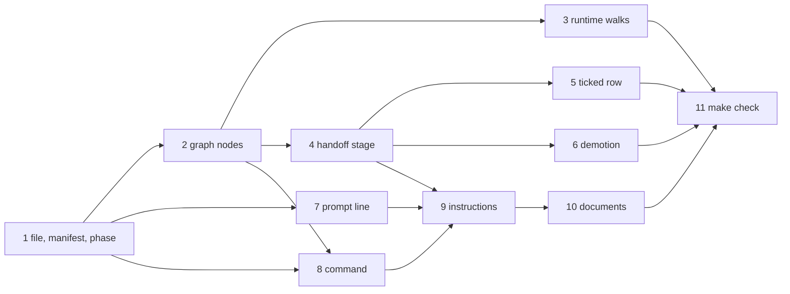

# Tasks: a context-gathering phase before the spec chain

> The last spec artifact. A DAG of implementation tasks derived from the approved
> [`design.md`](design.md) and [`testing-plan.md`](testing-plan.md). No approval gate
> follows it: it advances on shape alone.

## The short version

Eleven tasks in four tracks, all in this repository. The **graph track** (1–3) adds the
file, the two nodes and their runtime walks. The **handoff track** (4–6) adds the stage,
the ticked row and the demotion. The **prompt track** (7) names the file in later
prompts. The **text track** (8–10) is the command, the instructions and the documents.
Task 11 is the regression run.

The risk sits in tasks 5 and 6. They change behaviour that existing tests pin: an opt-in
row is never ticked today, and a demotion never selects a node today. Each starts by
changing those tests, so the old rule is replaced on purpose and not by accident.

## Task list

Each task writes or changes its test first, watches it fail, then makes it pass.

- [ ] 1. Register `current-state.md`: template, manifest entry, phase vocabulary
  - Add `skills/the-loop/templates/current-state.md` with the front matter and the six
    sections of the design, the "report it as data" and "no secrets" rules, and no
    listing of open pull requests.
  - Add the work-item artifact entry to `.the-loop/manifest.yaml` (role
    `current-state`, phase `context-gathering`).
  - Add `context-gathering` to the phase vocabulary after `phase-selection`, and to the
    label list `/the-loop:init` creates.
  - *Depends on:* none
  - *Requirements:* R1.8, R2.1–R2.5, R2.9
  - *Test:* T2 — `pytest tests/test_graph_parity.py tests/test_graph_model.py tests/test_writing_parity.py` (red→green)
- [ ] 2. Declare the two opt-in nodes and their edges in the outer graph
  - `context-gathering` and `context-approval` between `import-handoff` and
    `brainstorming`, with the edge table of the design, a description each, and the
    brainstorm pair's hook chains given `current-state.md`.
  - Update the tests that pin the opt-in list and the catalog.
  - *Depends on:* 1
  - *Requirements:* R1.1, R1.2, R1.7, R1.10, R2.7, R2.8, R3.1–R3.5
  - *Test:* T1 — `pytest tests/test_graph_model.py tests/test_graph_skips.py tests/test_graph_catalog.py`; T6 for the unticked rows in the checklist fixtures (red→green)
- [ ] 3. Prove the runtime walks of the pair
  - New `cli/tests/test_context_gate_integration.py`, beside the brainstorm gate's
    module, with walks (a)–(i) and the negative cases for abuse cases 3–6. Each test
    carries its Gherkin docstring and `Requirement:` link.
  - Production change only where a walk shows the declaration is not enough.
  - *Depends on:* 2
  - *Requirements:* R1.3–R1.6, R1.9, R3.1–R3.5; abuse cases 3–6
  - *Test:* T3, T8 (3–6) — `pytest tests/test_context_gate_integration.py`; T7 — `pytest tests/test_pdlc_e2e_integration.py`
- [ ] 4. Handoff: carry `current-state.md` and accept the stage `context-settled`
  - First name in the chain; the stage sits between `exploring` and
    `brainstorm-settled`, enters at `context-approval`, must carry the file and nothing
    later. A later stage imports and locks the file as an upstream file.
  - *Depends on:* 2
  - *Requirements:* R6.3, R6.5, R6.7
  - *Test:* T4 — `pytest tests/test_handoff_record.py tests/test_import_handoff.py tests/test_handoff_pickup.py` (red→green)
- [ ] 5. Checklist: tick an opt-in row when a verified handoff enters at it
  - Change the test that pins "an opt-in row is never ticked" to the new rule, and
    update the GitHub, Slack and Jira checklist fixtures.
  - *Depends on:* 4
  - *Requirements:* R1.2, R6.4
  - *Test:* T6, T4 — `pytest tests/test_graph_skips.py tests/test_handoff_selection.py tests/test_jira_integration.py` (red→green)
- [ ] 6. Demotion: select the opt-in producer when its carried file fails verification
  - The import records a selection for `context-gathering`, attributed to the demotion
    and naming the file. No other path may write an opt-in selection this way.
  - Security-relevant: the negative tests are a wrong hash (abuse case 7) and a forged
    opt-in entry (abuse case 6).
  - *Depends on:* 4
  - *Requirements:* R6.6; abuse cases 6, 7
  - *Test:* T4, T8 (7) — `pytest tests/test_import_handoff.py` (red→green)
- [ ] 7. Name the file in the process-state block
  - One boolean on the process-state context, set where the context is filled; one new
    prompt file `cli/the_loop/prompts/graph-context/current-state.md`; one line from the
    renderer for the outer scope and a pull request's scope. Add the file to the
    artifact rule in the prompts.
  - Security-relevant: the negative test gives the file content shaped like a prompt
    line and checks the block is byte-equal to the prompt file with the id filled in
    (abuse case 8).
  - *Depends on:* 1
  - *Requirements:* R4.1–R4.3, R4.6; abuse cases 2, 8
  - *Test:* T5, T8 (8) — `pytest tests/test_graphlink_integration.py` (red→green)
- [ ] 8. Add `/the-loop:gather-context`
  - New `commands/gather-context.md` with the three calling modes of the design, the
    data and secrets rules, and `gatheredAt`. Register it wherever commands are listed
    and counted.
  - *Depends on:* 1, 2
  - *Requirements:* R2.6, R6.1, R6.2
  - *Test:* T2 — `pytest tests/test_init_commands.py tests/test_quiz.py tests/test_graph_parity.py`; T11 — the manual run, at verification
- [ ] 9. Update the instructions agents read
  - The `the-loop` skill and its workflow reference: the artifact chain, the phase
    list, "read first", the tab order, and the one section that states
    `current-state.md` against `context.md`.
  - The phase commands' "read first" steps; the staleness check in
    `/the-loop:execute-tasks`; the handoff skill's stage table, interview answer and
    record fields.
  - *Depends on:* 4, 7, 8
  - *Requirements:* R3.6, R3.7, R4.4, R4.5, R5.1–R5.3, R6.2, R7.1; abuse case 1
  - *Test:* T9 — the `grep` checks, recorded in `evidence/documentation.md`; `pytest tests/test_writing_parity.py`
- [ ] 10. Update the documents people read, and record the decision
  - `docs/capabilities/process-graph.md` and `spec-workflow.md`,
    `docs/reference/commands.md`, `docs/cli/graphs.md`,
    `docs/reports/labels-and-dashboards.md`, the README's phase list.
  - One decision record: the file is `current-state.md`, and why it is not `context.md`.
  - *Depends on:* 9
  - *Requirements:* R7.1–R7.4
  - *Test:* T9 — the `grep` checks; markdownlint through T10
- [ ] 11. Run the whole check and fix what it finds
  - *Depends on:* 3, 5, 6, 10
  - *Requirements:* non-functional: compatibility
  - *Test:* T10 — `make check`

## Dependency graph (DAG)

## Checkpoints

- **After each task:** the task's own test command, then one commit that names the
  red→green transition.
- **After tasks 3, 6 and 7:** the whole CLI suite, `cd cli && uv run python -m pytest -q`,
  because each of these ends a track that touches shared code.
- **After task 11:** the `verification` node executes `testing-plan.md`, including the
  manual run T11, and records the evidence. The self, critic and security reviews
  follow it.

## Review comments

> Appended by the-loop's `record-feedback` hook when a human gate approves with
> comments (issue-109). Append-only and attributed: an approval never silently
> discards a reviewer's suggestions, and the feedback travels with the document
> it concerns rather than living in a side-channel tracker.
