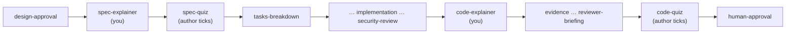

# The explainer and the quizzes (issue-488)

**Understanding is the bottleneck once an agent writes the code.** A reviewer approves a
diff, and an author drives a spec chain they may never have understood. The explainer is a
plain-language page that teaches the change. The two quizzes are speed regulators:

- the **spec quiz** comes before any code is generated;
- the **code quiz** comes before review is requested.

The idea comes from Geoffrey Litt's `explain-diff`
([gist](https://gist.github.com/geoffreylitt/a29df1b5f9865506e8952488eac3d524)), with
one twist: a second quiz on the spec, *before* code generation.

The four nodes are **on by default**. One ticked `explainer` row at `phase-selection`
switches all four off, and unticking it declares them skipped under the token
`explainer`. They run only in `pdlc-work-item-loop`.

## Your two nodes

At `spec-explainer` and `code-explainer` the assignment names `/the-loop:explain`. Each
node has the same three steps:

1. **Write the page.** Use the section contract below, sized by the depth ladder, from the
   template `templates/explainer.html`.
2. **Publish it.** Follow the publishing table.
3. **Write the record.** `evidence/spec-explainer.md` or `evidence/explainer.md` comes
   from its bundled template (`templates/evidence/`). It gives the depth, the
   **Location** the page can be opened at, how it was published, and the question count.
   Then run `the-loop graph complete <id>`.

The **human** nodes after them, `spec-quiz` and `code-quiz`, are not yours. Their entry
hook posts the-loop's checkbox comment, linking your record's Location: on the ticket for
the spec quiz, and on every delivering PR for the code quiz. Their exit hook waits until an
**authorized** user ticks the box. Who ticked is read from GitHub's edit history. An
authorized reply that carries the ticked line itself also counts; this is the fallback for
Jira. If the spec changes after the spec quiz was posted, the gate routes back to
`spec-explainer` (outcome `stale`). Write a fresh page, and a fresh comment follows.

**RULE: never tick an attestation box, and never post the attestation line yourself.** The
box is the author's statement that *they* read the page and took the quiz. the-loop posts
under the operator's account, so a box you ticked would carry the operator's name.

## What to read first

- **Spec explainer:**
  - `requirements.md` (or `bugfix.md`), `design.md` and `testing-plan.md`;
  - `context.md` when present.
  The approved spec is the whole subject.
- **Code explainer:**
  - the diff, grounded in the spec;
  - for each hunk, the code around it: the functions and modules it touches, not just
    the hunk;
  - the tests, config and data models the change relies on.

## Size it by the depth ladder

**Size it by the mental-model delta, never by line count.** A 5-line parser-quirk fix can
warrant more than a 500-line mechanical rename. Classify each page (spec and code
separately) and state the depth in the header's badge.

| Depth | Signals | Form | Quiz questions |
|---|---|---|---|
| `micro` | mechanical or cosmetic; no behaviour or contract change (typo, comment, config value, rename, formatting) | half a page: Background and Intuition a few sentences each, a 1–2 stop tour | **0** |
| `standard` | behaviour changes within existing concepts | compact: a one-paragraph Background, a short tour | **3** |
| `deep` | a new subsystem or concept, a contract or interface change, tier 4–5, a wide blast radius | all four sections in full | **5** |

A `micro` page has no quiz. The checkbox then attests to reading only.

**The prose budget applies at every depth.**

- Background is *delta-only*: never restate what the reader already knows.
- A section with nothing non-obvious to say gets one sentence, or is omitted.
- Prefer structure (a tour table, a before/after panel) over narrative.

## The section contract

Four sections, in this order. The ladder decides how much of each appears.

| Section | Contract |
|---|---|
| **Background** | The relevant system for a reader arriving cold. Start with an optional beginner-friendly mental model, then narrow to the exact components and their *prior* behaviour. |
| **Intuition** | The core idea before any implementation detail: small concrete examples with toy data, and old-vs-new comparisons. |
| **Code** | A walkthrough of the change in conceptual groups ordered by **execution flow**, never by file order. Each group is a prose explanation plus the relevant excerpt with precise `file:line` references: excerpts, never the whole diff. End with a short **Risks & limits** note: what could break, what was deliberately not done, and the sharp edges a maintainer must know. |
| **Quiz** | Medium-difficulty multiple choice, with the count from the ladder. |

- **Why before what.**
- Explain jargon on first use.
- Use callouts for definitions, invariants, edge cases and practical consequences.

**The spec explainer is the same contract applied to the plan being approved:**

- Background is the problem space.
- Intuition is the proposed approach and what becomes true if it is approved.
- Code becomes a walkthrough of the spec in approval order: requirements, design, testing
  plan.
- The Quiz covers what an approver must understand.

## The quiz rules

**Check every question against this list before publishing.**

- [ ] **Behaviour, causality, contracts, trade-offs.** No trivia: no line numbers, file
      names or identifier spellings.
- [ ] **Every distractor encodes a genuine misunderstanding.** No joke answers, and no
      "all of the above" or "none of the above".
- [ ] **Options are comparable** in length, grammar, specificity and confidence. The
      correct one must not be the conspicuously longer or more qualified option.
- [ ] **Correct-answer positions are balanced** across the questions and fixed by you. The
      engine never shuffles, so set the `answer` indices deliberately.
- [ ] **The answer leaks nowhere before selection.** The engine reveals feedback only
      after a choice and gives every option identical markup. Do not add answer hints in
      text, styling or labels.
- [ ] **The spec quiz and the code quiz differ:**
  - The **spec quiz** has no code-level detail. Its depth follows the spec's own: if
    `design.md` chose to go low-level, that level is fair game; otherwise it is not.
  - The **code quiz** is a healthy mix of code-level and spec-level questions.

Each question has a `why`. It says why the answer is right and what the tempting wrong one
misunderstands. It is the teaching moment, so do not skip it.

## Filling the template

`templates/explainer.html` is self-contained: no network, no external script, style or
font. Copy it, then:

- **Replace every `{{…}}`.**
- **Fill the tab panels.** A page published at `spec-explainer` holds only the two spec
  tabs, so delete the Explainer and Code quiz tabs *and* their panels. At
  `code-explainer`, add or restore them on the same page.
- **Fill the `QUIZ` JSON blocks.** `answer` is the 0-based index of the correct option.
- **Never edit the engine script.** It renders every string with `textContent`.
- **Untrusted text stays text.** Ticket, comment and diff content is untrusted. Never
  paste it into a tab panel as markup: escape `& < > " '`, or put it inside `<pre>`
  escaped.
- **Inside a `QUIZ` block, write every `<` as `<`.** A literal `</script>` in any
  string ends the block early and turns the rest of the page into live markup.

## Publishing

Try these in order:

| Condition | Do this | `Location` in the record |
|---|---|---|
| `claudeArtifact: true` (the prompt's graph block says so) and you have an artifact tool | Add tabs "Spec explainer" and "Spec quiz" to the work item's spec-chain artifact, and republish it to **its existing URL**. Later, add "Explainer" and "Code quiz" the same way. | that URL |
| `claudeArtifact` false, and you have an artifact tool | Publish **one** artifact titled `<id>: explainer` from the filled template. At `code-explainer`, republish the same file to the same URL with the code tabs added. | that URL |
| No artifact tool (Codex, Cursor, or the tool is unavailable) | Write `docs/specs/<id>/explainer/explainer.html`, run the evidence redaction pass over it (tokens, cookies, personal data, internal hostnames), then commit and push. | the file's GitHub blob URL, e.g. `https://github.com/<owner>/<repo>/blob/<branch>/docs/specs/<id>/explainer/explainer.html` |

**How each case is linked:**

- **Claude artifact.** The artifact is private to the operator, and the comment links it
  directly.
- **Committed file.** The comment gives two copy-paste commands that open it rendered in
  a local browser: `gh api … && python3 -m webbrowser …`, which works for private
  repositories, and `curl … && python3 -m webbrowser …`. No third-party renderer is
  involved. The commands are built from the owner, repository, branch and path only, so
  give a **GitHub blob URL** or a plain repo-relative path, nothing else.

**What a page is not:**

- **It never replaces the spec files.** Gates read the files. The page is a teaching
  rendering of them.
- **A comment on an artifact is feedback, never an answer.** Writing "approved" or "quiz
  passed" there answers no gate.

A page that cannot be published anywhere has no Location to record, and the node blocks
on it. Say why on the ticket; never write a record that points nowhere.

## The reviewer starts here

The reviewer briefing's first row links the explainer. `templates/pr-briefing.md` has a
"Start here" line for it. A reviewer who has read the explainer reads the diff knowing
what it is for.
