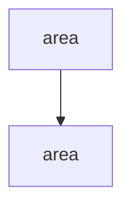

<!-- the-loop PR briefing (R10). This IS the PR description / top-comment. Produced
     before requesting human review — a required item of the ready-to-ship gate. Keep it
     condensed and prioritized; educating the reviewer is mandatory, not optional. -->

<!-- Written per the `the-loop:writing` skill: front-load each section's
     conclusion, draw it rather than describe it (3+ named parts -> a mermaid
     diagram), and keep the formal registers formal (EARS, abuse cases,
     RFC-2119, API contracts, schema descriptions). No length limit — length
     follows the change; the test is whether a sentence can come out without
     losing information. A gated section stays even when it is empty. -->

# <PR title> — reviewer briefing

## The short version

<!-- The card: what this PR does, why, and what to check. About 120 words is the
     guide, not a limit. -->

**This PR's spec:** [`docs/specs/<key>/pr-<n>/`](<link to the folder in this PR's branch>)
— what this pull request delivers of <work item ref>. (Drop this line when the work item
has a single pull request: its `pr-spec.json` records `required: false`.)

What this PR does and why, in a few plain sentences.

**Start here:** the explainer of this change — `<Location from evidence/explainer.md>`.
(Drop this line when the work item declared the `explainer` row away.)

## Review effort

**<1–5>** — one line on why. 1 is a few minutes (a doc fix, a one-file change); 5 is
hours (a new subsystem, a migration, a security boundary).

## Guided tour

Stops in the order to read them, so a reviewer of AI-authored work sees the riskiest
change first. Each stop links a file and line in the diff, with one sentence on why it
matters.

1. [`<path>:<line>`](<link to the line in the PR diff>) — what to check here.
2. [`<path>:<line>`](<link>) — …
3. [`<path>:<line>`](<link>) — lower risk; skim.

## What changed (map)

## Key decisions & why (education)

The low-level calls the harness made, so the reviewer learns the design, not just the diff.

- **<decision>** — why; trade-off; link to `docs/decisions/decision-<nnn>.md`.

## Evidence

Tests / checks / screenshots proving the acceptance criteria are met (e.g. CI green,
`pre-commit` output, live smoke test).

## Open questions for the reviewer

Anything the reviewer must decide or is explicitly being asked to confirm.
